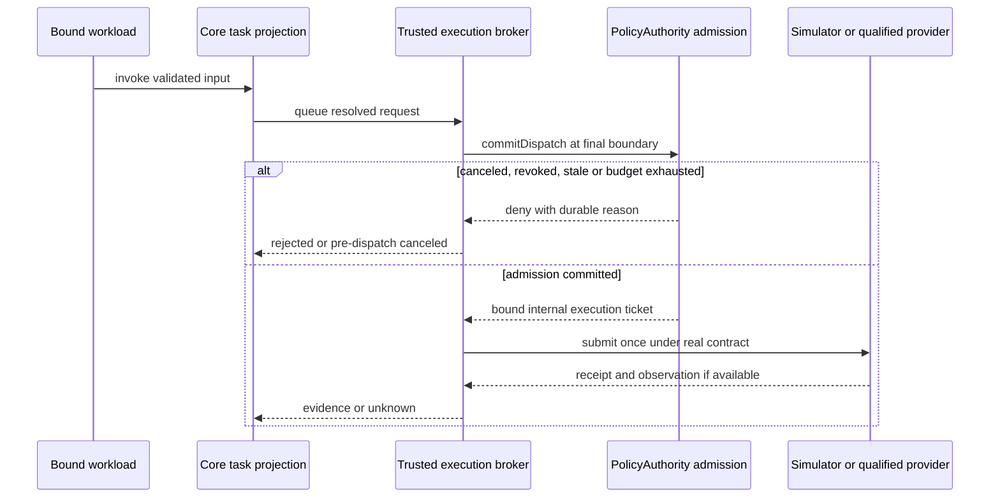

# 工程上下文：FEAT-MVP-001 — 受限机器人应用运行时 MVP

## 当前有效方案

### 架构设计

**关联产品上下文**：[REQ-MVP-001](REQ-MVP-001.product.md)

**工程上下文**：`.sdlc-v1/context/FEAT-MVP-001.engineering.md`

**已确认需求**：产品 C-01 至 C-08、REQ-001 至 REQ-008；EA-* 为工程候选，O-* 为待测事实。

**创建日期**：2026-10-23。**状态**：Plan 已验收，Build 已获授权；T001 已接受，T002 为下一个实施任务。精确进度以 lifecycle state 为准。

#### 背景

服务一个结果：受限应用先在 Linux + reference simulator 验证允许/拒绝，再在 T1 本体完成原屏动态内容与语音/机身触摸切页。T001 已建立最小可信驱动、契约、权限持久化与测试；当前实际范围见下方实现和验证记录，不能据此推断完整 MVP 或设备支持。

长期方向的已提交验证基线为 `none`；产品确认来源见产品 SRC-01 至 SRC-07。本方案引用 [架构](../../docs/architecture/overview.md)、[核心接口](../../docs/specs/core-interfaces.md)、[插件包](../../docs/specs/plugin-package.md)、[权限/沙箱](../../docs/specs/sandbox-permissions.md)、[Scene 渲染](../../docs/specs/scene-rendering.md)、[T1](../../docs/specs/t1-adapter.md)，不复制完整规范。

当前用户已授权实施 T001/T002、必要依赖与专用本地 Linux/Docker 环境准备、提交推送和更新 GitHub tracking；不据此启动其余任务、真实账号/模型 API、设备或远程 benchmark。真实外部/物理操作仍需对应授权。移动、第二台真实机器人、fleet 和任意市场不在本 Feature。

复用评估按现有代码→依赖→官方方案进行：源码/依赖搜索为空；可复用资产为规范、研究来源与合成场景设计。[研究基线](../../docs/research/2026-10-22-findings.md) 是有日期的工程输入，不是当前版本/兼容性的实测证据。

| 需求与候选（每域最多三项） | 复用决定与扩展方式 | 未采用项/成本、风险及复核点 |
|---|---|---|
| Agent loop：pi / DeepSeek Harness / 自写完整 loop | 引入 pi 为首候选，包装 AgentBackend；工具只接受信代理 | DSH 的 preview/隔离限制增加成本；不自写模型循环。T007 固定版本并查维护、许可证及 API；不直接加载第三方模块到可信 core |
| Linux 执行：OCI + gVisor / 普通 rootless OCI / OpenShell | 引入 OCI 管理与 gVisor 首候选，扩展 SandboxBackend 资格/限额检查 | 普通容器共享内核不自动满足要求；OpenShell 依赖实际 host 特性。T002/T004 验证；不兼容即拒绝，不静默选弱后端 |
| Scene：Chromium + FFmpeg / HyperFrames | 优先复用固定 Chromium/捕帧与 FFmpeg，自己实现很薄的 Scene/Artifact 流水线 | HyperFrames 为后备复用候选；首期无需完整视频制作平台。T008 固定字体/codec/版本，核对 FFmpeg 构建分发义务和 ARM64 兼容 |
| 业务 connector：官方 authsidecar / 固定语义 shim | 复用官方 transport 为 Lark 首候选；先自研最小 Mock + 可信语义 broker | 官方 demo 缺操作/资源授权、刷新、重放/预算；不能直接投入生产。T009 只验证 Mock；真实 CLI/账号兼容另需授权与证据 |
| 持久化：SQLite | 引入成熟本地事务依赖，按服务拥有数据库；admission 只有一个可信事务所有者 | 不引入分布式数据库。T001/T003 固定驱动/事务/持久性参数并做崩溃/竞争验证；没有跨网络文件共享 |
| qdroid 身份/权限/版本/设备语义 | 自研小型领域服务，复用通用 schema/协议/DB 库 | 现有 harness、MCP、OCI 都不拥有 qdroid 的 grant、epoch、显示证据与设备仲裁，不能代替这些规则 |

现有离线显示 POC 仅可借用 state/time、帧 hash 与资源冻结思路，不复制个人路径/产物或沿用桌面通过结论；没有新 UI 原型要实现。版本、许可、SBOM、source/image digest 与目标 ABI 在各任务实际选择后锁定；依赖下载/安装仅限当前已授权任务；不在该范围内的候选保持未验证。

#### 架构与组件

下列为逻辑目录，不要求分别发布包。core/contracts 不 import adapter；可信服务可受控共同部署，但不与不可信代码共享地址空间、凭据或可写数据。参数和配置以 schema/profile 为准，不在模型文本中提供授权。

##### 受信核心、授权与监督

- **职责**：`packages/core/` 路由与 Task 投影；`packages/policy/` 独立操作者授权及 admission；`packages/supervisor/` 绑定安装/实例/通道；`apps/cli/` 为受限使用/管理员入口。
- **接口**：版本化 JSON-RPC、受监督 stdio；可信私有 IPC 与管理端分开认证。主体由通道解析，参数中的 principal/grant/ticket 不能作为证明。
- **覆盖**：REQ-001、004、008；Task T001、T003、T007。

##### 运行与包管理

- **职责**：`packages/runtime-oci/` + 受信 SandboxManager 选择锁定镜像/profile、隔离/限额/清理；`packages/package-runtime/` 安全暂存、解析、构建、registry 与条件激活。
- **接口**：SandboxBackend 的 qualify/create/execute/stop 与安装生命周期；公开插件不能提供任意 mounts/devices/flags/image。安装许可不创建 grant。
- **覆盖**：REQ-002、003；T002、T004、T005、T006。

##### 应用与扩展适配

- **职责**：`packages/agent-pi/` 复用循环；`packages/mcp-host/` 监督沙箱 MCP；业务 reducer 在应用沙箱；工具描述与返回文本无授权权力。
- **接口**：AgentBackend 的受限工具目录和事件；MCP 初始化/schema/namespace 固定，输出/超时/子孙受控。首期用确定性模型 fixture，provider 连接默认关闭。
- **覆盖**：REQ-001、002、003、007；T007、T009。

##### 产物、Scene 与显示

- **职责**：`packages/artifact-store/` 不可变对象/ACL；`packages/scene-runtime/` 状态/action；`packages/renderer-html-video/` 无凭据渲染；`packages/display/` 协调单一呈现者与 revision。
- **接口**：SceneRef + frozen state/time/seed → RenderResult/ArtifactRef → 授权导入/提交/观察；语音/触摸先变更应用 state，MP4 不保留 DOM 交互。
- **覆盖**：REQ-005、006；T008、T011、T012；渲染细节以 Scene 规范为准。

##### Connector 与设备 provider

- **职责**：`packages/connector-broker/` 拥有凭据/业务策略/刷新，Mock 先行；`adapters/reference-simulator/` 提供可计数故障点；`adapters/primebot-t1/` 隔离 SDK/ROS2/原厂显示与输入。
- **接口**：能力 describe/probe/invoke/observe/cancel/reconcile；robotd 本地资源/lease；T1 player-agent 独立恢复。设备探测只由已授权的可信操作触发。
- **覆盖**：REQ-004、006、007；T001、T003、T009 至 T012。

#### 关键设计决定

##### 决定 1：一个 admission 事务决定是否可以执行

- **背景**：前置检查不能阻止排队期间撤权、预算竞争或取消。
- **决定**：PolicyAuthority 的本地 SQLite admission ledger 同时拥有 live grant/generation、预算/审批消耗、取消标记、幂等映射和 dispatch 意图；broker 在最终发送边界调用 `commitDispatch`，core Task 是投影。
- **替代项/取舍**：拒绝 core 读预算后另行扣减、跨库写两份授权事实。SQLite 不是与厂家/API 的分布式事务；commit 后崩溃可能 unknown，不盲发、不自动退款。
- **覆盖**：REQ-001、004；T003；一次预算并发、取消先后与崩溃子场景。

##### 决定 2：安装的条件切换独立于权限

- **背景**：多个候选/删除/迟到失败会覆盖较新版本。
- **决定**：同 installation 的激活、回滚、移除串行化，使用 `installationGeneration + expectedActiveDigest` 条件提交；暂存内容不可变，运行任务持有版本引用。
- **替代项/取舍**：不用“失败就写回旧指针”；清理尊重引用，回滚不恢复 grant，移除不冒充撤销外部 OAuth。
- **覆盖**：REQ-003；T005、T006；AC-08 的 A/B/移除交错。

##### 决定 3：按真实后端能力发布显示保证

- **背景**：宿主 revision 无法取消已进入厂家服务的旧 RPC。
- **决定**：一个可信 player sender 串行提交；分别保存 rendered/imported/submitted/observed-visible。播放器节点监督 lease 并执行实测的 fallback；无证据的强顺序/敏感显示模式保持禁用。
- **替代项/取舍**：不以 clip 时长当清屏，不关闭 Chromium sandbox，不借降低隔离解决渲染失败。初版无音轨/精准音画同步，软件编码为候选。
- **覆盖**：REQ-005、006；T008、T011、T012。

#### 数据模型 / 关键实体

| 实体/可信所有者 | 最小事实与约束 | 覆盖 |
|---|---|---|
| PolicyAuthority store | grant、issuer、subject、operation/resource、use budget、revocation generation；只有独立管理入口能改变 | REQ-001 |
| Admission ledger，同一 PolicyAuthority DB | admission/task ID、request digest、epoch、cancel marker、use/approval debit、dispatch ticket、状态；事务与唯一键约束幂等/预算 | REQ-001、004 |
| Core Task journal | admission ID、stateVersion、观察证据与 scoped result；不反向覆盖 admission 权威 | REQ-004 |
| Execution journal，robotd/broker | provider/boot epoch、实际提交/观察/停止/unknown证据；本地单调 lease；不共享跨板时钟 | REQ-004、006 |
| Installation registry，supervisor | 内容/平台/profile digest、generation、active digest、attempt、运行引用；条件切换和崩溃恢复 | REQ-003 |
| Artifact metadata/store | owner/task、digest/size/type、可信producer/provenance、validation、expiry/refcount；不信调用者自证来源 | REQ-005、007 |
| Scene/presentation，display/player | state/revision、stream/epoch、队列、lease、提交/可见状态；节点本地恢复责任 | REQ-005、006 |

每个服务的数据库只在所属节点本地打开，权限最小化；不挂到工作负载、不放网络共享文件系统。驱动、busy/commit失败处理及持久性设置须固定并故障验证，失败不允许 dispatch。schema 演进先版本化并备份/验证恢复；禁止以代码回退覆盖仍需对账的 admission 历史。

#### API / 接口契约

- 对外仅开放规范中的初始化、发现/调用、Task/事件、Artifact 与 display 方法；无公开 grant/approval 创建、宿主 exec、raw SDK 或通用凭据代理。对象 ACL 按真实实例/资源验证。
- 协商 protocol/capability/manifest 主版本与必需特性；拒绝不兼容、未知授权/运行时字段和重复 key；兼容可选字段只按 schema 处理。语义变化必须升级版本并重做受影响资格。
- 每次调用锁定 provider/schema/image/profile，不中途切换。超时、取消与期限分别建模；无观察支持不得生成 running/完成/停止。唯一 key 对不同 canonical input 冲突。
- 服务间 ticket 绑定 broker、subject/task、能力/资源、epoch/lease/generation，不能转交任意服务。跨板链路按 DeploymentProfile 认证/授权；同机 sidecar HTTP 不是通用跨节点协议。
- 失败码、错误净化、输出/事件背压沿用核心规范。查询可按明确重试策略执行；可能已提交的副作用只权威对账，不自动换 key 重试。外部写与物理移动均不在本 MVP。

#### 时序与数据流

图只解释 AC-06/12/13 的权威顺序，未渲染预览；等价流程是绑定身份→可信前检→执行方 commit→厂家调用→观察/unknown。取消与撤权先于 commit 则拒绝；后到不抹去 in-flight。commit 与厂家调用之间崩溃也不自动重发；同 admission 贯穿重启和状态投影。

#### 横切质量设计

- 隔离按确切 kernel/runtime/image/profile/suite 组合保存证据；改任一相关输入重验。首 profile 只承载固定只读 fixture，不借最小增量扩大为通用市场代码资格。
- CPU/memory/PID/disk/IO/output/time、出网、私有 scratch 与子孙清理由宿主边界落实；单 render/单前台应用为工程默认，数值待主控测量，不承诺 T1 SLA。
- 隐私：合成秘密/日程优先；真实凭据不进 workload/日志，数据读取不自动允许模型外传；cache ACL、expiry、移除清理；未证实播放器恢复前仅公开/合成画面。
- 可观测：关联 instance/grant/admission/task/provider/scene revision，净化输入摘要/错误，不收集秘密正文；可核对 dispatch 与观察证据，未知保持可见。

#### 风险与取舍

| 风险 | 影响 | 缓解措施/回滚 |
|---|---|---|
| Linux/T1 不满足隔离或 Chromium 组合 | 不能运行对应不可信包 | T002 早验最小真实组合，T004完整资格；不改内核/关闭隔离；保留失败与未支持能力 |
| SQLite锁/崩溃或两份授权事实 | 超预算或重复副作用 | T003 单权威事务、故障注入；停新dispatch并对账，不退款/删除journal冒充回滚 |
| 安装竞争/GC删除运行内容 | 旧候选覆盖新版本或任务损坏 | T006 条件切换/引用保留；回退仅匹配自己的generation，不恢复权限 |
| 厂家缺排序/clear/取消证据 | 最新画面或停止无法保证 | T011/T012 独立实测；受限模式与unknown，不宣称强保证，敏感Scene禁用 |
| 第三方版本/许可/ARM64依赖变化 | 构建或分发不可用 | 每次实际选型固定版本/provenance；不分发未许可SDK，替换后重验，不沿用候选名称结论 |

#### 需求覆盖

| 产品规格 | 设计覆盖 |
|---|---|
| REQ-001 | 受信核心/PolicyAuthority、决定1、身份/ACL/默认拒绝 |
| REQ-002、003 | runtime/package/supervisor、决定2、固定版本与资格 |
| REQ-004 | admission/Task/execution三种事实、决定1、取消/恢复 |
| REQ-005、006 | Scene/Artifact/display/T1、决定3、输入与本地恢复 |
| REQ-007、008 | Broker/Agent边界、合成fixture、最早增量及当前授权边界 |

### 实施计划

**关联产品上下文**：REQ-MVP-001；**关联设计**：本文架构设计；**创建日期**：2026-10-23；**状态**：已接受并开始实施；Task 状态由 lifecycle CLI 维护。

#### 背景

实现从空代码库开始，任务输出为未来可运行增量；当前先交付已获授权的 T001/T002，后续任务保留计划状态。`planner/sdlc-stage-plan.md` 只导航本文件，不成为第二套方案/状态。

#### 目标 / 非目标

- 目标：先获得真实 Linux 最小边界证据，再完成固定包运行、状态驱动显示、Mock业务与T1固定位置交互；覆盖 AC-01 至 AC-20 的适用环境。
- 非目标：未授权的后续任务、运动、真实账号写入、自动远端执行、任意网站捕获、精确音画同步、强行统一不同设备语义和第二真机支持。
- 真 Lark 只读 CLI、真实模型和实际设备操作均按各自授权选择；Mock完成不允许宣称它们支持。

#### 技术栈

- TypeScript/Node 用于 core/SDK；T001 已锁定实际版本与 workspace 工具，命令及验证范围见 docs/USAGE.md 和实际记录。
- SQLite 本地服务自有存储；驱动、schema migration、事务/持久性设置由 T001/T003 验证后记录。
- OCI + gVisor 为首隔离候选；Chromium/FFmpeg 为渲染候选；pi、authsidecar候选不改变权限边界。T1 provider 语言按SDK实际情况选Python/C++等，不要求core安装ROS2。

#### 实施层决定

##### 决定 1：首增量只依赖 T001 与 T002

候选为“先齐备所有框架”与“固定fixture纵向闭环”；选择后者。T001仅建立足够的契约、监督身份、最小可信grant/admission与SIM只读调用；T002在真实Linux验证所需最低profile后运行固定fixture。复现必须观察一个允许调用成功和一个未授予/伪造主体调用被拒绝、SIM操作计数不增加。

这是首个可独立展示的真实增量；无需包安装、完整pi/MCP、全部AC-02变体、显示、Lark或设备。最低隔离每项真实验证，不能用“后面再做资格”跳过；后续 T003/T004 完成竞争/崩溃和完整资格矩阵。覆盖 REQ-001、002、008；设计：受信核心/运行。

##### 决定 2：每个任务拥有实现及必要验证

默认测试先行覆盖行为/失败，不拆测试工单。实现者负责本任务代码、测试和usage更新；公共schema变更先协调依赖。当前12项默认串行交付，不能因无依赖或不同目录直接并行；主Agent另行确认稳定接口、独立验收、写范围及环境隔离后才能并行。

所有未来命令均须在创建实现入口后实际运行，再写入project/usage。下文以复现方法和目标测试路径定义验收，不捏造当前不存在的CLI flags或通过结果。覆盖全部REQ；设计：上述逻辑组件。

#### 风险 / 取舍

受控Linux环境、T1到货与SDK权限当前未知，工期不按日历承诺。当前 T001/T002 所需本地依赖和专用 Docker 环境已获授权；不包含租用远程资源或刷机。T010可在T001后且设备/只读访问获授权时提前调查，milestone不是技术依赖。具体风险与回滚引用架构风险表，不以关闭隔离换进度。

#### 实施阶段

| 阶段 / GitHub milestone | 增量与任务 | 覆盖 / 设计 |
|---|---|---|
| M0 — Linux sandbox and first capability（1） | T001→T002先展示；T003原子admission恢复；T004完整资格 | REQ-001、002、004、008；核心/运行 |
| M1 — Portable package runtime（2） | T005安全安装→T006生命周期→T007受限Agent/MCP | REQ-001至004；包/扩展 |
| M2 — Interactive scenes and connector（3） | T008 Scene/Artifact呈现；T009 Mock业务闭环 | REQ-005、007；显示/Broker |
| M3 — T1 hardware acceptance（4） | T010设备基线；T011播放器/恢复；T012语音触摸集成与资源预算 | REQ-004至006；设备/显示 |

#### 需求覆盖

| 当前 AC | Task | 计划验证 / 契约 |
|---|---|---|
| AC-01 | T001、T002 | 固定fixture在真实Linux沙箱访问SIM只读结果；核心/安全 |
| AC-02 | T002、T003、T007、T008 | 首次未授予/伪造主体拒绝；完整grant/admin/Task/Artifact ACL变体 |
| AC-03 | T004、T008、T009 | Linux canary、可信store/进程/网络矩阵；renderer/connector隔离 |
| AC-04 | T002、T004 | 缺特性/profile指纹变更拒绝，无host fallback |
| AC-05 | T002、T004、T007、T008 | 实际CPU/memory/PID/disk/IO/output/deadline超额和全部子孙清理 |
| AC-06 | T003、T006 | 排队撤权/lease/代际；一次预算两请求仅一个commit；同幂等不二次扣；unknown不退款 |
| AC-07 | T005 | schema/引用/digest/platform/解包逃逸/竞态/炸弹负例 |
| AC-08 | T005、T006 | 构建失败/中断/重复安装；A迟到失败不能覆盖B，升级/移除条件切换 |
| AC-09 | T006 | 固定任务版本、增权不继承、回滚不恢复grant、移除/GC/外部OAuth分离 |
| AC-10 | T007、T008 | 受限MCP与renderer，文本/action不改权限；schema/事件/输出背压 |
| AC-11 | T001、T007、T008 | 版本/未知必需字段；video/web模拟profile同应用、缺能力拒绝；无第二真机声明 |
| AC-12 | T003、T011 | accepted-only/完成取消交错；取消先commit不得发送，后commit保留真实结果；显示证据分层 |
| AC-13 | T003、T006、T011 | admission/厂家调用/结果前后崩溃；旧epoch/迟到/重复；恢复不盲发 |
| AC-14 | T008 | 固定state/time/seed帧hash、时间变化、完整Artifact/ACL、乱序与输入状态 |
| AC-15 | T009 | 合成凭据Mock操作/资源/重放/刷新/空态/离线/外传拒绝 |
| AC-16 | T010、T011 | T1真实基线/导入解码/原屏播放与退出恢复 |
| AC-17 | T010、T012 | T1真实ASR/触摸、焦点/去重/过期/gap、最终可见页 |
| AC-18 | T011、T012 | T1旧RPC、半文件、协调器/播放器重启、链路丢失、lease本地恢复/残留画面 |
| AC-19 | T010、T012 | 原厂告警/人工接管优先，不误杀原厂，不开放运动 |
| AC-20 | T004、T008、T012 | Linux与T1分别测冷/热延迟/资源；T1温度功耗/共存；预算有证据 |

验证方法是 correctness + 边界/恢复/集成；内部stdio不是HTTP OpenAPI，不虚构API URL。T008的HTML Scene属于固定viewport的Web视觉旅程，准备已提交的 tester-army/e2e Web engine用例，确定性操作不需模型，模型预算为0；选定版本/真实命令由Build核实。完整浏览器套件/截图可补充但不替代适用的正式检查。T1按真实物理步骤/观察取证，不伪装为移动App或桌面浏览器通过。

### 工程任务

**输入**：以上设计/计划与产品AC。每个标题对应一个后续Issue，依赖仅用Task ID；状态唯一由lifecycle state管理。所有代码路径均为未来写范围，不是已存在产物。

#### 路径约定

逻辑目录采用 `packages/`、`apps/`、`adapters/`、`profiles/`、`tests/`、`fixtures/`、`deploy/`；不预先要求独立发布。每项仅改列明区域及受影响根依赖锁；公共契约变更先由主Agent确认。未来全局操作说明只维护 `docs/USAGE.md`，README只索引；故事 USE-001至005映射产品US与AC，参数引用版本schema/profile，不写secret。现阶段它尚不存在，不提供可执行使用承诺。

#### T001 — 最小契约、受监督身份与只读模拟器

- **故事 / milestone**：US-01/02，M0；**依赖**：无。**覆盖**：REQ-001、004、008；AC-01/02/11的基础子场景。
- **代码写范围**：根workspace/锁/formatter/test配置，`packages/contracts/`、`packages/core/`、`packages/policy/`、`packages/supervisor/`最小切片，`apps/cli/`、`adapters/reference-simulator/`、`fixtures/readonly-sim/`、`tests/contracts/`、`docs/USAGE.md`。
- **交付**：只实现初始化、只读SIM调用、实际通道身份、最小operator fixture grant/admission与净化审计；无第三方安装、动态插件加载或真实模型。固定测试代码只作受信驱动，不在host执行不可信插件。
- **完成条件**：同schema可得正常SIM结果与未授予/伪造主体拒绝；版本/必需字段错误在调用前拒绝；SIM计数、instance/admission/task可关联。锁定实际工具版本/许可证，格式/类型/最小构建与行为测试通过。
- **验证环境 / 方法**：本地受控开发环境，契约fixture输入→受信driver→SIM；测试不是Linux隔离证明。创建且实际运行真实测试/CLI入口后记录命令，不以本任务声称沙箱可用。
- **授权 / 设备前置**：另一次Build授权及本地依赖操作许可；不需设备/账号/API。**usage**：USE-001说明当前受信fixture范围、schema参数与失败反馈。

#### T002 — Linux 最低隔离与允许/拒绝真实闭环

- **故事 / milestone**：US-01/02，M0；**依赖**：T001。**覆盖**：REQ-001、002、008；AC-01、02最小子场景，AC-04/05最低profile部分。
- **代码写范围**：`packages/runtime-oci/`、`packages/supervisor/`运行装配、`profiles/hosts/`最小资格、`fixtures/readonly-sim/`镜像、`tests/linux/first-call/`、`docs/USAGE.md`。
- **交付**：选定并固定Linux/backend/image/profile，真实受限fixture通过绑定通道访问只读SIM；容器管理权限留可信manager，不向workload传host资源或凭据。
- **完成条件**：先实测该fixture要求的所有最低属性：只读root、私有scratch/身份、canary/秘密不可读、默认拒绝出网、CPU/memory/PID/disk/output/time有界与子孙清理；随后允许调用成功、未授权/伪造主体被拒且SIM计数不增加。缺任何必要属性即拒绝，无host fallback。
- **验证环境 / 方法**：实际Linux受控host，固定digest镜像与合成canary；运行检查→启动fixture→检查两调用及清理，输出版本/设置/原始退出码与证据。只声明此最低profile范围，不冒充T004完整资格。
- **授权 / 设备前置**：Linux访问、所需运行时配置/下载/安装须另获授权；无T1/账号/模型。**usage**：USE-001按实际入口复现，参数由host/installation schema提供。这是T001+T002的首个真实增量。

#### T003 — 原子 admission、取消与未知结果恢复

- **故事 / milestone**：US-01/05，M0；**依赖**：T002。**覆盖**：REQ-001、004；AC-02完整策略部分、AC-06、12、13及其预算/取消子场景。
- **代码写范围**：`packages/policy/`事务与管理入口、`packages/core/`Task投影、`adapters/reference-simulator/`故障provider、`tests/admission/`、`tests/recovery/`、`docs/USAGE.md`。
- **交付**：本地SQLite的单一admission权威、grant策略交集/拒绝、use/approval/cancel/dispatch记录、幂等对账；Task/执行journal引用同admission，管理端不可由workload调用。
- **完成条件**：一次预算并发两请求仅一条commit，同幂等不二次扣/无约束重发，unknown不自动退款；撤权/过期/排队取消先commit则无副作用，commit先则依provider证据；accepted-only不伪造完成；同key不同digest拒绝。
- **验证环境 / 方法**：受控Linux + 可计数合成provider；逐个在commit/调用/结果持久化前后崩溃，重启/旧epoch/迟到/重复均能核对预算、cancel、次数和历史。SQLite contention/commit失败必须拒绝新发送；不操作真机或真实写API。
- **授权 / 设备前置**：后续Build与测试host许可，无真实外部效果。**usage**：USE-002说明Task/取消/unknown查询与恢复决策；不能提供“一键重试未知动作”。

#### T004 — 完整 SandboxBackend 与隔离资格

- **故事 / milestone**：US-01/05，M0；**依赖**：T003。**覆盖**：REQ-002、004；AC-03至06、20的Linux部分。
- **代码写范围**：`packages/runtime-oci/`、`packages/supervisor/`清理/限额、`profiles/hosts/`、`tests/qualification/`、`fixtures/host-boundary/`、`docs/USAGE.md`。
- **交付**：tool/build/render所需可配置但不可由插件放宽的合格profile、特性/配置指纹与失效规则、全子孙清理、实际限额/网络约束；不足的profile禁用。
- **完成条件**：真实负例覆盖host/跨app/可信store/进程秘密、控制设备/网络、管理socket、IPv4/6直连/DNS/UDP/private/link-local/redirect/适用rebind；实际触发CPU/memory/PID/disk/IO/output/deadline；取消/超额只影响所属任务，其他探针继续服务。
- **验证环境 / 方法**：固定Linux kernel/runtime/image/profile/suite，在隔离测试网络和合成秘密下逐项攻击/超额并核对拒绝、资源与清理；更换profile/缺特性/关闭必要控制必须拒绝。输出Linux基线，不作为T1资格。
- **授权 / 设备前置**：后续受控Linux实验与runtime配置许可；不能对在线机器人/个人账号做破坏性资格测试。**usage**：USE-001/002的qualification要求及拒绝恢复。

#### T005 — 固定包、安全解包与无凭据构建安装

- **故事 / milestone**：US-05，M1；**依赖**：T004。**覆盖**：REQ-002、003；AC-07、08的暂存/构建/重复安装部分。
- **代码写范围**：`packages/package-runtime/`fetch/stage/schema/lock/build/disabled-registry，`packages/contracts/`包schema，`fixtures/packages/`、`tests/packages/install/`、`docs/USAGE.md`。
- **交付**：按明确平台/source/digest解析固定内容，安全暂存/冻结与依赖构建，注册installed-disabled；不自动grant/启动。fetch/build使用受限服务和已批准registry，许可/provenance随产物记录。
- **完成条件**：遍历/链接/可变路径竞态/设备文件/模式/重复路径/炸弹、缺引用/重复key/未知runtime字段、digest/platform/version错均拒绝；build无账号/模型/robot秘密，不在可信host执行hook；重复digest不重复注册实例/grant，失败不动当前版本。
- **验证环境 / 方法**：真实Linux build profile + 本地/隔离registry fixture；对恶意archive、构建窃密/出网、中断各跑固定用例，核对包根外canary、registry、临时资源和旧版本。
- **授权 / 设备前置**：后续Build/registry访问许可，无设备/真实账号。**usage**：USE-003的manifest请求、lock来源、installed-disabled与失败处理。

#### T006 — 条件激活、升级回滚与移除

- **故事 / milestone**：US-05，M1；**依赖**：T005。**覆盖**：REQ-001、003、004；AC-06、08、09、13的安装生命周期部分。
- **代码写范围**：`packages/package-runtime/`activation/registry/GC、`packages/supervisor/`版本实例引用、`packages/policy/`撤权集成，`tests/packages/lifecycle/`、`docs/USAGE.md`。
- **交付**：串行化单installation的激活/回滚/移除；generation+expectedActiveDigest条件切换与持久attempt；运行任务保持内容引用；权限变化独立于包指针。
- **完成条件**：A候选迟到失败不覆盖B成功，升级/删除竞态不复活已移除包；崩溃恢复只有正确活动选择，GC不删运行引用；新增权限不继承，回滚不复权；移除失效代理/清理私有scratch/cache且保留非秘密审计，外部OAuth明确独立。
- **验证环境 / 方法**：Linux安装fixture + 两候选/移除同步屏障，逐步崩溃与重启；核对active generation/digest、运行内容、grants/keys与GC引用，不以单次顺序成功代替竞争测试。
- **授权 / 设备前置**：后续Build授权，无设备/账号操作。**usage**：USE-003的权限差异、回滚和移除恢复；不能承诺回滚撤回副作用。

#### T007 — 受限 AgentBackend 与本地 MCP 生命周期

- **故事 / milestone**：US-01/02/05，M1；**依赖**：T006。**覆盖**：REQ-001至004、007；AC-02、05、10、11。
- **代码写范围**：`packages/agent-pi/`、`packages/mcp-host/`、`packages/contracts/`适配schema、`fixtures/agent/`/`fixtures/mcp/`、`tests/agent-mcp/`、`docs/USAGE.md`。
- **交付**：固定pi候选版本的受限工具目录/事件适配、确定性模型transport fixture、本地stdio MCP在各自沙箱启动；不把市场npx/第三方模块载入可信core。
- **完成条件**：正常工具调用走admission；描述/返回prompt注入无增权，MCP工具列表变化不能自动加权；初始化/调用超时、stdout协议、stderr/输出长度、schema/事件ACL/backpressure与子孙取消受控；task查询与管理端越权拒绝。
- **验证环境 / 方法**：Linux已合格profile + malicious MCP/agent fixtures，正常、空输出、超时/断连、洪泛、旧epoch/版本不兼容与隐藏私有发现用例；模型调用数为0。若pi不兼容先返回证据更新方案，不绕过可信校验。
- **授权 / 设备前置**：后续依赖/Build许可；无模型API、账号/设备。**usage**：USE-001/002的受限Agent/MCP入口和unsupported状态。

#### T008 — Artifact、Scene 与受限视频呈现闭环

- **故事 / milestone**：US-04，M2；**依赖**：T006。**覆盖**：REQ-002、005；AC-02/03/05/10的render/Artifact部分、AC-11、14、20的Linux部分。
- **代码写范围**：`packages/artifact-store/`、`packages/scene-runtime/`、`packages/renderer-html-video/`、`packages/display/`，`adapters/reference-simulator/`显示实现、`apps/examples/calendar-card/`、`tests/scenes/`/`tests/e2e/`、`docs/USAGE.md`。
- **交付**：两页公开/合成日程Scene + next/back/close，冻结state/time/seed逐帧渲染、bounded FFmpeg/验证/Artifact发布/模拟导入呈现；video/web模拟profile复用相同state/action。
- **完成条件**：遵守Scene规范、保留Chromium sandbox、无音轨；重复帧hash一致且时间改变目标像素，MP4 byte identity另测不混淆；外部资产/host scheme/无效action/超额timeline拒绝；半文件/错digest/跨app产物不发布，旧未发revision丢弃，四类显示证据分开。
- **验证环境 / 方法**：真实Linux render profile + 固定浏览器/fonts/codec，成功/忙/空/失败和乱序/取消/encoder OOM用例；准备并运行已提交tester-army/e2e Web engine固定viewport测试与确定性结果断言，截图/帧/trace仅证据。无模型调用、无真实WebView支持声明。
- **授权 / 设备前置**：后续依赖/Build/Linux许可，无设备/账号。**usage**：USE-004解释state驱动切页、frame/profile参数来源、私有cache规则及SIM证据范围。

#### T009 — ConnectorBroker 与只读 Mock 业务闭环

- **故事 / milestone**：US-06，M2；**依赖**：T007。**覆盖**：REQ-001、007；AC-03的凭据部分、AC-15。
- **代码写范围**：`packages/connector-broker/`、`fixtures/connectors/`Mock API/secret/refresh、`tests/connectors/`、`docs/USAGE.md`；仅接口/目录预留Lark映射，不启用真实路由。
- **交付**：受限只读日程语义操作、账户/范围映射、实例代理、刷新单飞/重放与响应过滤；分开读授权与模型披露策略。评估固定authsidecar适配所需差异并记录候选，不把demo当权限服务。
- **完成条件**：允许/空数据结果、离线/刷新失败可辨；method/path/query/body/资源/身份修改、重放/过期key、伪造合法代理签名越权均拒绝；合成凭据不入workload/log；未授权外传在模拟route拒绝。
- **验证环境 / 方法**：Linux connector profile + 合成秘密/隔离Mock API/刷新并发，绕过CLI直接构造请求验证broker；记录实际操作计数和秘密canary扫描。这里不验收真实Lark OAuth或官方CLI兼容。
- **授权 / 设备前置**：后续Build许可；真实只读Lark CLI/账号接入需明确授权、scope/凭据策略和独立实际证据，未满足保持未支持；不作为Mock验收前置。**usage**：USE-005区分Mock与live。

#### T010 — T1 设备基线与受信适配器探测

- **故事 / milestone**：US-03/04，M3；**依赖**：T001。**覆盖**：REQ-003、006；AC-16/17/19的前置事实、AC-20设备基线。
- **代码写范围**：`adapters/primebot-t1/`只读probe/descriptor/status，`profiles/robots/`/`profiles/hosts/`/`profiles/deployments/`发现值，`tests/t1/probe/`、`docs/USAGE.md`。
- **交付**：实际board/OS/kernel/ABI/SDK/firmware、权限/资源/屏幕节点与恢复路径记录；只读探测真实ASR/touch schema、事件与原厂控制来源；能力默认unverified/disabled。合法用户自取SDK，不分发无许可材料。
- **完成条件**：公开profile仅含可公开版本/能力事实，私人地址/日志留私有；识别实际输入finality/duplicates、屏幕导入节点、vendor优先级/接管限制，未知项清楚；core/Skill无ROS/vendor依赖。
- **验证环境 / 方法**：到货T1上的有限只读清单与服务观察，保留实际命令/退出结果；host安全feature只探测不冒充T004资格。无设备则Task不可标完成，可先产出probe代码但明确未验收。
- **授权 / 设备前置**：合法设备访问与只读探测授权；不刷机、不升级内核、不发运动/显示控制。**usage**：USE-004设备前置和实际支持范围，不公开连接凭据。

#### T011 — T1 媒体导入、串行播放与本地恢复

- **故事 / milestone**：US-03/05，M3；**依赖**：T008、T010。**覆盖**：REQ-004至006；AC-12/13的显示部分、AC-16、18。
- **代码写范围**：`adapters/primebot-t1/`media/player-agent、`packages/display/`设备装配、`profiles/hosts/`实际资格配置、`deploy/t1/`受限服务模板、`tests/t1/display/`、`docs/USAGE.md`。
- **交付**：可信Artifact导入实际player节点，验证完整性/原子选择、单sender与lease；player节点独立supervisor恢复预生成安全/原厂画面，按实测能力发布限制。
- **完成条件**：公开/合成媒体实际原屏播放/退出恢复；半传输/错digest拒绝；旧RPC/epoch、timeout未知、协调器/播放器重启、心跳/板间链路丢失/有限clip结束逐项有观察；无恢复上界则敏感模式禁用，无法保证的latest-visible不声明。
- **验证环境 / 方法**：T1实际解码/尺寸/格式、原厂显示与告警共存，受控故障矩阵记录提交与可见证据、残留帧/恢复耗时；不终止共享vendor服务，不以宿主日志代替屏幕观察。
- **授权 / 设备前置**：设备部署/显示控制/有限故障实验单独授权；T1所选runtime组合亦须对应资格，不能搬用开发Linux报告。**usage**：USE-004的import/profile/lease、退出和unknown恢复。

#### T012 — T1 语音触摸交互与资源预算集成

- **故事 / milestone**：US-03/05/06，M3；**依赖**：T007、T009、T011。**覆盖**：REQ-004至007；AC-17、18、19、20及全链路相关AC。
- **代码写范围**：`adapters/primebot-t1/`input/session-mode，`profiles/robots/`绑定与预算、`apps/examples/calendar-card/`状态/反馈集成、`deploy/t1/`最小装配、`tests/t1/journeys/`、`docs/USAGE.md`。
- **交付**：固定位置应用接收实测ASR/机身触摸并改变state，显示动态卡片；会话/原厂模式有lease与崩溃恢复；用合成或Mock日程完成整体旅程，测量并落实T1预算。
- **完成条件**：两种输入分别next/back/close正确；焦点、重复/过期/gap、快速翻页最终实际可见符合声明模式；人工接管/告警优先、崩溃不争抢；冷/热与缓存延迟分布、CPU/峰值内存/磁盘/功耗温度和原厂共存有证据，超预算拒绝/缩小已验证规格。
- **验证环境 / 方法**：T1真实观察/屏幕证据与原始调用记录，按usage走正常/空/失败/离线/取消/恢复；Linux回归与设备结果分列。必要AC未测不以代码/桌面视频补通过；不开放运动，不要求真实账号或模型。
- **授权 / 设备前置**：真实输入/显示/会话及有限故障测试授权；原厂人工接管可用。**usage**：USE-004/005完整旅程与参数来源。Task实现含必要集成验证，之后仍需正式Validate/Review，不替代阶段验收。

#### 依赖与执行顺序

依赖为 T001→T002→T003→T004→T005→T006；T006→T007→T009，T006→T008；T001→T010；T008+T010→T011；T007+T009+T011→T012。无环；第一个代码任务是 T001。T010仅在设备到货/授权后可提前开始，不阻塞Linux首增量。

#### 执行策略

先演示T001+T002的有限真实结果，保留未覆盖AC；然后逐项交付本任务的实现/必要测试。每次证据记录commit、依赖锁、环境/profile、身份/权限引用、命令/结果和范围；实际结果只进下方记录。公共代码/配置变更后重验相关证据；schema/持久格式/跨板协议偏离规范先由主Agent更新当前有效方案，不由worker临时扩大。

后续Build按既有Sol决策/Terra实现路由，单一implementer完成有界任务及修正。非收敛停止与有限诊断遵循项目AGENTS及stage-agent-protocol；不能靠换Task名、换worker、反复重跑清除失败历史。已授权工作继续不新增逐阶段审批；本轮授权到Plan/仓库发布结束，因此现在不进入Build。

## 实现记录（实际）

- **T001（主 Agent 已接受）**：建立 npm workspace、锁文件、TypeScript/Prettier 与 Node 原生测试入口。实际测试解释器为本机已有的 Node `v24.16.0` / npm `11.13.0`，而非未验证下载的较新 Node 24 补丁版本；该 Node 的 `node:sqlite` 已实际创建、写入并读取 SQLite 表。固定开发工具为 TypeScript `5.9.3`、Prettier `3.6.2`、`@types/node` `24.10.0`，完整解析版本、完整性值和许可证见 `package-lock.json` 与 [第三方声明](../../THIRD_PARTY_NOTICES.md)。
- **最小实现**：`packages/contracts/` 定义严格、版本化 JSON-RPC DTO 和唯一允许的 `sim.status.read/v1` schema；`packages/supervisor/` 只向 Core 传入其创建的 installation/instance/boot/epoch/channel binding。调用参数中出现 `principal`、`grantId`、`ticket` 或 `instanceId` 会在 admission 前以验证错误拒绝。
- **可信路径**：`packages/policy/` 使用本地 SQLite 的 `WAL` 与 `synchronous=FULL`，在调用 provider 前持久化 request digest、input scope、policy generation、grant、admission 和 task；审计只保存关联的 opaque ID、digest 和 outcome。同一主体/能力的任一 active `deny` 优先于所有 active `allow`，不因后续 allow 隐式停用旧 deny。`packages/core/` 只依赖 contracts 中的 `ReadonlyCapabilityProvider` port；`adapters/reference-simulator/` 由受信 fixture 注入，独立维护实际操作计数。provider 调用或结果 journal 出错后，admission/task 保留为 `unknown` 并返回净化的不可盲重试错误；admission 写入失败则在调用 provider 前返回可安全重试的服务不可用。T003 仍拥有并发、取消、崩溃恢复与完整状态矩阵，不能从本实现推断已完成。
- **使用入口**：[docs/USAGE.md](../../docs/USAGE.md) 是 USE-001 的唯一操作说明。它明确这是 host trusted-driver fixture，不是 Linux sandbox、真机、账号或模型结果；Supervisor 的 channel handler 保持 transport-neutral，供 T002 以 supervisor-owned stdio 连接实际 Docker workload。

## 验证记录（实际）

- **T001（主 Agent 已接受）环境**：本地 macOS arm64 host，Node `v24.16.0` / npm `11.13.0`。这不是 Linux sandbox qualification、Docker/gVisor result、T1 evidence、账号 connector 或模型 API evidence。T002 必须在其专用 Linux 环境独立复跑协议路径并验证隔离。
- **工具与依赖**：`export PATH="/opt/homebrew/Cellar/node@24/24.16.0/bin:$PATH"; node --version; npm --version; node -e "const { DatabaseSync } = require('node:sqlite'); /* create, insert, select */"; npm install --ignore-scripts --no-audit --no-fund` 退出 `0`，输出 `v24.16.0`、`11.13.0` 和 `node24-sqlite-ok`；无 package scripts 在安装时执行。`npm run check:runtime` 在默认 Node `v25.9.0` 下按预期退出 `1`，拒绝版本漂移；build/lint/test/demo 都调用该检查。
- **TDD / 行为**：初始实现前 `PATH="/opt/homebrew/Cellar/node@24/24.16.0/bin:$PATH" npm test` 退出 `1`，原因是预先写入的 contract test 引用尚未实现的 trusted fixture driver。实现后首次 `npm test` 退出 `0`，覆盖允许只读调用、none/deny、伪造身份字段、跨 instance binding、无效 schema/version/required feature 及零次 simulator side effect；成功路径还重开 SQLite 验证 scope 内的 sanitized audit 持久化。2026-10-23 的复核反馈新增失败先行测试，`npm test` 先因 `applyTrustedGrant`、provider injection 和 unknown error data 尚未实现而退出 `1`；修正后同命令退出 `0`，共 8 个 tests，新增覆盖两种 grant 交错顺序均为 deny、provider 在 admission 后抛错、result journal 失败后 unknown/audit/task 关联，以及 admission 持久化失败时 provider 操作计数为 0。
- **静态与格式检查**：`npm run format`、`npm run format:check`、`npm run lint` 和 `git diff --check` 均退出 `0`。Prettier 范围只包含 T001 新增的 workspace 配置、源码、测试、fixture 与 usage 文档，未格式化 product/state 或既有规范。
- **CLI 实测**：`npm run demo -- --fixture allow` 退出 `0`，返回 read-only SIM 结果、`simulatorOperationCount: 1` 和 admitted/succeeded audit correlation；`npm run demo -- --fixture deny` 退出 `0`，返回 `QD_PERMISSION_DENIED` 和 `simulatorOperationCount: 0`；`npm run demo -- --fixture unknown` 退出 `1` 并显示用法。完整参数、范围和 failure feedback 在 `docs/USAGE.md`。
- **覆盖与缺口**：T001 仅覆盖 AC-01/02/11 的 host-driver 基础子场景，未标记任何产品 AC 通过。Linux profile/限定运行时、真实 stdio workload、host canary/network/resource/child cleanup、并发/revoke/cancel/crash recovery、安装、真机和外部账号均未覆盖。
- **仓库基础检查（历史）**：2026-10-23 主 Agent 的 `python3` 文档/JSON/lifecycle映射检查退出0：24个公开文件、3个JSON示例、本地链接、20项AC与12项Issue映射通过；未发现检查规则覆盖的私人路径/凭据标记。当时 Feature 为planned、Task为todo；当前进度以 `state.json` 为准。这是文档检查，不是运行安全测试。

## 评审记录（实际）

- **状态**：2026-10-23 已完成独立设计复审与主 Agent 接受；Feature 的正式实现 Review 仍为 pending。T001 的独立代码 reviewer 两次因模型容量不可用，未执行代码评审；主 Agent 已完成串行只读代码检查与集成验收，不能标为独立代码评审。
- **T001 实现验收**：主 Agent 实际定位并复现 active deny 被较新 allow 覆盖、provider 失败被误记为输入错误两项问题；同一实现者修正并增加行为/持久化故障测试。最终 format:check、lint、npm test（8/8）和 git diff --check 通过，范围为当前 T001 工作树；后续 commit 保存该实现。
- **范围、发现与处理**：初次风险分析发现预算原子扣减、安装条件回滚、取消与 dispatch 竞争三项 P2 设计缺口，均已写入规范和 T003/T006 验收。后续独立复审覆盖架构、五份规范、产品、工程计划与导航，共九份文档，未发现阻止作为实现输入的剩余 P1/P2。该结论仅为文档一致性；未来 Review 仍须只读已验证 commit，核对真实行为与证据。

## 发布与观察记录（实际）

- **产品观察计划引用**：[产品上下文发布后观察计划](REQ-MVP-001.product.md#发布后观察计划sdlc-补充)，产品指标/窗口/负责人不在此重复。
- **技术发布准备、实际结果、反馈证据与缺口**：产品发布尚未执行。未来逐版本记录合格host/profile、包/服务/设备兼容、最小权限配置、备份/回退与smoke。包回滚不撤回副作用/复权；数据库保留对账历史；设备仅恢复已验证安全显示/模式。
- GitHub [Foundation #1](https://github.com/arnow117/qdroid/issues/1) 与 [MVP epic #2](https://github.com/arnow117/qdroid/issues/2) 是协作入口；milestone不是阶段通过证据。运行时版本仅在全部适用验收、正式验证/评审及发布授权满足后发布。
