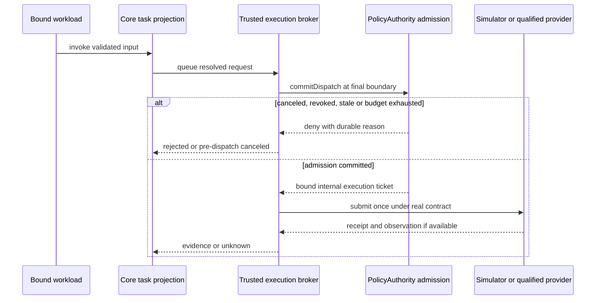

# 工程上下文：FEAT-MVP-001 — 受限机器人应用运行时 MVP

## 当前有效方案

T005 当前整合决定：依赖图 package-runtime 单元已在 host/Mock 范围接受，
实际生产 OCI、控制进程恢复和最终 Linux 验收仍未完成。当前唯一实施方案是
[T005 构建/恢复计划](../../planner/t005-build-serialization.md)，含 Graph unit
acceptance and production ownership return；SHA
`4a4d01d5b940d5d29f303b7b091dcd21bc0afe8cde5ece8b0fd6de556565f76d`。
主 Agent 已核对并将三个接受文件整合到工作树，将 package-runtime 与安装/graph 测试明确交回
原生产实现者；独立 graph 单元不再持有写权限。原生产实现者继续独占 runtime-oci、
guardian 和专用 VM，完整 T005 验收范围及已使用的诊断额度不变。生产工厂暂不声明
`supportsGraphMaterialV1`。此整合不代表当前生产工作树构建通过或 Task 完成。

跨会话接续入口为[恢复检查点](../checkpoints/FEAT-MVP-001.md)。2026-10-30 用户明确
授权把当前未验收进度提交并推送到独立 WIP 分支。此授权只保存源码、测试、规划和接续
记录，不接受 T005、不恢复已停止的网络实现、不重置诊断额度，也不发布产品。所有旧
实现和评审 Agent 均已完成/停止，没有在途写入者；下一会话须重新分配实现所有权。

分支登记迁移的预先决定：在实际 Git 根目录以当前 HEAD
`a3973e56d442e75361946eb26fc2e3b8b494882b` 创建并检出
`codex/t005-wip-20261030`，保留默认远端 `codex/project-foundation` 的已验收基线。
同一根目录执行 `lifecycle_state.py --repo . migrate-feature-branch`，完整操作参数为
`--feature-id FEAT-MVP-001 --expected-branch codex/project-foundation --branch codex/t005-wip-20261030 --expected-head a3973e56d442e75361946eb26fc2e3b8b494882b --reason save-unaccepted-T005-for-clone-handoff`。
只迁移本 Feature 的开发位置，不改变 Task/validation/review/release 状态。私有运行数据、
原始证据、专用 VM 和镜像不进入 Git；新环境不能继承原环境的资格结论。

登记迁移实际结果：lifecycle CLI 于 `2026-10-30T06:54:02Z` 返回成功，核对实际根目录、
附着分支和完整基线 HEAD；`FEAT-MVP-001.branch` 从 `codex/project-foundation`
改为 `codex/t005-wip-20261030`。T001–T004 done、T005 in_progress、其余 todo
及 pending validation/review/release 均保留，没有以 WIP 保存代替任何验收。

WIP 保存检查：当前整树在固定 Node24.16.0 下 `npm run lint`、
`npm run format:check` 均 exit0；README/TRACKING/工程上下文/40行检查点的
单独 Prettier 检查及 `git diff --check` 均 exit0。候选源码为 regular UTF-8 文件，
定向凭据/个人主目录模式扫描无命中。此次没有重跑 Linux 或整任务测试，不借备份
解除网络停止，也不宣称全树功能/崩溃恢复已验证。

### 架构设计

**关联产品上下文**：[REQ-MVP-001](REQ-MVP-001.product.md)

**工程上下文**：`.sdlc-v1/context/FEAT-MVP-001.engineering.md`

**已确认需求**：产品 C-01 至 C-08、REQ-001 至 REQ-008；EA-_ 为工程候选，O-_ 为待测事实。

**创建日期**：2026-10-23。**状态**：Plan 已验收，T001/T002/T003/T004 已接受；T004—T009 已获批量实施授权，T010—T012 待设备前置。精确进度以 lifecycle state 为准。

#### 背景

服务一个结果：受限应用先在 Linux + reference simulator 验证允许/拒绝，再在 T1 本体完成原屏动态内容与语音/机身触摸切页。T001 已建立最小可信驱动、契约、权限持久化与测试；当前实际范围见下方实现和验证记录，不能据此推断完整 MVP 或设备支持。

长期方向的已提交验证基线为 `none`；产品确认来源见产品 SRC-01 至 SRC-07。本方案引用 [架构](../../docs/architecture/overview.md)、[核心接口](../../docs/specs/core-interfaces.md)、[插件包](../../docs/specs/plugin-package.md)、[权限/沙箱](../../docs/specs/sandbox-permissions.md)、[Scene 渲染](../../docs/specs/scene-rendering.md)、[T1](../../docs/specs/t1-adapter.md)，不复制完整规范。

用户已明确授权按既定架构连续实施 T004—T009，允许在项目和现有专用 Linux VM 内准备必要依赖、镜像、运行时及受控测试环境；完成测试、独立评审和验收后提交推送并更新 GitHub tracking。范围为本地、simulator 和 Mock；真实机器人操作、真实账号/模型调用、付费远程资源及正式发布仍在对应接入时授权。真实外部/物理操作仍需对应授权。移动、第二台真实机器人、fleet 和任意市场不在本 Feature。

复用评估按现有代码→依赖→官方方案进行：源码/依赖搜索为空；可复用资产为规范、研究来源与合成场景设计。[研究基线](../../docs/research/2026-10-22-findings.md) 是有日期的工程输入，不是当前版本/兼容性的实测证据。

| 需求与候选（每域最多三项）                               | 复用决定与扩展方式                                                        | 未采用项/成本、风险及复核点                                                                                           |
| -------------------------------------------------------- | ------------------------------------------------------------------------- | --------------------------------------------------------------------------------------------------------------------- |
| Agent loop：pi / DeepSeek Harness / 自写完整 loop        | 引入 pi 为首候选，包装 AgentBackend；工具只接受信代理                     | DSH 的 preview/隔离限制增加成本；不自写模型循环。T007 固定版本并查维护、许可证及 API；不直接加载第三方模块到可信 core |
| Linux 执行：OCI + gVisor / 普通 rootless OCI / OpenShell | 引入 OCI 管理与 gVisor 首候选，扩展 SandboxBackend 资格/限额检查          | 普通容器共享内核不自动满足要求；OpenShell 依赖实际 host 特性。T002/T004 验证；不兼容即拒绝，不静默选弱后端            |
| Scene：Chromium + FFmpeg / HyperFrames                   | 优先复用固定 Chromium/捕帧与 FFmpeg，自己实现很薄的 Scene/Artifact 流水线 | HyperFrames 为后备复用候选；首期无需完整视频制作平台。T008 固定字体/codec/版本，核对 FFmpeg 构建分发义务和 ARM64 兼容 |
| 业务 connector：官方 authsidecar / 固定语义 shim         | 复用官方 transport 为 Lark 首候选；先自研最小 Mock + 可信语义 broker      | 官方 demo 缺操作/资源授权、刷新、重放/预算；不能直接投入生产。T009 只验证 Mock；真实 CLI/账号兼容另需授权与证据       |
| 持久化：SQLite                                           | 引入成熟本地事务依赖，按服务拥有数据库；admission 只有一个可信事务所有者  | 不引入分布式数据库。T001/T003 固定驱动/事务/持久性参数并做崩溃/竞争验证；没有跨网络文件共享                           |
| qdroid 身份/权限/版本/设备语义                           | 自研小型领域服务，复用通用 schema/协议/DB 库                              | 现有 harness、MCP、OCI 都不拥有 qdroid 的 grant、epoch、显示证据与设备仲裁，不能代替这些规则                          |

现有离线显示 POC 仅可借用 state/time、帧 hash 与资源冻结思路，不复制个人路径/产物或沿用桌面通过结论；没有新 UI 原型要实现。版本、许可、SBOM、source/image digest 与目标 ABI 在各任务实际选择后锁定；依赖下载/安装仅限当前已授权任务；不在该范围内的候选保持未验证。

#### 架构与组件

下列为逻辑目录，不要求分别发布包。core/contracts 不 import adapter；可信服务可受控共同部署，但不与不可信代码共享地址空间、凭据或可写数据。参数和配置以 schema/profile 为准，不在模型文本中提供授权。

##### 受信核心、授权与监督

- **职责**：`packages/core/` 路由与 Task 投影；`packages/policy/` 独立操作者授权及 admission；`packages/supervisor/` 绑定安装/实例/通道；`apps/cli/` 为受限使用/管理员入口。
- **接口**：版本化 JSON-RPC、受监督 stdio；可信私有 IPC 与管理端分开认证。主体由通道解析，参数中的 principal/grant/ticket 不能作为证明。
- **覆盖**：REQ-001、004、008；Task T001、T003、T007。

##### 运行与包管理

- **职责**：`packages/runtime-oci/` + 受信 SandboxManager 选择锁定镜像/profile、隔离/限额/清理；`packages/package-runtime/` 安全暂存、解析、构建、registry 与条件激活。
- **接口**：SandboxBackend 的 qualify/create/execute/stop 与安装生命周期；公开插件不能提供任意 mounts/devices/flags/image。安装许可不创建 grant。
- **覆盖**：REQ-002、003；T002、T004、T005、T006。

##### 应用与扩展适配

- **职责**：`packages/agent-pi/` 复用循环；`packages/mcp-host/` 监督沙箱 MCP；业务 reducer 在应用沙箱；工具描述与返回文本无授权权力。
- **接口**：AgentBackend 的受限工具目录和事件；MCP 初始化/schema/namespace 固定，输出/超时/子孙受控。首期用确定性模型 fixture，provider 连接默认关闭。
- **覆盖**：REQ-001、002、003、007；T007、T009。

##### 产物、Scene 与显示

- **职责**：`packages/artifact-store/` 不可变对象/ACL；`packages/scene-runtime/` 状态/action；`packages/renderer-html-video/` 无凭据渲染；`packages/display/` 协调单一呈现者与 revision。
- **接口**：SceneRef + frozen state/time/seed → RenderResult/ArtifactRef → 授权导入/提交/观察；语音/触摸先变更应用 state，MP4 不保留 DOM 交互。
- **覆盖**：REQ-005、006；T008、T011、T012；渲染细节以 Scene 规范为准。

##### Connector 与设备 provider

- **职责**：`packages/connector-broker/` 拥有凭据/业务策略/刷新，Mock 先行；`adapters/reference-simulator/` 提供可计数故障点；`adapters/primebot-t1/` 隔离 SDK/ROS2/原厂显示与输入。
- **接口**：能力 describe/probe/invoke/observe/cancel/reconcile；robotd 本地资源/lease；T1 player-agent 独立恢复。设备探测只由已授权的可信操作触发。
- **覆盖**：REQ-004、006、007；T001、T003、T009 至 T012。

#### 关键设计决定

##### 决定 1：一个 admission 事务决定是否可以执行

- **背景**：前置检查不能阻止排队期间撤权、预算竞争或取消。
- **决定**：PolicyAuthority 的本地 SQLite admission ledger 同时拥有 live grant/generation、预算/审批消耗、取消标记、幂等映射和 dispatch 意图；broker 在最终发送边界调用 `commitDispatch`，core Task 是投影。
- **替代项/取舍**：拒绝 core 读预算后另行扣减、跨库写两份授权事实。SQLite 不是与厂家/API 的分布式事务；commit 后崩溃可能 unknown，不盲发、不自动退款。
- **覆盖**：REQ-001、004；T003；一次预算并发、取消先后与崩溃子场景。

##### 决定 2：安装的条件切换独立于权限

- **背景**：多个候选/删除/迟到失败会覆盖较新版本。
- **决定**：同 installation 的激活、回滚、移除串行化，使用 `installationGeneration + expectedActiveDigest` 条件提交；暂存内容不可变，运行任务持有版本引用。
- **替代项/取舍**：不用“失败就写回旧指针”；清理尊重引用，回滚不恢复 grant，移除不冒充撤销外部 OAuth。
- **覆盖**：REQ-003；T005、T006；AC-08 的 A/B/移除交错。

##### 决定 3：按真实后端能力发布显示保证

- **背景**：宿主 revision 无法取消已进入厂家服务的旧 RPC。
- **决定**：一个可信 player sender 串行提交；分别保存 rendered/imported/submitted/observed-visible。播放器节点监督 lease 并执行实测的 fallback；无证据的强顺序/敏感显示模式保持禁用。
- **替代项/取舍**：不以 clip 时长当清屏，不关闭 Chromium sandbox，不借降低隔离解决渲染失败。初版无音轨/精准音画同步，软件编码为候选。
- **覆盖**：REQ-005、006；T008、T011、T012。

#### 数据模型 / 关键实体

| 实体/可信所有者                           | 最小事实与约束                                                                                                                | 覆盖         |
| ----------------------------------------- | ----------------------------------------------------------------------------------------------------------------------------- | ------------ |
| PolicyAuthority store                     | grant、issuer、subject、operation/resource、use budget、revocation generation；只有独立管理入口能改变                         | REQ-001      |
| Admission ledger，同一 PolicyAuthority DB | admission/task ID、request digest、epoch、cancel marker、use/approval debit、dispatch ticket、状态；事务与唯一键约束幂等/预算 | REQ-001、004 |
| Core Task journal                         | admission ID、stateVersion、观察证据与 scoped result；不反向覆盖 admission 权威                                               | REQ-004      |
| Execution journal，robotd/broker          | provider/boot epoch、实际提交/观察/停止/unknown证据；本地单调 lease；不共享跨板时钟                                           | REQ-004、006 |
| Installation registry，supervisor         | 内容/平台/profile digest、generation、active digest、attempt、运行引用；条件切换和崩溃恢复                                    | REQ-003      |
| Artifact metadata/store                   | owner/task、digest/size/type、可信producer/provenance、validation、expiry/refcount；不信调用者自证来源                        | REQ-005、007 |
| Scene/presentation，display/player        | state/revision、stream/epoch、队列、lease、提交/可见状态；节点本地恢复责任                                                    | REQ-005、006 |

每个服务的数据库只在所属节点本地打开，权限最小化；不挂到工作负载、不放网络共享文件系统。驱动、busy/commit失败处理及持久性设置须固定并故障验证，失败不允许 dispatch。schema 演进先版本化并备份/验证恢复；禁止以代码回退覆盖仍需对账的 admission 历史。

#### API / 接口契约

- 对外仅开放规范中的初始化、发现/调用、Task/事件、Artifact 与 display 方法；无公开 grant/approval 创建、宿主 exec、raw SDK 或通用凭据代理。对象 ACL 按真实实例/资源验证。
- 协商 protocol/capability/manifest 主版本与必需特性；拒绝不兼容、未知授权/运行时字段和重复 key；兼容可选字段只按 schema 处理。语义变化必须升级版本并重做受影响资格。
- 每次调用锁定 provider/schema/image/profile，不中途切换。超时、取消与期限分别建模；无观察支持不得生成 running/完成/停止。唯一 key 对不同 canonical input 冲突。
- 服务间 ticket 绑定 broker、subject/task、能力/资源、epoch/lease/generation，不能转交任意服务。跨板链路按 DeploymentProfile 认证/授权；同机 sidecar HTTP 不是通用跨节点协议。
- 失败码、错误净化、输出/事件背压沿用核心规范。查询可按明确重试策略执行；可能已提交的副作用只权威对账，不自动换 key 重试。外部写与物理移动均不在本 MVP。

#### 时序与数据流

图只解释 AC-06/12/13 的权威顺序，未渲染预览；等价流程是绑定身份→可信前检→执行方 commit→厂家调用→观察/unknown。取消与撤权先于 commit 则拒绝；后到不抹去 in-flight。commit 与厂家调用之间崩溃也不自动重发；同 admission 贯穿重启和状态投影。

#### 横切质量设计

- 隔离按确切 kernel/runtime/image/profile/suite 组合保存证据；改任一相关输入重验。首 profile 只承载固定只读 fixture，不借最小增量扩大为通用市场代码资格。
- CPU/memory/PID/disk/IO/output/time、出网、私有 scratch 与子孙清理由宿主边界落实；单 render/单前台应用为工程默认，数值待主控测量，不承诺 T1 SLA。
- 隐私：合成秘密/日程优先；真实凭据不进 workload/日志，数据读取不自动允许模型外传；cache ACL、expiry、移除清理；未证实播放器恢复前仅公开/合成画面。
- 可观测：关联 instance/grant/admission/task/provider/scene revision，净化输入摘要/错误，不收集秘密正文；可核对 dispatch 与观察证据，未知保持可见。

#### 风险与取舍

| 风险                                | 影响                       | 缓解措施/回滚                                                                    |
| ----------------------------------- | -------------------------- | -------------------------------------------------------------------------------- |
| Linux/T1 不满足隔离或 Chromium 组合 | 不能运行对应不可信包       | T002 早验最小真实组合，T004完整资格；不改内核/关闭隔离；保留失败与未支持能力     |
| SQLite锁/崩溃或两份授权事实         | 超预算或重复副作用         | T003 单权威事务、故障注入；停新dispatch并对账，不退款/删除journal冒充回滚        |
| 安装竞争/GC删除运行内容             | 旧候选覆盖新版本或任务损坏 | T006 条件切换/引用保留；回退仅匹配自己的generation，不恢复权限                   |
| 厂家缺排序/clear/取消证据           | 最新画面或停止无法保证     | T011/T012 独立实测；受限模式与unknown，不宣称强保证，敏感Scene禁用               |
| 第三方版本/许可/ARM64依赖变化       | 构建或分发不可用           | 每次实际选型固定版本/provenance；不分发未许可SDK，替换后重验，不沿用候选名称结论 |

#### 需求覆盖

| 产品规格     | 设计覆盖                                              |
| ------------ | ----------------------------------------------------- |
| REQ-001      | 受信核心/PolicyAuthority、决定1、身份/ACL/默认拒绝    |
| REQ-002、003 | runtime/package/supervisor、决定2、固定版本与资格     |
| REQ-004      | admission/Task/execution三种事实、决定1、取消/恢复    |
| REQ-005、006 | Scene/Artifact/display/T1、决定3、输入与本地恢复      |
| REQ-007、008 | Broker/Agent边界、合成fixture、最早增量及当前授权边界 |

### 实施计划

**关联产品上下文**：REQ-MVP-001；**关联设计**：本文架构设计；**创建日期**：2026-10-23；**状态**：已接受并开始实施；Task 状态由 lifecycle CLI 维护。

#### 背景

实现从空代码库开始，任务输出为未来可运行增量；当前先交付已获授权的 T001/T002，后续任务保留计划状态。`planner/sdlc-stage-plan.md` 只导航本文件，不成为第二套方案/状态。

#### 目标 / 非目标

- 目标：先获得真实 Linux 最小边界证据，再完成固定包运行、状态驱动显示、Mock业务与T1固定位置交互；覆盖 AC-01 至 AC-20 的适用环境。
- 非目标：未授权的后续任务、运动、真实账号写入、自动远端执行、任意网站捕获、精确音画同步、强行统一不同设备语义和第二真机支持。
- 真 Lark 只读 CLI、真实模型和实际设备操作均按各自授权选择；Mock完成不允许宣称它们支持。

#### 技术栈

- TypeScript/Node 用于 core/SDK；T001 已锁定实际版本与 workspace 工具，命令及验证范围见 docs/USAGE.md 和实际记录。
- SQLite 本地服务自有存储；驱动、schema migration、事务/持久性设置由 T001/T003 验证后记录。
- OCI + gVisor 为首隔离候选；Chromium/FFmpeg 为渲染候选；pi、authsidecar候选不改变权限边界。T1 provider 语言按SDK实际情况选Python/C++等，不要求core安装ROS2。

#### 实施层决定

##### 决定 1：首增量只依赖 T001 与 T002

候选为“先齐备所有框架”与“固定fixture纵向闭环”；选择后者。T001仅建立足够的契约、监督身份、最小可信grant/admission与SIM只读调用；T002在真实Linux验证所需最低profile后运行固定fixture。复现必须观察一个允许调用成功和一个未授予/伪造主体调用被拒绝、SIM操作计数不增加。

这是首个可独立展示的真实增量；无需包安装、完整pi/MCP、全部AC-02变体、显示、Lark或设备。最低隔离每项真实验证，不能用“后面再做资格”跳过；后续 T003/T004 完成竞争/崩溃和完整资格矩阵。覆盖 REQ-001、002、008；设计：受信核心/运行。

##### 决定 2：每个任务拥有实现及必要验证

默认测试先行覆盖行为/失败，不拆测试工单。实现者负责本任务代码、测试和usage更新；公共schema变更先协调依赖。当前12项默认串行交付，不能因无依赖或不同目录直接并行；主Agent另行确认稳定接口、独立验收、写范围及环境隔离后才能并行。

所有未来命令均须在创建实现入口后实际运行，再写入project/usage。下文以复现方法和目标测试路径定义验收，不捏造当前不存在的CLI flags或通过结果。覆盖全部REQ；设计：上述逻辑组件。

#### 风险 / 取舍

受控Linux环境、T1到货与SDK权限当前未知，工期不按日历承诺。当前 T001/T002/T003 所需本地依赖和专用 Docker 环境已获授权；不包含租用远程资源或刷机。T010可在T001后且设备/只读访问获授权时提前调查，milestone不是技术依赖。具体风险与回滚引用架构风险表，不以关闭隔离换进度。

#### 实施阶段

| 阶段 / GitHub milestone                      | 增量与任务                                                | 覆盖 / 设计                       |
| -------------------------------------------- | --------------------------------------------------------- | --------------------------------- |
| M0 — Linux sandbox and first capability（1） | T001→T002先展示；T003原子admission恢复；T004完整资格      | REQ-001、002、004、008；核心/运行 |
| M1 — Portable package runtime（2）           | T005安全安装→T006生命周期→T007受限Agent/MCP               | REQ-001至004；包/扩展             |
| M2 — Interactive scenes and connector（3）   | T008 Scene/Artifact呈现；T009 Mock业务闭环                | REQ-005、007；显示/Broker         |
| M3 — T1 hardware acceptance（4）             | T010设备基线；T011播放器/恢复；T012语音触摸集成与资源预算 | REQ-004至006；设备/显示           |

#### 需求覆盖

| 当前 AC | Task                   | 计划验证 / 契约                                                                      |
| ------- | ---------------------- | ------------------------------------------------------------------------------------ |
| AC-01   | T001、T002             | 固定fixture在真实Linux沙箱访问SIM只读结果；核心/安全                                 |
| AC-02   | T002、T003、T007、T008 | 首次未授予/伪造主体拒绝；完整grant/admin/Task/Artifact ACL变体                       |
| AC-03   | T004、T008、T009       | Linux canary、可信store/进程/网络矩阵；renderer/connector隔离                        |
| AC-04   | T002、T004             | 缺特性/profile指纹变更拒绝，无host fallback                                          |
| AC-05   | T002、T004、T007、T008 | 实际CPU/memory/PID/disk/IO/output/deadline超额和全部子孙清理                         |
| AC-06   | T003、T006             | 排队撤权/lease/代际；一次预算两请求仅一个commit；同幂等不二次扣；unknown不退款       |
| AC-07   | T005                   | schema/引用/digest/platform/解包逃逸/竞态/炸弹负例                                   |
| AC-08   | T005、T006             | 构建失败/中断/重复安装；A迟到失败不能覆盖B，升级/移除条件切换                        |
| AC-09   | T006                   | 固定任务版本、增权不继承、回滚不恢复grant、移除/GC/外部OAuth分离                     |
| AC-10   | T007、T008             | 受限MCP与renderer，文本/action不改权限；schema/事件/输出背压                         |
| AC-11   | T001、T007、T008       | 版本/未知必需字段；video/web模拟profile同应用、缺能力拒绝；无第二真机声明            |
| AC-12   | T003、T011             | accepted-only/完成取消交错；取消先commit不得发送，后commit保留真实结果；显示证据分层 |
| AC-13   | T003、T006、T011       | admission/厂家调用/结果前后崩溃；旧epoch/迟到/重复；恢复不盲发                       |
| AC-14   | T008                   | 固定state/time/seed帧hash、时间变化、完整Artifact/ACL、乱序与输入状态                |
| AC-15   | T009                   | 合成凭据Mock操作/资源/重放/刷新/空态/离线/外传拒绝                                   |
| AC-16   | T010、T011             | T1真实基线/导入解码/原屏播放与退出恢复                                               |
| AC-17   | T010、T012             | T1真实ASR/触摸、焦点/去重/过期/gap、最终可见页                                       |
| AC-18   | T011、T012             | T1旧RPC、半文件、协调器/播放器重启、链路丢失、lease本地恢复/残留画面                 |
| AC-19   | T010、T012             | 原厂告警/人工接管优先，不误杀原厂，不开放运动                                        |
| AC-20   | T004、T008、T012       | Linux与T1分别测冷/热延迟/资源；T1温度功耗/共存；预算有证据                           |

验证方法是 correctness + 边界/恢复/集成；内部stdio不是HTTP OpenAPI，不虚构API URL。T008的HTML Scene属于固定viewport的Web视觉旅程，准备已提交的 tester-army/e2e Web engine用例，确定性操作不需模型，模型预算为0；选定版本/真实命令由Build核实。完整浏览器套件/截图可补充但不替代适用的正式检查。T1按真实物理步骤/观察取证，不伪装为移动App或桌面浏览器通过。

### 工程任务

**输入**：以上设计/计划与产品AC。每个标题对应一个后续Issue，依赖仅用Task ID；状态唯一由lifecycle state管理。所有代码路径均为未来写范围，不是已存在产物。

#### 路径约定

逻辑目录采用 `packages/`、`apps/`、`adapters/`、`profiles/`、`tests/`、`fixtures/`、`deploy/`；不预先要求独立发布。每项仅改列明区域及受影响根依赖锁；公共契约变更先由主Agent确认。未来全局操作说明只维护 `docs/USAGE.md`，README只索引；故事 USE-001至005映射产品US与AC，参数引用版本schema/profile，不写secret。现阶段它尚不存在，不提供可执行使用承诺。

#### T001 — 最小契约、受监督身份与只读模拟器

- **故事 / milestone**：US-01/02，M0；**依赖**：无。**覆盖**：REQ-001、004、008；AC-01/02/11的基础子场景。
- **代码写范围**：根workspace/锁/formatter/test配置，`packages/contracts/`、`packages/core/`、`packages/policy/`、`packages/supervisor/`最小切片，`apps/cli/`、`adapters/reference-simulator/`、`fixtures/readonly-sim/`、`tests/contracts/`、`docs/USAGE.md`。
- **交付**：只实现初始化、只读SIM调用、实际通道身份、最小operator fixture grant/admission与净化审计；无第三方安装、动态插件加载或真实模型。固定测试代码只作受信驱动，不在host执行不可信插件。
- **完成条件**：同schema可得正常SIM结果与未授予/伪造主体拒绝；版本/必需字段错误在调用前拒绝；SIM计数、instance/admission/task可关联。锁定实际工具版本/许可证，格式/类型/最小构建与行为测试通过。
- **验证环境 / 方法**：本地受控开发环境，契约fixture输入→受信driver→SIM；测试不是Linux隔离证明。创建且实际运行真实测试/CLI入口后记录命令，不以本任务声称沙箱可用。
- **授权 / 设备前置**：另一次Build授权及本地依赖操作许可；不需设备/账号/API。**usage**：USE-001说明当前受信fixture范围、schema参数与失败反馈。

#### T002 — Linux 最低隔离与允许/拒绝真实闭环

- **故事 / milestone**：US-01/02，M0；**依赖**：T001。**覆盖**：REQ-001、002、008；AC-01、02最小子场景，AC-04/05最低profile部分。
- **代码写范围**：`packages/runtime-oci/`、`packages/supervisor/`运行装配、`profiles/hosts/`最小资格、`fixtures/readonly-sim/`镜像、`tests/linux/first-call/`、`docs/USAGE.md`。
- **交付**：选定并固定Linux/backend/image/profile，真实受限fixture通过绑定通道访问只读SIM；容器管理权限留可信manager，不向workload传host资源或凭据。
- **完成条件**：先实测该fixture要求的所有最低属性：只读root、私有scratch/身份、canary/秘密不可读、默认拒绝出网、CPU/memory/PID/disk/output/time有界与子孙清理；随后允许调用成功、未授权/伪造主体被拒且SIM计数不增加。缺任何必要属性即拒绝，无host fallback。
- **验证环境 / 方法**：实际Linux受控host，固定digest镜像与合成canary；运行检查→启动fixture→检查两调用及清理，输出版本/设置/原始退出码与证据。只声明此最低profile范围，不冒充T004完整资格。
- **授权 / 设备前置**：Linux访问、所需运行时配置/下载/安装须另获授权；无T1/账号/模型。**usage**：USE-001按实际入口复现，参数由host/installation schema提供。这是T001+T002的首个真实增量。

##### T002 当前执行方案（已获授权）

- **环境与镜像**：专用本地 ARM64 Linux VM，Ubuntu 24.04 / host kernel 6.8；应用镜像使用固定 Ubuntu 22.04 digest，参考 T1 SDK 的 Ubuntu 22.04 基线，不为 SIM 安装 ROS2。Node 固定 24.16.0，broker 与 workload 都在 Linux 运行；不挂载 host 工作目录。当前实测 Docker 29.2.1，gVisor release-20261019.0（完整 sidecars）+ systrap；这是开发资格环境，不是 T1 host 资格。
- **固定最低 profile**：trusted manager 使用 Docker argv API、固定 runtime/image/entrypoint；network none、readonly root、uid/gid 65532、cap-drop ALL、no-new-privileges，512 MiB memory/swap、0.5 CPU、host pids 256、guest nproc 32、core 0、16 MiB noexec/nosuid/nodev 私有 tmpfs。缺任一必要特性拒绝，不选择 runc/host fallback。探针可使用同一镜像内受信测试入口；真实应用不能选择 command/flags/mounts/devices。
- **通道与权限**：supervisor 创建实例和私有 stdio 绑定，增量解析有界 JSON-RPC frames、拒绝重复 key/未知字段；stderr、总输出、期限有界。Policy DB/grant 和 Docker socket 不进入 workload；可信 broker 独立验证 provider 操作计数，不信客户端自报身份、权限或计数。
- **实测资格**：在最终镜像/profile 上运行 root/scratch 写入、nonroot/caps/no-new-privileges、既有 host canary 与另一实例 scratch、秘密/socket/store 不可读、实际可达控制目标的 TCP/UDP/DNS/IPv6 默认出网拒绝，CPU 节流、memory OOM、guest/host PID、scratch ENOSPC、output/deadline 与全部子孙清理。控制目标使用合成数据；T004 完整代理/重定向/rebinding 矩阵仍未完成。
- **证据与拒绝**：资格绑定实际 host kernel/arch/boot、Docker/runtime 版本及二进制/config、image ID/digest、profile/suite；改变相关输入就失效。不能通过外部 JSON 的 passed=true 取得授权。受信内存 handle 或同等可信资格拥有者控制执行，缺失/不匹配时 fail closed。
- **首闭环**：allow 实例真实 stdio 只读调用成功，host simulator count=1；none/deny 实例拒绝且 count=0；active deny 优先，伪造 authority/重复 key/不支持方法拒绝，count 不增加。停止必须确认实际容器与子孙结束及任务附件移除，不能只杀 Docker CLI。
- **验证范围**：只资格化这个固定 ARM64 fixture；不声称 AMD64、任意第三方包、T1 内核或其他后端支持。完整 admission 竞争/恢复仍由 T003 承担。构建、测试、复现及失败反馈同步到唯一 docs/USAGE.md；公共记录不包含私人路径、proxy 配置或凭据。

##### T002 有效修正方案（2026-10-26；替代本次失败后的环境归因）

独立只读复核发现了具体的资格探针缺陷：secret/store 参数未传入却把 TypeError 视为不可读；host `/tmp` canary 的同名 sandbox 私有文件写入被误判为 host 修改；I/O 在读操作前采样后使用旧 statistics；Docker Unix socket 用文件读取而非连接验证；create 失败在清理范围外。基于这些源码证据修正同一 T002，不先归因为 gVisor 环境限制，不调整权限或最低验收条件。

- 对所有合成路径校验实参，以可读文件/可连接合成 socket 的正向控制证明实际使用目标；参数和未知探针错误不能计作隔离通过。host canary 的修改结果以 broker 复查 host 内容为准，保留实际写入尝试与私有 scratch 行为。
- I/O 使用有界、确实发生在读操作之后/期间的同设备 cgroup 计数证据，并记录隔离读操作的实际耗时；不能用启动时旧值、整个 suite 时长、配置存在或空计数证明限速。不得增加无关 sleep、全局清 cache、切 runc 或放宽控制。
- 容器名的管理责任覆盖 create 的非零退出/超时等不确定结果，清理已知名称并保留无法确认时的失败；正常 fixture 接收响应后自行退出，正常场景区分 completed 与 deadline。
- 同一实现者批量修正、增加比例适当回归并更新 usage，然后冻结源码重建镜像，保存原始日志/逐文件摘要并运行一次完整 Linux 资格和 first-call。失败时按实际新增证据判断，不连续盲改/重跑；此前诊断 allowance 和非收敛历史不重置。主 Agent 复核修正和集成后才可接受、提交及更新完成状态。

##### I/O 资格方法补充（2026-10-26）

固定 [gVisor release 源码](https://github.com/google/gvisor/blob/release-20261019.0/pkg/sentry/fsimpl/gofer/inode_impl.go#L114-L137) 显示 guest 的 `O_DIRECT` 没有传给 host 文件打开参数，故 image-layer 上的 guest direct-read 不能保证冷的 host I/O。主 Agent 只读检查确认专用 VM 的 `/mnt/lima-colima-qdroid-t002` 与 Docker 数据目录均属于 `/dev/vdb1`，后者是该盘 `/docker` 子目录的挂载；当前 broker UID 为 501，现有挂载点归 root 所有。这是方法修正的依据，不是限速通过证据。

资格测试采用 manager 拥有的合成文件，位于该专用盘预建的 `qdroid-t002-io` 目录。目录限当前可信 broker，随机任务文件为非稀疏、已同步、无秘密的数据；核对实际文件所在设备、路径归属与无 symlink 后，按 [GNU dd 的文件级 nocache 方法](https://www.gnu.org/s/coreutils/manual/html_node/dd-invocation.html) 仅请求丢弃此文件的缓存并检查退出结果。只在 I/O 资格 probe 的固定路径添加这一项只读、私有传播的合成文件挂载，逐项核对 inspect；普通 workload/profile 不获得 mount 参数或 host 路径入口。

I/O probe 仍使用相同最终镜像、runtime、cgroup 设备/限额、非 root 和其余限制。实际读耗时不包含初始化或采证等待；同一 live cgroup 必须记录真实设备读字节及既定限速，不能因缓存清理命令成功就视作通过。资格后有界删除 probe 容器和合成文件。host/runtime/profile 或 probe 方法相关输入改变时重验。禁止全局 drop_caches、raw block-device passthrough、真实 host 数据挂载、runc/host fallback 或任何 app 自选 mount；本补充不增加应用权限，也不扩展 T004 的通用资格范围。该专用开发盘准备及合成文件测试属于现有 T002 本地环境授权。

##### I/O probe 正常退出修正（2026-10-26；额外定向诊断后的有效方案）

唯一额外诊断于 UTC 04:06:46 前完成，主 Agent 已读取原始结果：合法 read 已送达，dd 的 exit/close 均为 0，read-complete 已发出，guest 读耗时 16004.819112 ms，2 秒采证等待已结束；随后仍由 deadline 终止（exit 143），stdin 未 destroyed/ended，容器清理确认。失败已定位到完成读取后的 probe 生命周期，不将读取或 cgroup 配置认定为失败原因。此定位不代表全部资格已通过，尤其读字节增量与最终 first-call 仍须重验。

同一实现者在 probe 完成唯一输入命令后显式释放该输入流，并覆盖结束/错误路径；保持读量、采证窗口、profile、25 秒 probe deadline、普通 workload 的 5 秒预算及权限不变。增加进程级回归：父端发送合法命令但保持 stdin 打开时，probe 的对应生命周期仍应自然完成退出 0；不能用父端 EOF、强制 process.exit 或调高 deadline 使测试通过。源代码和镜像重新固定后运行适用 contract/static 检查与完整 Linux 验收，再由主 Agent 集成与复核接受。此为已有定位证据支持的修正，不新增诊断轮次；此前失败和两次诊断授权均保留。

##### 根目录写入与子进程观察修正（2026-10-26）

I/O 生命周期修正后的完整验收已得到 16777216 字节的实际读增量、16038.43642 ms 的读取耗时；原输入未关闭也由父端保持 writable 的失败先行回归复现并修正。新的资格汇总显示 rootMountReadOnly=true、readOnlyRoot=false、descendantCleanupConfirmed=true、descendantsObserved=false；不是重复旧 I/O 失败。

主 Agent 复查当前源码：根目录写入选在 `/etc`，固定非 root UID 本就缺少该目录写权限，无法排除 DAC 抢先拒绝；子进程观察无论实际任务期限多长，只观察启动后的 400 ms。修正方法为：镜像内预建无秘密、目录权限明确允许 guest 写入的 root-filesystem 控制路径，检查其权限前置，再实际写入并要求 EROFS，同时继续要求 root mount 为 ro；不接受普通 EACCES 作为只读证明。子进程观察覆盖原有任务 deadline 内的剩余时间，仍必须通过真实进程表发现 child，并确认停止和容器移除；不依靠 self-report、不延长任务 deadline、不去掉观察断言。加入控制路径和延迟出现子进程的必要回归、保留有限失败字段后，固定新镜像重跑完整资格和 first-call。若仍失败按实际证据报告，不盲改或追加诊断；失败史和次数不重置。

##### gVisor 子进程观察接口修正（2026-10-26）

上一修正后的汇总已确认根目录 EROFS、I/O 和其他探针通过，但原 2 秒内 `docker top` 的 27 次成功采样都只见一个 host 进程。固定版本 [gVisor 资源模型](https://github.com/google/gvisor/blob/release-20261019.0/g3doc/architecture_guide/resources.md#processes) 明确说明 guest 进程不表现为 host 进程，进程级交互需进入 sandbox；[runsc ps](https://github.com/google/gvisor/blob/release-20261019.0/runsc/cmd/ps.go) 读取的是 guest Processes。故 host `docker top` 不能作为 guest child 的观察接口，这是接口语义错误，不能靠延长采样或去掉 child 要求解决。

当前 Docker 固定 fixture 改用可信 manager 执行固定的 guest `/proc` 观察器（Docker exec），不接受 workload 提供的命令、PID 或进程报告。观察器不再派生子进程，返回自身 PID 以及有界的 guest PID/PPID 记录；必须排除 observer 自身，明确找到 workload init（PID 1）的另一个真实 child，不能用包含 observer 的总行数判断。观察仍受原 2 秒期限及命令/输出上限约束，停止和移除断言保留。对只有 init+observer、延迟真实 child、异常输出/早退加必要回归。命令/脚本固定在可信源码和最终镜像中，普通应用无 exec 或管理接口权限。保留实际 guest 观察证据并在新镜像上重验完整资格与 first-call；这是依赖语义与已有观测支持的实现修正，不再追加诊断轮次或改变隔离预算。

##### 合成网络目标逐协议正控制修正（2026-10-26）

最新 guest observer 快照的 Linux suite 已退出 0，但主 Agent 静态复核确认网络正控制只连接 TCP/IPv4；UDP、DNS 和 IPv6 只 bind/listen，不能证明负向探针确实指向可达目标。此外 DNS query 把六字节 `qdroid` 标签长度编码为 7，需修为有效的合成 `qdroid.invalid` 数据报。这是具体源码缺口，前一成功 run 保留为当时事实，不能直接作为最终接受证据。

同一实现者补齐四个现有合成目标的 broker 正向访问，逐一确认对应 listener 收到预期控制连接/数据报，有界失败并清理全部已打开目标；正向完成后清零，再执行原 sandbox 负向尝试。reachable 必须由各协议真实控制结果得出，不能常量 true 或只用聚合 count>=1。保持 network none、原 runtime/profile、期限、地址范围及全部权限不变；不加入真实 DNS/互联网、代理、重定向或 T004 范围。加入比例适当的缺单项拒绝、清零/cleanup 与 DNS wire encoding 回归，重新固定 manifest 和镜像，执行适用静态/契约检查及一次完整 Linux suite。主 Agent 随后按唯一 usage 做 CLI 集成并由同一独立 reviewer 复核增量，再决定 T002 done/提交/推送。此为已有观察支持的修正，不新增诊断授权或重置失败史。

##### TCP 正控制超时取消修正（2026-10-26；最终独立复核）

四协议正控制补齐后的 Linux suite 与主 Agent CLI 集成均成功，但最终独立复核定位到 `connectTcp` 的失败清理只执行 `socket.end()`；未完成连接需要销毁该 manager 自有 socket，避免继续等待系统 TCP 握手超时。正常连接、四项 receipt 和负向计数证据不因此被否定，最终 T002 仍须接受这个失败分支的修正。

同一实现者仅修正超时/失败时对该自有连接的强制取消，并用可控、未完成连接回归证明有界释放和保留原始失败；不改变正常控制目标、应用权限、profile、500ms 等待或底层运行时。不以真实外网 blackhole 作为测试依赖。执行必要 contract/static 检查、更新源码 manifest 并同步 VM，运行一次完整 Linux suite 确认最终 broker 与既有镜像仍一致通过；fixture 镜像源未变时复用其 immutable image，不为 broker-only 修正另建镜像。独立 reviewer 复核这个局部差异，主 Agent 核对后接受。保持失败史和已使用诊断授权；这是具体审查发现的清理修正，无新增诊断轮次。

#### T003 — 原子 admission、取消与未知结果恢复

- **故事 / milestone**：US-01/05，M0；**依赖**：T002。**覆盖**：REQ-001、004；AC-02完整策略部分、AC-06、12、13及其预算/取消子场景。
- **代码写范围**：`packages/policy/`事务与管理入口、`packages/core/`Task投影、`adapters/reference-simulator/`故障provider、`tests/admission/`、`tests/recovery/`、`docs/USAGE.md`。
- **交付**：本地SQLite的单一admission权威、grant策略交集/拒绝、use/approval/cancel/dispatch记录、幂等对账；Task/执行journal引用同admission，管理端不可由workload调用。
- **完成条件**：一次预算并发两请求仅一条commit，同幂等不二次扣/无约束重发，unknown不自动退款；撤权/过期/排队取消先commit则无副作用，commit先则依provider证据；accepted-only不伪造完成；同key不同digest拒绝。
- **验证环境 / 方法**：受控Linux + 可计数合成provider；逐个在commit/调用/结果持久化前后崩溃，重启/旧epoch/迟到/重复均能核对预算、cancel、次数和历史。SQLite contention/commit失败必须拒绝新发送；不操作真机或真实写API。
- **授权 / 设备前置**：后续Build与测试host许可，无真实外部效果。**usage**：USE-002说明Task/取消/unknown查询与恢复决策；不能提供“一键重试未知动作”。

##### T003 当前实施契约（2026-10-26；事前复核后定稿）

本任务复用已固定的 Node 24.16.0、node:sqlite、SQLite WAL/FULL、受监督 JSON-RPC 与合格 OCI manager；不引入数据库/队列框架。新执行协议在单个 PolicyAuthority 本地数据库内增加带版本的 admission 表，不修改旧只读 capability 的含义，不把 Task 投影当授权事实。T001/T002 的 legacy 只读 fixture 保持兼容，新的预算/取消/恢复范围由本节的版本化 feature 和合成 capability 明确标识。

1. **接口与兼容**：沿用 `qdroid.rpc/v0.1`，新增显式协商的 required feature `qdroid.admission/v1`；旧 `requiredFeatures: []` 的只读调用、输出形状和严格字段校验保留。新 capability 为 `sim.counter.add/v1` / schema `qdroid.capability.sim.counter.add/v1`，固定合成资源 `counter.default`，输入仅 `counterId` 和整数 `amount`（1—10）。调用必须有有界 `idempotencyKey`，返回 queued TaskHandle；`tasks.get` 与 `tasks.cancel {taskId, reason}` 是唯一公开任务操作，无公开 grant/approval/revoke/reconcile/dispatch 管理接口。Core 用可信调度入口推进 queued task；应用不能指定 provider、身份、epoch、lease、grant、approval、ticket 或恢复证据。required feature 未协商不能使用新语义；未知 feature/字段/非法字符串均拒绝。新字段只按新 capability schema 接受，旧只读调用不隐式变更语义。
2. **持久模型与升级**：新增版本化的 subject/context、provider generation、host/installation policy、grant/approval、queued admission、cancel/use/dispatch 与 append-only history 表，均在原 PolicyAuthority DB 中；保留 legacy tables/rows，避免改变其 CHECK/历史意义。用 SQLite schema version 拒绝未来/不支持版本；非空旧库先通过 SQLite 一致性备份保存快照，再在一个事务中做 additive migration。迁移失败/崩溃不得删除或覆盖旧结果，测试 legacy 升级、回滚/重开、未来版本拒绝；无需重建历史数据或在网络文件系统运行。禁止直接复制运行中 sqlite 主文件冒充完整备份。旧只读 fixture 不会获得新 side-effect grant。
3. **可信上下文**：在 workload 初始化前由 trusted fixture/supervisor 装配注册完整 installation/instance/boot/channel/epoch 与本地 lease，provider/profile generation 由可信路由注册；初始化和每次新操作必须校验 live binding。注册/换代/撤销不通过公共 RPC。跨重启复用稳定 instance 的任务查询需由可信 supervisor 重新绑定更高 epoch，旧 channel/epoch 不能恢复权限；查询可见性按当前 installation+instance 所有权，ID 不构成权限。
4. **策略交集**：固定 counter capability 必须通过 host、installation、所有适用 active grant 的范围/amount 上限/expiry/预算约束，至少一个 allow、任一适用 deny 即拒绝。operator 变更在事务内增加 installation policy generation；queued intent 捕获的旧 generation 不能 dispatch。grant 的 use budget 和可选 approval 均为可信输入；approval 必须精确绑定 task/subject/capability/resource/canonical digest/期限，issuer 不可由 workload 充当。默认测试可选择不需审批的有限 grant，使一次预算竞争不被缺审批掩盖；审批另有精确作用域与重复扣减负例。
5. **规范化与幂等**：可信侧从 schema/operation/resource/固定 provider contract/规范化参数计算 SHA-256 digest；原路由的 provider identity/epoch 另存于不可变 intent binding，dispatch 时校验两者，不含 caller RPC ID，也不把 caller key 当权限。唯一去重 scope 为 installation+stable instance+idempotencyKey，不含 channel/epoch；同 key 同 digest 返回原 Task/admission，不产生新扣减或 send right；同 key 不同 digest 明确冲突。新 epoch 的同 key 也只能查原记录，不能变成新操作。旧 epoch 请求在读取/取消/提交前先拒绝；key 为有界非空合法 Unicode 字符串，digest 的 canonical schema 有明确版本。
6. **原子提交**：precheck/入队不扣预算。`commitDispatch` 通过 `BEGIN IMMEDIATE` 在同一事务检查任务仍 queued、cancel marker、live subject/provider/profile/lease、policy generation、所有适用限制和 approval，然后条件扣 use/approval、记录 admission ID/dispatch intent、增加 stateVersion/history 并 COMMIT。两个独立 Node 进程/连接同时竞争一个 use 只能一个 fresh commit。返回 existing/canceled/denied 分支都无 send right。只有真实 fresh 分支可在可信 executor 中获得一次内部发送许可；公共 DTO、伪造结构/ticket ID、重复 dispatch API 调用或重开数据库不能获得第二次许可。SQLite busy/commit/存储异常不得调用 provider；有限等待，保留已提交记录，不自动退款。
7. **取消顺序**：`requestCancellation` 与 commit 使用同一事务所有者和顺序记录。queued cancel 先 COMMIT 则任务 canceled、没有 dispatch/use/approval 消耗；dispatch 先则记录独立 cancelRequested 并交由 provider cancel/observe，不抹去 in-flight 状态和已耗预算。取消接受回执不等于 stopped；合成 provider 的每个 operation 以持久事务/CAS 决定唯一不可变终态，并提供单调 observationVersion；完成先发生时，之后 stop 返回 completed 快照，不能签发 stopped 证据。先 stopped 则后续 complete 不再产生 effect。回调仅是查询通知，可信 executor 在提交终态前查询 provider 当前持久快照，核对 operation/admission/provider epoch，不能按回报到达顺序裁决。无法提供这种权威事实的 provider 继续 unknown/cancelRequested。补反向交付完成/停止通知的验证。重复取消幂等，别的 instance/installation 无查询/取消权。
8. **执行证据与恢复**：独立合成 provider 用自己的本地持久记录保存每次真实 invoke attempt、counter mutation、operation reference 和观察结果；不通过 provider 去重掩盖 broker 重复调用。admission/task/provider journal 关联同一 admission ID。可信 executor session/epoch 显式登记，多个并发连接共享同一 session；禁止每次 PolicyAuthority 构造自动恢复/使其他活跃连接失效。确认旧 executor 已退出后，受信恢复操作 CAS 换代/fence 旧 session，queued 不自动运行，dispatched/running 无终态证据转 unknown；commit 到 provider 调用间崩溃也 unknown、无重发/退款。before commit、after commit/before send、after provider effect/before result、after result 各用真实子进程同步点和 SIGKILL 验证。旧 session 回报不能覆写新状态，新的可信 reconcile 只向固定 provider 查询已有 operation/admission，不能 invoke。
9. **状态与对账**：queued/dispatched/running/succeeded/failed/canceled/unknown，stateVersion 单调增加，cancelRequested 与终态独立，accepted-only 不伪造 running/succeeded；provider 明确 observation unsupported 时立即转 unknown 并保存原因，支持观察但在固定有限 observation deadline 内仍无可核实结果也转 unknown。新范围的 provider observe/query/cancel 同样有界；这两个分支不依赖 executor 先崩溃，不新增 send right 或返还预算。append-only 观察 history 保存版本与来源；有权威完成/停止证据的 reconcile 可用期望 stateVersion 将 unknown 解消。重复 event 幂等；陈旧/跨 scope/矛盾终态证据不能覆盖既有事实，保留拒绝/冲突记录。`tasks.get` 是 ledger 的受限投影，不自建可反向授权的缓存；post-dispatch 持久失败返回 `QD_OUTCOME_UNKNOWN`/manual-reconcile/taskId，已提交 use 不返还。测试只有 cancel acceptance、完成/停止先后、重复与迟到结果。
10. **验收和范围**：本地 contract/static 累计检查；Linux 上独立进程的 budget/approval/取消竞争、SQLite busy/commit fault、真实 SIGKILL 崩溃恢复矩阵、旧 context 和 key 冲突、provider attempts/effects/history 查询。增加唯一 `docs/USAGE.md` 的 USE-002 与已实测 CLI（正常、取消、unknown→权威查询恢复）；固定 sandbox 内用显式 T003 workload mode 实测新协议的 queued cancel/拒绝/正常路径。允许修改 contracts/Core/Policy/simulator、专用 admission fixture、CLI/root scripts/tests，以及 OCI mode enum/fixed client 的必要最小接线；不改变 sandbox profile/权限。fixture 输入改变则重建 immutable image，重验 T002 Linux 资格与新 T003 Linux journey；只改 broker 时复用镜像。无模型、账号或物理设备，T004 完整多 profile 资格仍待后续任务。主 Agent 只读集成与独立 review 后接受，才可 mark done/提交/推送/更新 #5 和 epic #2。

实施约束补充：当前可信 executor 的 reconcile 可以查询任务原 provider epoch 的历史持久记录，该 epoch 必须与原 admission/operation 一致；它不是旧 session 获得写回权限。不能因为 provider 或 broker 已重启就丢弃可验证的历史结果，也不能据此授权历史 intent 重发。旧 session 的直接回报仍由新 session fence 拒绝。故障验收中 COMMIT failure 要由实际 SQLite 提交失败（例如 deferred constraint）或等价明确的事务层注入证明，不能只用提交前业务回调抛错替代；两进程争用必须在各自 precheck 后同步释放，不以单进程 Promise.all 假装并发。trusted fixture 可以显式推进队列，无需在 T003 新建通用生产 daemon。

本协议的一次 fresh-context 事前复核发现两个 actionable 的缺失契约（终态回报乱序、存活 executor 的 accepted-only 退出条件），已据此明确上述第 7/9 项；本轮不再做重复协议复核，代码完成后的独立 review 另行进行。两项修正均保留产品 AC-12 的既定行为，不增加产品范围。

#### T004 — 完整 SandboxBackend 与隔离资格

- **验收证据索引**：[planner/t004-acceptance.md](../../planner/t004-acceptance.md) 汇总原完成条件及已接受评审修正；不新增范围、不重置故障史，最终接受仍以本工程上下文与实际输入/命令/独立评审为准。
- **故事 / milestone**：US-01/05，M0；**依赖**：T003。**覆盖**：REQ-002、004；AC-03至06、20的Linux部分。
- **代码写范围**：`packages/runtime-oci/`、`packages/supervisor/`清理/限额、`profiles/hosts/`、`tests/qualification/`、`fixtures/host-boundary/`、`docs/USAGE.md`。
- **交付**：tool/build/render所需可配置但不可由插件放宽的合格profile、特性/配置指纹与失效规则、全子孙清理、实际限额/网络约束；不足的profile禁用。
- **完成条件**：真实负例覆盖host/跨app/可信store/进程秘密、控制设备/网络、管理socket、IPv4/6直连/DNS/UDP/private/link-local/redirect/适用rebind；实际触发CPU/memory/PID/disk/IO/output/deadline；取消/超额只影响所属任务，其他探针继续服务。
- **验证环境 / 方法**：固定Linux kernel/runtime/image/profile/suite，在隔离测试网络和合成秘密下逐项攻击/超额并核对拒绝、资源与清理；更换profile/缺特性/关闭必要控制必须拒绝。输出Linux基线，不作为T1资格。
- **授权 / 设备前置**：后续受控Linux实验与runtime配置许可；不能对在线机器人/个人账号做破坏性资格测试。**usage**：USE-001/002的qualification要求及拒绝恢复。

##### T004 当前实施契约（2026-10-26；事前独立检查后定稿）

本批授权来源为产品 SRC-09，不改变既定产品 AC。复用已固定 Node/TypeScript、Docker/gVisor、stdio supervisor、私有 qualification handle 和本地 VM；不另引入沙箱平台或队列框架。先由主 Agent 确定接口与验收，再由一个 worker 完成 T004 实现、测试及修正。独立只读架构检查限于 profile/执行/清理/资格的安全边界及后续 T005—T009 组合需要，原因是把固定 fixture 扩展为复用 backend 会新增配置与执行入口；由主 Agent 聚合意见后定稿，不扩大产品范围。

1. **可信 API 与兼容**：实现规范中的 `SandboxBackend.qualify/create/execute/stop` port 与可信 SandboxManager 装配，契约置于设备中立 contracts。保留 T002/T003 固定 fixture 兼容路径。它们是可信 TypeScript 接口，不增加 workload RPC 的宿主 exec、profile 管理或 Docker 配置入口。image 必须是已在本地的 immutable ID/digest，不能由插件选择 tag、运行时、UID、mount、capability 或 host network。
2. **Profile 与网络**：可信目录提供版本化 tool-offline、build-restricted、render-offline profile，严格校验字段和有界 limits 后冻结并计算 digest；未知/不足要求拒绝。首批三个 profile 的 workload 均无外部网络；build 的依赖先由 T005 可信 fetch 服务按已批准 source/digest 取得，再离线执行，不能因为 build 需要依赖就开放直连。connector 后续先走受限 stdio broker，选择性网络 profile 不得凭名称假装合格。gVisor netstack 内部 loopback 与 host loopback 分开，不能把 guest 内部 loopback 的可用性误称为外部网络泄漏。
3. **输入与执行范围**：T004 使用 image 内的固定只读 package/input；后续 T005 用可信固定模板装配已校验内容的 immutable OCI 产物，不接受包自己的 Dockerfile 在可信主机运行。此版本不开放任意宿主 bind path。执行只传容器内 executable/argv、固定允许的 cwd、最小显式 env、有界 stdin/stdout/stderr 和 deadline；不插值宿主 shell，不继承宿主凭据环境。明确请求限额不得超出 qualified profile；Skill 选择 shell 时 shell 和子孙仍在同一沙箱。Artifact 的外部读取/发布由后续可信服务组合，不能临时加宿主目录。
4. **所有权和并发**：qualification/create/exec handle 由同一 manager 持有的不可伪造对象关联，绑定当前 host boot、supervisor installation/instance/channel/epoch、image/profile digest 和 suite/config fingerprint；拷贝 JSON 或另一个 manager 不得恢复权限。create/execute 在副作用前重验，失效 profile 禁止新执行。单 sandbox 同时最多一个 active exec，重复/并发 execute 必须拒绝或按声明串行化，不产生重复进程。stop 始终可清理同 manager 的自有资源，不因资格失效阻止清理。
5. **取消与清理语义**：执行返回有界结果与可观察完成句柄，stop/取消、deadline、output overflow 共用一个 task-owned 终止状态机；重复/并发 stop 幂等，先取消则不启动，启动后停止整个容器/子孙而非仅 attach CLI。完成、请求停止、停止已确认和 cleanup 未确认分开。每阶段及总体都有有限 deadline，保留首个故障及 bounded diagnostics；未确认清理不得声称已停止或合格。另一任务与可信控制进程必须继续可用，不停止共享 Docker/vendor 服务，不作全局容器清理。
6. **资格和失效**：每个实际 image/profile tuple 分别收集真实 negative/limit/cleanup evidence。绑定 boot/kernel/architecture/Docker/runtime 组件与 args、image、profile/settings、suite version；修改任一相关输入使旧 handle 无效。不能只检查 Docker inspect 或先验特性后标 qualified。管理端配置字段与外部报告严格解析，伪造报告、配置降级、缺 controller、runtime/image/profile mismatch 先拒绝。旧固定 profile 的通过不自动覆盖新 profile。
7. **攻击矩阵**：用合成 host/可信 store/跨 app 文件、独立进程的合成 env/memory、无害合成控制设备、管理 socket 与工作负载逃逸探针，提供可信正向存在/可读控制及沙箱拒绝证据，不以目标不存在冒充权限拒绝。隔离测试网络覆盖 IPv4/IPv6、TCP/UDP/DNS、host/loopback/private/link-local/metadata 类地址；不访问真实云 metadata、个人服务或厂家控制网。各 protocol 的正控制与负向 receipts 独立记录。redirect/rebind 在无外部网络/无允许解析时明确记为不适用并说明机制，不假造已测链路；将来允许解析/联网前补对应资格。
8. **资源矩阵**：实际触发 CPU、memory、host/guest PID、可写 scratch/共享内存空间、IO、output 和 execution deadline，核对 host cgroup 与真实结果；只读 root/最小权限/无提权/不暴露 host PID、其他 app scratch 或可信 store。limits 数值及可配置 envelope 必须先由现有专用 VM 容量确定并记录；实际超额不得使 peer canary/task 或 broker 失去服务。测试所有者负责有界 finally 清理网络/文件/容器/子进程。
9. **保留故障史与验证**：保留 T003 首轮 output-limit cleanup 超过既有命令期限、同输入重验通过和根因未知的事实；先用可控 contract 与真实固定终止场景核对，不凭猜测加超时、删断言或放宽隔离。T004 使用项目非收敛规则，既有问题的历史不因任务名变更清空。必要本机 static/contracts 与专用 Linux qualification，真实执行新 backend 的正常/取消/超额/peer survival、配置失效/伪造负例，再回归 T001—T003。冻结编译/fixture/profile/lock/suite 输入 manifest 和 immutable image，保留原始日志；源码或配置改变后按实际影响重验，不盲目重复完整 suite。
10. **交付与接受**：更新唯一 usage、profile 支持矩阵/限制和实际证据，新增 commands 必须先实跑。worker 不写 state、不做 Git/GitHub；独立 reviewer 只读最终差异和证据，主 Agent 按 usage 集成后接受 T004、通过 lifecycle CLI 标 done，再提交推送并更新 #6/#2。随后在同一 SRC-09 授权内继续 T005—T009；真实 T1、真实账号/模型、付费远程资源和正式发布不包含在本批。

实现前独立检查定位两项必须明确的组合契约（manager 异常退出、实时双向 transport），主 Agent 补充如下：

- **实时 transport**：`execute` 在启动后立即返回可信端 ExecHandle，而不是等子进程退出。handle 提供有界字节流 `stdout`/`stderr`、支持背压的异步 `writeInput`、显式 `closeInput` 和独立 `completion`。stdin EOF 不自动当作进程完成；stdout/stderr EOF、退出和最终清理事实分别处理。固定单消费者、单 chunk/排队/累计 input/output 上限；写入在取消、断连、deadline 或 EPIPE 后有界失败，慢/缺失消费者不能导致无限 host 缓冲或阻止取消。流中内容始终是不可信数据，不当管理协议解释；supervisor/MCP framing 在各自上层执行。完成前能把二进制输出交给可信消费者，不引入宿主 mount。验收多轮 request/response、慢消费者、stdin EOF/EPIPE、取消中的 pending write 和二进制完整性。
- **独立监督**：复用 Node 子进程与现有有界 Docker 管理逻辑，每个 sandbox lifecycle 使用一个与 workload 隔离的可信 guardian 拥有其实际容器和计时器；manager 可同时持有多个独立 sandbox/guardian，私有 IPC 管理消息不与 workload stdout 混用。guardian 与 manager 进程组分开，manager 的 IPC 断开/死亡触发所属任务停止和清理；guardian 自己也执行 task/profile deadline。工作负载无 guardian IPC、宿主进程/凭据或 Docker socket。普通 EOF、显式 stop、超额与 parent death 均走相同有界清理；不另引入调度框架，也不依靠 untrusted guest PID1 执行自身期限。
- **崩溃回收**：Sandbox service 拥有 private owner store（目录 0700、记录 0600），以 versioned、原子写入/同步的 cleanup-only 记录保存随机 owner/session/task、host boot、parent/guardian PID 与启动标识、预先确定的随机 container name、实际 ID、绑定标签及 profile/image digest。创建副作用前先保存 intent；create 后补 ID；崩溃在两者间时仅按精确 name+标签确认所有权。新 manager 只能在原 parent 与 guardian 已确认退出（包括 boot/start-time 防 PID 复用）后回收同 private owner scope 的残留；guardian 仍活跃时等待其有界清理或报 pending，不回收 live peer。不接受工作负载提供的 recovery 路径或所有权 JSON。恢复只停止/移除，绝不重建 execution/qualification authority；未知版本、损坏或所有权不符记录保留并拒绝受影响恢复/执行，不能删记录冒充成功。原执行者全退出后才由一个恢复所有者处理；并发恢复必须通过受控锁/CAS 拒绝或串行，不能与 live writer 竞争。
- **最小 crash 验收**：真实 SIGKILL manager，观察 guardian 在有限时间内清除所属容器；再模拟 guardian/manager 均退出且留下创建中或已创建记录，新进程仅回收该任务，active peer 继续服务。回收完成前后核对实际容器、记录和零次重执行，包含伪造记录/未来版本/并发恢复负例。不将这份 cleanup journal 当成 PolicyAuthority 或给旧 Task 新发送权。
- **guardian 单独失败**：只有 guardian 死亡、manager 仍活跃时，manager 依据真实 process close/start identity 确认退出，立即退役该 sandbox session，拒绝它的新 execute/write；取得串行 cleanup-only 所有权后回收该任务，无需退出 manager。仅 IPC 断连但 guardian 尚存活时，先失效执行权并等待其有界清理/退出，不与 live writer 并发回收；超时报告 pending/unknown。不能因重启 guardian 获得重执行权。用真实 SIGKILL guardian 验证 manager 与另一个 sandbox/guardian 的 peer 仍服务、目标清理且零次重执行。

以上补充已闭合前置独立检查的实时 transport、manager 异常退出和 guardian 单独退出三项契约缺口；不再重复设计复核，下一步为同一 Task 的实现、真实验证与独立代码 review。

上述网络/限额选型参考官方 [gVisor networking](https://gvisor.dev/docs/user_guide/networking/)、[Docker resource constraints](https://docs.docker.com/engine/containers/resource_constraints/) 和 [runtime metrics](https://docs.docker.com/engine/containers/runmetrics/)；文档说明不是本项目的资格证据。

本次只读环境预检确认专用 VM 为 ARM64、Linux `6.8.0-100-generic`、4 CPU、约 3.8 GiB 内存（可用约 3.4 GiB）、无 swap、Docker 存储可用 `18976358400` bytes；Docker `29.2.1`/cgroup v2，现有 gVisor runtime args 仍为 systrap/network none，task label 容器与合成 I/O 目录为空。批准首批 profile 上界为 CPU 1 core、memory 1024 MiB、scratch/shm 各 128 MiB、output 16 MiB、deadline 120000 ms、host PID 256/guest nproc 32、IO 1048576 B/s；并发资格超额实验最多两个 sandbox，总内存 limit 不超过 1536 MiB，重负载探针串行。具体 immutable profile 数值须在实现和实际证据中固定；保留既有 readonly profile 的所有限额。render 需要实际浏览器/codec 兼容证据由 T008 提供，本轮只验证其基础隔离 profile，不提前宣称 HTML/MP4 已支持。

##### T004 guardian 丢失后的有效修正方案（2026-10-26）

一次有限诊断已实际定位：guardian 丢失后的容器回收成功，但旧 sandbox handle 仍能重新执行；不能把释放资源预留等同于恢复执行权。保留上方全部接口、权限及验收条件，同一实现者按以下方法继续：

- 将 sandbox 的可执行生命周期与资源预留分开保存。guardian 丢失或失去可确认的监督通道后，先永久退役该 sandbox/session，再进行 cleanup-only 回收；`execute` 在异步资格检查之后及副作用前再次检查退役状态，旧 write handle 也必须有界拒绝。确认清理只释放资源，不能清除退役事实或允许重新启动；正常完成的既有语义保持不变。
- SIGKILL 验收分别输出并断言 guardian-lost、目标清理、peer 存活/清理和旧 handle 拒绝，不能只用无分项诊断的组合 boolean。目标 guardian 依据该任务私有记录及 PID/start identity 确认，不从全局进程列表差集猜测。所有必要断言完成后才删除 owner store；任一失败或未确认清理均保留记录和原始日志。
- 实际 manager-only、guardian-only、两者同时 SIGKILL、创建 intent/补 ID 间隙恢复、fresh manager、future/forged/concurrent recovery 仍是原定必要验收，未执行项不能称为后续可选改进。优先使用有界的独立场景入口，复用同一 fixture/协议，不复制整个资格套件。
- 可信 Manager 在副作用前原子预留活动数量和 memory limit，最多 2 个/1536 MiB；清理未知时不释放。重负载资格及累计 Linux 测试入口强制串行，保留原 CPU 阈值和其他断言。现有累计 CPU 失败的原因仍未确认，串行执行是落实既定测试策略，不是已经证明该失败的环境归因；修正后必须完成实际累计回归。
- 保留本段已有五次 guardian 试跑及定位历史；主 Agent 的一次有限诊断 allowance 已使用，不因本方案、`supersedes` 或新增场景重置。若同一问题再次满足非收敛条件，停止并报告，不追加另一轮诊断或盲目重试。

##### T004 CPU 资格计量的有效修正方案（2026-10-26）

CPU 资格段先后观察到 guest `process.cpuUsage()` ratio `0.814969`、`0.8197991598632226` 超过既有 `0.8`，串行运行仍失败。该计量问题独立于 guardian 退役缺陷；保留两处失败，不将其归因于并发负载。主 Agent 对本问题的一次有限诊断窗口为 UTC 13:19:53—13:39:53，实际于 13:22 前完成，假设为 guest 记账不同于宿主实际 CPU 用量。只在相同 immutable image、gVisor、非 root/无网络/只读 root/既有 PID/IO/memory 限制下运行三组串行合成计算，CPU 为 0.5/0.5/1 core、时长 2/8/2 秒；后者是既有 T004 envelope 内的正控制，不改变任何生产 profile。每次先等待 guest ready，再读同一个 live cgroup 的 `cpu.stat`/`cpu.max`，发送开始输入，用宿主 monotonic wall time 和 CPU usage 增量采样，保持 guest 存活直到采证完成。三个自有容器均确认移除。

0.5 CPU/2 秒的 guest ratio 为 `0.7090753226283916`，host cgroup ratio 为 `0.4914500834691543`；0.5 CPU/8 秒分别为 `0.8116982468435352` 和 `0.49725247672357925`，实际 usage 增量 `4001703` µs，host elapsed `8047.628091` ms，81 个周期均出现节流；1 CPU/2 秒 host ratio 为 `1.0078372885980962`，`cpu.max` 为 `100000 100000`。这支持“guest CPU 记账不能代替宿主资源消耗”的定位，不等于全部资格/恢复验收通过。原始脚本和日志在 `artifacts/private/t004-20261026/cpu-diagnosis.mjs`、`cpu-diagnosis.log`，未修改生产输入或阈值。本 CPU 问题的一次诊断 allowance 已使用；后续同问题再满足非收敛条件则停止报告，不再诊断/盲改/重跑。

同一实现者保留上方 T004 全部契约与 guardian 修正，按此完整补充继续：

- 既有 0.5 CPU 资格的接受条件改为可信宿主对**同一运行中 CPU probe cgroup**的 `usage_usec` 增量与 monotonic wall time 之比不超过原 `0.8`，不能以容器 inspect 或另一 I/O probe 的配额替代。要求非零有效计算/CPU usage、正确的 `50000 100000`、可观察的实际节流，严格解析计数、同一 PID/start/cgroup identity、无回绕、有限 ready/start/result/release 协议和清理。guest 原 ratio 保留为诊断字段；明确命名新增 host 字段，既有 `cpuToWallRatio` 不静默改变语义。缺失/错误/过量/超时/换 PID 或 cgroup/未知清理均拒绝。
- 保持原合成计算长度、CPU 拒绝阈值、沙箱限制、普通 workload 期限和所有负例，不调高阈值或通过多次资格择优。采样在计算前后、guest 退出前完成，不能混入容器启动时间稀释占比。guest 握手如需改镜像则重建固定 immutable image；若固定 trusted `node -e` 即能满足则可复用未变 image，但必须冻结对应可信源码。资格 suite 版本/指纹必须体现计量方法变更。
- 增加必要回归，证明 guest 高 ratio/host 合格时不被错误拒绝、guest 低 ratio/host 超过 `0.8` 时必须拒绝；缺失/坏计数、计时/身份变化、早退/有限停止等失败有界且清理；Linux 测试和 CLI 输出明确区分 host 与 guest 证据。新 backend 的三个 1 CPU profile 也须有各自实际 CPU 计算与 host 用量证据，不能只读配置或借用旧 profile 测量。
- 补齐此前未完成的 manager+guardian SIGKILL、intent/ID gap、新 manager 恢复、伪造/future/concurrent 恢复、runtime fingerprint 失效、peer survival 和无重放等原矩阵。重负载/累计 Linux 入口仍串行；冻结最新输入，运行所需 host checks、完整 Linux 资格/累计回归及 usage CLI，按实际结果交回独立评审和主 Agent 验收。失败保留 owner stores、原始退出码与未执行项，不请求 done，不做 Git/GitHub。

##### T004 fresh recovery 的有效修正（2026-10-26）

此段问题为新 manager 对已清理资源的 journal 回收，区别于上文 guardian 丢失后的旧 handle 执行权。保留 worker 首次 fixture labels 失配、已修正后仍拒绝 absent 记录的两次失败、CPU/guardian 各自已使用 allowance 以及全部未接受状态。主 Agent 本段唯一有限诊断窗口为 UTC 13:58:29—14:08:29，14:00:03 完成，只读原失败日志、指定 journal 的非秘密字段及认证布尔结果、相应 `/proc` 和精确 Docker inspect，没有执行 recovery/启动容器/写 journal。初始 zombie 假设被推翻：parent 与 guardian 当前均为 ENOENT；host boot、0600 regular journal、版本/labels/identity 形状和 HMAC 均正确。相同参数的实际 inspect 返回 exit 1、stdout 单 newline、stderr `error: no such object: <exact-name>`；当前只识别首字母大写的完整消息，分类结果为 false。这是具体拒绝条件的定位，不能以“环境不稳定”解释。原始日志与有限观察在 `artifacts/private/t004-20261026/recovery-main-diagnosis-failure.log`、`recovery-main-diagnosis.json`。本段一次 allowance 已使用；再满足非收敛条件即停止，不追加诊断。

同一实现者继续保留全部原契约和之前有效修正，完整处理下列有证据的增量：严格 absent 分类须支持实际大小写变体的完整 Docker 消息并绑定精确自有 container name，或改为成功的精确空结果查询；daemon/连接/timeout/杂项 stderr 均为未知，保留 journal/资源预留。补实际 lowercase 完整响应及多余错误/错名称/daemon failure 负例，禁止仅检查 `No such` 子串。新增恢复锁当前仍有静态并发缺陷：两个进程都读到 dead lock A 后，第二个迟到 unlink 可能删除第一个刚建立的 live lock B；token 检查与 unlink 不是原子操作。改用已依赖的 `node:sqlite` 在 owner store 内建立独立、私有、版本化恢复锁 DB，由一个专用连接持有 BEGIN IMMEDIATE，覆盖整个异步 cleanup；进程崩溃由 SQLite 释放锁，不用 mtime 或字符串 lock 的 check-then-unlink 充当互斥。连接/DB/schema/权限异常拒绝；finally 回滚/关闭，有界 busy timeout，事务内只授权清理已核对记录。旧未接受测试锁不得绕过活跃 peer，遗留/损坏状态不能冒充有锁资格。增加两个独立进程争抢及持锁 SIGKILL 后接管的实际测试。

原始 Linux 另一失败为 legacy qualification 的 fixed-profile container removal 未确认，目前原因未知，未由本次只读恢复诊断定位，不能称为已修复或调整 deadline 掩盖。保留并在受影响修正后的必要验收记录实际结果与清理；若同问题满足项目非收敛条件，停止并报告。另一次 VM 源码同步错误地删除旧 checkout，部分仅存于其中的旧日志丢失；主 Agent 已归档日志及外部 owner stores 未受该删除影响。缺失日志不得计入验收。此后每次源码同步必须使用新的唯一 VM 目录，禁止删除/重建旧根或日志；依赖准备沿用本批授权，不能以准备依赖为由清理证据。

##### T004 输出流量控制的有效修正（2026-10-26）

此段针对新 guardian-backed 输出链路，保留之前 guardian 退役、CPU 计量、fresh recovery 的各次失败/已用 allowance，以及 T003 legacy output cleanup 原因未知的事实，不混为已修复。profile-matrix 两次输入分别观察到新 Docker SecurityOpt 规范化差异、随后多个实际验收项成功而 output 组合 false；这些新事实不构成两个“无进展/无定位”的盲目循环。worker 已保守停止该段，主 Agent 仍只安排本输出问题的一次有限诊断，窗口 UTC 14:48:21—15:08:21，14:53:41 完成，原源码/镜像/预算/断言未变。

主 Agent 首个入口误设 umask 077，导致既有合成 I/O 文件的显式 0644 被屏蔽，资格前置失败，输出与 peer 尚未启动；该错误保留。VM 默认 umask 实际为 0002，诊断入口选用 022，对显式 0644/0600/0700 的文件结果相同，仅限本次进程，不改宿主全局设置。在同一窗口修正此前置条件后，原定输出目标实际仅运行一次。四个关键源及 legacy index 的 host/VM SHA-256 一致。用同一 image/profile/code 执行 `17 MiB` 单次 stdout write，立即计数消费 stdout/stderr并同时执行原 peer，结果：output reason=`output-limit`、exit 143、cleanup=true，guardian stdoutBytes=`1114112`，主进程收到 `1048576` bytes/20 chunks；peer 返回 `output-peer`、completed/exit0/cleanup=true。两个诊断 owner stores 保留，目标完成后的 store 仅剩私有 key，未输出 key 内容。主 Agent 没有运行整个 120 秒 deadline/profile suite。

这把 false 定位到中间接收/IPC 缓冲先触发停止，而非 16 MiB 总量、peer 或清理失败；现有代码两处 64 KiB 缓冲溢出均会发 output-limit，总量判断在该字节数不成立。原始入口/前置错误/目标日志在 `artifacts/private/t004-20261026/output-diagnosis.mjs`、`output-diagnosis-setup-failure.log`、`output-diagnosis-target.log`。不通过删除“收到至少 16 MiB”断言或增大缓冲掩盖。本输出问题的一次 allowance 已使用；后续若同问题再次满足非收敛条件即停止报告，不重复诊断或择优重跑。

同一实现者在全部既定契约内落实有界输出背压：保持现有 64 KiB 传输/接收预算和 16 MiB aggregate cap，停止把正常 burst 的临时满队列直接当成总量超额。guardian 读取进程 pipe 受可用 credit 限制，stdout/stderr 共享有界在途预算；父端在可信消费者取走 bytes 后归还对应 credit，不能仅以 IPC send callback 代替消费确认。使用有界 chunk/sequence 与一次性确认，拒绝异常/重复 credit，不能产生无限等待的控制队列。背压只暂停输出读取，stop/deadline/断连控制与 pending stdin settle 仍须独立、有界。无消费者时保留有限队列并按既定 deadline/stop 清理，不能无限增长/无限存活。

计算 aggregate cap 时先核对剩余额度，只转发额度内 bytes，超出部分不可递交给消费者，再终止并确认清理；stdout/stderr 合计计数，语义/统计明确。回归需证明合法大块二进制输出超过 64 KiB 仍逐字节完整（含快速单次 write 和双流消费），17 MiB producer 达到实际 16 MiB 上限后停止，交付不超过 cap；非消费、取消、deadline、IPC 断开、早退及 pending stdin 都有界，peer 保持可用。Linux 原组合断言继续保留并补分项证据。网络地址类别、每 profile 实际 IO 等尚未完成项继续实施；最后才冻结并做累计 Linux、CLI、独立 code review 与主 Agent 验收。同步使用全新唯一目录，禁止删除旧根/原始证据。

本次实施前独立只读协议检查发现两项时序缺口，纳入同一有效方案后继续，不增加授权请求：stdout/stderr 独立消费，因此消费确认可以跨流乱序；以有界 outstanding ledger 核对每个 sequence 和确切字节数，合法确认仅归还一次，不能要求按全局连续 sequence 确认或因此扣住已消费 credit。已接受的输出消息先于终态消息交付，completion/cleanup 不等待消费者确认；终态后仍能排空父端已经接收的尾块，其迟到消费确认只在本地退役，不再向关闭的 IPC 发送、不重新开放窗口、不改变终态。对应双流乱序确认和 completion 后延迟排空尾块均须有回归。

主 Agent 同时静态发现现有 peer fixture 的证据不足：output peer 是一次写后退出，deadline peer 在目标的 120 秒 deadline 之前已经完成，不能证明故障时 peer 仍在服务。原 peer survival 条件不变，改为同一个活跃 peer 在目标故障前后分别完成受控 stdin/stdout heartbeat，再单独 stop 并确认清理；stop、output、guardian loss 场景均保持实际重叠，按分项证据断言。deadline 场景保留真实 120 秒目标，在目标生命周期中途启动 peer，使 peer 自身的 120 秒预算覆盖目标清理；确认目标 deadline/cleanup 后再 heartbeat 和 stop peer，不能将已提前退出的进程计为存活。仍限两个 tool sandbox/1536 MiB，不延长生产 deadline 或放宽其他限制。

主 Agent 已从保留的 VM 原目录额外归档两份原始日志：fresh recovery `recovery-lock-target-archived.log`（SHA-256 `ed972342fa324f55336bdaab7ec797448dc389eeafc0e4f424139060b639ff87`，4/4）和 profile matrix `profile-matrix-runtime-fix-archived.log`（`237ccb3729960ef927a6590369f8a43ea0b6d5c76e4112bc044f9a0e2cc40c2f`，output 组合 false），均位于 `artifacts/private/t004-20261026/`。这次只读复制未重跑测试、删除旧根或修改 VM 状态；原始旧 peer 组合 true 仍受上段证据不足限制。GitHub [#6 进展](https://github.com/arnow117/qdroid/issues/6#issuecomment-6419529472) 保持 open/unaccepted。

##### T004 当前 journal/崩溃验收的静态差异（2026-10-26）

本段来自主 Agent 对当前源码的只读检查，不是追加运行诊断，不重置任何既有问题的失败史或已用 allowance。`created` listener 以未等待的 `updateJournalContainerId` 更新 journal，而 completion 独立 unlink 同一记录，存在 delayed write/rename 在终态删除之后重新落盘的时序；同一实现者须对每个 execution 的 journal update/retirement 建立顺序，并以确定性延迟屏障验证正常完成和 guardian loss 下不复活记录，失败仍保留可恢复证据。guardian 的实际 stop/cleanup 不依赖 workload 消费或任意无限等待。

现有 4/4 中的 intent 测试把已创建任务的 authenticated journal 改写为无 containerId，随后 SIGKILL；它证明 intent-form parsing/recovery，未证明原定真实 create/补 ID 间隙。保留原测试和结果，同时增加可信 fixture 的确定性屏障：真实容器已创建、初始 intent 未被改写且 ID 尚未持久化时，实际 SIGKILL manager 与 guardian；新进程只回收精确 owned 容器，零次重执行，活跃 peer 在前后 heartbeat 均服务并可单独清理。测试注入只属于可信构造/fixture，不增加 workload admin 协议。该项是补齐原完成条件，不能用重写 journal 代替，也不将 4/4 中间结果升级为全部恢复验收。

同一次只读检查还发现 `recoverAbandoned(): Promise<void>` 丢弃每个 `recoverOwnedJournal=false`，live guardian/pending、未知 Docker 状态、future/forged/坏记录和所有权不符均可正常 resolve。原契约要求明确报告 pending/unknown 或拒绝受影响恢复，故须返回有界可信 recovery report 或对未解决记录 reject；保留记录/活跃 peer，不把文件仍在但函数成功当成全部清理完成。测试同时断言结果分类与实际资源/文件；T005 串行构建必须依据该可信结果阻止在未知清理后启动。此接口不向 workload 开放恢复路径或新执行权。

##### T004 冻结源码独立评审后的有效修正（2026-10-26）

独立 reviewer 核对只读快照 62/62 输入一致（manifest SHA-256 `cbf51a3a3128bb69b64827592036d8535a6af6a5dc11b620bc04abc04e14a033`，基线 `6f798b0fd310f26aea497a2d93be48c2dd6499af`），发现七项 P2，主 Agent 接受为原 Task 完成条件的修正。同一实现者保留以上全部有效契约、预算、诊断历史与已用 allowance，完整处理下列增量；不因评审或新根重置失败次数，不以新授权请求中断本批。

- `stop` 同步退役该 owned sandbox/session，再等待或清理 starting/active 状态；异步资格检查后和实际启动前重验。stop 先于启动生效时，迟到 execute 不得创建/启动容器；覆盖资格等待与 intent 写入两个确定性交错窗口。stop 后不再通过相同 handle 启动新执行，正常新会话使用新 handle；foreign handle 拒绝，stale owned handle 只允许 cleanup-only。
- Trusted `SandboxBackend.stop` 返回明确的 cleanup evidence（confirmed/pending/unknown，字段在 contracts 中固定），不能丢弃 guardian 的未确认结果或 `recoverAndRelease=false`。与实际终态使用相同证据；有界未确认时保留 reservation/journal，不把 Promise resolve 当成资源已清理。
- 资格 create 的非零/超时也可能已创建精确名称，必须进入同一有界自有资源清理。CPU/IO 的 catch/finally 不能在删除前无限等待 attach close；先停止自有进程/容器，再有限等待并确认清理，保留首个错误与清理未知，不扩大 deadline/放宽隔离。增加 create 不确定结果、guest 不响应 release、attach/IO/CPU 超时的回归。
- 资格探针前后读取并比较完整 host/runtime binary+args/image/profile/suite tuple；任一变化拒绝签发，不能在探针后第一次采集新配置并赋给旧测试结果。覆盖探针中配置/二进制变化；既有 execute 前及重复 qualify 的过期检查保留。
- 完成原网络地址类别（含受控 private/link-local/metadata-class）及每 profile 的实际负例；不得只复用 T002 四目标。补 fake/foreign/stale qualification handle 与必要 runtime/config 缺失拒绝。network-none 下 redirect/rebind 不适用的理由保留，绝不访问真实 metadata。
- 真 create-before-ID SIGKILL 测试的 peer 必须由另一个仍存活的 manager 持有；同一被杀 parent 的 peer guardian 本来就会清理，不是独立 peer。对目标崩溃及 fresh recovery 前后做同一个 peer 的真实 stdin/stdout heartbeat，再单独 stop/确认清理；仅 Docker 容器存在不证明服务可用。
- 更新旧 USE-001/002 累计命令，使 runner 所需两个 immutable image 参数齐全，或提供明确的 legacy 单项入口；文档中的命令必须实跑。主 Agent 接手最终公开 CLI 集成，避免 worker 重复同一耗时旅程。

Output credit 的合法乱序、严格总量截断与终态尾块语义本快照未发现新增 P1/P2。76/76 host 仅为实现者报告，真实 Linux 尚未接受。后续 `k-journal-recovery`、`l-io-parser` 的新运行均在资格前置失败，未进入 journal/crash 断言：先定位到 io.stat 空白分隔解析，修正后又出现 rbytes 字段无效，后一原因尚未读取原始字段确认；另一次 legacy fixed-profile output cleanup 失败仍未定位。保留两轮源码、日志及 owner stores，不能称崩溃验收已失败/通过，不能直接把缺失计数改成零。最终修正须重新冻结受影响输入，累计 Linux/CLI/独立 delta review 和主 Agent 验收后才能提交。

##### T004 新 profile I/O 计数的有限观察与有效修正（2026-10-27 +08）

本问题是新 T004 每 profile cgroup 采样的读前基线解析，保留 T002 原 I/O 早退/EPIPE 的诊断及额外用户授权历史，不能重置或混为同一次故障。k/l 两轮均提供新解析分支定位，未形成两个无进展盲目循环；主 Agent 仍将本问题观察限为一次，UTC 16:02:17—16:17:17。假设为读前尚未建立 I/O counters，而非真实读后记账缺失；只在新私有 VM 根复制 l 的已编译代码、增加 private exports，运行一次原 `tool-offline`/immutable image `85ec…a4d` 的原合成 I/O probe，读取同一 live cgroup 前后原始文件。不跑完整资格/崩溃矩阵，不改生产源码、flags、阈值、预算或全局 cache；最多一个自有容器和合成文件。预检 load 0.02/0.07/0.08、available 3464 MiB，worker 暂停 VM 运行。此问题的一次 primary allowance 已使用，后续同问题若满足非收敛条件则停止报告，不追加诊断。

实际于 UTC 16:05 完成：读前 `io.max` 为 `253:16 rbps=1048576 wbps=1048576 riops=max wiops=max`，`io.stat` 为仅设备号的 `253:16 `；读后同一 PID/start/cgroup 下，`rbytes=16777216 wbytes=0 rios=18 wios=0 dbytes=0 dios=0`，guest code 0、elapsed `15920.603666` ms，限速配置不变。定位成立。主 Agent 入口错误地用无 `--format` 的 inspect（stdout `[]`）调用只接受格式化空 stdout 的 absence classifier，因此原日志 cleanup confirmed=false；rm exit0，随后对精确自有名称只读查询返回 No such object，确认该容器不存在。保留入口/原日志/该误用，不将其称为生产 classifier 缺陷。合成文件未因误判自动 dispose；没有删除任何旧 I/O 文件、VM 根或 owner store，保留待按精确所有权处理。原始入口及日志在 `artifacts/private/t004-20261026/profile-io-observation.mjs`、`profile-io-observation.log`；私有 VM 根保留。

同一实现者在上方七项评审修正及全部原契约内继续：只有**读前**固定设备记录存在、严格解码后完全无 nested fields 的已观察状态可解释为零基线；设备缺失、坏格式、重复键、部分字段但缺 rbytes 都拒绝。读后必须有显式合法安全整数 rbytes，原不少于 16 MiB 的 delta、实际最小时长、同一 live identity、quota、单调性与清理要求不变；不得将任意缺字段或读后缺失当零。补读前空记录、读后空记录拒绝、部分坏记录/缺设备等回归，并在修正后的必要真实 profile 验收中保留实际 rate/counter 证据。kernel 的 [io.stat 接口文档](https://docs.kernel.org/admin-guide/cgroup-v2.html#io-interface-files) 解释设备 keyed/nested fields，实际空基线行为以本 VM 观察为证，不从文档推定所有平台支持。

随后在同一观察窗口内只读核对六个 synthetic 文件元数据，只有一份创建于本探针的 UTC 16:04:50，其余五份均早于 UTC 15:55；worker 当时没有 VM writer。再以精确名称查询成功且空结果确认容器不存在，通过 no-follow dir/file FD、501:1000/0644/16 MiB、mtime 范围、inode/dev 不变，以及全部 0x5a 的内容 SHA-256 `55c7e25571a69216de25162f191bb2847201a09ee7efe46b5bada034acc695d5` 识别这一自有文件，才 unlink 并 fsync 目录。其他五份旧失败文件和全部根/日志/owner stores 保留。此为上述误分类后的精确清理，不是重跑探针。receipt 在 `profile-io-observation-cleanup.json`；原入口 SHA-256 `fe60f65ecee32a513c72e3cc66a9398cad7e017ad3a71706848fb59609d7f988`，原日志 `eb30d613b81f7038e8e135bf8e6df8505553ecf3d0e91b66a23bbcd30f14cb78`。实际清理确认后本次有限观察结束，未用剩余窗口启动任何第二探针。

UTC 16:31:55，worker 报告受限工具下 Colima Broken/not-running、start 却称 already-running、Lima 无实例，未同步新根或运行 Linux tests。主 Agent 从 `/` 用已授权的执行权限仅做 status/list/SSH uptime，均成功：专用 VM Running、4 CPU/4 GiB/20 GiB、连续 uptime 3 days 3:30、load 0.02/0.01/0.00。没有 VM 修复、重启、重建或数据清理；该控制通道误判不构成一次 Linux 资格失败，也不提供测试通过。后续 Colima 调用使用正确执行权限与工作目录，保留全部原根/日志/owner stores 后继续同一阶段。

##### T004 输出 EOF 推进的静态定位与有效修正（2026-10-27 +08）

新根 `20261027p2-cc8b9080` 的 VM host aggregate 为 76/77，唯一失败为 credit burst 的 completion 在原 5 秒期限返回 deadline；同输入随后只跑该命名测试一次通过。两项事实均保留，后者不是完整通过，也不证明环境归因；尚未运行本轮 Linux qualification。主 Agent 没有追加 VM/pipeline 诊断，仅只读当前 guardian 源码与固定 Node 24.16.0 的内置 `internal/streams/readable`：guardian 在 `readableLength === 0` 时直接返回，而 Node 的 EOF 路径可在 length=0 发出 readable，需要 `read(0)`/read 推进 endReadable。若 EOF 晚于最后一次 payload drain，就可能不产生 stdio end/child close；EOF 早于最后一次 read 的时序则可能通过。这是可指向具体控制流的因果定位，不把此前未知的 legacy fixed-profile output cleanup 故障称为已解决。

同一实现者保留全部七项 P2、I/O 修正、既有预算和失败史，进行有界零字节 EOF 推进：在 aggregate/credit 检查之前处理空 buffer 的 `read(0)`，包括 credit 耗尽的流；不能额外读取 payload、消费 credit 或放大缓冲。增加真实 child 的确定性回归：child 输出最终 payload，可信测试确认已读完后再发送退出信号，child 不再写字节，由此强制 EOF 晚于最后一次 payload；在原 5 秒期限内确认 completion，并保留 stdin EOF 与 completion 独立语义。实现者报告 format/build/该回归已通过，仍须实际完整受影响测试、冻结新输入、Linux 资格/累计回归、独立 delta review 与主 Agent 集成验收。输出问题的一次有限诊断 allowance 已使用；本静态定位不重置 allowance，后续若再次满足非收敛条件则停止并报告，不盲改/重试。

##### T004 v4 独立增量代码复核后的完整修正（2026-10-27 +08）

冻结快照 `review-p2-v4-45245f6d` 的 manifest SHA-256 为 `316e7bf777e86bbfc7ecfdf8121ae852ec2764af9b87639b769e4fa6c0f0c755`，独立 reviewer 验证 64/64 regular inputs。v4 的 VM host tests 78/78；实际 Linux crash/recovery 专项 6/6、272.99 秒，覆盖 manager SIGKILL、SQLite lock、两个 stop 窗口、真实 create-before-ID 双进程崩溃、独立 manager peer heartbeat 与 future/forged/concurrent recovery。它们是中间证据，不是最终累计或 T004 接受；USAGE 在冻结后有文档修正，最终 manifest 另记录。该轮 reviewer 定位下列具体控制流及原负例缺口，主 Agent 接受为同 Task 完成条件，不重置任何问题的失败史或已用诊断 allowance。

同一实现者继续持有全部七项原 P2、I/O 基线与 EOF 修正，按本完整增量处理：

- **idle guardian 的 Promise**：constructor 即观察内部 `created`/`completion` 拒绝，不能等 start 才挂接；早 stop、写 intent 失败或 guardian 早退仍须向后来的实际调用传播失败，不能吞掉 public 结果。v4 只有 completion 的提前 sink，stop idle guardian 可使无人观察的 created 拒绝终止 manager。用独立真实 manager 子进程确认无 unhandled rejection、manager 与 held peer 继续服务，不能仅断言目标 execute reject。
- **intent 写入失败的清理**：当前 cleanup 在 intentWrite 拒绝/超时后直接 unknown，跳过 idle guardian stop，外层删除 starting 状态且尚未登记 pendingCleanup；后续 stop 不能再回收。保留预先生成的路径/身份与 cleanup-only 状态；写失败也有界停止尚未得到 start 授权的 guardian，对可能已落盘或迟到写入的记录建立顺序。已知未启动/已退出资源可按真实证据释放，身份/写入/删除仍未知则保留 reservation。不能把一次 unknown 永久缓存为不可重试；后续可信 stop/观察可继续清理但不能恢复 execute。覆盖写前失败、rename/fsync 后报错、挂起/迟到写、stop 重试和无任务重放。
- **资格探针失败清理**：ready/result/attach-close 在创建时立即有 rejection sink，实际 await 仍传播首个失败；create 失败、baseline 读取失败、attach 早退均不能触发未处理拒绝。先启动精确自有容器/attach 的终止与清理，再有限等待 close；不先等 guest release/attach 退出。I/O 不得丢弃 rm 失败或提前 dispose 仍可能挂载的文件；保留首错与 cleanup unknown、精确 name/ownership 证据。补 uncertain-create（非零/超时但容器可能已创建）、不响应 release、CPU/IO/baseline/attach 失败的确定性回归，不能只验正常资格。
- **真实受控网络类别**：v4 只为 loopback TCP/UDP/DNS 提供 listener/正控制，private/link-local/metadata-class/ULA 仅尝试无监听地址，不能证明对应隔离。为这些实际类别建立可信、匹配的受控接收端和每 protocol 真实正控制，沙箱阶段核对各接收端零 receipt；UDP send 成功不等于网络被阻断。只能在现有专用 VM 准备有界合成网络 fixture，使用独占命名的临时接口/地址、先查冲突、固定可信准备逻辑和精确自有清理；不改 Docker/共享服务、已有接口/全局安全配置，不访问真实 metadata 或外部服务。基础设施准备权限只属于可信 qualifier/fixture，绝不加给 workload。若需要的受控地址环境无法准备，返回明确缺失证据，不能仍判 qualified。
- **资格权限/漂移负例**：补 fake/foreign/stale qualification、缺 runtime/必要 config、probe 中 tuple/binary/args 变化拒绝。使用受控可信 adapter/test seam 或进程隔离的私有 CLI fixture，不能修改共享 daemon 配置来造失败；正向 image/profile 资格仍须真实执行，不能以模拟测试代替。外部 JSON/未知版本仍不能生成可信 handle。
- **唯一 usage**：USE-001/002 的累计命令和错误反馈都与双 image runner 一致并实跑；只有一个变量缺失时错误只列该变量。文档单独变化可复用未变代码的对应证据，最终 manifest/独立 review 必须包含该文档差异。

暂停新增完整 Linux/CLI 运行直到上述有因果依据的代码修正；保留正在进行或已完成的自有 job 日志，不停止共享 Docker/VM。修正后同一 worker 运行必要 host、真实受影响 Linux 与完整串行累计检查，冻结新输入/镜像/原始退出码。主 Agent 接最终 sandbox:demo 集成，独立 reviewer 仅复核最终实际差异及证据。未满足原完成条件不标 done、不做 Git/GitHub 完成声明；T005 仍等待 T004 接受。此轮是新控制流发现和未完成原矩阵的处理，不是追加有限诊断授权。

##### T004 v6 中间累计结果与 v7 调度失误保留（2026-10-27 +08）

v4 代码及后续 usage 输入的 v6 串行累计命令实际 exit0、8/8、529.39 秒，使用 T002 immutable `ba0d…386f0f` 与 T004 `85ec…76a4d`；该运行已在最新独立评审修正前启动，日志 `test-linux-v6.log` 保留，不能为修正后的失败路径背书。随后 v7 source sync 58/58，host tests 78/78。首次受影响 Linux 执行中，执行器未等远端命令状态确认即重复启动两个 task-owned node test groups，识别 PGID 976155/982931 后仅向它们发送 TERM，保留各 root/日志；未停共享 Docker/VM、未删除根或数据。这一调度失误使该轮 Linux 结果无效，不是 qualification pass，也不证明任何实现缺陷已修好。

新运行前，同一实现者须确认这些精确自有组退出，并按原 intent/name/labels/身份核对 guardian、容器、I/O 和合成网络 fixture 的清理。不能把 node group 退出当所有独立 attach/guardian 已退出，不能清理其他任务或旧失败证据。执行 wrapper 状态未知时只观察原 session/cell/job，不重复发起命令；按唯一远端 job identity 和日志单次启动、有限观察实际退出码。所有既有问题/诊断 allowance 继续保留；本段记录已知调度错误和清理要求，不提供另一次运行诊断授权，不替代最终源码、负例/失败回归、串行 Linux、CLI 和独立 review。

实现者随后报告只读资源核对：上述两组均已退出，未见 guardian-worker、自有 `qd4*` link 或五个 controlled target 地址残留。Docker 仍有五个 exited qualification 容器，其 CreatedAt 均为 UTC 2026-10-26，早于这次运行，故完整保留，未按全局 label 删除。该报告只覆盖实际核对的进程/网络/容器，完整 I/O 文件和原始命令清理证据仍须在最终交回中逐项提供；不凭没有当前容器推定所有暂存资源不存在。未再次启动 Linux；先完成剩余 host 失败回归，再冻结新 source snapshot。

##### T004 v8 独立复核与剩余完整修正（2026-10-27 +08）

v8 source manifest SHA-256 为 `50c2e64841ae3a8a3a783cfbdcc9405deb11dd79f158e230f7733a5064ea03fd`（58 inputs），archive 为 `1e839d855d13ae9e966af24e8fb8844f160d1c66741ef07b4d3001dbd94ecc36`。独立 reviewer 对 `review-p2-v8-e49f9c95` 验证 65/65 regular inputs（manifest `d9bd9960b9f199ec717374ceb719fc948e19a048680fd5e5a57c00b715607e04`）。已确认 idle guardian 拒绝观察、intent 可重试状态、CPU/IO deferred 拒绝/首错/先清理、各类别协议正控制以及故障前真实 heartbeat 等修正落码；仍有三项源码 P2 和原验证缺口，主 Agent 接受如下同 Task 完整增量。

1. **资格 stdin EPIPE**：CPU/IO attach 一创建就观察 stdin 的 error，持续到该流实际终止；write callback 的 reject 不能代替 error listener。将真实早退/EPIPE 传播到既有首错及有界 cleanup，不能令 manager 因未处理事件退出，也不能吞掉实际失败。用真实受控 child 在 ready 后、start/read/release 写入交错早退，断言错误返回、进程/资源清理和 manager/peer 连续服务。
2. **合成网络 fixture 所有权**：创建前原子/fsync 保存 versioned、认证的 cleanup-only intent，绑定随机 name、创建时原子赋予的唯一 marker（如受控本地 MAC）、kind、固定合成地址集合、boot、parent 与独立可信 controller 的 PID/start/PGID。复用现有 guardian 的独立进程组/私有 IPC/有限期限模式，不引入通用调度框架或 workload 管理协议；controller 仅接受固定的资格 fixture 操作，不能传任意 ip/shell argv。先持久 intent 才允许 controller 创建。创建命令已生效但非零/超时也进入同一精确清理，不能依赖 `created=true`。正常结束及 parent 断连由 controller 有界清理；controller 单独死亡或监督通道丢失即永久退役该 fixture、停止资格且不重发 create，仍活 parent 可依据原认证记录取得 cleanup-only 接管权，但须先确认原控制组/命令实际退出再核验删除，不能与活跃 controller writer 竞争。未解决记录阻止受影响的后继 fixture 创建，不影响已确认独立资源；controller/parent 均死亡时 fresh trusted recovery 仅在原控制组实际退出后按精确 name/marker/kind/记录身份核验并回收。未确认的控制子进程/命令、仍活 controller、foreign link/坏记录/unknown 结果保留 pending，不凭当前查无接口推定迟到创建不可能。所有 ip 子命令留在该专用 controller 进程组；不杀共享组/服务，不删除其他 qd4 前缀资源。单独命名空间的私有记录复用现有 owner-store/HMAC/原子写与 recovery 排他机制，实际网络恢复结果计入 unresolved report；不把记录当执行/授权凭证。
3. **必须补齐原实际用例**：v8 相较 v4 仅新增 intent peer 测试，索引/源码修正不能代替未写的回归。增加 fake/foreign/stale qualification/instance 拒绝、必要 runtime/config 缺失、probe 中 tuple/binary/args 变化；使用私有受控 adapter/CLI fixture，不改共享 daemon。增加 uncertain-create（确已创建但非零/超时）、CPU/IO/baseline/attach 失败、不响应 release、真实 EPIPE、迟到 intent write/stop retry/零重放。故障注入必须命中实际目标分支；仅在 write 外抛异常不证明 intentWrite 拒绝，只有 barrier 标签也不证明 peer 服务。Mock 控制流与真实 Linux 资格证据分别标记，必要的真实失败/崩溃/清理场景实际执行。新网络 fixture 还须实际不确定创建、manager-only 与双进程中断后的精确恢复，live/foreign/malformed 负例不能误删其他接口。
4. **fixture finally**：所有 manager/peer/controller 引用在 try 外持有；断言早于预期 kill 失败时 finally 仍停止精确自有进程并有界观察其 guardian/容器，失败 store/原日志继续保留。不能让 barrier child 无限存活以等待 runner 输出，不能掩盖首个断言或把清理缺陷推断为断言根因。
5. **USAGE**：主 Agent 接手最后文档一致性与公开 CLI，worker 不再写该文件。统一 `t002_image`/`t004_image`，区分历史 T002-only image 与 T003 eleven-scenario evidence，最终实际运行对应 CLI；后续 source manifest 包含当前文档。网络环境的稳定新增准备条件由实现者返回 project candidate，再由主 Agent 更新。

本轮 v8 串行 Linux 只启动一个 job（PID/PGID 1005218，durable log/exit marker），前段通过后有两个真实恢复测试失败，完整 assertion stacks/退出结果尚未交回；不因新源码 review 推定它们原因。一个失败 intent-gap 用例在预定 kill 前断言失败，留下 barrier manager；实现者以 authenticated journal、PID 1029545/start 27677770/cmdline/store 确认自有身份，guardian 1033265 已死且精确容器不存在，仅向该 manager PID 发 TERM，1 秒内退出，未向 root job/peer 发信号，store/日志完整保留。现有 job 继续单次有限观察，不启动同输入重试；读取实际错误后只按观察到的因果修正。以上所有原问题的失败史、已用诊断 allowance、预算及隔离边界继续有效，不因 v8/new controller/新文件改名重置。

同一 worker 在原写范围内完成这整批源码、实际测试与必要修正（runtime-oci/supervisor/host-boundary/contracts/相关 tests、profile/scripts，USAGE 现由主 Agent 持有；不改 state/Git/GitHub）。保持 branch/base、SRC-09 授权和所有原完成条件；真实机器人/账号/模型/付费资源/发布仍排除。当前 job 结果与原日志交回后，完整补齐源码和缺失测试，再冻结下一份输入；host aggregate、必要实际 Linux 及最终串行累计/主 Agent CLI/独立 delta review 全部完成后才能接受。不得再次以“无预定源码修改”交回仍缺原测试的候选；无法完成的项目明确列 unresolved，不伪造通过或扩大期限。

##### Legacy fixed-profile output cleanup 的一次有限诊断（2026-10-27 +08）

v8 单次累计实际 exit1、6 pass/3 fail、942.17 秒：intent-gap held-peer readiness 在 104872 ms 超时；recovery-crash 与 profile lifecycle 都在 legacy `DockerSandboxManager.runOutputLimitProbe` 报 `The fixed-profile workload container could not be removed`。这是早先 T003/T004 已保留的 fixed-profile 清理故障，不由 new guardian 的 output-credit/EOF 修正证明解决。该 legacy 实现段此前未用 primary 定向诊断；new guardian flow-control、CPU、fresh recovery、IO 等 allowance 不重置，也不把本段改名来清空历史。

主 Agent 将本段一次诊断固定为 UTC 18:08:57—18:23:57，最多 15 分钟。可证伪假设：实际 rm/attach 终止顺序或 CLI command timeout 导致 generic removal failure，而非真实 rm nonzero/所有权不符；先只读 v8 原日志及精确资源/相关源码，必要时一份私有 compiled copy 增加有界命令退出/状态日志，仅运行一次原 output probe（原 image/profile/limits）。不跑完整资格/并发/反复择优，不升 timeout/放宽隔离，不碰共享服务/其他资源；最多一个自有 probe 容器/attach 进程，保留精确名称/身份和有界清理证据。worker 暂停 VM 使用、继续独立 host 修正。本次 allowance 已使用；没有观察到因果定位则本段停止报告并等待方向，后续满足非收敛条件时不得追加诊断或盲目重试。

新的 network-controller/持久接口 cleanup 契约因涉及 privileged 删除、进程死亡与版本化记录，另交同一独立 reviewer 只读检查本新增方案的身份/晚到命令/恢复安全；范围限新 network 条目，聚合点为主 Agent 更新此有效方案后同一 worker 实施，不重复既有 archive/其他 T004 review。review 期间 worker 可先做 stdin/缺失测试/finally 等无依赖工作。

本窗口实际于 UTC 18:20:48 结束，只运行一次原 output probe，之后不再诊断重跑。预检 load 0.00/0.02/0.09、available 3436 MiB，旧 fixed-profile label 容器列表为空。私有 compiled copy 仅记录命令退出/elapsed、bounded stdout/stderr 及被 finally 覆盖的 attach 首错；宿主准备脚本最初仅在 Python 解析阶段报错，尚未执行远端或 probe，修正后只运行一次。原 image `85ec…a4d`、512 MiB/0.5 CPU/5 秒/65536 output bytes、原非 root/只读/no-network/IO 等参数全部不变。本次 probe exit0，stop 31.9 ms、rm 10.5 ms，故不能声称复现或证明修好了先前 failure；精确诊断容器 `output-235a08d4-f557-4699-baf8-e440e3652a50` 随后 inspect 为 No such object，diagnostic Node `/proc` 已不存在。

只读既有 Docker events 和服务日志提供了两次原失败的实际定位：`edad1b6d…`、`d546b65e…` 两个 output 容器先收到 kill，约 10.9 秒后才有 stop、约 31.7 秒后才 destroy；日志明确记录 `failed to exit within 1s of signal 15`、`within 10s of kill`、`context deadline exceeded`，随后 runtime 回复 `sandbox is not running`，Docker 又尝试 stop/force。源码的 10 秒 trusted command budget 会在该控制链完成前失败，且 runStreamingContainer 的 finally 删除失败在 result 未形成时覆盖 attach/stop 首错。定位是既有 graceful-stop→daemon 等待/重试→迟到删除及错误覆盖，不把它归为 guest 输出字节或单纯宿主负载，也未证明 runtime 内部丢失退出通知的更深原因。原事件/daemon 日志和单次通过都保留，不用通过抹掉失败。

同一 worker 在上方全部有效契约/写范围内追加这个有证据的终止修正：复用现有 guardian 对已确认创建的 task-owned 容器进行**有界 force removal**的策略，取消 legacy overflow/deadline 的前置 graceful-stop 等待及重复 stop/rm 链；只作用精确自有容器，不能删全局/peer。不提高 10 秒 command、1 秒 attach grace 或工作负载期限，不修改 runtime/daemon/隔离。force removal 后有界停止/观察 attach；成功删除或对该已知创建对象的严格精确 absence 证据才确认清理，命令/daemon/子孙仍未知时保持失败/unknown，不把超时当已退出。保留首个 attach/stop/stdio 故障并分别报告 cleanup failure，不能以 finally 通用错误覆盖。正常完成仍保留实际 exit/result，不能移除所有权/descendant/permission 断言。方向是依据观察到的等待链采用已存在的自有强制清理模式，尚须实现和实际验证，不能称直接 force 已被此次诊断证明有效。

先补受控真实 child/CLI 回归重现 graceful-stop stall/late removal、force cleanup failure/unknown、缺对象和首错保护，并核对确切目标/peer与有限返回；再按新代码运行必要原 Linux/最终累计/主 Agent CLI。所有 prior failures 与本段已用 allowance 永久保留，后续该段再满足非收敛条件即停止报告，不追加 probe/诊断或盲重试。原始私有入口 `legacy-output-diagnosis-{setup,run}.py`、`legacy-output-observe.mjs`，记录 `legacy-output-diagnosis-setup.json`；base compiled SHA `ee02c3fcf1ba40678622d55b4cb5556eed2af5c4a0cec1f563845ff6efdcf9f2`、私有 instrumented SHA `0d3d32437d046215fc94ce5103c2b2b5ad852d22452fcd4d02b8f4d1593ba68c`。raw probe log SHA `d056c68b416d05627ba181529a5e184dbed27757317f57ffa3003d924de43172`，既有 events/journal audit SHA `c450f42dc052f990f8040a909535317c39aa8313b3cdda483508dc59bdee5a44`。全部私有根和原日志保留，没有删除旧失败资源或启动第二 probe。

network 契约的独立复核另发现并在一次增量复核关闭 controller-alone P2：第2项现已明确 controller 失联即退役、不重发，存活 parent 的 cleanup-only 接管、原控制组退出前禁止删除、unresolved 阻止受影响后继 fixture。新增契约无剩余 P1/P2；**实际 sudo monitor/ip 的进程组归属和退出仍是实现验收必需证据**，无法证明时拒绝资格，不能修改全局 sudo/安全配置来通过。主 Agent 已完成这条契约聚合，同一 worker 可继续 network 实现；不代替后续独立 code review。

##### v8 普通 peer readiness 的静态定位（2026-10-27 +08）

主 Agent 只读核对冻结 v8 `crash-recovery.test.ts:732`（当前同一分支仍存在）：普通 `heartbeat-peer` 的 `expectedFailurePhase` 为 undefined，而 `if (message.phase === expectedFailurePhase)` 位于 ready/heartbeat 分支前并直接 continue。合法 `{ready:true}` 和 `{heartbeat:token}` 都不带 phase，因 undefined===undefined 被吞，确定导致本次普通 peer readiness 无法完成。固定 Node 的只读谓词检查先断言冻结源码确有该 continue 分支，再分别输入这两个合法消息，实际均输出 discardedByPhaseBranch=true，exit0；没有重跑 Linux、修改 VM、增加等待期限或开启另一 legacy 诊断。此控制流证据与两个 legacy output 清理失败分开。

同一 worker 在当前完整 T004 批次修正可选 phase 的匹配，补普通 peer 的 ready/heartbeat 回归，并保留两种 intent-failure 的阶段校验、真实故障前 heartbeat 和未知消息拒绝。原 60 秒 readiness、5 秒 heartbeat 及精确 finally 清理均不变。最终 genuine intent-gap/独立 peer 仍须真实 Linux 通过，静态定位不计作运行验收；所有失败史和已用 allowance 继续保留。

ordinary peer 修正后的真实 Linux 单项已运行。独立新根 `/tmp/qdroid-t004-run-20261027g-ordinary-peer-adapters` 的 57 输入 manifest 为 `b7704912b76243f7742872e2ed2030e7ba4ad4671352d24bf7ccd98531208e91`，archive 为 `270933844f20502ca435850031c7784fef8c257efc43e3242ec96636e85e8f71`；worker 报告 hashes/npm ci/build 退出0。命令为 `QDROID_T004_IMAGE=sha256:85ec5b256629377c431378387603d94c5b7a4a68be3b687ef35c69989ac76a4d node --test --test-concurrency=1 --test-name-pattern="ordinary heartbeat peer" dist/tests/linux/qualification/crash-recovery.test.js`，exit0。主 Agent 随后只读该根 `ordinary-peer.log`，确认 tests1/pass1/fail0/cancelled0/skipped0，duration45837.173603ms，覆盖 readiness→真实 heartbeat→明确 cleanup。前一个 `20261027f-ordinary-peer` 根因同步未包含 adapters，在 TypeScript imports 构建阶段失败，尚未运行测试；根和原始失败保留。该 g 输入早于后续 network 修正，单项通过不替代最终累计或完整 intent-gap 恢复。

后续 worker 报告 network startup/partial-setup/retained-pipe 修正后的 host checks 86/86；`20261027h-network-startup` 的单项1/1使用 Mock 命令、无 privileged link，不计真实网络恢复资格。`20261027i-network-pgid` 的单项1/1确实执行真实接口创建/正常stop/精确absence，但主 Agent 只读测试发现其 PGID 断言在 wrapper release 前、exec `/usr/bin/sudo` 前，尚未观察实际 sudo monitor/提权命令；因此原实际进程组及退出条件仍未满足，不计闭合。测试 finally 也必须在未确认清理时保留精确私有身份/证据目录，不能吞掉 stop 未确认后仍总删除目录。已交同一 worker 按原有限控制/精确所有权条件补足，保持 i 原输入/日志，不重复同一 pre-exec 实验或更改全局 sudo/安全配置。真实 manager/controller/both-death 与不确定创建恢复、原其他负例和最终累计仍待完整候选实际验证。

后续 `20261027n-network-pgid-postsudo` 已改用固定 post-sudo root helper：读取实际 Uid0/cmdline/PID/parent，断言提权 helper 与 parent 的 PGID 均等于 detached controller，随后 exec 固定 `/usr/sbin/ip` 完成真实创建；正常 stop 后断言精确 link absence 和整个 controller group 消失。name/MAC 已随机化，cleanup unknown 时保留私有证据目录。主 Agent 只读该根冻结测试及原日志/exit，确认 `node --test --test-concurrency=1 dist/tests/linux/qualification/network-controller.test.js` exit0、tests1/pass1/fail0/skip0/cancel0、duration127.330298ms；实际 SHA-256 与 worker 一致：archive `e7b7f142fb2ef6f09687e31f7010469ce65f564e085624644218b6ebeffb585f`、manifest `73946fd78bb83a3d8760bc09bf1b18c2b2a163fdd9c573f4cdb9a407f5837f8e`、log `ea8b559202461e88a6b81b7c19f441ed55f15f079ff412b25d4f8fe61447e396`。接受其实际 post-sudo group/正常精确清理的单项证据，尚不接受整体 network crash matrix 或 T004。中间 j（sudo 清除 env）、l（assertion 误走 test wrapper）的失败均据实际原因修正并保留根/日志；不凭其进程结束推定资源已清理，最终须交回精确审计。未变更全局 sudo 或安全配置。

##### network recovery 后续失败与精确清理前置（2026-10-27 +08）

同一 worker 在 o 输入（archive `410f1d598dc158ca948fa485ff4971d6cfd20801f2586b6dc298fbac7fdc4e71`、manifest `25042eab36dff5a8b36f3be8a1d7024fbfdedf4deacae401c59327d5428a0a51`）报告真实 controller 测试 2/2 通过，但 network crash recovery 失败，定位到 absence classifier 的过度转义及 controller-first worker 提前结束。实现者已修正这两处；随后的 p 运行因上次残留的精确自有 synthetic interface 占用固定地址，在独立 peer 的资格前置阶段失败，尚未到达目标 crash assertions。这些仍是 worker 报告，最终交回需包含 o/p 各自原始命令、日志、exit、实际输入和失败阶段；不据此接受最终矩阵。

主 Agent 已只读核验该 record 的 boot 与当前 boot 一致、mode0600，真实接口为记录的 exact name/MAC/dummy kind，四个 synthetic 地址匹配；原 parent/controller PID 和整个原 controller PGID 均无进程。原始 store、key 和日志保留。现有 SRC-09 授权涵盖这种自有测试资源的精确恢复，无需新的用户授权；同一 worker 须先私有归档原认证 record 和 inventory，再由当前 cleanup-only recovery API 核验 HMAC、临近动作复核原 writer/group 已退出和精确身份，只回收这条匹配资源。不能因保留证据而永久保留阻碍后继测试的运行资源，也不能广泛删除接口、清空 store、重放 workload 或把 unknown 当 absence。恢复后保存 link/group absence 证据，再按既定条件接续目标测试。没有开启另一 bounded diagnosis，也不重置任何故障史或已用 allowance。

##### network recovery 的一次只读诊断与有效修正（2026-10-27 +08）

前述精确恢复 API 实际返回 `network-unknown`、保留 record/link；worker 的手工查询与组扫描未见错误，但不能据此推断一定进入删除分支。主 Agent 为此 delivery segment 使用一次有界诊断：UTC `20:12:27—20:27:27` 为最大窗口，实际两个最小只读观察在 `20:13:12` 前完成。可证伪假设为原恢复函数的进程组检查或原查询命令与手工观察存在差异；仅给 p 冻结编译文件的私有副本增加有界日志并调用原 group/inspect helper，不调用 recovery/delete/unlink，不改 production/runtime/限额，不重跑 suite。

原 helper 实际在 group 检查抛出 `The trusted process group identity is invalid.`，而同一次原 `sudo -n ip -o/-d link show` 均 exit0、inspect 为 present。第二个最小观察精确定位到实际 PID100 `kworker/1:1H-kblockd` 的合法 `/proc/100/stat`：PGID 为0，被只接受正数的 `readProcessGroupId` 拒绝。因 fresh recovery 遍历全部 `/proc`，这个无关内核线程导致整个目标 group 退出检查 unknown，尚未执行删除。此证据替代 worker 的“删除分支失败”推断，不把普通 ip 或 sudo 授权当根因。两个诊断 log SHA 分别为 `daa2a6c7041524bb598c93dfed207616718ec611562d0f690c2169ebfdae671d`、`511a24683c1c4e5dcc79759b0942f620742a292e607c244f29bc76d145f4f24b`，私有入口/原日志已归档至本地 artifacts。base compiled SHA `7ab7f1f7ac2d355ce122914dbc9c42eba821305ca06c1c5f24a2a2922972ed0d`，两个 instrumented SHA 为 `a130a69a157cf396af1bf63bcb47fc36d3a9a83f4d9c8507a69c3afb0b26a1d0`、`9bc780f111bff62c07708d99f243c427723e70b10b8368ee95523982e6d2fb56`。该 allowance 已使用；以后本段再次满足非收敛条件即停止报告，不因新候选/恢复记录升级重置。

同一 worker 将“读取合法非负 PGID”与“本工具新建 controller 必须有正 PGID”的校验分开。枚举中的合法 PGID0 内核线程不能是正数目标组成员，可跳过；权限/读取错误、损坏/缺字段/非法负数仍保持 unknown，只有已证明的 ENOENT 可视为该进程已消失。补实际 Linux 内核线程扫描与受控0/正数匹配/损坏/不可读回归，不用宽泛 catch/忽略全部异常修复。

主 Agent 后续只读核对另确认同类身份判定仍须一并遵守原 unknown 边界：`readProcessStart` 当前将任何读取错误或不合法 start 字段都返回 null，`isLiveProcess` 随即当作不存活，可能把 EACCES/损坏身份当退出。仅确切 ENOENT 可返回不存在；其他读取/格式错误向可信调用者保留 unknown/失败，不回收或退休对应记录，不释放资源或恢复权限。新 writer 的身份无法确认时不得获准副作用。此为原精确死亡证明的必要修正，复用同一身份读取与恢复负例，不开启额外诊断或改 PID-reuse/boot 语义。

##### network 独立代码评审后的有效补充（2026-10-27 +08）

冻结 network snapshot 26/26 输入已由独立 reviewer 核验，manifest `896dc7029c173b695b5751ceb4cdc34fe8dcadbc2870f467e924c8e0a078a5a7`。主 Agent 接受以下四项 P2，合并到同一 worker 原 T004 实施契约和必要 runtime/supervisor/fixture/tests 写范围；不是新的产品范围或另一个实现阶段：

1. **不确定命令优先**：controller 的 delete timeout 与暂时 absence 不能同时构成 cleanup confirmed。完整保留 `cleanupUncertain`，只有实际 controller/所有命令所在组均已退出、无迟到 writer，且精确资源确认已移除/absence，可信端才可退休 record。normal stop 的 finished 消息本身也不能代替整个控制组退出证据。未知保留 record/受影响 reservation，cleanup success 不得覆盖首错。
2. **监督失效与清理分开**：created 后的 controller 异常退出/断连永久记录 qualification failure，停止启动后续探针并在既有期限内结束所属在途探针；cleanup-only 接管成功不能清除该失败或签发 qualification。保持 parent/独立 peer 服务；不重启 controller 来恢复资格，不重放创建。补真实 controller-only SIGKILL、parent 存活、qualification 拒绝与精确清理证据。
3. **最早观察 fork 错误**：在可能因缺 PID 提前 throw 前安装/保持 child error 观察，初始化顺序保证异步 error 和 completion 都受控，不产生未处理 error/rejection 或终止 manager。补 EAGAIN/ENOENT 等受控启动失败和活跃 peer 存活回归。
4. **恢复命令也须持久所有权**：不能在只记录原 controller 的 record 下直接 spawn 新 detached privileged delete。复用现有专用 controller/private IPC，增加可信 cleanup-only 操作：idle fork 后取得实际 PID/start/PGID/boot，在同一排他恢复所有权下原子/fsync 保存新的 recovery writer 身份，再允许任何查询/删除副作用。writer 只接收既定 exact name/MAC/kind，不提供任意 ip/shell argv，也不能执行 create。恢复者死亡后，后继者先验证该 writer/controller/整个组实际退出；SQLite 物理锁释放不代表可接管或退休。使用明确版本/HMAC 格式（必要时升级 network record），旧已认证 v1 仅按旧字段安全读取并在新 writer 副作用前原子升级，future/损坏/身份不明继续保留；不把它迁移为执行权。无 PID/写前失败时 idle child 没有获准动作，断连后有限退出；写后未知保留可恢复身份。normal/live-parent/fresh 清理都保留同一精确所有权和有限退出规则。

实现者在修正上述已定位问题后才重试原精确留存 fixture 的 cleanup-only 恢复，并保留原归档记录、o/p 原始日志和新版本记录轨迹。先补相应受控反例，再实际验证 delete 超时/暂时 absence/迟到 writer、恢复者命令执行期间 SIGKILL、live writer 阻止后继接管、controller-only 丢失及 uncertain create/manager/both-death/foreign/malformed 等原矩阵，核对独立 peer 和零 workload/qualification 重放。原限额/command/attach deadlines、全部隔离条件、剩余 T004 必要负例、最终冻结累计和主 Agent CLI/独立最终 review 保持不变。不把此定向 review 当整体 T004 接受。

##### network 修正后仍 unknown：停止与待明确方向（2026-10-27 +08）

同一 worker 报告 q 冻结输入 archive `6fab37736f90fd047239c4229578d6644c8b7bdf75072cc8481648f17603bf57`、59 输入 manifest `2385cfd091d9d771078f70a7d9550114ab9d65c8261aff8649871815360637e5`，独立 VM 根 `20261027q-network-recovery-p2` 的 npm ci/build exit0；本地主定向 contracts 30/30，覆盖 PGID0/严格损坏、cleanup-only 不创建、timeout 保持 uncertain、no-PID EAGAIN error 观察。这些为 worker 报告，尚无主 Agent 原始日志核验或独立最终差异接受，也不是新的完整 host/Linux 通过。

在重新核验原 boot/身份/组退出/精确 link/四地址后，修正后的 `recoverAbandoned()` 仍 exit0 且报告一条 `network-unknown`。record 已成为带 recoveryWriter 的认证 v2；worker 报告新 writer PID/整个组随后退出，但原 exact link 保留。该运行只有汇总 JSON，未定位 unknown 的具体阶段；不能推断发生 delete 或任意分支已成功，也不能声称四项 P2 全部关闭。原 record/key、私有归档及 o/p/q 根/日志均保留。此 q 冻结输入不代表之后工作树中的任何未冻结修改。

worker 报告触发同段非收敛停止；网络段的一次主 Agent 诊断已经使用。主 Agent 已停止该 segment 所属实现 Agent，没有 reset Git、删除数据、手工删除接口、重跑恢复/套件或停止共享服务；没有已识别的活动测试/build 需要取消。按父级 AGENTS.md 第34行等待明确方向，不借 T005 或新名称继续本段诊断。T004 保持未接受，T005—T009 尚未实现。

该停止时提出、**当时尚未获准**的下一步为额外一次最多15分钟定向诊断：核对 q 冻结代码/已有原日志；必要时仅在私有副本加入有界阶段/命令结果日志，以区分身份校验、controller 生命周期/固定命令、completion 解析等具体分支；最多一次针对同一已认证合成接口的 cleanup-only 恢复，动作前重验身份/原 writer 退出且保持持久所有权，不创建 fixture、不重放 qualification/workload、不放宽 runtime/权限/限额。仅获“只读”方向时不执行恢复；无定位或再遇停止条件即保留现场并报告。有明确因果证据后才更新有效 Plan，并由原 worker 在本批既有授权内修正、完成原最终验收。后续明确授权与实际结果见下一节，不能将当时的提案本身当作执行证据。

##### 追加定向诊断授权、实际恢复与有效启动修正（2026-10-27 +08）

用户在完整诊断范围说明后回复 `ok`，明确同意追加一次最多15分钟诊断；此前 SRC-09 的实施、修正、验证、接受后 Git/GitHub 授权继续有效。最大窗口 UTC `00:34:52—00:49:52`（本地08:34:52—08:49:52），实际实验于 UTC `00:41:54` 完成，随后仅归档。额外轮次已使用，不再自行追加诊断，也不重置此前所有失败/allowance。

主 Agent 先核对 q 的59输入及 archive 摘要，实际项目位于该 VM 根的 `source/`；第一次按根目录寻找 dist 的只读操作因路径不符退出1，未执行恢复。对原 boot、记录模式、parent/controller/旧 recoveryWriter 身份、全组退出、exact dummy/MAC/四地址重验后，先私有归档认证 v2 record 与 inventory，再给冻结 backend/controller 的私有编译副本仅增加有界阶段/固定命令日志。保留原 HMAC、持久 writer 先于动作、版本/精确身份和退出检查，以 `.mjs` 文件入口执行获准的**唯一一次 cleanup-only**。API exit0：recovered1/unresolved0；原 `ip -o/-d link show` 和 exact delete 均 exit0、无 timeout，controller reported confirmed=true/uncertain=false，实际 recovery writer group 已退出。主 Agent 随后独立只读确认原接口/record absence，以及原 controller、前次/本次 recovery group 均无成员。原 store/key、所有原失败和前后记录/日志仍保留；未创建 fixture、重放 workload/qualification 或修改生产代码/隔离/限额。该通过本身不证明先前 unknown 已修复。

实际定位来自启动方式的区分：原 worker 提供 q 的真实命令是 `node --input-type=module -e ...recoverAbandoned()`；默认 `fork(workerFile)` 继承父进程 execArgv。固定 Node24.16.0 的真实 idle-controller 复现使用同样 inline module 参数、不发送任何 start/cleanup 消息，child exit1、明确报 `ERR_INPUT_TYPE_NOT_ALLOWED`，parent diagnostic exit0。本机相同 Node 内建 `child_process.fork` 源码也确认仅剔除 eval 参数，不剔除 `--input-type`。因此 inline 父入口把仅适用于字符串输入的参数传给了 worker 文件，worker 在执行控制器代码前退出；原 stdio ignore 使此启动错只变成汇总 unknown。原 q 没有保存 child stderr，定位依据为原启动命令、冻结 fork 代码、相同运行时真实复现和文件入口的成功对照，不声称恢复了已丢失的 stderr。

第一次 idle 对比测量按 close 等待，在3秒诊断期限内未完成且退出1；原始失败保留，不计通过，未据其推断生产 cleanup 失败。随后仅针对继承参数的最小复现按真实 exit/stderr 采证，得到上述具体错误；没有第二次恢复调用。精确 cmdline/start 身份检查没有发现遗留的本次诊断进程，未向共享服务发信号。全部10个原始证据文件在本机私有 artifacts 归档，manifest SHA `3bc4e1b5fd2c21b35c1ad7c2740a19d86838caa2ce3e9760036c0eccdd177276`；command log `927b8726198890810eef84ca7237ea3fb0acdfa206ec953781543a914423dcd1`、API result `9b0918dcbe123d661cf04ca58568d050d7d7efd4986f5d5e9e88ffbeda40b80c`、post-cleanup `5da29e908152870acbf58fcfecad63226484ae6805ab33582217125aff69a6b9`、inherited-fork result `d61b91e629b37338197c86486f4856e1800b0b892ccf682ebf7b95c779f31333`。原 archive/fixture image 未变，私有 instrumentation 不是生产修复或最终 suite 输入。

**本节 supersedes 前一节的等待方向，但不 supersede 原安全/验收契约。** 同一 worker 固定可信管理子进程的 Node 启动参数（首版显式 `execArgv: []` 或等价代码所有的明确空参数集），不隐式继承父进程的 eval/input/inspector/loader/test flags。对 runtime/supervisor 同类 trusted fork 做必要最小一致修正，仍沿用固定 Node binary/private IPC/独立控制组/有界期限；不改 guest executable/argv/profile、daemon/runsc 或应用权限。保留启动失败的有界可信诊断，避免只剩无法区分的汇总结果，不向 workload RPC 暴露宿主环境。补真实 inline-ESM parent 的 child 启动/清理回归，并保留当前 PID0、unknown 身份、四项独立 P2 的原修正/反例与真实恢复矩阵；观察到确定启动失败时不得签发资格，未知仍保留记录。

恢复后原合成接口已不存在，无需再重试该已完成记录。原实现者接续 T004 剩余契约、真实 Linux network/controller/recovery-writer SIGKILL/uncertain-create/peer/foreign/malformed 测试，之后冻结最终 source/lock/profile/suite/images，完成 host 与串行 Linux 累计、主 Agent 公开 CLI、独立最终 review。新的实现和实际证据通过前 T004 仍不接受、不提交；T005—T009 不因此提前开始。后续再次满足非收敛停止条件时，保留所有历史并报告，不追加另一诊断。

##### 启动修正后的独立增量复核与有效收尾契约（2026-10-27 +08）

worker 报告两个可信 fork 固定 `execArgv: []`、真实 inline-ESM guardian 启动/停止回归及 strict process-start parser 已完成；host build、format、lint、累计92/92，定向2/2。这些仍为 worker 报告，最终须绑定冻结输入/原始证据。独立 reviewer 随后逐项核验新的27文件 snapshot（manifest `54623520f0380da9819f17d90973916560c0f45dd22fd3fa61c7100a53f5b268`），确认旧 uncertain/完整 writer-group 退休条件、无PID error顺序、fresh recovery writer持久身份与v1/v2认证兼容已在源码闭合；仅ENOENT视为不存在和两个固定execArgv也符合修正。review 不运行测试/VM，不扩大为整体验收。

主 Agent 接受本轮剩余三项 P2 的具体源码证据，作为同一 worker T004 既有完成条件的必要修正；无需新授权/诊断，也不重置任何历史：

1. **成功提交前的监督失败检查**：最后一次 probe 健康检查之后仍有异步 dispose；controller 可在此时死亡，而 cleanup-only 接管成功后流程正常返回。资格的不可清除 failure 必须覆盖这个窗口：dispose 发现失联/stop结果未知时立即记录监督失败，不依赖稍后到达的 exit event；等待必要清理结束后、成功提交前再次检查。只有正常已确认的 stop 才是预期监督结束。清理成功只能释放资源，不能清除 qualification failure；保留原首错与独立 cleanup fault。
2. **拥有并结束在途操作**：`Promise.race` 的失败不取消 losing operation。必须保存已开始的 host positive/probe operation，监督丢失后阻止所有后续 create/start，取消所属在途操作，并在原有限 deadline 内等待其实际 cleanup/命令退出后才返回/退休对应资源占用。对 create 进行中必须处理其真实结果/不确定创建，不能只 abort Promise 后按 absence 清理；完成 create 后已取消则不能 attach/start。attach 中取消精确 owned 容器及其 CLI，保留首错；未知清理保留实际所有权/占用/证据，禁止把 timeout 或网络 record 的清理当作另一 probe 已清理。host socket/timer 也须结束，不留下脱离等待的异步操作。复用现有精确清理与有限命令，不引入通用 scheduler 或提前宣称 T005 的完整持久 QualificationSession 已实现。
3. **有界可信启动诊断**：network controller 和 guardian 的 stderr 都须有界消费/保留，包含固定启动阶段、实际 exit code/signal、有限 stderr；可通过私有可信日志或可信消费接口读取，不增 workload RPC 或凭 stderr 解释管理命令。不记录整个 env、凭据或工作负载内容，超过 cap 后仍 drain/discard，不能无限缓存或阻碍退出。诊断处理失败不终止 manager 或覆盖首错；不把证据存成可误识别为 cleanup authority 的记录。实际宿主路径等诊断仅保留私有，不进入公开 tracking。

先补可控反例明确触发 probe 已完成但 dispose 时失去 controller，以及 create/attach pending 时 failure 赢得 race：断言 qualification 不返回成功、无返回后新 create/start、精确资源与相同 peer 的有限停止/存活。增加真实 worker 文件启动失败的 exit/stderr 采证、容量边界和公开结果净化回归。保持原四P2的真实controller-only/manager/both/recovery-writer死亡、uncertain-create/live/foreign/malformed/零重放与剩余全部矩阵，随后完成最终冻结/累计/CLI/独立最终复核。此源码复核提供新的确定时序缺口，不能以启动诊断一次成功掩盖它，也不以新标题/brief重新计算诊断机会。

##### 普通执行 Docker writer 的持久所有权与创建终结（2026-10-27 +08）

前节三项 P2 的实现者报告 host build、format、lint、累计95/95、sandbox-backend 35/35及定向4/4通过；新增 dispose-loss 的 Linux 用例尚未运行。这是当前工作树的中间报告，不是冻结输入或接受。主 Agent 随后核对取消 create 路径：`runCommand` 在 abort 后杀 CLI，`createQualifiedProfileContainer` 再按精确 name 做 rm；该组合仍不能证明 Docker daemon 的创建请求已经终结，不能仅据 rm/inspect 暂时 absence 声称该 probe 已完成清理。前节“拥有并结束在途操作”保持未接受，直到这个已定位窗口关闭。

另一次独立只读复核定位普通执行 journal 的两个 P2：guardian 的 Docker CLI 使用独立 detached 组，而 journal 只记录 parent/guardian；guardian 死亡后旧 create 可能在恢复已按 absence 退休记录后迟到创建。fresh recovery 又用未登记的 detached rm writer，恢复者 SIGKILL 后 SQLite 锁释放，后继者可能忽略尚活跃的删除命令。证据绑定同一27文件 snapshot manifest `54623520f0380da9819f17d90973916560c0f45dd22fd3fa61c7100a53f5b268`，原锚点为 guardian-worker create/runDocker、backend recoverOwnedJournal/runCommand；不把该局部复核当完整 review，也不重置任何失败或诊断 allowance。

主 Agent 将以下契约加入同一 worker 的原 T004 完成条件与原 runtime/supervisor/fixture/test 写范围。独立 reviewer 对该具体候选契约给出 no additional finding；实现与实际 Linux 证据仍待接受：

1. **创建授权先于副作用**：执行 journal 升为明确 v3，在 start/create IPC 授权前持久记录实际 guardian PID/start/PGID/boot，严格确认新身份与正 PGID。guardian 的 Docker CLI 都属于该已记录控制组，不再产生未登记的 detached 组。持久阶段至少区分 `not-authorized` 与 `possibly-submitted`；后者必须在发送 start 前原子/fsync 写入。发送不确定、guardian 死亡或 group 退出不能把该阶段变成“请求从未到达 daemon”。固定 `--pull=never`、无 create 重放/重试，不接受包或 workload 自定管理命令。
2. **独立创建成功证明**：只有实际 Docker create 命令已经 close 且 exit0，guardian 才可原子/fsync 写独立 HMAC receipt，绑定原 session/name/guardian/boot/版本与创建成功事实。receipt 不保存 container ID，与父 journal 的延迟 ID patch 分开写，避免跨进程覆盖；不得将普通事件或内存 flag 当持久证明。先保存 receipt 再发 created/允许后续 start；write/rename/fsync 不确定则失败并保留记录。receipt 已保存而 IPC 丢失仍可由可信恢复验证。未知/非零/timeout/命令被杀均不伪造成功 receipt。原真实 create-before-ID 测试继续要求 Docker 已创建、receipt 已持久化、任何 container ID 尚未持久化的窗口杀 guardian/parent后精确恢复成功；同时新增 actual-create 完成但成功证明缺失的未知反例，不能仅移动屏障来隐藏该窗口。
3. **退休要有完整证明**：正常 completion、startup/stop、live-parent cleanup-only 与 fresh recovery 均检查同一条件：创建确定未获授权，或存在可信成功 receipt；所有原 guardian、CLI 所在组及后续 recovery writer 已实际退出；精确 owned 对象已验证并确认清理。`possibly-submitted` 而无可信成功证明时，即使暂时 absence 也保留 unknown、record、receipt/证据和受影响资源占用，禁止重放 create/运行 workload。超时只终止精确所属进程，不把已发送 SIGKILL 当退出；不增加既有限额/deadline。成功 receipt 已存在、原 guardian 已死亡且能确认残留控制组确属该 journal 时，可按既有精确身份/boot 规则有界终止其控制进程，再核实真正退出；foreign/复用/无法确认身份仍 unknown。不能把原要求成功清理的受控 guardian-only/both-death 用例改成一律接受 live-group unresolved。journal/receipt 的终结写入和删除仍须防迟到写复活，只有完整条件成立才释放 reservation。
4. **恢复 writer 先登记再动作**：fresh/live recovery 复用固定 cleanup-only guardian/controller：idle fork，取得实际身份/控制组，在 SQLite 排他恢复所有权下原子/fsync 保存 recoveryWriter 身份后，才授权 inspect 和删除。cleanup-only 消息只接受原固定 name/image/labels/可选已知 ID，验证 exact 对象后使用实际完整 ID 删除；不能 create/start/执行任意 shell/argv。所有 CLI 同一已登记组。恢复者死亡后，后继者先确认所有先前 writer/controller 及整组实际退出；不能因 SQLite 锁释放或暂时 absence就接管/退休。若更新 writer，先证明前一组退出并保留原记录轨迹。正常错误与 cleanup fault 分开保留，资源清理成功不改变执行结果 unknown。
5. **版本兼容与未知状态**：旧执行 v2 保留原 HMAC payload/验证，不能补默认 guardianPGID、创建授权或成功证明后冒充 v3；缺必要证据继续 unresolved，不赋执行权。未来版本、损坏/不可信 receipt、未知身份均保留。network v1/v2 的既有认证/清理语义不回退。公开恢复结果可增加明确、净化的未解决状态，但不泄露私有路径/凭据，不添加 workload 管理 RPC。
6. **在途 qualification 的同类取消窗口**：原网络 P2 仍要求保存真正进行中的 create/attach。监督丢失时先禁止后续 start；对已发送 create 在原有限期限内等待真实结果，再清理精确容器。若因 timeout/终止/非零仍不能证明 daemon 请求终结，保留可追溯的原 writer/目标身份、未完成清理和相应占用，阻止在未知资源上继续 qualification；不能用 mock rm exit0或一次 absence假装取消完成。可复用上述受控执行/记录机制处理该最小路径，但不提前实现或宣称 T005 覆盖全部 qualifier/IO/network 资源的 QualificationSession。对应 mock 必须模拟 create 在 client 退出后仍有 daemon 侧迟到效果，不仅是可被杀掉的 sleep。

官方固定版本的 [Docker CLI create](https://github.com/docker/cli/blob/v29.2.1/cli/command/container/create.go) 在成功返回 ContainerCreate 后输出 ID；[Moby create](https://github.com/moby/moby/blob/docker-v29.2.1/daemon/create.go) 将注册容器和返回结果置于 daemon 请求内。这支持“实际成功响应已完成创建”的正向证据，不支持从 client 被杀推导 daemon 请求撤销。实现不依赖未验证的取消保证；部署环境版本仍由原 fingerprint 约束。

必要验证为：原真实 create-before-ID/guardian-only/parent-only/both-death与同一 live heartbeat peer；真实 CLI 在提交 create 前受控阻塞、杀 guardian/parent、恢复不得退休，释放旧 CLI 后核对迟到资源与未知记录；创建已完成但 receipt 写前丢失；恢复 rm 在途杀恢复者、后继者阻止/串行接管；旧 v2/future/foreign/malformed/receipt 错误、intent 延迟写/stop retry/首次错误、零 create/workload 重放。新增受控 barrier 只在可信 fixture 入口，不成为公开能力。最终 host 全检查、冻结 source/lock/profile/suite/images、串行 Linux 累计、主 Agent 两个公开 CLI 与独立最终增量复核保持必需。最终 Linux 验证在此修正后执行；不在不同输入之间沿用95/95或旧 cumulative 作为接受证据。

本节 supersedes 前节“可仅 abort CLI 再 rm 结束 create”的实现理解，并扩展已确定的精确 writer 完成条件；不替换原产品/安全/剩余验收要求。同一实现者继续，现有批次授权充分，无新增真实机器人/账号/模型/付费资源操作；所有已用诊断与失败历史继续累计。

**v3 实现中的清理模式控制流复核**：worker 报告 v3 中间源码 build、sandbox-backend 36/36、format/lint/diff检查通过；首次35-pass运行因 fake-Docker继承stdio不退出而中断，精确归属 orphan PID核验后TERM，原失败保留。该增量尚未冻结/实际Linux接受。主 Agent 读到一个确定的新增越权清理路径：`cleanupOwnedContainer` 发送 closed 后没有设置 terminal，sendCompletion 的 disconnect 又触发全局 `finish('stopped')`；普通 finish 对已设置 containerName 再按 name inspect/rm。于是 cleanup-only 的 mismatch/unknown 之后仍可能执行第二次未验证删除，成功清理后也可能删除迟到同名对象。普通 start 在 create 前设置 name、create非零后进入同一 finish，也不能凭创建尝试授权删除名称冲突对象。当前没有为定位该问题执行真实删除或开启另一次诊断。

有效修正仍由同一 worker 完成：idle/run/cleanup 模式与 terminal 状态必须明确且不可在断连/stop/异常时重新获得 run-mode 清理权限；cleanup-only 任意失败、发送结果、parentloss路径均不能回落普通 finish。所有删除仅能针对已验证原 image/labels/已知ID 后得到的实际完整ID；未知 create或名称冲突不授权删除 foreign 对象，未知记录/占用规则不变。补实际 child IPC 的 mismatch→closed→disconnect、stop/parentloss和普通create冲突反例，核对零 foreign rm/stop，不仅检查返回false；保持先登记writer、真实group退出、全部原AC与失败历史。该源码时序证据允许必要修正，不重置任何诊断 allowance；最终独立 review仍必需。

worker 随后报告上述 cleanup terminal/create拒绝的实际child回归与receipt测试定向3/3、build/format/lint/diff通过。主 Agent 核对确认cleanup-only不会再回落普通finish；普通成功start仍有原绑定条件的差距：只按name inspect出一个语法有效ID即标owned，后续start又使用name。有效完成条件仍是以真实create成功响应的完整ID或等价可靠身份，核对可信spec原image/labels，后续start/stop/rm只固定该实际ID；不允许inspect后重新按name绑定。补create成功但binding mismatch、inspect后name已指向foreign两个实际child命令负例，断言foreign零start/stop/rm并保留未知。此为同一越权清理/启动边界的必要补全，复用原固定结构和写范围，不增加新权限、诊断或产品范围。

随后实现者报告实际child/Mock-Docker命令定向5/5及build通过，覆盖cleanup terminal、create拒绝、成功create后的binding mismatch和固定ID操作。主 Agent 捕获59输入的只读中间snapshot，manifest `30b1c3f84ec1cdd6c07fdf10635a9fd2e8b86cbf842bfd3b9505105f56bb8843`、source identity `08010c57e5bc6049cb483604997d3ada9bef091be16cdd8da24a1d31d150cee4`，交同一独立reviewer核对实际v3生产delta；不是最终冻结/完整host/Linux通过。v3 crash/recovery、迟到daemon取消、原guardian残余组有界退出、剩余矩阵/累计/CLI和最终差异接受仍待完成。

##### v3 独立源码复核与精确对象清理顺序（2026-10-28 +08）

独立 reviewer 核验上述59/59 regular inputs 后给出四项 P2，主 Agent 接受其具体源码交错：旧 guardian PID/start 不再存活并不授权按旧数字 PGID 发 SIGKILL，组编号可能已被复用；先 unlink receipt 再 unlink journal 的崩溃会永久丢失创建证明；新增 possibly-submitted 授权写未加入 stop 等待链，可在 stop 删除 journal 后迟到 rename 复活；cleanup-only 的 IPC 授权/completion 缺整体有限期限，可无限持有 SQLite 恢复锁。成功start的固定ID绑定及cleanup-only终结模式，本轮没有新增遗留问题。该只读 review未运行测试/VM，不是整体接受，且不重置原失败/诊断历史。

**本节 supersedes 上一节对 receipt-backed 残留组使用数字 PGID 终止的实现许可，以及“原组必须先退出才可删除已确认创建对象”的具体顺序；不改变实际退出后才能退休/释放占用的条件。** 采用固定对象清理，复用现有 Docker 适配器：

1. 不向仅由旧 journal 数字 PGID 找到的进程组发送任何信号。旧编号复用、未知成员、活跃 foreign 组均不能成为终止权限；原 group 仍用于保守的退出观察。现有 guardian 仍活跃时不能接管。
2. 仅普通执行、可信 create-success receipt 存在且原 guardian 已确定退出、先前 recovery writer/整组已退出的情况，可在原 attach/inspect 组仍活跃时，先登记固定 cleanup-only writer，再核原name/image/labels/可选已知ID，按实际完整ID删除原对象。receipt证明唯一create调用已实际成功结束；后续受信命令已固定该ID，不能创建第二对象或重绑同名对象。删除使原attach正常结束；随后在原有限deadline内确认原组与本次writer整组实际退出，才退休/释放。若组未退出或编号已复用到foreign，保留unknown与占用，不杀组。未知创建/无receipt、旧v2和network fixture不适用此顺序，也不能重放创建。
3. 这一顺序依赖固定 Docker29.2.1 对同一实际ID的 start/removal状态约束，而不是 client取消保证。主 Agent 已核官方 [start.go](https://github.com/moby/moby/blob/docker-v29.2.1/daemon/start.go) 的容器锁与RemovalInProgress/Dead检查，以及 [delete.go](https://github.com/moby/moby/blob/docker-v29.2.1/daemon/delete.go) 的删除状态与对象清理。必须补实际Linux的迟到start/并发删除反例，确认删除后同一旧ID不能再次启动，迟到同名foreign对象零操作；不能仅凭源代码推断实际环境通过。原guardian-only/both-death成功清理与同一live peer条件不减弱。
4. 保留receipt，直到journal退休已持久确认。最小允许实现是先unlink journal并fsync所属目录，之后再删receipt；必要时使用明确认证终态。两步之间崩溃可留无执行权限的孤立receipt，不能留下丢失成功证明的possibly-submitted journal。孤立receipt不被journal扫描/执行授权采用。文件写/删除/目录fsync不确定继续unknown，不吞错后释放占用；补两步之间实际恢复反例。
5. 初始intent、possibly-submitted更新、ID patch与退休使用同一execution的串行写入所有权；stop先封闭新增写，再等待所有已开始的写真正settle。不能只等原initial intentWrite而遗漏authorization；超时pending/unknown，既不删除journal也不释放占用。补授权tmp写后/rename前阻塞，stop发生后再释放的真实延迟写反例，确认无复活/无start与资源证据一致。
6. cleanup-only授权与completion均受既有整体生命周期/cleanup期限约束；不新增更长预算。期限到达后保存原writer身份/record，有限停止/观察其真实退出并返回unresolved。只有本次已开始的非取消持久变更真正settle后才能释放排他锁，具体所有权见下方补充；不能把发出信号当退出，不能让脱离等待的操作后续退休record或释放占用。补持久writer后不响应、恢复者退出/后继接管的受控反例；已登记的writer/组仍活跃时后继不动作。

主 Agent 将完整修正与反例交同一实现者，继续原T004矩阵；新的源码交错构成明确因果证据，未开启另一网络运行诊断或扩大权限。最终冻结/完整host/串行Linux累计/公开CLI和独立最终增量接受仍必需。

同一独立reviewer只读核对本节的具体顺序和其余三项修正契约，给出no additional finding：唯一create已成功、原guardian已退出、后续CLI只用同一实际ID时，可先删除已核验对象，再等待原组退出；数字PGID只观察，复用组不被误杀。该结论只是修正输入，未运行测试/VM，不替代迟到start/rm、旧ID不可复活、foreign零操作与peer存活的实际证据。

**本机累计失败记录**：worker的v3 backend aggregate报告38/40，test runner总时长1,659,834.175458ms；第一项旧 delayed-create 断言仍期待rm，与当前不确定创建契约不符，须改为无start/rm并保留unknown/record/占用及迟到effect验证。第二项network-controller inherited-pipes timeout用例内部627,160.239ms、Date.now断言627,220ms，超出原7,000ms；原因未定位，不能称为无关或认定实现/环境原因。该case此前同批完整contracts35/35中为5,066.381459ms通过，之后只发生这一次失败、未重试；正常timeout/一次必要验证失败本身不构成两轮非收敛。network-controller源码SHA `22a8c1d1264bdf98fd22b2777ec54c76e42562960ef054075a43eff6af2e3501`未在v3批次修改。失败后记录的backend/test SHA分别为 `8d9b472f279c23d7fc6fbbb6d1f690c57f2ff77b2e825308ca94e9b476b4a59c`、`e34f75a18c35ea76bdb025a9996654ddf79534dc1cbf6990c31edf0a7d18077b`；worker未tee，只有其执行cell TAP历史，没有独立原始log文件或起止wall-clock，不补造文件/时间或声称主Agent已核原TAP。保持失败与原阈值，不改network代码/提限/主动重跑。完成当前必要代码修正后，原必须的最终host累计仍包含该case并保存完整原log；不以单次timeout添加审批或重置诊断次数，重复非收敛仍按原AGENTS停止。

##### 恢复超时与非取消持久变更的所有权（2026-10-28 +08）

主 Agent 只读当前实现确认：`withinCleanupDeadlineAt` 的 `Promise.race` 不会取消文件操作；`recoverOwnedJournalWithWriter` 对 writer 注册和 journal 退休使用该方法后，`withRecoveryLock` 与 `recoverAbandoned` 的 finally 仍立即关闭 SQLite 连接。注册 rename 迟到可覆盖后继 writer 身份，退休 unlink 迟到可与后继恢复并发。这是具体源码时序证据，不是新增运行诊断，也不重置失败或已用 allowance。同一独立 reviewer 对以下最小所有权修正及 late-result 收束边界给出 no additional finding；未检查最终实现或运行测试。

本节 supersedes“超时后无条件 finally 释放恢复锁”的具体实现理解；既有调用期限、权限、真实退出、receipt 顺序及 unknown 占用条件不变：

1. 一个恢复 lease 拥有本次已经开始的持久变更，包括写入、rename、unlink 与目录 fsync。调用在原 cleanup 期限内返回 unresolved；如果这些非取消变更仍在途，由原 lease 继续持有 SQLite 排他事务，直到它们真正 settle 后才释放。所有结果和失败均被观察。其他恢复者有限返回 busy，不能与旧写入并发；不加新数据库/schema或外部锁服务，不将 API 期限无限延长。
2. 每个实际副作用边界先检查 deadline/closed，再启动操作；传递延迟执行函数，不能先计算 Promise 再判断，也不能只在整个多步退休函数外检查一次。期限到达后封闭新增步骤；后台 continuation 只收束已经开始的持久变更，不因迟到成功授权 Docker、启动新的退休步骤或释放 reservation。纯读取/IPC 的迟到结果不得重新推进状态；无响应 IPC 不属于无限持锁的文件变更，已持久 writer 身份继续阻止接管。
3. 统一 `recoverAbandoned`、live-parent stop/recovery 的锁所有权；一个 record 有未 settle 变更时，不越过它继续修改下一 record。进程死亡仍由 SQLite 释放连接锁；保留原持久身份和恢复检查，不靠 mtime、numeric PGID 信号或提前释放占用解决互斥。
4. 只有完整清理证明成立后才可开始退休。若已启动 unlink/fsync 跨期限后才完成，保留绑定原 execution 的可信 late-result 与错误，调用仍不后台释放占用。下一次显式 stop/recover 可以重核该结果、补齐必要持久步骤并收束；不能仅凭 ENOENT 当成功，也不能因 journal 已缺失永久 invalid/泄漏。receipt 只能在 journal unlink 与目录 fsync 已确认之后删除；超时封闭后不自动发起下一文件删除。
5. 补独立进程和实际延迟文件变更反例：writer 注册 rename 跨期限后首次有限 unknown、第二 owner busy且零 Docker、解除 barrier 后安全接管；退休 unlink/fsync 跨期限同样不能被下一 owner 越过，后续显式操作可完成收束。保留无响应 durable writer、真实 SIGKILL/接管、无 record 复活、零 foreign 操作、原 peer 与资源占用断言。不得用普通可取消 sleep 代替非取消写入时序。

同一实现者继续原 T004 全部完成条件。当前修正批次之后的必要最终 host 检查和串行 Linux 验收在既有授权内执行，保存真实原始日志；单次已有 timeout 不增加权限要求，不成为跳过检查的理由。全部检查、最终独立差异复核及主 Agent CLI 接受之前，T004 仍未接受、未提交推送，T005—T009 不提前实施。

**持久写入所有权中间增量**：同一实现者报告 host build/lint/format/diff 检查及累计 `npm test` 退出0、101/101；新增 delayed rename/unlink、SQLite busy、精确 idle writer 退出、same-backend late-retirement 收束及 fresh orphan receipt 仅清理 metadata 的反例。主 Agent 随后实际读取 `recovery-timeout-host.log`，SHA `6f22157fc96dbbdf88d396068644c07ec079b6362be404500a1efa9d8266bbf0`，确认101 pass/0 fail/0 skip/0 cancel。实现者的实际命令为 Node24.16.0 PATH 下 `npm test`，经 tee 保存原日志，UTC 02:13:45—02:14:22；原 inherited-pipes host contract 本次5069.450167ms通过，保留此前627220ms失败及原因未定位，不将这次通过归因于环境或源码修复。10输入 scoped manifest SHA `49364ed58a130af424793ec0d240b89cf7858adb18c35ffe46e790884ee8c396` 已与当前源码及下述 snapshot 核对10/10相同；其他静态检查仍为实现者报告。新增 Linux 用例尚未运行，原 network probe pending-create 与最终矩阵仍待完成。主 Agent 原子捕获并逐项重读一致的61输入中间 snapshot，manifest `c69590fbe2e84bc1712e0e3903ef07d1f2182752b9e36ed71d10309b8ec9923c`、source identity `a1aae181429e4561d727b6f31307d13dc7dae4f031ac245b3afcbaac220aded8`，交同一独立 reviewer 复核实际7文件 delta；这是有明确范围的中间证据，不当作最终冻结或 Linux 接受。所有原失败记录继续保留。

101/101 的已核范围为实际保存的 stdout reporter 与10输入 hash。实现者归档命令显示 `npm test | tee ...`，未提供 pipefail/原npm退出码的独立凭据或合并stderr，故“npm退出0”仍按实现者报告归属，不从tee退出码推导。无需为补这个证据单独重跑旧输入；本批必要修正后的最终host/Linux检查须保存stdout+stderr、真实执行退出码、起止时间和完整相关manifest，旧日志缺失部分不补造。

**61输入增量复核与有效修正**：同一 reviewer 实核61/61后确认四项 P2；主 Agent 接受源码交错，继续由同一实现者修正。已开始写入追踪/持锁的主路径与授权更新串行链符合方向，但 host101/101未覆盖以下具体缺口，不能据此接受。下列规则 supersedes 本增量的 identity-only PID 终止、自动 orphan receipt GC 与不完整 late-result 处理，不改变原整体期限/权限/资源条件：

1. `isLiveProcess(PID/start)` 后再 `process.kill(PID)` 仍有校验与信号之间的 PID 复用窗口。保留原 fork 的 `SandboxGuardianClient`/`ChildProcess` 实际所有权，通过受控实例方法只终止该仍为 idle、从未获清理授权的 child；不从存储的数字 PID/PGID 重新构造终止权限。child 已退出后不得发信号；不新增 workload 终止 RPC或无限等待。补已退出/过期身份时不调用数字 kill，以及实际 idle child 有限终止/peer 存活的反例。
2. T004 不自动 GC orphan receipt，继续惰性保留。A 的 journal unlink/fsync 超时后可能仍需 receipt 完成显式收束；B fresh backend 不能仅凭 journal 缺失就删掉它，否则 A 的后续验证永久失败。fresh 恢复既不凭孤立 receipt 报 execution recovered，也不删除仍可能有活跃原 owner 使用的证明；不为此引入跨 owner GC 协议。补 A late retirement→写 settle→B fresh recover→A显式收束的交错，receipt 在 B 之后仍保留，A 最终能完成。
3. 可信退休结果绑定原 backend 的 sandbox/reservation 与 journal identity。所有显式成功收束入口，包括 `recoverAbandoned` 和 stop/recovery，统一、幂等地清除该 execution 的 pending cleanup并释放对应预留，随后才消费 late-result。不能只递增 recovered计数或删缓存，也不能释放 peer/其他 execution；unknown 和后台完成仍保留预算。新增真实 execution/reservation 测试：stop超时→同 backend 公开recover成功→容量可再使用且原handle已退役；重复stop/recover不二次扣减，原独立peer仍存活。合成 dead journal不能替代这个预算证明。
4. 退休开始前建立受信、绑定原 execution 与完整清理证明的阶段状态，覆盖 journal unlink、目录 fsync、步骤间期限耗尽、receipt unlink/fsync 的所有部分成功/失败。启动 receipt 删除的 thunk 也须处于捕获/记录范围；journal 已durable而下一步期限耗尽时仍可下一显式操作继续。unlink 已成功而目录 fsync 失败时，后续可根据已观察阶段补齐目录持久化，不能永久重复等待原 rejected Promise。保留 receipt 顺序、所有在途写的 lease 与实际失败；不以裸 ENOENT补造清理证明，不后台推进新步骤。补步骤间 deadline 与实际 unlink 后 fsync失败/重试用例。

本轮只读复核未运行测试/VM；原 network pending-create 已知缺口和全部最终矩阵仍待完成。明确源码证据支持本次修正，不开启新诊断或清空既有 allowance。最终相关输入改变后重验必要 host/Linux 检查、独立实际 delta与主 Agent CLI，验收后再提交推送/更新Task状态；同一授权下继续。

**idle child 的受控退出实现选择**：主 Agent 核固定 Node24.16.0 内置 child_process 与 libuv1.52.1，并查 [Node subprocess.kill文档](https://nodejs.org/download/release/v24.16.0/docs/api/child_process.html#subprocesskillsignal) 和 [libuv固定源码](https://github.com/libuv/libuv/blob/v1.52.1/src/unix/process.c)；保留 ChildProcess 实例本身不等于 pidfd 或通用原子身份保证。独立 reviewer 对当前“真实 FS continuation→身份读取→同步 exit/closed guard→child.kill”的特定路径未发现额外 P1/P2，前提为无其他 waiter/事件循环重入，不将 generic warning 补造成运行故障。为避免此私有退出方法依赖 Node 内部回收时序，主 Agent 选择原受控实例的私有 IPC stop/disconnect：只对尚未获 start/cleanup授权的 idle child 撤销通道，受信 worker 的 idle disconnect只做无Docker的finish并退出；不发外部数字信号。无响应仍有限unknown并保留writer/占用，不升级强杀、不增加native/Python/process runner。以实际child/组退出证据确认收束，原10秒调用期限与其余三P2不变。此为原“受控实例退出”契约内的最小实现选择，不是新增诊断或扩大改造所有既有进程路径。

**新增 Linux 定向验证 r4 与错误观察修正**：同一实现者在新的61输入 VM 根、原 immutable T004 image上运行一次恢复用例，UTC 02:45:45—02:46:07，实际1pass/2fail、exit1。主 Agent 已只读取得原日志，SHA `88bd6b02bc591d923d5871002035e17c7033e02132d5f2e006a51127f2e69aa3`：writer 注册延迟持锁通过；unlink 后 directory-sync 失败与 delayed unlink 未通过，后者恢复 worker 在返回前退出。实现者定位 `startPersistentMutationBeforeDeadline` 创建 bounded result 但某些阶段只保留raw mutation，未观察的result rejection导致用例/worker失败；主 Agent 读当前源码确认已增加result rejection observer，调用方仍正常await/分支处理，不吞自身返回错误。按原“全部失败被观察”契约修正后，只重验受影响用例，不另开诊断/升限/重置历史。r4根与失败owner store保留。原日志手写command header的`late-recovery` literal与三条真实测试标题不一致，待实现者从原工具argv核对精确regexp，不用header推导覆盖或补造重跑。

本次未保存pre-run容器inventory，故最初所称“五个pre-existing容器”不能据当次取证成立。主 Agent 随后于UTC02:50:51只读inspect五个qualification-label容器，完整ID/labels/state保存私有inventory：当前均exited/Running=false/Pid0/ExitCode0，Docker Created均10月26日。没有由label推导删除权限，未清理，不将其作为r4自身cleanup通过证据；当前无运行占用阻塞原必要重验。所有原失败和已用诊断继续保留，T004仍未接受。

实现者随后从原执行记录给出 r4 实际 argv 为 `node --test --test-concurrency=1 --test-name-pattern "late recovery-writer registration|explicit recovery resumes|late journal unlink" dist/tests/linux/qualification/crash-recovery.test.js`；原 header 是不准确的简写，保留不覆盖。后续命令元数据须从实际 argv 自动生成，不能手写 alias代替命令。

**真实 reservation 用例 r5 与只读定位**：manifest `330d8485819fe9a08e129f3adf0a20abb6691f8aa9c201210b27bf1021646fda`、原T004 image，UTC02:56:50—02:57:49单次执行、exit1。主 Agent 已只读保存stdout SHA `83fb276114e17deb5d39a46461199d3719aa6673c25b9d12987539adce4d28a1`、空stderr SHA `e3b0c44298fc1c149afbf4c8996fb92427ae41e4649b934ca495991b7852b855`、meta SHA `8c3446f1282b994c331e6b0df1403f115a82d962cd1fc58c96c35d050276c695`，以及与r5 manifest匹配的fixture/backend源码。实际五项组合为reservation flag=false、oldHandleRetired/peerSurvived/replacementCompleted=true、repeat flag=false；没有保存各子字段，不能补造具体返回值。失败store保留，不能称通过。

主 Agent 未启动另一次probe，只读r5源码即定位确定冲突：fixture的首次/重复recover都要求全store `unresolvedRecordCount===0`，但同一store中的原peer此刻仍在heartbeat，backend按既定恢复契约扫描其journal后返回`guardian-live`并计入unresolved。新的replacement确实完成，不能从两个组合flag直接断言预算泄漏。按原真实reservation/活peer验收契约修正fixture，不改变runtime隐藏livepeer：受信fixture预先固定目标与peer journal身份，首次严格核target recovered1且唯一unresolved恰为该peer/guardian-live、无其他记录/截断；重复recover为recovered0且仍只有该peer；保留stop未知、重复stop确认、旧handle拒绝、真实容量复用、同一peer存活/显式清理，peer停止后再核store真正无unresolved。不用宽松count或任意live状态代替精确身份。

该明确源码定位支持必要的changed-fixture重验，无需先运行仅增加日志的诊断型VM试跑；主 Agent已通知同一实现者。r4有局部AC进展和新observer因果定位，r5为新case单次失败且现有上述明确契约冲突，不将两个exit1笼统认作无进展，也不清空任何原失败或诊断allowance。r5 meta的pattern同样为不准确alias，待实现者核原argv，原文件不覆盖；最终Linux累计/独立review/公开CLI仍未完成。

**四P2修正的第二次源码增量复核**：主 Agent 捕获61输入 snapshot，manifest `904305897a9e76a1fd0ed4b9241b25004b17e52bbbbeb86a92069523a4a7642c`、source identity `df307928a35e98ec297bde4a5d275e7528c794d16298adb9cb951454c8309841`。同一独立 reviewer 核61/61及八文件delta：idle私有IPC、取消orphan GC、绑定原reservation幂等释放、journal阶段和步骤间expiry及bounded-result观察均已落码；仍有两个具体P2。其一：receipt已由可信阶段unlink成功但目录fsync失败时，下一显式恢复仍先要求文件存在并验证HMAC，无法进入receipt目录补sync。有效局部修正是仅首次receipt unlink前验证；已观察receiptUnlinked的受信阶段可以在lease下补fsync，不能把裸ENOENT当证明，补receipt对应真实部分失败/显式retry用例。其二：目录列表在消费late-result之前快照，前次journal仍存在的部分失败恢复成功后，又按旧列表将同target误报invalid；同次必须跳过已处理精确路径或在消费后读取列表，与r5活peer的正常guardian-live是不同问题。

实现者随后将目录列表移到late-result消费之后，并修正精确peer断言。主 Agent 已只读取得r6原日志/meta及fixture/backend源码，二者与r6 manifest `6798f7fda5dbb35ee29f5899d290a7b2159b7e002452c60de1678b20b48f6ece`所列hash匹配；backend SHA `9e085a74b706132b7323ff1f39f422e86abe27b8557753003c5708d473bde814`，fixture SHA `7e54bb15644e6ccea7242821ce6691fc0309cd12813cb8abe0c515155792da2e`。实际源码已将scan移后，精确固定peer journal并要求first target recovered1/repeat0、唯一peer guardian-live、无截断，保留原stop未知/重复确认、旧handle拒绝、replacement实际完成、同一peer心跳/清理，停止peer后再核0记录；未改runtime忽略livepeer。该目录快照P2在此源码范围已修正。

r6真实reservation用例UTC03:10:28—03:11:25单次1/1、exit0，stdout SHA `73cedb2a81920b1c84eb7f9d57f26464b542110dc91ea17bbbd65278343317b8`、meta SHA `4610f19c1211b0415c9a05bf38fca02ca77f519279dc245a870e9da56171ec23`，实际regexp为`explicit late-retirement recovery`。同一r6输入下，r4受影响三用例UTC03:12:43—03:13:05单次3/3、exit0，stdout SHA `150e224e8bb425a7b0cafe98fe85b656ca567ec9edd80d416a3883a55c0a48ff`、meta SHA `b664bdcc45a6ac0712f2f4b439860773405545357b6987b64ae0e47372ab34a4`；延迟writer注册11.356s、journal目录sync retry76ms、延迟journal unlink11.231s。两组stderr均空，各为0skip/0cancel，meta逐参数保存实际argv和环境/真实退出码。主 Agent 已核这些原文件；这是4项有界Linux增量，不替代receipt剩余修正、完整host/矩阵/累计/CLI或最终接受。原r4/r5失败、stores和原meta继续保留，不能改称通过。

两项源码发现均在原部分失败/精确结果契约内，由同一实现者完成必要局部修正；未增加诊断/权限/限额，原失败和已用allowance继续保留。receipt fsync缺口及其对应实际回归仍待完成，原network pending-create与其他矩阵也未据此关闭。

##### r7 文件系统资格失败与固定 Docker 修正（2026-10-28 +08）

r7 的61输入 manifest 为 `b37914fc3b92e5cfd34d2aec88a507096b6751e5c6ae17d0995a4218912ee69a`。真实 reservation/receipt 组合用例 UTC03:17:42—03:18:02，单次exit1、0pass/1fail，尚未进入receipt hook；stdout SHA `bd7b8c7859c6e7d57ea2383d2ecd4f2abcd1d92ecd5a6809c85c1f9b75b30dcc`，meta SHA `4173eb94f4c8acd9846b3d8278ab13d5b2899711a7e8f65b608df7452517c359`，stderr为空。主 Agent核对冻结compiled `runQualificationProbes:402`，实际失败于filesystem `runJsonProbe`，不能沿用“output失败”的归类，也不能据此判receipt修正失败或通过。

主 Agent只读既有events、daemon/containerd日志和版本，未启动新probe/诊断或做cleanup：精确自有probe只有一次create/start，dockerd在UTC03:17:42将exit0事件记为`ignoring duplicate container exit event`且state=running；同秒journald明确`Time jumped backwards, rotating`。随后force removal等待10秒，runsc报告sandbox is not running；后来精确inspect已为absence。实际Engine29.2.1/commit6bc6209。官方固定29.2.1源码以ExitedAt.Before(StartedAt)过滤running容器退出，[Moby #52153](https://github.com/moby/moby/issues/52153)描述相同机制，[#52156](https://github.com/moby/moby/pull/52156)改用live containerd task状态，[Docker发布记录](https://docs.docker.com/engine/release-notes/29/#2940)确认29.4.0纳入。现有时钟/退出/等待证据支持本次r7的具体环境因果解释，不把之前所有legacy失败改称同一根因。三份原始只读采证SHA依次为 `067d7f0a1f78f6483f14b31d6ea8bc4ce7c690a315e35fa13783697cf1b3dec8`、`15047e4bbc44752b96baece4ec1aa23c9298f507be8cbb80fff31655633197c4`、`f336f0cbb4fabacfb53eab51878ba0f495aa25ac8e73c2c113c249637c3fab85`；均私有归档，不发布内部对象身份。

同一worker另在r8（61输入manifest `f2588f407be5962ee4d125a5db4394edc25d95d4dc82132fe916bf88171d5640`）补receiptUnlinked阶段判断与定向用例。主 Agent已取得并核原始日志/argv/源码：UTC03:22:35，`node --test --test-concurrency=1 --test-name-pattern "receipt directory sync" dist/tests/linux/qualification/crash-recovery.test.js`，exit0、1pass/0fail/0skip/0cancel。stdout SHA `d796237849673cbfbd5887df9ae0d398337fb7bb834c4ab2e985dcc77296c056`，meta `ca5fce5aedd834140b6f5a0fe910da1fb5d47a966984218c26a7e8b26e63c614`。这是在Linux运行的真实文件部分失败/Mock-Docker回归：第一次receipt unlink后hook抛错，两文件已不存在仍保持unresolved；同manager下一显式恢复仅补目录sync并recovered1，Docker日志严格只有一次inspect。它不包含真实Docker创建/活peer/预算释放；r7原组合与完整矩阵仍待新环境实际验证。worker初报日志子目录/扩展名不准确，实际原文件位于r8根目录的stdout/stderr `.log`与`.meta.log`，按真实文件归档，不覆盖原始证据。

**有效环境修正与原实施契约**：独立Sol只读评审未发现此环境方向、既有授权或停止规则P1/P2，主Agent接受。SRC-09已授权专用VM必要运行时准备，本次固定官方Engine/CLI29.9.2；优先保留包声明兼容的现有containerd2.2.1，若实际dry-run或API兼容证据要求其他版本，先记录明确依赖决定。官方InRelease用VM现有可信Docker公钥验签，Packages.gz的签名SHA为 `c375589fb2f4753331184e2244d7fafd6eafca7b11cc511e8ae01db03a982bc6`；只选ARM64 noble两项包，不执行无关升级、存储迁移或全局清理。升级前保留新旧包SHA、配置、image/container身份、owner stores/key/receipt与日志；禁止新Linux提交，并确认guardian/controller、迟到Docker CLI、在途持久变更及自动重启容器均无活动。单凭docker ps为空不足以确认静默；若仍有任务不能打断。

更新仅作用现有专用VM Docker服务，保留VM/kernel/gVisor binary与配置、固定镜像、profile、flags、资源限额及无host fallback边界；不重启/重建VM、不停共享服务、不删除旧对象/记录。daemon重启本身不是cleanup证明，不能释放unknown占用或恢复旧执行权。更新后实际核对create/start/rm语义、相关版本/配置/二进制新指纹与原镜像/IO控制路径，再冻结源码并重跑必要host与串行Linux累计、主Agent两个公开CLI及独立最终review。旧环境下所有通过仅保留为历史增量，不授权新环境资格。实现worker继续独立host网络pending-create修正，Linux提交保持暂停直到环境准备完成；T005—T009仍未开始实现。所有历史失败和已用诊断额度继续保留；本次依据既有证据的纠正不重置额度，也不增加新的主动诊断轮次。

**环境修正实际完成**：安装前再次确认无task-owned guardian/controller/node/迟到CLI或在途进程，五个旧容器均exited/Pid0/restartPolicy=no；没有清理它们或owner store。两项签名新包SHA为Engine `c34d0bd4a58891b1fd9bab57702d7ce84c0f0c77db5fbabcf192288fe52d2535`、CLI `de18f48f32758568af16d73aa758678af472c2e780dc2aaa9fd9279b8260f7a9`，旧29.2.1包及配置已保留。dry-run严格2upgrade/0new/0remove；实际UTC03:36:03—03:36:05、exit0，仅更新Engine/CLI。现Engine/CLI29.9.2、Engine commit0367cbe；containerd v2.2.1/runc1.3.4未变。实际dockerd二进制SHA `96f389c04e737a1bba6dc73115733a22b55dec9aa2c06891b0b2ee6af4f1706e`、CLI `5e2952141d8a9c925c4cea2947d210d4b7d828c46dc56e80959564baaabe5219`。daemon.json、service drop-in、runsc和shim哈希与备份一致，保留overlayfs/containerd snapshotter、cgroupfs/v2、systrap/networknone及T002/T004完整imageID。安装改变了Engine/CLI包hold状态，主Agent随后仅为这两项恢复hold，containerd hold始终保留。五个旧退出容器仍在，当前无运行容器；VM未重启，unknown占用未被更改。

install combined raw log SHA `9e2694b318d0096c1eddd6620b83dd62786969f77adaf6313a6f7e06d4f25f70`，post-install读证 `9c11cfe0a97f75947d7d628b65228f4fa4e77df5413c311c6ebbab856158ec66`，固定holds/二进制/旧对象核对 `fb72709ffd9ca7d8566c94d2de72e137e7768f2a81382df9c19440ad5e36ea77`。同一实现者已获新指纹与Linux串行资源交还；这不是资格通过，实际create/start/rm和原全部所需验证仍由后续必要用例取得。未追加runtime probe或扩大诊断授权。

**network pending-create 的集成路径复核**：主Agent只读捕获当前草稿backend SHA `3d2397ffe495e3792ae43ea5aa26a8fa68a448668965ca022e37b6a6ac801ea9`、contract test SHA `c3f30be2ddf40fb8c68de9148e4b6422086cf06fefa9339494836bcbf8933548`，不是最终冻结/接受。新增tracked create已记录possibly-submitted，但fixture dispose的controller-cleanup成功分支仍直接unlink整个record；实际qualify finally必经该分支，故可能丢弃仍未知的probe创建，而新用例只直接调用recover、未经过dispose。原“接口清理不能冒充probe清理”的完成条件继续有效：dispose必须保留带pending operation的认证记录及占用，失败后下次资格明确拒绝；回归覆盖真实调用顺序，不能只看helper的返回值。创建成功的精确绑定还需比较实际create响应ID与原image/labels，后续start/rm固定该完整ID，不能只凭同名inspect的ID。同一实现者已收到这些明确源码约束，在原T004修正内完成，不增加运行诊断或放宽限额。

**r8 独立修正复核**：同一Sol reviewer实际核61/61输入、仅3文件delta，确认receiptUnlinked可信阶段的补fsync和消费late-result后再readdir两项原P2均在源码闭合，无新增P1/P2；已读取r6 4/4及r8 1/1原日志。review仍指出“显式retry开始时journal尚存在、late消费删除后再扫描”的专门直接用例尚未定位；同一worker核对既有覆盖或补必要回归。真实receipt/预算/peer组合与新环境资格仍待运行；不把源码闭合当整体验收。

**network pending-create 的r11真实Linux/Mock增量**：worker完成上述dispose保留和实际create响应ID比对。主Agent从原archive构建并核61/61只读快照，JSON manifest SHA `a677f43a7bbcce67c9df194a811c6d00847e9338df32f6f2d33af312637cede4`，archive `d10996f05c55f9db49dd38d6b05eda112747b25bc9afac023ec8283af7cf97c1`。VM npm ci/build实际exit0原日志已归档；UTC03:55:01，固定Node24.16.0、`node --test --test-concurrency=1 --test-name-pattern "network qualification create" dist/tests/contracts/sandbox-backend.test.js`单次exit0、2pass/0fail/0skip/0cancel。stdout SHA `7c756358cd3834d5d82dfae06b4bfc84ab196c7076db9f93adab5cf687e4e6de`，stderr为空，meta `1fe5e0addace67c8688b487294ec70a3e9ffce14323528a7f09f171e133c50ac`。两用例分别证明client非零后fake daemon的迟到效果不导致start/rm，dispose仍保留未知record且下一fixture拒绝；成功响应但image/labels不匹配同样零start/rm并保留未知。它们使用真实Linux进程/文件和Mock Docker，不是新runtime的实际gVisor资格或完整in-flight controller-loss矩阵。主Agent已将完整冻结delta交独立reviewer核对原P2和覆盖，不提前宣布network全部接受。

更早r10单用例UTC03:49:49为1pass/exit0、stdout SHA `c330dd931ecccbdb29fb1563e5137622c7c23a7f9864b9205193ffca517bceb1`，只覆盖nonzero/dispose路径，原日志/根保留；r11增加精确binding用例与必要源码，不把它们当无进展重复运行。r11 meta保存command文本和实际exit/time，但命名pattern未shell引用，不能把该行直接当可复制shell命令；本文按实际报告的单个pattern参数表达，不覆盖原meta，最终执行须自动逐参数保存真实argv。host 42pass/2Linux-only skip及build0目前为worker报告，不能把skip计Linux通过。剩余真实组合/矩阵、最终host/串行Linux累计/主Agent公开CLI/最终review仍必需。

##### network r11 独立复核、r12 前置失败与完整修正交接（2026-10-28 +08）

独立Sol实际核r11的61/61输入、两文件delta和2/2原日志；创建前pending、actual response ID/image/labels绑定、固定ID、dispose保留pending及v1/v2 HMAC兼容已在该源码范围闭合，但原P2尚未整体接受。新增两项具体P2：公共qualify在检查pending记录前已运行legacy/tuple探针；新增beforeCreate/confirmCreated/confirmRemoved直接等待非取消持久写，controller失联后的owned operation等待可能无界。两项r11用例均在create非零返回后才杀controller，不覆盖create尚在途时监督失败赢得race；旧取消用例走未跟踪helper，不能替代实际路径。此为新的明确源码证据，不重置已有失败或诊断额度。

r12真实组合UTC03:58:55—03:59:22、exit1，在verifyProfileNetworkIsolation的synthetic-address前置失败，未到late-retirement assertion；worker报告manifest `7bbfe1cca8a483277d6be818b209d3e61d209187967a9465b770d47198905c1b`、stdout SHA `92cb921dad30a45d80ea48cc34dc1ccb1eb134fc685b3200f252e63c8db51b8a`，原根/日志保留。源码与实际inventory定位了测试清理缺陷：旧r10/r11未知probe测试杀controller后，network recover在pending分支提前返回，未清理已认证的独立dummy接口；finally却无条件删除store/key。r10/r11的TAP通过不证明实际接口清理或证据保存，不能扩大为合格的全场景通过。两个清理记录已丢失，不能伪造恢复它们。

主Agent没有运行新probe或追加诊断，只读既有OS sudo日志找到足够的独立归属证明：两个精确随机接口的create命令、MAC、全部四地址和up命令，PWD分别属于r10/r11，时间与原test meta一致，当前dummy属性亦一致。原始OS/link证据SHA `e47488e6b17874c12f383255a36fad48f6aa6eec355c0d69b63f30435f0c0d1e`已私有保存。确认原boot、ifindex/MAC/kind/地址不变及原test/控制进程不存在后，按SRC-09既有专用测试环境授权仅精确删除这两个自有合成接口一次，absence及固定地址为空均已核；原始修复记录SHA `1b768c092975fd2d9a620996cc61bba6fb616b1246ddcaba33b21ea15537af38`。没有删除其他资源、改网络隔离、重建HMAC记录或把OS日志加入运行时授权机制。r12前置阻塞解除不等于组合通过。

**本节supersedes原network pending草稿的直接持久写/局部factory检查和测试finally清理理解；保留原产品AC、全部故障/allowance及其余任务边界。同一worker继续完整T004修正与验证：**

1. **公共资格入口先拒绝未知占用**：纯参数/可信store准备后、任何legacy/tuple/container/network资格副作用前，检查既有network记录与本manager未完成的网络持久变更/封闭状态。未解决、损坏/未来记录、live或unknown占用按原规则拒绝，不能等到私有factory才检查。既有成功handle不因此恢复，修复不绕过必要新指纹资格。用实际公共qualify配合命令ledger证明零后续探针；不以factory-only测试代替。
2. **非取消持久写始终有所有者**：每fixture使用有界、被立即观察的持久变更链，保存待写/在途意图与sealed状态；初始intent、operation更新、相关cleanup writer登记/退休都不能与未完成写互相覆盖。reuse既有RecoveryLockLease/持久变更原则和SQLite排他恢复，保持原有限期限。监督丢失、deadline或dispose先封闭后续授权；API有限返回unknown，但真实fsync/rename尚未settle时继续持有原所有权/必要锁、记录和占用。迟到settle只能更新完成事实，不能自行create/start、进一步Docker动作、退休记录、覆盖后继者或释放占用；下一显式清理须在原写真实settle并重验后推进。不能用裸Promise.race后丢弃loser或仅增加timeout。初始持久写未确认则不得授权fixture创建，后续写未确认则不得授权probe create/start。
3. **区分接口与probe的清理**：原controller/整组退出、所有在途持久变更settle且取得原串行清理所有权后，可依据仍可信的原网络record，用固定cleanup-only controller验证exact名称/MAC/kind并清理独立接口。即使接口/新writer退出均已确认，pending/unknown probe仍保留其认证operation记录/身份/占用并报告network-qualification-unknown，不能unlink整个record或授权probe名称删除。若任一前置未知，有限保留unknown。正常live controller也可按原所有权结束接口，不能把它的完成当probe终结。
4. **真实在途取消证据**：受控create屏障尚未返回时使controller监督失败；实际create迟到成功并返回完整ID后零start、精确ID清理；非零/timeout/client死亡但daemon迟到效果仍保留unknown、记录、writer/目标身份和后续资格拒绝。新增持久写跨deadline/after-rename延迟回归证明API有限返回、锁/占用保留、late continuation无Docker副作用且下一显式操作有界处理。保留同一live peer、真实预算、首错/cleanup错误分离及无unhandled rejection原验收，不更换为helper-only或只杀sleep的反例。
5. **测试现场和证据**：测试passed不代表cleanup confirmed；任何故障或预期unknown均按实际资源和记录分别判断，保留store/key/receipt、精确身份及原日志，输出私有保留位置。只在相关实际资源已确认结束且不再需要证据时清理，禁止无条件finally rm。当前Linux测试实际会通过sudo创建真实受控dummy，Mock Docker不等于Mock网络；保留该范围并核实际精确接口cleanup，或明确使用不会落到sudo secure_path真实ip的Mock，两者不得混称。旧已丢失记录不重造，运行时不添加人工OS日志fallback。
6. **完成与复用**：先修正并冻结新source/lock/profile/suite与当前runtime指纹，运行上述必要用例、真实receipt/budget/peer及原剩余矩阵；然后最终host全检查、串行Linux累计、主Agent两个公开CLI及独立最终delta复核。逐参数自动保存actual argv、stdout/stderr、真实exit/time/输入hash。无关已验证且相关输入不变的局部证据可准确复用；旧环境资格和受缺陷影响的清理证明不可复用。r8两P2源码复核仍仅覆盖其未变范围，T004继续in_progress/unaccepted，T005—T009保持todo。

上述r10/r11有局部断言进展，r12提供具体原测试清理因果，独立review提供具体源时序缺口；不将不同目标的exit或新发现笼统合为无进展，也不因此清空任何已用诊断。后续若同段达到非收敛条件仍按原规则停止报告，不追加诊断；当前SRC-09授权内的必要修正/测试与独立评审继续有效。

**同一交接中的取消/清理细化**：主Agent只读mutable新草稿发现两个具体集成后果，已批量反馈同一worker，不构成新阶段或诊断。sealed若同时阻止confirmCreated，而exact ID清理授权仍在其await之后设置，会使controller已丢失、实际create迟到成功的已知对象无法清理。需区分：仍在原caller有限期限内等待的既有取消操作，继续拥有原task的精确cleanup-only权与清理事实持久化义务；API已返回unknown后才settle的非取消持久写loser，只记录完成事实，不能背景启动Docker/退休/释放。封闭禁止新执行授权，不取消原有有界精确清理义务。另一个路径为dispose fallback实际recovered后仍保留active mutation owner，导致已完成显式清理后公共qualify永久拒绝；retained owner须绑定exact record/session，下一显式清理仅在对应记录真正退休且全部写settle后精确释放，禁止清空整个owner集合。原zero-start/exact-ID-cleanup、unknown保留与重复显式恢复条件共同验证，不扩大权限或增大期限。

**r13/r14/r15定向增量及证据范围**：主Agent已归档冻结archive与清单，r13 manifest `86695b16ec10f65a8eb1899a702eb3e515457db46a9f01b377f0ba4286016087`、r14 `34999c96f7ac4177fd3a125a169d7822258dbf8ec1b41dd0a7ec849567f384fc`、r15 `6a453c9ccfe58676a301c226b60a2250cb797dcc8648f3779e19d991a496ef4c`各94/94文件SHA和bytes匹配。新清单扩为整个受控源码快照，含私有ignored bootstrap文件，仅供私有评审，不是发布文件清单。r13实际3pass/1fail、exit1，stdout SHA `e1f141f02d75d6f9ab9eb5fa7ff757ab7da6526f5e4937dac67ff8a8a0b9913e`；nonzero/binding/public-entry三用例通过，held-create/controller-loss只在fixture ledger失败：fake rm记录了第二参数`--force`，实际目标ID是第三参数。只修正该记录后，新r14单独用例1pass/exit0，stdout `0649579f4af3a232ccc8c9b827e703bd976d7b6a98f6773ba0a2e1dbf42fa4eb`，验证零start、精确返回ID删除及unknown记录保留。原r13失败/stores保留，不能改称4/4或因新root重置历史。r13首次npm ci因未设置Node PATH报`/usr/bin/env: node: No such file or directory`，修正准备环境后的retry/build退出0；首次错误原log保留，不当成已启动runtime试跑。

r13/r14原日志仅有stdout/stderr及独立exit文件，没有自动保存argv/time；worker从原执行记录给出Node实际参数，r13 pattern为单个`network qualification create|public qualification rejects|controller lost during`，r14为`controller lost during`，均为`--test --test-concurrency=1`和同contract文件；不重写旧元数据或另跑修饰证据。r15开始自动参数记录：UTC04:33:36.229—04:33:46.355，固定Node24.16.0，pattern `timed-out network record write`，actual exit0/signal null，1pass/0fail/0skip/0cancel；stdout SHA `0deac2818b8f01ee2ff2da93db714a6ac141389b2c700efd332e9f98eff51164`、meta `2b66eb7ee3359516814918a79f62b744a5bd89678ff295bc4cb94a545628393f`，stderr为空。主Agent已核原文件，确认r14→r15仅测试文件变化。该真实Linux进程/文件+Mock Docker用例让after-rename写跨原10秒期限，有限返回后零create、late写零副作用、record/占用保留且同manager公共qualify拒绝；它不证明跨进程恢复锁已正确持有，也不替代新环境真实gVisor组合/累计。

**原持久写P2的跨进程部分仍须闭合**：主Agent只读r14发现public recoverAbandoned虽持有RecoveryLockLease，network分支未将lease传入recoverNetworkFixtureRecord/WithWriter；其registration/unlink只由per-instance NetworkFixtureMutations跟踪，超过deadline后raw rename可继续，而outer lease.mutations为空使SQLite锁提前释放。另一个进程此时可接管并被旧迟到写覆盖。worker已收到明确源路径，需把这些raw network持久变更纳入既有SQLite lease的真实settlement所有权，包含私有live-parent清理的对应串行化；保持有限返回、原期限/先登记writer/cleanup-only和精确记录条件。已有r15 same-instance通过不能据此关闭该P2；增加原要求的独立进程排他/延迟注册或退休证据。此为原P2范围内的必要补全，不新增诊断、权限或框架。

##### r14独立复核后的同一网络恢复收尾契约（2026-10-28 +08）

独立Sol已核r14的94/94及r13/r14日志、两者仅测试变化；r15又仅改测试，故以下生产发现仍适用。公共qualify前置拒绝P2在源码闭合；精确ID清理授权前移、独立接口清理和同步成功后的精确owner释放已有落码。剩余五项具体P2由主Agent接受，补全同一worker/同一T004原完成条件，不新建阶段或重置失败/已用诊断。**本节supersedes上文将known late-success仍永久保留possibly-submitted当成功结果的草稿理解；保留实际未知创建的全部保守约束。**

- **同一SQLite恢复所有权**：r14约1349/1759的network registration/retirement raw mutation没有进入outer RecoveryLockLease；超时可能释放跨进程锁。传递或等价复用既有lease，持有至实际settle，未完成时停止扫描下一记录。私有live-parent清理取得相同受控串行权，不能与已有lease嵌套竞争或只依赖实例Map。独立进程证明旧写跨期限时新owner不能登记/删除，旧写settle后下一显式调用才允许继续；不以busy timeout或parent已退出替代mutations实际终结。
- **封闭后仍保存原清理事实**：r14约1635的confirmCreated/confirmRemoved都走拒绝sealed的start；因此迟到create虽被精确ID删除，确认必然失败，错误地永留possibly-submitted。原caller仍在原有限取消/清理过程中时，实际create close/exit0、response ID+image/labels绑定、精确ID rm确认且全部相关writer/持久变更真实结束，可通过cleanup-only事实写入和显式dispose/recovery收束record/占用。资格结果仍因监督失败而拒绝；清理成功不恢复旧执行/qualification authority。该已知结果用例应证明清理收束，不能把永久unknown当预期而隐藏缺口。实际nonzero/timeout/client death/缺少终结证明仍保留unknown；API已经返回unknown后的FS loser不背景执行Docker/退休/释放，仍按原明确界限处理。
- **迟到退休必须可显式消费**：r14约1581的raw unlink/fsync跨期限后可能成功，但active owner没有消费路径；重复dispose提前return、recover只扫文件会永久阻塞。保存绑定exact session/record/原owner的可信退休阶段和完成结果，在下一显式dispose/recover中验证并释放。支持部分unlink/fsync和文件已消失，裸ENOENT不是清理证明；后台settle不释放。复用之前execution late-retirement FSM原则，正常重复清理仍幂等、其他session不受影响。
- **首错与cleanup fault分开保留**：r14约3910的remove.then(async success)内部confirmRemoved拒绝不会进入同then第二handler，直接逃出finally覆盖primary。将删除与事实确认整体纳入同一cleanup错误捕获，再运行现有聚合逻辑；回归实际primary failure与确认写故障同时出现时二者均保留、有界返回且记录未知，不只校验任意reject。
- **读取失败不是空现场**：r14 test约2607的readdir.catch空列表会在EIO等未知情况下递归删除record/key。无法读取时保留现场并记录私有位置，仅经实际资源清理/写结束和确切空目录证明后删除。补必要读取失败保留证据回归，不再把TAP pass等同于cleanup。

同一worker按这个完整batch继续必要修正及其测试，维持原host/新指纹真实Linux矩阵、真实receipt/budget/peer组合、最终串行累计、主Agent公开CLI和最终独立delta review。原r13的3/4、r14的1/1与r15的1/1仅是各自有限AC进展；五项源码条件和最终接受仍未完成。主Agent不因这些有新的明确定位的修正开启额外诊断；后续若满足原非收敛规则仍停止并报告。

##### r17修正定向证据（2026-10-28 +08；未完成T004验收）

主Agent核对r17 archive `05fb338475f0cc9d4047ba9437d4b93c1476043fed79e40dcd0038af238e150f` 和94输入manifest `b9ccde6b4c538f7a5be3ed810c0057db766441025343f386469bb41cc52b3b02`，逐项bytes/SHA匹配94/94。相对r14的执行相关变化仅backend、recovery-lock-worker与两份contract/Linux test；其余为主Agent文档更新。专用VM新根为r17，保留所有旧失败根与unknown现场。主Agent从VM实际拉取原始stdout/stderr/自动argv/UTC/exit metadata，未运行追加诊断：

- contract pattern `network qualification create|public qualification rejects|controller lost during|timed-out network record write|late network fixture record unlink|profile workload preserves`：UTC04:59:26–04:59:47，7/7、exit0、stderr空，stdout SHA `e27ee19899509d75a3b3502377f258d7591390ff2b17730fe422c57028daff0d`，metadata `6256dc95ecdf683e9220a0a2783173749095c03ef4f272d2df2de56d3efb0b75`。包含非零/ID绑定/qualification前置拒绝、held create监督丢失、原10秒持久写超时、迟到unlink显式重试及主错+确认错；用例名不代替实际断言，known-cleanup语义待独立源码复核。
- Linux pattern `late network recovery record write`：UTC05:00:07–05:00:45，1/1、exit0、stderr空，固定T004 image `sha256:85ec5b256629377c431378387603d94c5b7a4a68be3b687ef35c69989ac76a4d`；stdout SHA `e00add536cf3ee7949fa2ac1f0b59ae18f6e138f6d4b4cd411ed3bd59b565e20`，metadata `bfce69de26ad9ecc83559fffae1394a333de8bd298895c4012d9379e5eb11a4a`。worker报告独立进程在有界返回前后均不能取得旧raw registration持有的SQLite锁，实际write结束后显式恢复成功；主Agent核实真实argv/result，场景断言由同一独立reviewer检查。

原始副本位于私有`network-r17-main-read`，同一reviewer已收到冻结r17而只读复核原五P2。定向通过不代表全部网络恢复/crash矩阵、完整host检查、累计Linux、主Agent公开CLI或T004接受；原worker继续原完成条件，不推进T005/state/commit。

**r18独立增量结论与原范围内必要修正**：r18 manifest `75835290c7097d5ef08b90092b47e8a72e073ed2575d24f25a33e23a95fd43ff` / archive `d0c63e99f5aab0bf31f7586a43fa9030305a5caa017bcf016b6c6a6b848e3a2e`，主Agent与reviewer均核94/94；相对r17仅backend `persistCleanupFact`加`!active`拒绝。独立复核确认同一SQLite lease连接、known cleanup事实、inventory读取失败保留现场已落码，实际held-create断言也清除operation并退休精确接口/记录；但原迟到退休/幂等/首错三个条件仍部分未闭合。主Agent只读核实以下路径并接受发现，保留其确切因果定位；不是无变化重测，也不新增诊断或范围：

- public `recoverAbandoned`约1371仅按readdir分派network恢复。unlink已成功、fsync跨期限后raw成功时，文件已消失，下一公共调用漏掉Map中的exact session退休状态，owner永久占用。按现有execution处理原则，在目录扫描前显式处理本实例可信network retirement，仍持既有lease直到raw mutation实际settle，有限unknown、无背景释放；不能仅补fixture.dispose测试。
- 正常成功consume约1786删除Map；第二次dispose约1571无法识别已消费终态，再次创建retirement被`!active`拒绝。原fixture需保留不可恢复执行权的清理完成结果，正常重复调用幂等且不重新写/删，监督失败仍拒绝资格。增加真实重复调用断言，不让test finally的catch掩盖。
- `runOwnedProfileNetworkOperation`约3940在fixture failure赢得race后丢弃ownedOperation最终reject；inner helper虽已聚合监督首错与confirmation故障，outer仅抛fixtureError，仍丢独立cleanup fault。整个公共组合路径须保留首错及独立清理错、避免重复报同一个取消错误，维持原有界终结和未知证据。新增经wrapper的监督失败+确认写失败用例；已有直接helper测试不替代。

inventory读取故障新回归未被r17七项pattern选中，尚须提供其实际执行结果。以上交回同一worker，连同原最终矩阵/host累计/CLI/独立终审继续，不把部分通过当接受，不重置原失败及已用allowance。

**r19失败与r20定向增量（实际）**：主Agent分别冻结核94/94，r19 manifest `497c492d914ad479f0ac302b27a117e318747bb4dfd78f215f61bb6eb5201eb2` / archive `6682a0a9f248635e4e0ff2ba9a05c05b402bb302e7a5391ddeec7c50bd20eeaf`；r20 manifest `7d42347e12f1edafd0ae0ded72249e419b6d409591c595d368305d3ba3e372b9` / archive `c926defa35dedcae04a9aa57c490d9215e0dd57bce65d50328b42c776487e824`。同一worker实现公共recovery先消费exact network retirement、保留consumed终态以重复dispose、wrapper保留独立cleanup错误并去重取消。相对r18只改backend与contract test，以及主Agent工程/安全规范文档。

- r19实际pattern `public recovery consumes|controller lost during|network fixture evidence cleanup`，UTC05:19:19–05:19:29，exit1、2pass/1fail：新监督用例仍期待旧`mutation is no longer authorized`，而实际返回既定controller-loss与注入的confirmation-write两错。stdout `451b51816f77bc29cf30f19e42f15c0560ebbcda4eb0df6f609e471b21880c87`；metadata `6f7bc478f3d44c33e582ce825abcb3ce3ff8d6744e7a3692fdf953ec30b3aae4`；stderr空。失败根/日志保留。
- r20同pattern，UTC05:22:14–05:22:24，exit0、3/3、skip/cancel0；stdout `17f8143c4759c1903a204f794da16c4b4ba9e6edffd0752546cca68111657774`；metadata `d17ff3a3cddd7711bcf4ec962e38a3c5723d30cc38adc42e6bcea4e1b3b81bc3`；stderr空。主Agent实际读日志/argv/UTC/exit，确认inventory读取失败用例此次已执行。r19→r20生产代码完全相同；仅该断言更正为AggregateError恰2项、包含confirmation fault且controller fault恰1项，另有主Agent安全规范文档变化，未删除所需错误断言。

原始副本为私有`network-r19-main-read`、`network-r20-main-read`。同一reviewer已收到r20与实际差异/失败记录，正只读复核原三P2；不重复无变化广泛复核。worker另报告host 103pass/7 Linux skip与format/lint通过，最终相关输入及原始host结果仍须随正式handback核对；这不是当前最终host或完整Linux接受。原完成条件不变。

**r20独立复核结论（主Agent接受有限范围）**：同一reviewer核94/94及r19/r20原始日志、argv/UTC/exit与测试差异，确认public恢复先消费exact session迟到退休、成功重复dispose终态、outer监督wrapper保留独立cleanup fault三项均闭合，无新增可操作P1/P2。回归实际包含恢复1/未解决0与后继fixture创建、连续两次dispose、两个聚合错误/零start/精确ID rm/接口清理；inventory读取失败亦在本轮3项中实际执行。主Agent接受这批源码与有限回归结论；Mock Docker合同测试不是剩余真实Linux矩阵或最终接受，不要求无变化重派该批review。原worker继续真实receipt/reservation/peer、crash/network/resource矩阵、最终host与串行累计Linux；之后主Agent公开CLI及最终输入/差异复核。T004/state/commit仍未完成。

##### r20首次最终累计失败与有证据的同一任务修正（2026-10-28 +08）

原worker完成新指纹r20的单次串行`QDROID_T002_IMAGE=<ba0d…386f0f> QDROID_T004_IMAGE=<85ec…76a4d> npm run test:linux`，UTC05:25:11–05:44:12，实际exit1，27项中21pass/6fail，skip/cancel0，1138789.639233ms。主Agent已实际读取并保存stdout `7ef81bf39f4d34aa75932fa2e97654aa820317e5310ae14aba27a2a2891bde30`、空stderr及自动argv/UTC/exit metadata `1bbb8de8286dfe0c66dc797984ca85d505396eaaf3a42ce3dfabd437bde21476`，目录为私有`network-r20-cumulative-main-read`；对应94输入manifest仍为`7d42347e…72b9`。worker已退出该批job，没有失败后改码、重试或清理。T002七场景/T003四场景、三个offline profile实际资格与生命周期、真实late-retirement预算/peer组合，以及多项真实crash/network恢复通过；这不能抵消六项失败。

主Agent随后仅只读核对冻结source、失败输出及六个保留store的文件名/非秘密状态字段，没有执行诊断probe、重试、删除、读取key或更改runtime。已直接定位下列代码/fixture契约冲突，足以形成有区别的修正；保留全部既有失败和已用allowance，不因r20或新根重置，也不把尚未观测的时序假说写成既定环境根因：

| 失败                                                                     | 已观测原因与既定修正                                                                                                                                                                                                                                                                                                                                                                                                                                                                               |
| ------------------------------------------------------------------------ | -------------------------------------------------------------------------------------------------------------------------------------------------------------------------------------------------------------------------------------------------------------------------------------------------------------------------------------------------------------------------------------------------------------------------------------------------------------------------------------------------- |
| inspect用例期望docker-unknown，实际creation-unknown；lock用例没有inspect | 两份实际store均为v2、无guardianPgid/create证明。生产约2378按既定v2兼容规则在Docker前返回creation-unknown，正确。正向inspect/锁用例应新建当前v3、真实已退出测试guardian及独立认证receipt的合成fixture，复用既有writeReceiptBackedDeadJournal；保留专门v2拒绝/不改写/零Docker断言，禁止给遗留记录补字段、伪装实际创建证明或放宽生产检查。                                                                                                                                                            |
| journal退休后等待SIGKILL子进程退出false                                  | 实际store只剩认证receipt，journal已消失。killExactProcess已等/proc退出；waitForChildExit约861仅认exitCode，SIGKILL的exitCode为null，已发生的exit事件又无法重收，15秒后误报false。受控ChildProcess终态须同时识别signalCode与正常exit，仍验证真实owned child/group，不能只把timeout改成成功。                                                                                                                                                                                                        |
| delayed daemon-side effect未发生                                         | 当前fixture在spawn客户端后只读其/proc，未取得任何daemon已启动/已武装的ack就杀客户端；缺少测试前提证明，不能将该失败归因于运行时阻止了迟到daemon效果。用本测试直接持有的受控daemon子进程、明确ready/release握手与独立生命周期证明daemon在client实际退出后仍产生受控效果；无需真实Docker副作用。receipt-less恢复仍unknown/不重放，不得用存储的死client PGID去杀可能复用的外部进程。                                                                                                                  |
| before-intent stop误报unknown                                            | 原starting状态intentWriteSettled=false；约1031预先设置journalPath，beforeJournalIntentPersist尚阻塞时根本没有enqueue/write。stop关闭并等SerializedJournalUpdates、停止实际未授权guardian后，cleanupStartingExecution约2232仍只传settled&&!persisted，于是把不存在但从未启动的intent当未知。明确区分“未开始任何持久写”与“已开始但未settle”，只在前者及实际guardian/group结束、没有create IPC/权限时确认cleanup并释放一次；pending/after-rename保持unknown，不改变原stop fencing、期限或不复活规则。 |
| future/forged未解决数实际0、期望2                                        | 实际保留文件为future-record.json、forged-record.json；生产只扫描UUID型execution文件名，两者均未参与分类。future正文version3现在也不是future。使用受扫描的独立UUID文件名和真实未来version4/错误MAC，保留invalid/不删除断言；不放宽生产扫描范围或把当前版本称未来。                                                                                                                                                                                                                                  |

同一worker在原写范围内实施这一个完整batch：backend启动状态的小修正、已有Linux fixture/helper与必要contract/Linux回归。先运行受影响六项及v2/未知创建/延迟持久写反例，再据真实结果完成新的冻结host检查、Linux专属合同及一次最终串行累计；失败仍按原规则处理。保留旧六store及原始日志，不拿它们当新合格fixture，不做全局清理。相关实现/测试输入改变后不能用r20的21pass冒充最终累计通过，但独立r20网络修正的未变相关源码结论可复用。最终仍须主Agent公开CLI、当前delta独立复核和主Agent接受后才state/commit/push/GitHub关闭。用户已授权必要依赖/本地VM与测试，不需新增普通实施授权；这不是新的诊断窗口。

**r21/r22定向修正结果（主Agent已读原始证据，未最终接受）**：r21-sixfix manifest `6a9e94b58995c9a9726b76b5dcf9a2491571b5a4c137125b104b0ea037e39e03` / archive `5d75e4ef4c872a24c6b3b22071ddaf306cba6ff87f46e7b3d5ea8ffd9138c761`；r22-inspect manifest `656983abfe232a57a4ece4e43aa037ea28081e2301ce0b3206659be564d743de` / archive `45a96f2ed7e3d80269d531ac1d6008d8ec8e4b89c9e09501e46bf80de50c6910`，主Agent均核94/94。相对r20执行相关只改backend与Linux crash test，其余是主Agent文档/格式变化。backend新增仅在真正进入writeIntent前设置的intentWriteStarted；清理先封闭/等待序列，再仅将从未开始write的缺失intent作为已知未创建处理。已开始的写仍保守保留unknown。

- r21按原六问题加独立v2拒绝回归的pattern实际运行7项，UTC06:01:07–06:03:26，exit1、6pass/1fail、skip/cancel0；stdout `57c0729a4350c0b54a1c0bdd385280759e06a35cf8574325b4d5dac3bad8a306`，metadata `45de2eb96fa93912f5f3fcda4ae9df73217d7433675d4cf844e04bb1c9bbf961`，stderr空。已通过lock、signal-exit、受控daemon ready/实际client退出后迟到effect、before-intent stop、UUID/v4/forged分类及legacy零Docker/不改写。唯一失败为新的receipt-backed inspect正向输入返回remove-failed而断言仍期待docker-unknown。
- r22仅改这一个断言，生产与r21完全相同；精确inspect用例UTC06:06:31–06:06:33，exit0、1/1、skip/cancel0，stdout `17ee17df7edc76a473fbf1c30a6cc010915228c25066330f541d32c20104f11b`，metadata `eebe8b5776433e4c013ff55628346d3c946e7acd5613d3b861f0cec5ea9ffd77`，stderr空。原路径在cleanup writer已结束但completion.cleanupConfirmed=false时约2570返回remove-failed，记录仍保留；不是把失败改成recovered，也没有放宽v2/receipt规则。主Agent将断言意义连同实际差异交独立reviewer复核。

原始日志、metadata和runner分别在私有`network-r21-sixfix-main-read`、`network-r22-inspect-main-read`。**metadata格式限制**：两份旧meta的argv把`npm run build`和`node --test`合并成一个数组，PATH也为字面模板，不能称一个实际子进程argv。主Agent已读原始runner（SHA分别`8df54bf2b400934ab24b16bb487c319537f33f585763ab5c9381b47b40c5e209`、`d89d2a048602fecc7ceeec0317b2c5c76a2fd89a16cd7a8aa77b0ae3a757c5e7`），确认实际是两次顺序执行、build成功才test、保存最终真实exit，无tee掩盖。旧文件原样保留，worker已收到后续按实际invocation分别记录及capture真实PATH的修正；不为呈现格式重跑旧测试。最终host/当前累计尚待结果，T004不接受、不提交。原始六失败与本轮r21失败均保留，不新增诊断窗口。

**r22独立复核后的同批两项必要补全**：reviewer核94/94及原始runner/日志，确认intentWriteStarted与关闭队列的区分、v3正例/v2不改写负例、signalCode、UUID/v4及remove-failed原路径均合理。仍有两项P2，主Agent只读核实并接受；均是上文已明确要求的实际进程终结/失败路径清理，不新增范围或诊断：

1. `abortStartingExecution`约2183的两个无journal快速确认分支只等待`guardian.completion`。`SandboxGuardianClient.handleMessage`收到closed IPC时即resolve该promise，先于实际child exit；因此仍活着或被暂停的guardian可让backend提前确认并释放。保存创建时已取得的可信guardian PID/start/PGID，在**同一原有绝对清理期限**内观察该真实进程与整组实际退出后才快速确认。缺身份、仍live、未知或超时继续unknown/保留占用，不按旧数字发信号，不把IPC/kill请求当退出证明。补受控closed消息已到但真实guardian/组仍live的负例及实际退出后显式重试释放一次；原pending/after-rename反例仍适用。
2. late-daemon fixture仍由client生成detached child，直至ready解析成功才登记daemon身份；此前身份读取/ready/解析失败时finally没有其身份，daemon会无限等待release，写出的armed文件也未消费。按上文原方案由测试直接持有daemon ChildProcess，创建后立即登记有界清理，ready/release/实际client退出/迟到effect正例仍保留；失败、未ready或解析异常也只收束本测试持有的子进程，保留现场。不重建存储数字的信号权限。

同一worker补这两个原完成条件及必要测试后再完成最终输入验收。若r22累计已开始，其结果只能归入该输入的中间证据；不因耗时盲目杀任务或丢现场，不新启已知未接受输入的重复累计。既有r20网络review未变部分复用，后续只复核实际新增delta。原授权和全部失败/已用allowance不变。

##### r22中间累计27/28与replacement清理归属（实际）

r22在已发现上述两P2时已有累计执行，UTC06:08:35–06:26:44结束exit1，28项中27pass/1fail、skip/cancel0，1102468.554015ms。主Agent已拉取并核真实单次`npm run test:linux`的stdout `302dd66d81d438f7fb926b70b1ae3f6a0cb4eec059b3e44b8ce6c5339f252881`、空stderr及metadata `74bada417463e17e01244fd76b27d1f3b2a639d6f3fb875a61c5433e2ebd94ba`；私有`network-r22-cumulative-main-read`保存原件。原六项当前输入均通过，新legacy负例也执行；本次唯一失败为late-retirement reservation fixture，保留store `qdroid-t004-late-retirement-reservation-AmWswb`。

实际结果中lateRecoveryReleasedReservation、lateRecoveryRetiredJournal、oldHandleRetired、repeatedRecoveryIdempotent均true，repeatedStop confirmed；peerSurvived/replacementCompleted为false。主Agent只读冻结fixture和现有exact journal/容器历史事件/原Docker日志，未运行重试或清理；证据JSON SHA `5401c603531f1d0723ab6d8a3bae5ca1da5647885628ecd8ce48fbfc795c85f6`。已有peer为`58f84548-dfee-4074-871f-c949176aa038`；最终剩余`85f49fbe-10a4-4520-84f0-c87275d5bc1f`是后建replacement，实际container ID `002447ab7d45b783081679b944d43ee79a98a6dbfb3fe98260b4cace22d20974`在06:26:44已有create/start/die(exit0)/destroy事件，当前exact inspect为No such object。其v3 journal/receipt仍在，没有recoveryWriter字段。public recovery当原parent尚活着时返回parent-live，符合现有归属规则。

**原fixture oracle补全**：`peerSurvived`还合取了全store未解决数为零，并非只报告心跳；`replacementCompleted`又把首次completion.cleanupConfirmed直接当最终清理，fixture从未显式`backend.stop(replacementSandbox)`就检查peer后的全store。按现有API，首次cleanup未确认时仍需原owner显式清理，public abandoned recovery不能越过live-parent。保持原预算/同peer存活/最终全部owned清理完成的验收目标：保存replacement output、reason/exitCode和首次completion事实，调用所属backend的显式stop并要求confirmed，再检查peer与最终零未解决。保留旧handle失效/恢复计数/幂等断言；不允许unknown当最终成功、不删parent-live断言、不放宽recovery权限/期限、不盲重试。若一次显式清理仍未知，保留现场并失败，同时输出有界的peer心跳、peer清理/completion、replacement output/completion/cleanup原始子结果，避免将别的记录合取错误称作peer死亡。尚无证据定位首次cleanupConfirmed=false的更底层原因，不能写成Docker/时间/环境因果，也不据此猜改guardian。此为既有未知结果与owner清理接口的fixture组合修正，连同上述两P2交同一worker；不是新诊断窗口或新权限。

**r23定向进展及停止后的单一重试所有权**：主Agent核95/95，r23-p2 manifest `9f6b9f0d4b86b363c39051e833e59bb65884a6bbf6f3d0a85fef9a7ebb1549f6` / archive `547f30ebf3168eb317bdb7222ebc7f43d14d9e9616cca42d776a0f681c3a4bad`。相对r22为backend、crash worker/suite、新closed-but-live guardian与Linux crash test，另有主Agent文档。真实命令记录现已逐调用保存install/build/test的argv、UTC、exit/signal及展开后的PATH；install/build均0。定向Linux UTC06:41:02.022–06:42:59.402，exit1、2pass/1fail、skip/cancel0：受控迟到daemon与真实late-retirement预算/peer各通过，新增closed-but-live guardian回归在stop-fence wrapper的15秒等待失败，现场`qdroid-t004-closed-guardian-stop-Ygw9ek`保留。stdout `2a09b6a4a490f6f7961b90a8cbcc283441cc1de56ce890147b4e282eb4d029c0`、空stderr、metadata `4c1bcf117cece51165c61ecc83b0c053c40184e83ec3f3159b0d11f763eab1c0`均实际保存于私有`network-r23-p2-main-read`。

worker定位原控制流：第一次stop的实际退出观察耗原10秒后返回unknown，cleanup缓存重置；execute在stop hook释放后拒绝，catch又调用cleanupStartingExecution，隐式启动第二个10秒清理，因而15秒wrapper无法收到executeRejected。新证据指向重复清理所有权，不得延长wrapper/清理期限。主Agent只读确认该控制流，并补全同一既定不变量：**starting.stopRequested为true时，所有execute内部迟到停止分支及catch都只消费first starting.settle；只有后续显式backend.stop可成为重试owner。**例如beforeJournalIntentPersist hook若在第一次stop结果返回之后才释放，其分支在catch前也会重启清理，不能只修catch。未发生stopRequested时仍由execute处理其自身失败清理。r23两个通过为明确AC进展，closed回归的新代码定位保留；同一worker修正并以新输入重验，不开启诊断窗口、不将旧失败或原期限改成通过。最终仍需当前delta复核、完整验收与主AgentCLI。

**r25 frozen source / r26 cumulative / final delta review (2026-10-28)**: The same worker returned r25-p2 manifest `5bec11b74ac7721a4e9e326376b845e0db2c96dc8c29cffa90164a935e4938ad` and archive `d3023daddd945d3f880ac8a23af0735784c18b5b2daf9e7ac5c53ad1d3de0a10`. The primary verified 95/95 files and equality with the working tree. Final host format/lint/npm test exited 0; 103 passed and 7 Linux-only contracts skipped. Raw stdout hashes: `2f06f5fc0f6a533d5d9eea4d304f70a00bb4d6ccfe9108d37528a309359e86fc`, `13c4fa6e90233b4aeb83d6bf21b07a8101fec22cf7cbc17b92aafe587ee8dbc1`, `4d13afdba5dda72be4cb774068ff5fa5f83738fc0e233ab40e6410f466e608d5`; metadata `31ad2f0fb18a52a87c0e7387c6bef88124cdd29915c95fe164e1fc826f27970d`. Fresh r26 VM npm ci and the two-image npm run test:linux exited 0. The cumulative ran 07:03:37.217-07:22:37.549 UTC: 29 passed, zero failed/skipped/cancelled, 1161228.424099ms. The primary copied and checked raw stdout `5dc61460d440d51431aabddc2a3f56e5f0c6603c0157d09b585177d55621b125`, empty stderr, metadata `681c87ea7d9264c2f3018cf1626565b994f298145ad64cc80671cdff00593fc7`. Private raw evidence: network-r26-host-main-read and network-r26-final-main-read. The Linux cumulative glob does not execute the seven skipped contracts; their real Linux evidence must be checked separately.

The same independent reviewer verified 95/95 and closed actual guardian/group exit, first-settle consumption after stopRequested, directly owned daemon failure cleanup and explicit replacement stop. One P2 remains: abortStartingExecution's trailing path checks and recoverAndRelease do not inherit its absolute deadline; retireJournalAfterConfirmedNoCreate creates another ten seconds. The primary confirmed this in source. **Required same-scope correction**: carry the one starting-cleanup absolute deadline through path/stat/read, lock acquisition, recovery and retirement. Expiry returns unknown and retains reservation/evidence. Already-started non-cancellable durable mutations retain the original SQLite lease until settlement; late facts require explicit recovery consumption and cannot start another implicit window. A bare outer race must not abandon ownership. Unrelated independent public recovery calls retain their existing independent window. The same worker owns correction, a composed-delay regression, actual Linux-only contracts and affected/final cumulative checks, followed by final delta review and primary CLI. The r26 pass covers its frozen input and does not mark T004 done. This is a source-localized correctness finding under the existing deadline contract, not a new diagnosis allowance or a reset of failure history.

**Intermediate r24/r25 targeted history checked by primary**: Actual logs are directly under the VM r24-p2/r25-p2 roots, not their nonexistent output/ subdirectories. r24 manifest `a3587c0847ca055bce50375c12ecfd08d2743974fdb7140eb44e9bbe2b23c39f` ran UTC06:48:44.801-06:50:37.796, exit1, 2pass/1fail: closed-guardian returned pending instead of the required unknown. Raw stdout `77d480ea323d1b8857c5ab3c7aa4d311c6c4d01067acecceb9f79aa05ff9452a`, metadata `2dd51ef77154499d2cdba316febb7d4c866b6e81b89c91b38d63df4e02eb6fcc`. r25 manifest above ran UTC06:54:06.041-06:55:59.733, exit0, 3pass/0fail/skip/cancel (late daemon, closed-but-live guardian plus explicit retry, actual late retirement). stdout `edc0ec3de5837d5b3b64fc3b1bcd0970303766d77c198900730ff93982a862e2`, metadata `e39246112397cd2f6d08bffe0d49a5601484d20c2c83e9b5bf1a4e89fdfd887e`; both stderr empty, install/build each0, actual per-command argv/time/exit retained. Primary copies: private network-r24-p2-main-read/network-r25-p2-main-read. These checks preserve intermediate failure attribution and do not resolve the later final-review deadline finding or failed public sandbox CLI.

**Primary public CLI on r25 (2026-10-28)**: Source 95/95 matched both before and after. `npm run linux:demo -- --image sha256:ba0d9c3ddb249ef76ea8a369b17de94e5cce92d4f88d67bfbdcf81b50e386f0f` exited 0, UTC12:52:19.108-12:52:49.226; full eleven-scenario envelope and live Docker29.9.2/runtime tuple retained (stdout `4315fb900a0c280b4b7b8500f377afe3dc7906538049754498e5727ead05d706`). `npm run sandbox:demo -- --image sha256:85ec5b256629377c431378387603d94c5b7a4a68be3b687ef35c69989ac76a4d` exited 1, UTC12:52:49.227-12:56:38.519. stdout `16b5e4b7302353e0b6f3be60d07bc05d9bfedbe6cb9eeaea50a074ded82c408f`, stderr `5edd613db03d7fb1eab79a8e1d9dd63004c90b5cae37c3724a433a2d347a25b1`, both-command metadata `443dc17e25b1ea866ac29fff0c9a970e253e851de64917dbc0ba324f9ae02b63`. The bounded CLI only reported failure and preserved its owner store; the exact failed assertion and lower-level cause remain unlocated. Read-only retained-record inspection found one tool-offline execution journal with receipt and an already-absent exact container; those facts do not prove the reviewed deadline defect caused this failure. Preserve this input/failure/store. The same worker was given the evidence and VM ownership after both CLI processes ended. The already-required corrected-input run must retain bounded fixture failure phase/subresults without weakening assertions or logging secrets; no unchanged-input blind retry or extra diagnosis window is authorized. Private raw evidence: network-r26-public-cli-main-read. T004 remains unaccepted; independent review, final Linux-only contracts/current cumulative and current public sandbox CLI remain required.

**r27 affected Linux evidence and acquisition ownership review**: The primary verified r27 manifest `5772a1e5482987496f7c8297658c8993c83b883ea051587fa70ebdf5eb54ab3f`, archive `97cca3c9f0301cc393b95cc4ec9194643eb6481941e0cf6941e1c394c9f5f0b4`, 95/95 frozen/current files. Actual Linux sandbox-backend contracts passed 50/50, including all seven host-skipped cases, UTC13:10:27.314-13:11:00.943, exit0; stdout `73f42b08be37ac19151f2e5f18520a51017da117d959f5789b2acc22ed697bb5`. New composed startup-deadline regression passed1/1 UTC13:11:00.943-13:11:59.323, exit0; stdout `6b73d34cf5d58daf73eacbe75d5f11153dc5855b5da87b6087d87a54fdf33fa9`. Both stderr empty; install/build0; per-command metadata `0cb1bc8fe33d6784a6b1bc91cc909e29560e084e3380f5f8c7fb1c079796b2cb`. Private raw copies: network-r27-targeted-main-read. This is actual acceptance progress, not a reset of earlier failures.

Independent r27 source review confirmed original deadline propagation and the meaningful already-acquired-lease mutation regression, with no weakened assertion. One newly introduced P2 remains, also observed by primary: withRecoveryLock races raw acquireRecoveryLock; the latter opens SQLite then awaits chmod/stat before BEGIN IMMEDIATE. If timeout wins, a later acquired lease is never handed to the caller's finally, so the database/lock can remain unowned. **Same-contract completion**: retain/observe raw acquisition; once the deadline has closed it, any late lease has exactly one cleanup-only release owner, cannot invoke recovery/Docker/retirement actions, and a later explicit call can acquire after that release. Cover the acquisition-loser separately from the already-proven pending-mutation case. Preserve raw mutation lease retention, one absolute starting deadline and reservation/unknown semantics. Also complete the previously required bounded failure phase/subresults in the original runSandboxBackendLinuxSuite; the new deadline-only fixture's error is insufficient for the public CLI failure. No unbounded/raw workload output or secrets. The same worker owns both local corrections and necessary final checks. Static review will run on its frozen delta alongside required checks so acceptance still waits for both. Do not start another known-stale broad run; if an identified old-input job is already active, preserve it and end only at a safely identified quiescent boundary, otherwise let it finish as intermediate evidence rather than abandon untracked qualifier resources. All failure/diagnosis history is unchanged; no extra diagnosis window or scope authorization is created.

**r29 acquisition regression / r30 diagnostic candidate**: No broad r27 cumulative was launched. The same worker retained the raw acquisition promise and added one cleanup-only late-lease release observer, plus an actual backend acquisition-return boundary test. Primary verified the actual r29 VM root's95 inputs against manifest `d3fe97a66e0bd4d6765b885a046bc5e5a75ef46f96c8c66ca229673e5dfa1412`. Focused Linux acquisition regression passed1/1, zero fail/skip/cancel, exit0, 56905.836369ms; completedAt13:28:31.801 UTC, stdout `f54c160cd440d50ee36048defabc4207c28bd645a24e5ffedb76c2b07990aba3`, empty stderr, metadata `22565546c1a12df2ea297d7d9bf7bbb35a71ceb81a04c7bd079eed6f18754b2d`. It checks bounded first unknown, exclusive pending lease/reservation, journal retention after late release, same peer through explicit retry, replacement and final cleanup. Actual npm ci/build/test exit files and raw logs are retained. The metadata has command argv/exits and one completion time, not individual start/end or expanded PATH; do not fabricate those missing fields. Initial npm ci was issued from the wrong directory and exited1 before build/Docker, with its original output retained separately; corrected invocation used the same frozen root and separate output. Private copy: network-r29-acquisition-main-read.

The primary verified r30 manifest `d3fd365fb033f14930d5f2e05087c43155f38c3b46328d7a017abdebbc2fa325`, archive `c6225f4423003d8d82b2cef27869d89577e2307793e9ed4633dc84f9aa1a6969`, all95 extracted/current files. Relative r29, only original-suite diagnostic wrapping and its contract test changed; acquisition backend and Linux regression are byte-identical. r30 includes fixed phase/boolean/count diagnostics and recognized bounded CLI output rather than the original inner error message. The same independent reviewer is checking only actual acquisition/diagnostic delta and regression adequacy; no acceptance yet. Current-source host checks, Linux contracts/affected and serial cumulative, and primary sandbox CLI remain required after source review. Previous P2/failure history, reservations, used diagnosis allowances and all actual limits remain unchanged.

**r30 independent delta conclusion / final local guard**: Independent review verified95/95 and closed the raw-acquisition ownership P2: the timeout observer alone releases a late lease, the normal finally releases a delivered lease, and no late recovery action/double release/unobserved rejection was found. Actual acquisition regression is distinct from pending mutation coverage; diagnostics have fixed trusted call inputs and no reachable workload/secret leak or weakened assertion. One remaining source-localized P2: withRecoveryLock starts acquireRecoveryLock before checking whether its supplied absolute deadline is already expired. That can still open/initialize SQLite and occupy a lock outside the allowed window, even though the observer later releases it. Primary source review agrees. Same-contract minimal correction: reject an already-expired deadline before creating raw acquisition; retain the existing observer for acquisition begun within the deadline. Add an expired-entry zero-acquisition assertion (fresh private store unchanged, no recovery action/lease-return hook), without a new mechanism or runtime-limit change. The same worker owns this local guard and current final checks. This is a new observed missing boundary, while prior corrections have real acceptance progress; no failure/diagnosis history resets.

Worker also retained intermediate r30 host npm-test TAP111/104pass/7skip/0fail, but its shell wrapper then assigned zsh's read-only status variable. No trustworthy exit file was produced; do not call this a final exit0. Raw output is preserved privately under r30-host-npm-test. Final capture must retain actual per-command argv, expanded relevant environment, UTC start/end and exit/signal using a non-reserved variable/structured runner; current-source checks remain necessary anyway. This wrapper failure did not start VM work or change source, and creates no passing evidence or new diagnosis allowance.

**r31 source review accepted for final checks**: Primary extracted/verified95/95, current executable inputs equal manifest `c4b6df0ad3b2d6f66bf39b53f8a815a43b18e2262ea3228a3b514cc9f295c845`, archive `fc8f329c6274b71ddfeaa5e2f1ce7707e3e4416ce952740b57c4caf370b25aa1`. Only the four-line pre-acquisition expiry guard and fresh-store zero-acquisition regression changed from r30 (plus primary engineering prose). Independent reviewer verified95/95 and found no remaining actionable P1/P2; the guard now precedes raw acquisition and the regression distinguishes the original defect through unchanged empty store/action/hook assertions. Unchanged late-observer and diagnostic dispositions are reused. Primary accepts this limited source-review closure; it is not final T004 acceptance. The same worker is executing required current-source host/static, real Linux contracts/affected and serial cumulative checks, then will return VM ownership for primary public sandbox CLI. No lifecycle/Git transition yet; all retained failed inputs and unknown outcomes remain part of the evidence history.

**Primary checked current r31 final host evidence**: format check, lint, explicit build and npm test each exited0 with null signal under Node24.16.0, UTC13:43:24.130-13:43:52.935. Test summary112 total/105pass/7 expected Linux-only skips/0fail/cancel. Actual raw logs and structured runner are retained privately under r31-final-host; metadata SHA `37142ab8411c8a60af93625db6726d6556377c3890fbc2874ad18abd7fce8d32`, test stdout `11ef9281c6678a4d9a2261418097fd1b9778ba94995ef3cde0893d972ce7c45e`; all stderr empty. Each command records actual executable argv, UTC start/end, exit/signal, cwd and expanded PATH. This supersedes the incomplete-exit r30 wrapper output for host acceptance. Primary compared the95 manifest inputs to the current tree: only primary engineering/TRACKING prose differs; all executable, test, lock, profile and runner/config inputs match r31. Those prose changes record existing results, add no new obligation and do not require repeating equivalent host evidence. Actual final Linux contracts/cumulative and primary sandbox CLI remain pending; no T004 completion transition yet.

**Primary checked final r31 Linux contracts and affected cases**: VM root r31-final actually matches all95 frozen inputs, including manifest `c4b6df0ad3b2d6f66bf39b53f8a815a43b18e2262ea3228a3b514cc9f295c845`. Corrected preflight observed Docker29.9.2 and both retained exact immutable image IDs, then npm ci/build0. Actual sandbox-backend contracts ran UTC13:47:33.013-13:48:06.848, exit0/null signal,52pass/0fail/skip/cancel; stdout `1158994d190ef445c6bf9fd7496c06fc85f956862fba53e9a290881aa77c5d0d`, metadata `d33290bfe10136dea40e951fe1f34c282b60072d4b78f59ece2e1bc94fcd09f2`. The composed startup-deadline and late-acquisition cases then ran UTC13:48:39.169-13:50:32.289, exit0/null signal,2pass/0fail/skip/cancel; stdout `befe25d48e8f81db80b9cfb5893e152b6c8b27535c4974efeee46dd2a95d7f36`, metadata `739a9113c84630321d6d76e328986e73660b61ff1f954fe3f1d0fbc8c56dd8fc`. Both test stderr empty. Metadata retains actual command argv, UTC start/end, expanded PATH/images/cwd and95-file verification. Actual runner v2 was preserved privately, SHA `5bf9a5af86683960a48e513ec5e593fcbb8e154fada35c56dd911174915b6d78`. Main raw copies: network-r31-final-main-read/output/contracts-v2 and /affected.

An earlier r31 runner preflight tried nonexistent /usr/local/bin/docker and received spawn ENOENT before install/build/tests; its null-exit/error metadata `93b691cebfc7ab97100b683ef3853c401edd428e6cea43a785dff50d2b91b33c` remains in /output/contracts. It did not execute a Linux test or change Docker configuration. The corrected runner uses actual /usr/bin/docker with separately retained output. Neither that harness failure nor host Linux-only skips are counted as passes. Current full serial cumulative and primary sandbox CLI remain required before acceptance.

**r31 final cumulative failure, existing evidence only**: The one current serial cumulative ran UTC13:51:09.446-14:12:23.415, exit1/null signal,31 total/30pass/1fail/0skip/cancel,1292594.416159ms. Primary copied/verified metadata `46957563e2597c528f3c2c4c3e973051cb31ad0dbf4de5222890dc21bb7b64c4`, stdout `84c41ae7dd3f36d37e845fbbbeeb5c7007015edb977d3952fb8ad298b4438d4f`, empty stderr, same95-file manifest and both pinned images. Sole failure: original offline-profile lifecycle suite,232213.737144ms. Safe diagnostic reports resource-budget phase before that phase's result, completedProfiles3, binaryRoundTrip/peerSurvivedStop/outputLimitAndPeerSurvived true, deadlineAndPeerSurvived false. All other30 cases, including actual late retirement, startup-deadline and acquisition recovery, passed. No retry or new CLI was launched. Worker ended its job and preserved the exact failed store.

Primary read only the existing exact journal/receipt, original metadata and actual process/container state; no key, new probe, signal, retry or cleanup. Private observation SHA `a52d3962f803121f68dec3e30d13c9ee4e1314eaef6b359c302d5fca78e36a15` (network-r31-final-main-read/retained-profile-store-existing-evidence.json): sole tool-offline session edcdc69d-b893-4cc7-a722-34298029f354, a v3 journal and signed-format v1 create receipt present (this read did not load the key or verify their MAC), exact container already absent, recorded guardian and parent absent, no recovery writer. Docker historical event query returned no retained events, so no event-based cause or exit status is asserted. Source shows raw completion.cleanupConfirmed=false retires the handle and keeps its reservation; fixture does not call backend.stop(deadlineSandbox) before its next1024MiB budget exercise. Thus a retained768MiB reservation conflicts with the unchanged1536MiB envelope. The exact original completion fields and lower-level reason for unconfirmed cleanup were not retained and remain unlocated. No claim that the earlier deadline-guard defects caused this run.

**Bounded read-only contract review before any further implementation**: The primary asks the same independent reviewer to compare normative completion/stop semantics and this fixture's lifecycle ownership. Determine whether the manager must explicitly settle a completed handle through its own stop API before subsequent independent budget cases, preserving the initial cleanup result and requiring final confirmed evidence; identify any normative requirement that instead demands first automatic completion always confirmed. Assess the minimal affected fixture composition (deadline only versus every completed owned handle, including the earlier exit0 CLI record) with no runtime/permission/timeout changes, no relaxed final cleanup or blind retry. Root aggregates that contract conclusion with observed source/store evidence before choosing any effective-plan change and complete supersedes brief. No VM/test/mutation by the reviewer. This is source/existing-data analysis of a newly localized failure, not a new diagnostic experiment or reset of any allowance. If evidence cannot justify a correction within the existing contract, report and await direction rather than launching another probe or retry.

**Effective T004 manager-fixture cleanup composition correction (supersedes, 2026-10-28)**: The same independent read-only contract review found no normative requirement that first automatic completion must always confirm cleanup. core-interfaces225-237 explicitly separates completion/exit from cleanup and retains unknown reservations; sandbox-permissions92-118 requires actual proof and permits idempotent cleanup. This matches the previously approved r22 replacement composition. Primary accepts that source-backed conclusion, not a claim about the unrecorded first fields or Docker cause. New r31 trace narrowed the failing combination and retained source/store evidence exposes the missing cleanup step; no further diagnostic experiment is required to correct the client protocol. All previous failure history and used allowances remain unchanged.

The current effective correction changes only the trusted main fixture's manager composition. For every completed owned handle in runSandboxBackendLinuxSuite that has not already received an explicit stop (profile executions, binary echo, output-limit target, deadline target and deliberately lost guardian target), retain the first completion object verbatim, then call exactly one stop on that handle's originating backend. Require final status confirmed AND cleanupConfirmed true before proceeding into an independent scenario. Existing explicit-stop targets/peers receive no extra call; no loop or implicit retry. A pending/unknown/error final cleanup fails that phase, retains evidence and prevents later admission. A completion exception remains a failure even if subsequent cleanup is confirmed; preserve primary plus independent cleanup errors. No workload re-execution or inference from absence alone.

For normal profile/echo paths, require their intended completed reason/exit0 and exact payload. Output-limit/deadline/lost-guardian paths retain their original reason and byte/limit assertions. Their target's one explicit cleanup occurs while the same heartbeat peer is still live; retain pre/post heartbeats, peer's explicit cleanup and original permanent-handle rejection. The raw first cleanup flag is a separate bounded diagnostic fact and is never rewritten or reported as confirmed by a later call. Final confirmed evidence establishes only final cleanup. Keep controlled unknown/crash/recovery negative tests unchanged, including reservations, uncertain creation and no replay. No production backend/guardian, profile, deadline, resource limit, credential or permission changes are justified by this finding.

Use the same Terra implementer with bounded writes to the main fixture and necessary composition contract/Linux tests; primary owns this context, normative/usage wording and tracking. Add observable tests for raw unknown preserved plus one owned stop, unknown/pending final cleanup preventing continuation, and no duplicate stop for already explicit-stop paths; reuse existing real unknown/lease/recovery cases rather than invent a new runtime. Run affected main lifecycle on actual Linux before the required new serial cumulative, current host checks and necessary actual Linux contract tests. Reuse unchanged r31 backend-only evidence only with precise relevant-input comparison; its failed cumulative cannot be accepted/reused as a pass. Freeze the actual new source/test/config/runner and images; delta review runs alongside checks, primary public sandbox CLI follows final VM handoff. No Git/state until primary acceptance. This evidence-backed change to fixture verification/composition receives a complete supersedes brief to the same worker, not a new segment, task, diagnosis allowance or permission request.

**r32 fixture composition / independent delta review (2026-10-28)**: Primary and the same independent reviewer verified95/95 inputs, manifest `2e3568b149af9c909fb6f4e56470a18c341be04d3ff2a916e2b8387cb839b1d1`, archive `0c8ae8b411d7fb8c7d46041c943ecb9ec97649a75a583843f1283ced337f999d`. Executable changes from r31 are only the main fixture and its composition contract tests; production backend/guardian/contracts/profile/config/lock are unchanged. The delta preserves first completion and original reason/exit/payload/output-limit checks, places target cleanup between the same peer's heartbeats and adds one-shot stop/error contracts. Reported host checks are intermediate; precise TAP pass/skip and command metadata still require verification, and host-skipped Linux cases are never counted as Linux passes.

The independent review found two P2s, both accepted by primary within the existing settled contract: the shared exactly-once stopper must reject unknown/pending or inconsistent evidence before returning, so already-explicit-stop paths cannot continue into later admission; and the main suite's safe outer error must retain the original structured cause rather than discarding the helper's primary/cleanup AggregateError. The same worker receives both together with observable continuation-block and outer-wrapping tests. Keep bounded public diagnostic text and internal error provenance separate. No runtime or permission change is justified. A running affected r32 check may finish with its exact attribution, but no new broad cumulative starts on this known-incomplete input. Current corrected checks, delta review and primary public CLI remain required; T004 stays unaccepted/uncommitted. All prior failure/diagnosis history remains controlling; this local correction creates no new segment or allowance.

**r33 independent source closure and actual checks (2026-10-28)**: Primary and the same independent reviewer verified95/95, manifest `aea7d7a5d6bd04226ae09aec4254105cf2a3f5319d77ed992875bee3209c1ef9`, archive `90f52dd038fb2033ee81d3f1aba93975d40ccf2c790dd0cfa069a6789a62d795`. Both r32 fixture P2s are closed: every one-shot stop requires confirmed cleanup before returning, and the bounded outer suite error retains its structured cause. No new source P1/P2; production backend/guardian/profile/config/lock remain unchanged. Actual host format/lint/build/npm test exited0/null signal, UTC14:55:55.505–14:56:24.606,118 total/111pass/7 Linux-only skips. Actual Linux backend contracts58/58 passed (14:56:52.697–14:57:26.193), startup/deadline acquisition regressions2/2 passed (14:58:00.521–14:59:54.378), and corrected main lifecycle1/1 passed (14:51:19.965–14:55:10.983). Primary read raw logs and actual argv/environment/UTC/exit metadata; all95 VM files still matched. Private copies are under network-r33-final-main-read; host evidence remains in r33-cleanup-composition-p2/host. These limited passes do not accept T004.

The mandatory r33 serial cumulative exited1/null signal, UTC15:00:48.098–15:21:50.439,31 total/30pass/1fail/no skip or cancellation. Stdout `2623700dbadc9d6ba2346699128a05db51ebf90d1055d2369c8c87611d271c81`, metadata `b49a432838d55f3d50e83df0e0937cb4d6fff2b66e8a7e7b1daef62c6057e961`, empty stderr. The sole failure is the separate concurrent orphan-recovery fixture: its create-intent assertion observed an actual64hex containerId after rewriteAsAuthenticatedIntent. The frozen source still rewrites a real live manager's journal before terminating its writers. The original main fixture and remaining30 cases passed. Failed store qdroid-t004-recovery-crash-NvLUW9 is retained; primary did not read its key or mutate it. The worker initially drafted a synthetic receipt-backed journal replacement, but primary rejected it because that helper creates no real container and would remove this integration proof; the draft was restored before any build/freeze/run. The earlier r20 decision allowed synthetic current-format positives for inspect/lock cases, not removal of the real orphan/concurrent recovery case. No claim that a daemon/runtime defect caused this observed live-writer fixture race.

**Effective T004 real concurrent-orphan fixture correction (supersedes, 2026-10-28)**: Primary accepts the source/trace-localized correction and the independent read-only plan review. Reuse existing startCrashWorker created-before-id handshake, actual create-success receipt and real container; never rewrite a live manager journal or replace this positive with synthetic proof. Require the barrier's full container ID/session to match the target, journalv3/possibly-submitted with no persisted ID, and the genuine receipt. End the precisely owned original guardian/manager using existing controlled-test helpers and require actual bounded exits. Do not call the existing unbounded killWorker helper in this new path: use the existing bounded waitForChildExit (15 seconds) for the owned manager and fail/preserve evidence on timeout without entering recovery. Do not expand unrelated common helpers or runtime limits.

After both original processes have actually exited and before either fresh recovery backend starts, prove the real target still exists: full ID equals barrier ID, name/image/labels bind to that journal/session, journal still has no ID and actual receipt remains. This excludes an empty success where the target disappeared before recovery. An old attach group need not be prematurely declared gone; the accepted backend must remove only the identified container, confirm relevant writers/groups and retire proof in its existing order. Then retain the original two-backend concurrent recovery, actual target absence, exact journal retirement, recovered1/unresolved2invalid and preservation of UUID futurev4/forged records. Keep separate v2 no-proof/no-Docker/no-rewrite negative and genuine create-before-ID/live-peer cases unchanged. No test-generated target receipt, workload replay, production backend/guardian/profile/permission/limit change or old-store cleanup.

Same Terra implementer, writes limited to this existing crash-recovery fixture and necessary local assertions within it; root owns this context and tracking. Current main/contract/production evidence can be reused only for identical relevant source/config/environment; the failed cumulative cannot become a pass. Freeze the changed actual test/source/runner, run this affected real Linux concurrent case with the separate v2 negative, then one required new serial cumulative and relevant final host checks. Same independent reviewer checks the frozen delta; primary runs both documented public Linux/sandbox CLIs after exclusive VM handoff. All original failures and used diagnosis allowances remain; no new segment, diagnostic probe/window, permission or lifecycle transition. Complete supersedes brief follows this effective update; T004 remains unaccepted/uncommitted and T005 remains dependent.

#### T005 — 固定包、安全解包与无凭据构建安装

当前 graph 安装器接口采用已独立复核的
[executable-graph unit contract](../../planner/t005-executable-graph-unit.md)
（SHA256 `13d11ccaead7d3d03470450dec304fb7bf1fe1d090b37d52719b0bf47031628a`）。
独立单元已完成 package-runtime 的可执行依赖图编排、材料保留、opaque graph
输入和原记录只读复用，使用实际 filesystem/SQLite 与可信 Mock runtime port，
在精确 121-source overlay 上通过 host 累计（214 pass、0 fail、16 Linux skip）
和独立修正复审。主 Agent 已核对并合入三个所属文件，明确将 package-runtime
与 installer/graph 测试交回原 producer；独立单元不再持有写权限。
原 producer 继续负责 ResourceOps/guardian/assembler/executor、全部专用 VM 与最终集成。
既有 BuildSession/recovery/publication/retirement 原语行为不变。
可信 factory 必须显式支持新材料版本才允许 executable graph 在任何持久/运行副作用前
进入；默认 production 保持拒绝，实际 graph copy/recovery 完成后才能声明支持。
单元采用固定 v97 基础加专属及已接受兼容修正 overlay 验证；组件通过不代替
同一完整输入的 Linux/CLI/崩溃恢复验收。全部失败与已用诊断额度继续保留。

主机累计中已定位的旧断言、迟挂 rejection assertion 与非原子 JSON checkpoint
已由原 producer 完成最小修正，并独立复审；graph worker 未获得这些文件的写权限。当前
[构建串行契约](../../planner/t005-build-serialization.md) 的 Host regression assets
alignment 允许原 producer 提供精确、最多四文件的 v97 兼容修正 overlay，避免读入
控制实现的在途源码。graph 单元已在 v97＋专属实现＋该兼容修正的同一冻结输入上，
记录完整真实 pre/post manifest 并通过静态、构建和全量 host 累计；原失败记录保留。
这些是验证资产与方法修正，不改变产品权限、期限、unknown 或不重放语义。

- **故事 / milestone**：US-05，M1；**依赖**：T004。**覆盖**：REQ-002、003；AC-07、08的暂存/构建/重复安装部分。
- **代码写范围**：`packages/package-runtime/`fetch/stage/schema/lock/build/disabled-registry，`packages/contracts/`包schema，`fixtures/packages/`、`tests/packages/install/`、`docs/USAGE.md`。
- **交付**：按明确平台/source/digest解析固定内容，安全暂存/冻结与依赖构建，注册installed-disabled；不自动grant/启动。fetch/build使用受限服务和已批准registry，许可/provenance随产物记录。
- **完成条件**：遍历/链接/可变路径竞态/设备文件/模式/重复路径/炸弹、缺引用/重复key/未知runtime字段、digest/platform/version错均拒绝；build无账号/模型/robot秘密，不在可信host执行hook；重复digest不重复注册实例/grant，失败不动当前版本。
- **验证环境 / 方法**：真实Linux build profile + 本地/隔离registry fixture；对恶意archive、构建窃密/出网、中断各跑固定用例，核对包根外canary、registry、临时资源和旧版本。
- **授权 / 设备前置**：SRC-09 已覆盖本 Task 的本地/专用 VM 实施、依赖、registry 和受控验证；无设备/真实账号。**usage**：USE-003的manifest请求、lock来源、installed-disabled与失败处理。

##### T005 实施输入与复用决定（2026-10-26；T004 接受后执行）

`docs/specs/plugin-package.md` 的 First installer subset 是本 Task 的规范输入；T004 未接受前不实现、不登记 in_progress。本补充不宣称安装器已支持。先前独立只读规划复审已关闭五项问题：继承 ONBUILD/隐含卷/healthcheck、摘要自引用、archive 有效路径/类型、build output、disabled registry 身份与原子提交；第二次复核仅发现 build 输出不应要求 bundle 的 manifest/lock，规范已明确仅复用编码/完整性/安全规则。无新增问题时不重复规划复审。

实际 T004 代码的组合限制须在后续实施前处理：`OciSandboxBackend` 的 immutable image 固定于构造参数，2 executions/1536 MiB 计数目前属于每个 backend 对象。创建多个 image backend 并不自动获得节点总预算，也不能据此宣称存在跨 image/进程的全局限制。T005 安装/构建入口只允许可信服务构造 backend，首期跨 image 构建串行，并在启动前完成前一 owned execution 的确认清理；未知清理阻止后继构建，禁止通过另建 backend 绕过。T006/T007 需要多个安装实例并存时，须先按实际接口建立唯一可信 SandboxManager 的共享预算与重启/遗留资源规则，再实施多 image 并发；该组合问题尚未以候选文档冒充已实现或已接受的全局资源限制。

跨进程构建串行的候选细则在 [planner/t005-build-serialization.md](../../planner/t005-build-serialization.md)：private 独立 SQLite lease 覆盖资格/构建/确认清理，短 registry 事务预存可信 session intent，fresh owner 在物理锁释放后仍须核对旧 guardian/未知资源。针对性独立只读检查另发现一项 P2：相同 final image 可能被多个候选共享，释放 lease 后检查未提交再删除 image 会与另一个候选发布竞争。主 Agent 接受，并选择首版不自动删除任何 sealed final image；保留 image identity/receipt，候选失败恢复只清理精确自有临时容器/暂存内容，有限存储不足则拒绝新构建。后续 T006 只能通过 reference/collecting 与发布互斥的协议回收。补真实同 image 两候选、一个崩溃恢复与另一个提交交错的无删除证据。独立 reviewer 对此增量只读复核确认原 P2 闭合、无新增 P1/P2；未运行代码/VM，不代替实现验收。T006 草案同步明确未提交候选的 receipt/session 也计入 image retention，实际 schema 对齐前继续保留 sealed image。T005 仍为 todo，须 accepted T004 实际 cleanup/API 对齐后生效，不借此重开无变化的 archive/schema 复审。

- **依赖复用**：复用 Node 24.16.0 的 crypto、zlib、fs/FileHandle、SQLite 与现有严格 JSON 框架、T004 SandboxBackend。引入维护中的 `tar@7.5.22`（BlueOak-1.0.0）处理 USTAR 解码，`semver@7.8.5`（ISC）处理完整 engine semver range，类型依赖固定候选为 `@types/semver@7.8.0`（MIT，npm registry 只读元数据 integrity `sha512-1mAINjtQCXXeLkJ9ehXkwOcBpqtLxiVtKhpUf83DdRNdQKV0iXZpaHYqRr7nj+wvxuJzoAmAwXI+sCNMv1CzLQ==`，尚未安装），一并固定 lock integrity 与 notices；不能把 tar 的默认路径修正/skip/warn 当作接受。tar 官方包只读检验的 SHA-256 为 `b792c2d1c7fc770910522ca1ffc29eee02ee38de4fa3a01e7832eb705879c6c6`，registry integrity 为 `sha512-MFO/QzvtAOmJbkhOaCTvbGcFN9L9b+JunIsDwaKljSOdcLMea3NJ1k9Usz/rjdfSXTq4dfzfeS7W4p4YOAAHeA==`；semver 官方元数据 integrity 为 `sha512-Y7/KDsb8LjooZpwaqGyulO6DQlksgCncchHGk+sZIY4SBvUocMBEFH5Ur1fI4dV+Jvl0w6cjvucaIi40puRioA==`。安装依赖时使用禁 lifecycle scripts 的锁定 npm 流程；不在可信主机运行插件 hook。若选定依赖不能满足严格格式，返回具体差异，不临时自研完整通用 tar/semver 框架。
- **有限 fetch/resolver**：首批提供可信构造的精确来源 catalog + 本地/隔离合成 registry fixture；来源条目固定 transport SHA-256、最大字节和 source identity。插件只能引用已批准 source ID/digest，不能提交宿主路径、URL、headers 或镜像构建权限。无需真实账号或公共市场。每次安装图最多 32 个不同 package、深度 8、总 transport 64 MiB、总 expanded 128 MiB，检测环和同 key 不同 digest，逐源仍受规范的 16/32 MiB 限制；fetch/metadata/解压/构建都有有限期限和并发预算。来源读入冻结 Buffer 或私有 nofollow 文件描述符后，只对同一字节校验/解析/装配，拒绝 mutable symlink/path swap。
- **格式/JSON**：支持且只支持规范的 root-relative USTAR 与单 gzip member；gzip 用固定 Node zlib 解码/CRC/长度核对，必须知道第一个 deflate stream 消耗的精确字节，拒绝第二 member、尾随内容、破损 trailer 和超过压缩比/expanded 预算。主 Agent 已在固定 Node 上用合成拼接 gzip 验证 `inflateRawSync(..., {info:true,maxOutputLength})` 的 `engine.bytesWritten` 只计首 stream，`crc32` 与 trailer 一致；这是方法可行性证据，不代替恶意样本测试。用 tar Header/Parser 解码并做薄的严格 raw 格式支持检查，不允许其忽略 PAX/GNU/无效头。校验完整 archive 再写私有 staging；所有计数、零块/结束/模式/路径冲突和文件内容都入同一冻结 inventory。复用/扩展现有 strict JSON，补 depth、严格 UTF-8、isolated surrogate 约束，不能只用 JSON.parse 丢弃重复 key。
- **Schema/引用**：提供明确版本的 manifest/source-lock/trusted receipt TypeScript contract 和严格 validator；未知运行/授权字段拒绝。只接受 app/tool/renderer；kind、entrypoint、实际 platform/ABI、resources/profile/features 必须一致，content-only 无执行入口。entrypoint、Skill（含 SKILL.md）、asset、scene/schema/license 引用指向冻结目录内正确类型，不能越界或悬空。完整 semver range 用 semver 校验；首批许可证校验支持明确列出的 SPDX 标识及合法包内 license-file 引用，不把未经实现的任意 SPDX expression 称为已支持。按规范分别计算 transport/input-content/package/resolved-lock/build-input/build-output/image identity，拒绝 source lock 循环摘要或不匹配。owner/name/target 的逻辑 slot installation ID 跨不可变版本稳定；version record ID 与运行 instance ID 分开，T005 不创建 active pointer/grant/instance。
- **镜像/构建**：可信 catalog 指向本机已批准 immutable base/builder image，校验实际平台/ABI 和继承配置（ONBUILD/VOLUME/Healthcheck 均不允许），不可把任意本机 image ID 直接当作批准。通过可信 `ImageAssembler` port 使用固定文件复制模板和私有生成的有限 context，输入/预取依赖在只读固定 package 路径；首个 Docker adapter 优先 create（pull=never）→对从未启动的私有容器复制已校验文件→commit 实际 immutable image，不调用任意 Dockerfile/构建 RUN。Docker 官方文档确认 [create 不启动进程](https://docs.docker.com/reference/cli/docker/container/create/)、[cp 支持 stopped container](https://docs.docker.com/reference/cli/docker/container/cp/)、[commit 记录文件变更且排除 mounted volumes](https://docs.docker.com/reference/cli/docker/container/commit/)；此路径仍须 worker 实跑，不凭文档称已支持。Adapter 属于 runtime-oci 的可信基础设施代码，package-runtime 仅依赖 port；该必要写范围包含在 T005，第三方包不可调用 assembler。禁止 source Dockerfile、remote ADD、host bind/credentials、可注入 flags、网络 RUN 或装配容器 start；固定目标目录/UID/模式/继承配置重验，装配意图先持久化、只清理精确自有临时容器/暂存内容；sealed final image 可能被另一候选共享，首版不自动删除并保留 receipt，不误删 catalog base 或其他候选的资源。包声明的 build 仅在单独的 T004 `build-restricted` 沙箱执行；精确 executable/argv/cwd/env 受验证，stdout tar/stderr 同时有界消费，取消/EOF/非零/cleanup 未确认/导出不完整都失败。source 不能占用 generated，输出仅精确 exports。build-input 包含固定模板/工具链/profile/依赖身份。装配 source+validated outputs 后实际读取最终 immutable image ID 与配置；安装和构建不能自行激活/创建 grant。
- **持久化/并发**：使用现有 Node SQLite 模式、私有 owner store、唯一 owner/name/version/target key 与原子 disabled 注册，不另引入 DB/queue 框架。registry 使用自己命名空间内的 schema metadata，不占用 PolicyAuthority 的全局 PRAGMA user_version；可信数据库路径/连接边界须保留 T006 在同一 SQLite 事务提交 lifecycle selection 与权限失效的能力，不能预先固定为互相无法原子更新的两个权威 DB。本 Task 不修改既有 admission 的迁移或权限语义。完整候选目录、resolved lock/输出/receipt 按规范 fsync/封存后事务提交。记录 committed candidate 根/实际 image，失败/崩溃只回收确认属于死亡未提交候选的内容，不删除共享/已提交记录；daemon/锁/身份不明保持失败与证据。相同 package/build-input 返回现有 disabled 记录；不同内容或不同 output 冲突，不覆盖先提交者，不新增实例/grant。启动时确认已提交内容和 image 仍可用，否则保持不可执行/报告损坏；不能通过重建悄悄替换已提交 image。跨进程竞争与提交前/后 SIGKILL 恢复必须有实际证据。T006 另实现 active pointer、运行引用和 GC。
- **验收/写范围**：同一 Terra worker 完成本 Task 及修正。可写 package-runtime、必要 contracts/strict-JSON 复用扩展、fixtures/packages、tests/packages/install、Linux installer 测试、CLI/USAGE/root scripts/依赖锁/notices；不重构无关 T001—T004 或改权限边界。先失败测试覆盖 archive/metadata/引用/digest/platform/immutable-key 等负例，再完成纯内容和 executable+offline build 真正 Linux 安装；合成 canary/秘密/出网尝试、半 stdout、超额/非零/取消和实际资源清理；验证 host hook 从未执行、包根外 canary 不变、已注册旧内容不变、零 grants/instances。运行适用累计 static/contracts/Linux、唯一 USE-003 CLI；冻结输入/依赖/最终镜像与原始证据，独立 code review + 主 Agent 集成后才接受、提交推送/更新 #7/#2，再继续 T006。真实 robot/account/model、外网插件市场、付费资源和正式发布保持本批排除。

- **资格 session 集成前置**：共享资源复核已确认当前 T004 execution journal 不覆盖全部 legacy/profile qualifier 资源；可执行 installer 不能把空 `recoverAbandoned()` 当资格清理确认。[构建串行契约](../../planner/t005-build-serialization.md) 已补前置持久 `QualificationSession`、逐资源副作用前精确登记、原 writer/迟到命令退出后 cleanup evidence、未知保留独占与引用、零资格/构建重放和实际创建边界崩溃用例。独立定向复核已关闭这项契约 P2，无新增 P1/P2；主 Agent 接受该必要前置。T005 的必要 runtime-oci 可信 adapter 写范围包括这一集成，但须先对齐最终接受的 T004 API，不能提前声称已实现或把它误计入当前执行 journal 的资格。
- **strict JSON 复用定位**：当前实现实际位于 `packages/supervisor/src/index.ts` 的 `parseStrictJsonFrame` / `StrictJsonParser`，不是 contracts；它已用 null-prototype record 并按解码后的 key 拒绝重复，现有 stdio tests 覆盖普通/转义重复键。保留这些语义及现有 stdio 导出/调用兼容；必要时提取到 contracts 的纯解析模块并由 supervisor 委托/重导出，不令 package-runtime 依赖具体 supervisor。安装 metadata 另补字节级 fatal UTF-8、深度 64 和孤立 surrogate 校验；现有字符串 parser 本身不能证明这些新要求。必要写范围包括这次薄的解析复用与既有 stdio 回归，不能顺带重构通道或放宽输入限制。

##### T005 accepted-T004 API alignment and effective implementation boundary (2026-10-29 +08)

T004 is accepted on r34 (95-input manifest9465f9672ec29fd53aa5be362d3a0550a845fcbd59b058729aac05de51071540). This section makes the already authorized T005 plan effective and supersedes only the earlier pending-API/qualification-only ownership description; the archive/schema/registry/image-retention decisions above remain unchanged. The same independent reviewer inspected the actual accepted backend/index/guardian integration, with no VM run or write, and identified one additional P2: create/execute call assertQualification, which starts detached Docker/runtime-version/checksum commands before an execution journal. A session ending at qualify return leaves a real crash window. Primary accepts this source-supported finding and resolves it in the existing necessary runtime adapter scope.

Implement one continuous trusted BuildSession from pre-qualification intent through confirmed qualifier cleanup, post-qualification create/execute/fingerprint preflight, durable execution handoff and final whole-session cleanup. Narrow production ResourceOps injection into the existing trusted adapter must own actual resources/effects and settlement, not merely observe test callbacks: legacy/profile probe containers; control/attach groups; synthetic network fixtures; source/canary/secret/store files, including before local try/finally; exact I/O/control paths; and the native post-qualification preflight groups. Persist each exact host-generated owner/identity before the effect, using existing guardian/receipt/cleanup-only-writer and raw-mutation-lease principles. Qualification resources still end with confirmed cleanup before builder execution; no next build while any owned effect is unknown. Preserve opaque WeakMap handle ownership and public SandboxBackend/T002/T003 compatibility. Use a separate versioned qualification-resource namespace. No generic IPC/exec relay, backend proxy/framework, host plugin hook, workload management API or trustedTestHooks dependence.

The private BuildAuthority SQLite exclusion spans the entire continuous session. Physical lock release on crash is not retirement; fresh recovery accounts for every exact authenticated resource and all actual writer settlement, including a native preflight process created after qualifier cleanup but before execution journal. Unknown/live/malformed/future effects retain exclusive session/candidate/image references; no qualifier/build replay. The accepted network pending-operation recovery does not by itself prove whole-session cleanup. Actual schema/types/injection points are routine implementation choices within this contract; return a concrete conflict before widening the framework or changing public/security behavior.

Add the real preflight crash boundary to the already required cross-process/cross-image build serialization, legacy/profile resource crash cases, unknown-owner prevention and same-final-image two-candidate publication tests. Preserve previous malicious-content/build-output/idempotence and all applicable host/Linux regression checks. Same complete T005 Terra implementer owns implementation, necessary verification and corrections; main owns state/Git/acceptance, and a separate Sol context reviews actual code. The historical T004 failures and used diagnosis allowances do not reset; T005's distinct acceptance objective has its own observed implementation history. No new permission is required within the current local/simulator/Mock authorization.

##### Effective T005 ResourceOps API choice (supersedes, 2026-10-29 +08)

The first executable-adapter draft duplicated raw Docker create/start with its own flags and did not qualify through T004. Primary rejected that production path; the same implementer removed it before any executable VM test. Copy-only assembler tests are separate and do not establish package build isolation. The implementer then returned the real gap: accepted OciSandboxBackend has one immutable image per constructor and no production resource dependency; its managed legacy/profile qualifier resources must be integrated before executable installation can run. This is an implementation prerequisite within the original T005 scope, not a new permission or a reason to weaken isolation.

Primary accepts the independent source mapping and chooses the concrete private interface in [Accepted internal ResourceOps implementation choice](../../planner/t005-build-serialization.md#accepted-internal-resourceops-implementation-choice). Inject the same BuildSession.resources explicitly through OciSandboxBackend, cached DockerSandboxManager, all legacy/profile resource helpers and post-qualification fingerprint. Fixed native intents, prepared probe handles, fixture/control handles and an async production network factory own actual side effects and raw settlement. Extend/reuse the existing guardian with fixed native/probe control modes and create-only/inspect/start separation; no generic executable/argv IPC relay, backend proxy, global ambient context or test-hook ownership. All managed creates need real close-success receipt plus full ID/image/labels; uncertain bootstrap/native/create/mutation retains session/resources. Persistent control stores/keys/SQLite evidence are distinct from probe scratch; parent-owned sockets/FDs recover by actual owner exit, not port/PID-derived deletion. Existing T002/T003 default fixture path and public SandboxBackend/weak handle ownership remain compatible; installer requires managed resources and cannot fall back.

The trusted copy-only assembler explicitly selects purpose builder or runtime from the frozen approved catalog snapshot. Build frozen source/dependencies into the builder candidate image first, qualify that exact image, then create/execute/stop through the same T004 backend under its unchanged build-restricted limits. Final runtime assembly uses validated output and the same fixed directory template. Retain sealed builder/runtime images and receipts under finite storage admission; no candidate GC. Keep the current backend environment whitelist: fixed HOME/PATH belongs to trusted builder image/template configuration, while execution supplies only approved locale/timezone/QDROID fields. Guest cwd is the fixed image source directory, never a host staging path.

This section supersedes only the prior delegation of exact production ResourceOps/API choices and the rejected raw-executor implementation method. The settled archive/schema/resolver/registry/digest/image-retention semantics, all original acceptance and failure history remain. Same T005 Terra worker owns implementation, necessary tests and corrections; primary owns current Plan/state/Git/acceptance. Continue across this resolved internal blocker without a user-approval request. Complete supersedes brief must carry these choices and the original scope/verification before runtime implementation resumes. No execution or cleanup qualification is claimed from this design decision.

##### Effective T005 package publication corrections (supersedes, 2026-10-29 +08)

Independent read-only actual-source review froze six inputs (manifest SHA `5efcf24d4bad4500bdcd555955c0a469e6b8b3b3e627637cab07c29030af1a8b`; package index `e12c1cc4965ecbc22dbc7697617be3c4a453595ece07b9b3bc1a0d4896f9fcf7`, archive `6abee7c7aca8cd24edf03bc0ae22e742dab717b3c4c01b2522ade01a8862e799`) and found six concrete P2s in implemented paths. Primary accepts these findings. They supersede the deficient implementation methods below, while preserving the complete original T005 scope, settled ResourceOps choice, boundaries, required Linux/primary/review acceptance and all failure history. Same Terra implementer owns the entire Task and corrections; root owns this effective Plan, state and Git. No new diagnosis window or permission is introduced.

1. BuildAuthority checks retained sessions after acquiring its physical `BEGIN IMMEDIATE` exclusion and before publishing the new intent or starting any effect. An optional earlier check is only a fast rejection. Cover the actual interleaving: B's precheck sees empty; A leaves cleanup-unknown and releases the SQL lease; B then acquires and must reject without a new build.
2. Materialize, freeze and fsync every file and directory entry in a private owned tree before atomically publishing its reusable content name, then fsync the publication parent. Only a precisely recognized destination-already-exists race may verify and reuse a fully sealed existing tree; chmod/fsync failures remain failures. A rename success cannot turn a subsequent sealing failure into successful publication. Preserve existing committed data on all failures; no automatic repair/replacement of committed corrupt content.
3. Persist the trusted full input and materialized-tree inventories bound to the package identity. On committed reuse, recursively verify all expected files and explicit/implicit directories, exact bytes/type, normalized executable distinction and absence of extras/links/aliases. The materialized-tree inventory accounts for implicit ancestors separately without silently changing the specified archive/package identity. Missing/corrupt/type/mode-conflicting committed content rejects. Verify the exact retained runtime image is still present and matches its trusted receipt; missing image rejects rather than rebuilds.
4. Before the atomic disabled registry transaction, durably seal full resolved-lock selection, complete validated generated content/inventory and actual builder/runtime assembly receipts, not only their digests. Registry/candidate records bind immutable material references and digests. Retain these referenced materials and sealed images on unknown cleanup/crash. Cleanup removes only precisely owned, proven-unreferenced temporary scratch, never an unconditional candidate tree still referenced by unknown resources or committed metadata. A narrow trusted assembler verification operation may validate a sealed receipt (exact image ID/platform/config/labels and approved catalog selection); it cannot build/run/fetch/delete or grant authority. Any native inspection uses the same managed resources/session and exclusion; even a reuse check creates no workload, instance or grant.
5. Archive alias validation maintains one spelling for every explicit and implicit directory component. Reject `Assets/` plus `assets/x`, and `A/x` plus `a/y`. A parent appearing after descendants with the identical spelling remains valid.
6. The versioned canonical build-input representation uses explicit JSON `null` for an absent build declaration. Accept a valid executable variant with no build, assemble frozen content without invoking the build executor, and cover its stable identity/reuse. This is an unaccepted format and does not authorize altering committed records.

Required corrections include targeted causal regressions for all six, real independent-process exclusion interleaving, injected sealing failures and complete inventory corruption cases, persistence/crash recovery of outputs/receipts and no-build assembler-only integration. Runtime work continues under the already settled production ResourceOps contract; no raw Docker executor or weaker qualification is allowed. Independent source review here ran no tests or VM and is not final acceptance. Original final cumulative/Linux/crash/publication/USE-003/primary integration and final independent review remain required.

##### Effective T005 publication delta corrections (supersedes, 2026-10-29 +08)

The same independent reviewer checked eleven frozen v2-package inputs, manifest `85424ff57ad265fcfc8be57d469a4015395ea4eebee034b81b95da51d64977ed` (11/11 matched; index `e738800ce3379e20a7748bba984f4634f37f30554e702ba5e51c567b8fb1750e`). Primary accepts the observed source localization: original in-lock session check, complete tree validation, implicit ancestor spelling and no-build canonicalization are implemented; persistence/reuse ordering has five remaining concrete P2s. This is an evidence-backed correction of the same segment, with actual closure and new causal findings, not a reset of attempts/history or another diagnosis. Worker reports focused29/29, but primary has not independently read/bound its raw execution evidence. No Linux acceptance or T005 done/commit request.

- Both fresh publication and reuse require the complete sealed input inventory AND materialized inventory/readiness record. Current code writes the materialized marker before input inventory and existing-content reuse checks only the first; a crash can therefore register a missing inputInventoryPath. Publish one final readiness condition only after all necessary immutable records and directory syncs exist; validate every prerequisite on reuse.
- Persist the parent directory entry for every newly created hierarchy before registry commit, including the parent of candidate seal directories and new content/generated parents. File sync plus sync of only the innermost directory is insufficient. A durable mkdir helper or pre-persisted hierarchy is a routine implementation choice; tests must observe all required ordering and failure behavior without treating injected failure as success.
- Executable committed reuse acquires the same BuildAuthority exclusion and durable managed session before any native retained-image inspection. It cannot bypass retained unknown sessions or start native work outside the recorded owner. Content-only reuse requires no native inspection. Reuse creates no workload, instance, grant or build.
- Registry idempotence compares immutable semantic identities (package, build-input, resolved-lock, validated build-output), not candidate-specific absolute material/receipt paths or a newly produced image ID. Identical semantic publication verifies and returns the first committed record and its original immutable references/image; it never overwrites them. Candidate IDs, receipt storage paths and nondeterministic commit IDs do not create an output conflict. Different validated output remains a conflict. Native/material verification must finish under the managed owner; the short registry transaction must not await native I/O. Retain loser sealed images/receipts under the existing no-auto-GC rule.
- Reuse a fully sealed generated tree with the same package/output identity after validating its complete expected tree, bytes, type/modes and inventory. The current unconditional existing-directory error breaks valid interleaved publication and explicit retry after abandoned-candidate cleanup. Missing/corrupt/incomplete material still rejects and is not silently repaired. Fresh recovery stays cleanup-only, without replay; an explicitly new installation after confirmed cleanup is distinct from automatic recovery replay. Preserve references/unknown evidence and do not retire the session merely because the directory already exists.

Same worker implements corrections with targeted readiness-boundary failure, ancestor-directory durability, executable-reuse exclusion, real independent publication interleavings and sealed-output reuse regressions, then all original remaining Task checks. This supersedes only the deficient v2 publication methods; the complete ResourceOps/guardian/session design, raw-settlement ownership, final Linux/cumulative/crash/USE-003/review/primary acceptance and authorization remain unchanged. Complete correction brief follows this effective update.

##### Effective T005 native ownership and session binding corrections (supersedes, 2026-10-29 +08)

Primary actual-source concurrency analysis of the first native-only ManagedRuntimeResourceOps implementation finds two concrete ownership defects before any executable VM run: native() forks a guardian before recording its per-resource intent; parallel append/update operations persist different whole-journal snapshots without serialization, so a late older rename can remove a newer resource from durable evidence. The newly created journal also overwrites an existing same-session path. These are source-localized corrections of the original identity-before-effect/raw-settlement contract, not a new diagnostic allowance. Native-only host tests and deliberately unsupported probe methods do not establish complete production coverage.

- Persist an authenticated per-resource bootstrap intent with session/owner/current-boot binding and a fresh resource nonce BEFORE fork. Then observe errors immediately and persist actual guardian boot/PID/start/group identity before authorization. Uncertain bootstrap retains its intent; no unreported-child absence inference. Initial create must be exclusive and preserve existing/future/malformed records; recovery opens authenticated existing evidence through a distinct cleanup-only path.
- Serialize session journal mutations, or use equivalent individually durable resource records with ordered ownership updates. Register actual raw filesystem/native settlement, not merely the Promise returned to a bounded caller. A late stale snapshot cannot overwrite newer resources or recreate a retired journal. Begin close by sealing admission to new operations; wait for all in-flight mutation settlement and actual owned-process/group cleanup before final retirement. Timeout/cancel/unknown retains durable evidence and BuildAuthority exclusion. Reuse the accepted RecoveryLeaseMutations discipline; no blind async after-release writes.
- Bind runtime dependencies to the actual current BuildAuthority session. Static options containing a preconstructed assembler/executor must not make one resource owner span unrelated candidates or execute before lease acquisition. Use one narrow trusted runtime factory invoked only AFTER physical exclusion and durable session intent. It receives the actual opaque host-created BuildSession ownership object, returns that session's assembler/executor/managed-resource lifecycle, and is reused for builder assembly, qualification, post-qualification fingerprint, build, runtime assembly and executable retained-image verification. Package-runtime depends on this port, not on a runtime-oci implementation. A read-only host-generated session identity/private store accessor and mutation-settlement ownership methods are permitted; never expose raw SQL, signing keys, caller-minted resource rights or a generic exec transport to workloads. Private type/factory names are routine choices; session affinity and all-effects coverage are mandatory.
- Retire the build session only after its returned runtime owner has sealed operations, proved cleanup and settled all mutations. A boolean marker such as managesResources is not evidence of actual ownership. Existing Mock adapters may be explicitly test-only and cannot satisfy production creation. Factory/constructor failure before a runtime handle returns must still leave its intents owned and retained. Executable reuse uses its own acquired session/factory without any build, workload, instance or grant; content-only behavior remains host file validation only.

Same Terra implementer continues the complete original Task, covering the new concrete bootstrap, stale-write/close race, exclusive-create and session-affinity regressions, plus all pending probe/fixture/network/assembly ownership and original actual Linux/crash/cumulative/USE-003/final-review/primary acceptance. No fallback or additional permission. This supersedes the unsafe initial native journaling and preconstructed-adapter production wiring methods only; all accepted package publication corrections and prior failure history remain.

##### Effective T005 durability and winner validation correction (supersedes, 2026-10-29 +08)

The same reviewer verified eleven v3 snapshot inputs, manifest `7380ab9e597cce1a91c9b8c50184680a1dc230c64b59bcfda4d99842f25fc241`; only package index (`321bf3110fdc69e940e54dbc46ffa3778d031a8dbcab5644d332395a39dc78f2`) and installer tests changed. Executable-reuse lease ordering and complete same-output generated-tree reuse are now implemented in the package path. Three source-localized P2s remain: readiness can be observed between chmod and final file sync; existing ancestor directories bypass parent fsync; a semantic winner is returned without validating its original material/image. Primary accepts these findings and selects the following concrete durability/order protocol; no extra marker-only fix or assumption that another writer's file existence proves sync.

1. Finalize immutable readiness/metadata bytes AND mode on the private temporary file and fsync that file before rename. The publisher syncs its parent before returning. Every reuse/adoption path independently validates ALL complete prerequisites, including full input inventory (also in the rename-conflict branch), materialized inventory/tree and final ready bytes/mode; sync the observed immutable files and directory entries needed for publication. A reader's own successful synchronization may establish durability; it cannot rely on another still-running writer having done so. Keep inode/path binding stable across verification/sync or reject/retry within a finite bound if it changes. Original writer failure remains failure; committed material is never silently repaired/replaced.
2. Verify/sync every required ancestor directory entry toward the configured trusted root (including the root entry if it was created), even when mkdir says already existed. Another writer may have created it but not synchronized its parent. Precreate-and-sync or an unconditional durable-chain helper is permitted; no existence-based shortcut. Sync failure prevents registry publication.
3. Keep the physical executable BuildAuthority/session and its managed runtime owner through the short registry publication and any winner-material verification. Before creating a NEW record, candidate material is already fully verified/sealed. The short registry transaction returns whether it inserted a new record or selected the existing semantic winner; it does not await filesystem/native I/O. For an existing winner, outside that transaction but still under the same managed owner/exclusion, verify the winner's ORIGINAL full input/generated/lock/receipt references and exact retained image, then return them. Do not validate only the losing candidate. On failure reject without modifying the winner; retain candidate/unknown material and all sealed images as required. Content-only winner validation has no native process. Retire session/release only after the owner's actual cleanup and mutation-settlement rules.

Same worker adds deterministic in-flight final-sync/adoption, existing-ancestor pre-sync failure and actual winner publication/corruption interleaving regressions; deleting a test registry cannot substitute for abandoned-session recovery or independent publication evidence. The package readiness, directory and winner fixes are the same delivery segment with observed closures/new causal evidence, not a reset or a new diagnosis. All complete production ResourceOps/factory/bootstrap/mutation corrections and original Task acceptance remain pending where not yet proven. Review itself ran no tests/VM, and15/15 was only a focused worker report. Complete supersedes brief follows this Plan update.

##### Effective T005 owner lifetime and adoption correction (supersedes, 2026-10-29 +08)

The independent v4 review verified seventeen inputs, manifest `00be2d002d9030e9c602eca72a53046e3dca6de857e6c66c28bafd0490e5c088`; package source `45e3f47ec108e1048ef9b329e31891da7b946b0a7568ef84079df2822d3c0938`. Ancestor syncing and winner verification ordering are now implemented in source. Native bootstrap-before-fork, exclusive initial creation and serialized journal mutation are implemented, but review found five concrete remaining P2s. Primary accepts them; unfinished full probe/network/assembly/HMAC/recovery coverage remains separate pending original work, not a new finding.

1. Normal material adoption still only reads metadata; the existing-file sync helper covers write collisions alone. A ready hard-link can be observed before its parent's sync. Put verification plus independent synchronization in the COMMON adoption/readFrozenMetadata/full-tree validator paths, not only EEXIST. Observe actual immutable files through no-follow descriptors, verify expected bytes/type/final modes, sync those descriptors and every required directory chain, and preserve inode/path binding or reject a changed binding. Readiness existence and mode alone are not proof. This applies to every existing-content, rename-conflict, generated reuse, committed reuse and winner-material path.
2. Creation mode is filtered by umask. Explicitly set the required final mode on each private temporary metadata inode before fsync and no-clobber publication. Validate before any new registry insert; restrictive umask must not produce a record that immediately rejects its own metadata. Likewise assign the normalized archive file modes explicitly rather than rely on open mode surviving umask; guest-readable payload permissions and private secret/control permissions remain distinct. Cover umask0077 in a separate test process without altering shared process state.
3. A native operation must register its ENTIRE preparation/start/raw-settlement lifetime at method entry, before its first await/bootstrap mutation/fork. Close atomically seals new actions, waits those complete raw lifetimes, and blocks late authorization after every awaited identity publication. If already forked but not authorized, explicitly close that same idle guardian and observe its actual exit/group; identity-write failure cannot abandon the child. Mutation queues alone do not cover startup continuations.
4. One unified session finalizer owns fresh success, known build failure, reuse failure and factory failure. Seal the runtime owner, settle all preparation/process/mutation work, preserve the primary operation error AND an independent cleanup error, retire only after confirmed cleanup, retain on unknown. A confirmed nonzero build failure may retire its fully cleaned session and still return the original failure; it must not leave a permanent unresolved intent. Physical lease release cannot cross in-flight raw persistence. If bounded caller return occurs before raw settlement, the internal owner keeps the actual lease until settlement rather than abandoning it. Failure before runtime handle return still drains tracked work and preserves unconfirmed intents.
5. Primary selects a private WeakMap registration for actual host-created BuildSessionOwner objects, with active/closing/released state and tracked raw operation leases. Only BuildAuthority registers one; no JSON tuple or boolean can do so. Export narrow trusted-host helpers to assert active identity, begin an operation before effects, seal authorization and await raw settlement; no raw SQL/key or generic exec API. Factory creation and every new provider action verify that exact active owner. Raw completion/cleanup facts for already registered resources may finish while closing, without authorizing new actions. Release synchronously seals authority, awaits actual registered settlement, then invalidates owner state before dropping the SQL lease. Cached owners cannot recreate a factory/provider after retirement. Private names are implementation choices; same-address-space port dependency remains package-runtime to interface, runtime-oci to implementation.

Production code must not export a test helper that registers arbitrary structural owner tuples without the actual BuildAuthority lease. A test-only name or comment cannot establish session affinity. Adapter tests obtain a real owner through a bounded installer/authority fixture; private registration remains reachable only from actual authority acquisition.

Required regressions: non-collision adoption while publisher parent sync is paused/fails; restrictive-umask metadata/payload creation; native close during bootstrap/identity publication and identity-write failure after actual fork; original operation plus cleanup failure visibility; confirmed failed-build cleanup then fresh install; stale/forged/closing owner factory/resource calls; actual raw-write settlement before lease release. Use changed-input focused tests and the original final Linux/crash/cumulative/USE-003/independent-review/primary acceptance, no fallback or new permission.

Nonconvergence accounting: v4 still leaves the ALREADY LOCALIZED normal-adoption synchronization path unsatisfied; do not describe that unchanged defect as fresh causal evidence or reset its history by the new helper/factory names. This is one unchanged correction in that adoption subproblem. A further consecutive correction with neither that acceptance condition nor genuinely new causal localization triggers the existing mandatory stop/report rule. Other verified closures and independent native-owner work may continue, but do not reset the affected segment. No T005 diagnosis allowance has been invoked by these ordinary read-only source reviews.

Same complete T005 Terra implementer owns all corrections and full provider migration, while root owns this Plan/state/Git/acceptance. Existing local/simulator/Mock and dedicated-VM authorization remains; native-only Linux regressions are allowed before broad migration, while executable install/qualification through an incomplete provider remains prohibited. Complete supersedes brief follows.

##### Effective T005 initialization seal and factory error correction (supersedes, 2026-10-29 +08)

The independent reviewer verified frozen v5 inputs24/24 (`23bffbc5241d56f92b5a623e960e0f0d2962d830b25f884370dd174ef201b176`) and test supplement2/2 (`d1be0e7fc5cca583467519d0a69da5d06af8309fed3dd84ecbfb0ea705665652`). Normal adoption now independently synchronizes observed no-follow files and directory chains with finite inode/path rechecks; explicit final modes and the original native preparation/close race are closed in source. Arbitrary test registration is removed. This is genuine correction of the previously unchanged adoption path, so its prior nonconvergence history is preserved without triggering another unchanged attempt. The deterministic paused-publisher-parent-sync regression remains required. No T005 diagnosis allowance has been used.

Primary accepts the remaining factory failure and initialization lifetime findings as the same Task's correction batch:

1. Every factory/settlement failure exit, including executable reuse, must reach the unified finalizer. Preserve the original creation/verification error and any independent cleanup error; never throw from a settlement hook across the finalizer, and never convert a cleanup failure to a boolean that loses its cause. Primary inspected the subsequently frozen v6 delta (`169fa3ed548eb36690521898f6a32850ae7acb5df8234436874f89e1dd79c483`,25 files): reuse catches settlement failure into the aggregated primary failure before finalization, and the OCI factory awaits close and propagates its error. The same independent reviewer then verified25/25 and confirmed this source defect closed, with no new P1/P2 in that targeted delta. Direct fresh/reuse constructor-plus-close double-failure regressions are still required; existing new tests cover only fresh construction failure with successful close and retry. Review ran no tests/VM and does not establish full acceptance; do not redo this closed source control flow blindly.
2. Seal the actual owner synchronously at the start of whole-session finalization, before awaiting cleanup or retiring the durable intent. Closing permits only completion facts and cleanup of already registered resources, not new factory/provider/native creation. Track the entire factory and resource-provider initialization before its first await/effect, including boot lookup, directory/journal writes and a handle not yet returned. On closing, an initializer may settle/clean its already owned effects but cannot authorize later creation or return a new usable runtime. Physical lease release waits for all actual registered preparation/mutation settlement; unknown resources retain their durable intent and references.
3. Primary selects at most one production runtime and one root resource-provider initialization per actual owner. Enforce these claims in the real session registration shared across factory instances, not a per-factory cache or an arbitrary test registration path. A direct second provider/factory call cannot create a second unobserved owner while the first close/finalizer is running. Retain failed-initialization ownership until the same finalizer/cleanup-only recovery can establish its outcome; an absent returned handle is not a no-effect proof. The implementer may choose narrow helper names; do not introduce a generic component registry, new execution service, or workload-facing administration API.

Required regressions: fresh and executable-reuse factory plus independent cleanup failures preserve both errors, invalidate the owner and release the SQL lease only after raw settlement while retaining unknown intent; held factory/provider initialization intersecting finalization cannot write or return a usable resource after retirement; direct/cross-factory duplicate initialization rejects; closing/released/forged owners reject all new actions; only registered completion/cleanup may finish while closing. Keep the original actual-init-failure-after-fork, adoption interleaving and full provider/qualifier/HMAC/recovery/assembly/current-input Linux/cumulative/USE-003/independent-review/primary acceptance requirements. The same Terra implementer owns this correction and all remaining T005 work under existing authorization; no new diagnostic window, permissions, state transition or acceptance is created.

##### T005 v7 source closure and Linux fixture correction (2026-10-29 +08)

Independent review verified v7 manifest `f7d60ca165e1abeb1cf0211233836262f96b854cc63b058a46fc5f9ad531500b`,25/25 files, only the six expected inputs changed. The owner initialization/closing production defect is closed in source: synchronous finalization seal; shared real-owner runtime/provider claims and tracked initialization before effects; active rechecks after awaits; retained failed-initialization ownership and raw settlement before SQL release. Fresh/reuse double-failure tests now preserve both causes and exercise owner invalidation and released physical lock with retained intent. No new production P1/P2 was found in this targeted delta. Host154pass/7skip remains worker-reported, not independently raw-bound final acceptance.

Primary accepts two concrete fixture corrections in the same T005 implementation/verification boundary. The held-provider factory must await proof that provider initialization reached its intended `beforePersistInitial` barrier BEFORE throwing the outer failure; immediate throw currently seals the owner while provider is still in mkdir, so it rejects before that barrier. Observe the installation rejection immediately, and bound both barrier and finalization waits. The forged-owner case must keep all tuple/path values identical and change only object identity; changing resourceDirectory first triggers the unrelated tuple/path guard. Require the actual registration rejection and zero effects. Preserve any running failed job's evidence; only safely cancel its precisely identified test process if needed, never VM/Docker/shared services. Correct and rerun only the authorized native-only suite on changed frozen inputs before the eventual original full acceptance. These are new observed fixture causes, not another diagnosis allowance or a reason to rework the closed production logic. Full provider migration, paused-publisher regression and final T005 evidence remain pending.

##### T005 v8 remaining bounded-fixture correction (2026-10-29 +08)

Independent review verified v8 `cd012f1c9339c655da5f11b936d4ab71d76a76998e472ed1e6b62cada17ee87f`,25/25, only the Linux fixture changed. Forged-owner rejection and admission-before-outer-failure are corrected. Primary read native v7 raw logs, versions and explicit npm-ci/build/test exit0 records; verified its77-member regular-source archive (`47fb6fd0c38184dc3475e1656587d1734c74a0d80d2728f44418d81d42d78ede`) and per-file manifest (`11293f5cb40e77a2b8975d08519df39007d460e8ccc747aa3094385c030da6e6`), all77 matching the working tree at verification. Native3/3 passes the normal paths; third-case unknown initialization evidence remains intentionally retained. This does not cover a provider failing before its admission hook or an indefinitely held barrier.

The remaining fixture P2 is still unbounded admission/finalization waiting. Primary requires one cohesive correction: each barrier observes the corresponding provider/installation's early terminal failure as well as a finite deadline; immediately observed rejection must also feed control flow rather than be discarded. Failure/timeout releases any held fixture barrier, starts only its owned cleanup, waits finitely for settlement, and preserves unknown intent/evidence and any continuing raw owner/lock. Do not hide a pending raw operation with a timeout and then delete its root. Add direct negative coverage for provider initialization failing before hook admission and a withheld admission/settlement barrier; distinguish expected fixture failure from a hung test. Use changed-input focused checks, then the necessary native-only Linux run; do not repeatedly rerun the unchanged normal three paths as proof of these failures. Production source is already closed for the prior owner-lifetime findings and need not change without new evidence.

Nonconvergence accounting: v8 has one unchanged correction for the already required bounded-fixture failure handling; the normal3/3 pass does not satisfy that separate condition. Preserve this history. A further correction with neither bounded failure acceptance nor genuinely new observed causal localization triggers the mandatory stop/report rule for this fixture segment. No T005 diagnosis allowance has been used. The complete provider migration is independent and remains authorized. Root has requested export of the preserved v4/v5/v6 VM logs/actual exits and their attempt-to-cause mapping before treating that history as verified; no reconstruction of missing facts or rerun for reporting.

Primary subsequently read the exported failure records: native v4 has npm-ci/build0 and test1,1pass/2fail (forged tuple/path rejection mismatch and held-provider outer/cleanup AggregateError); stdout SHA `b5f6cac4bda8f8f71cf8b9de7f6e4ed15eddbad39786726b5f3761132407f58d`. Native v5 has npm-ci/build0 and test1,2pass/1fail, the same held-provider aggregate; stdout `7f6f7cce136b989bd83bc17362aabaf50dc5cf05ff3a668776689d0577582016`. Both raw stderr files are empty and versions record Node24.16.0/npm11.13.0. V6 is explicitly transfer/preflight only: a prepared VM root but no versions/exits/stdout/stderr, so no execution result or timestamp is claimed. All prior roots/archives/logs remain preserved. Native v7 raw stdout `4f0f06ea9cf7dddea03ba221fbe8eacf749e0ed6d80feb1e4848446d5c1e970b` reports3pass/0fail/skip/cancel; explicit exit-status confirms npm-ci/build/test0, versions are pinned, stderr empty, metadata SHA `e4cb6374912e1a64f770e0ec6ed9cb99dc5c1b166aeed4cb0ceb2e7c51bfbd45`. This verifies normal-path recovery of the fixture defects, while the above bounded negative-path obligation and its one-unchanged accounting remain controlling.

##### T005 bounded-fixture v8/v9 and host checkpoint evidence (2026-10-29 +08)

Primary read native v8's preserved raw failure: extract/npm-ci/build0, test1,3pass/1fail. The new pre-hook failure fixture attempted chmod before its future directory existed, yielding ENOENT rather than exercising provider privacy validation. This is new observed fixture preparation evidence; v9 creates the exact owned directory first, then makes it non-private for the real provider check. Native v9 raw stdout `86279bec6dec0f0a96e842b5f5e531e2316a2304e4ffa9da4167e2969934e713`, empty stderr, explicit extract/npm-ci/build/test0 and versions Node24.16.0/npm11.13.0 are verified:4pass/0fail/skip/cancel. Primary verified all77 regular archive files, no extras, all77 current source hashes matching: archive `28206756dfffce030ba5a7a960e6166c2b19ea8f50f945e25e78fabe9c1c5972`, manifest `69b5b73600d0d78b76bdf36a3fb2ae20253752064a528182c4fd9e4d1a708db5`. Interrupted-initialization and early-provider-failure evidence roots remain deliberately retained. The frozen source follow-up is25 files, manifest `b89f45b5b2e3d5765fe29e31a2cde94ab0351e0c8057e24455ca7b0c82e42f0b`, only the Linux fixture changed from v8; independent review of the original bounded failure requirement is pending. The existing one-unchanged history remains; no diagnosis allowance is used or reset.

Primary also read host-v9 format/lint/npm-test logs and pinned-version/exit metadata: format/lint/npm-test0,161total/154pass/7intentional Linux skips/0fail/cancel,25729.63875ms. Npm-test SHA `e7f72553d2579a26afc2e0826bbfcd06e4ff45a258ab2d68fe8e3811c1e6c2e7`; metadata `fbdecbc56a4ee18eb1bc6e79fa35523265b99df5739ea8389cf345c19f5b9519`. This is an actual raw-verified host checkpoint, not the final complete-provider revision or Linux installer acceptance. Original full ResourceOps/HMAC/qualifier/managed-assembly/crash/cumulative/USE-003 and final review/integration remain required. Evidence stays in the ignored native-owner-v8/v9 and host-v9 artifact directories.

##### T005 v9 explicit terminal correction (supersedes, 2026-10-29 +08)

Reviewer verified v9 `b89f45b5b2e3d5765fe29e31a2cde94ab0351e0c8057e24455ca7b0c82e42f0b`,25/25. Finite timers, rejection-driven control flow, pre-hook provider privacy failure, finally barrier release and unknown preservation are now implemented. A newly localized helper-call P2 remains: outer barrier arrays capture `providerTerminal` before `installer.install` has reached factory creation; the value is undefined despite a TypeScript assertion. Promise.race then fulfills immediately and the test can measure slow startup instead of the intended held-provider state. Primary read the frozen caller/helper and confirms this concrete value/order error.

The same fixture-only correction removes the optional outer terminal: the outer waits use the already established installationTerminal, while the factory's inner wait uses its locally created actual provider terminal. Do not filter undefined silently or use another assertion to pretend initialization. Explicitly assert that the admission hook and settlement hook have both entered before timing withholding or releasing the held admission. Preserve finite early-failure/timeout/finally handling and the existing real provider privacy negative case. Run changed-input focused checks and one necessary native-only verification; no production rewrite or unchanged reporting reruns. The prior one-unchanged bounded-handling history remains recorded; this is genuinely new causal localization in newly introduced helper use, not a renaming reset or diagnosis allowance. The ordinary mandatory stop rule continues to control any subsequent non-converging correction. Full provider migration remains independent and authorized.

##### T005 owner/native fixture segment acceptance (2026-10-29 +08)

Independent reviewer verified v10 source manifest `0f6ec02bbea2472d4564e6fa904f16452fe2fbe2eea689282a428a801444341a`,25/25; only the agreed Linux fixture changed. The undefined-terminal P2 is closed, with no new P1/P2 in the delta. Outer waits use the already defined installation terminal; both hook-entry assertions precede withholding/release. Finite waits, early failure propagation, finally barrier release, journal absence, owner invalidation and unknown-intent retention remain. This source review ran no tests/VM. Combined with primary's actual native-v10 raw4/4, explicit extract/npm-ci/build/test0, Node24.16.0/npm11.13.0, empty stderr and exact77-member/source verification, primary accepts this narrowly bounded owner-lifetime/native-fixture segment. Prior failure/nonconvergence/transport records remain; no T005 diagnosis allowance was used. This is not T005 acceptance or a lifecycle transition.

Native-v10 archive SHA `50802cf6a50a87b8c39e3c24986175b8efddf3e08ec4f6516c7cce7c0cd00943`; actual per-file manifest `source-contents.input.sha256` SHA `7fbc8d550784db1dcc672709b238c205cea2c756f9d45bc3edb23ab13fe2289b`; stdout `9128a2bf1b714e3ced6691c534679218f150e76bfa8b028e6e353c5cf8800ff6`. The differently named `current-source-contents.sha256` is digest-only in this bundle; primary preserved its initial parser-path mismatch and corrected the checker without rerunning tests. Initial transfer failed on inherited nonexistent cwd before snapshot writes, then succeeded from `/`; no execution failure is claimed for that transfer. Tests run the actual trusted PackageInstaller/BuildAuthority with a synthetic runtime/assembler: there is no production Docker assembly, qualifier, package build/workload execution or executable-install acceptance. Unknown fixture roots remain retained as reported.

Continue the same implementer's full original T005 ResourceOps migration, authenticated journals and cleanup-only recovery, probe/fixture/network ownership, managed assembly, required publication/crash/concurrency regressions, current-input host/Linux/cumulative/USE-003, independent final review and primary integration. Relevant code/environment changes invalidate only the affected evidence and require appropriate re-verification; do not repeat unchanged native runs solely for reporting. T005 stays in_progress, uncommitted; T006 remains todo.

##### Effective T005 managed-file fixture lifetime correction (supersedes, 2026-10-29 +08)

The first full-provider migration increment adds `legacy-host-inputs` intent, fixed synthetic content/modes and exact-path disposal. Primary read native-v11 raw4/4, explicit extract/npm-ci/build/test0, pinned versions and empty stderr, verified its77 regular archive files: archive `e467a057c2d24c8e0ed6852cca4a2bff16350f03317c0fab3d66eaf47926f696`, actual manifest `64052d187310a7d58f6047526b959f47d34de73b5d9f0805c10f1357da4dd9a0`. Current manager index had already changed after that run; this evidence covers archived provider/component tests only, not the later manager integration or production qualifier. Qualification readiness remains deliberately unsupported.

Primary read the frozen provider and identified concrete lifetime defects: setting `disposed=true` before removal means a concurrent/repeated call returns confirmed even if the first removal is pending, fails or returns unknown; dispose's raw removals/journal writes are not registered in the session operation set, so finalization can release ownership before their settlement; catch cleanup attempts every generated `/tmp` path even when exclusive creation failed before proving that file belongs to this fixture. File paths alone are insufficient creation proof. These are actual first-increment source findings under the original ownership contract, not a diagnostic window.

The same implementer corrects this one cohesive file-fixture boundary while continuing independent provider migration:

1. Use one retained disposal promise/state per fixture. Concurrent and repeated calls observe the same actual confirmed/unknown result and errors; never return confirmed merely because disposal started. A later explicit retry, if supported, must revalidate the exact retained ownership and cannot silently upgrade unknown. Preserve cleanup causes where relevant.
2. Register fixture lifetime/disposal and all its actual filesystem/journal mutations before effects. Provider close seals new creation, initiates or joins cleanup of its own fixtures and waits for their raw settlement before journal retirement or SQL release. Already owned cleanup may run while closing. Recheck session/creation admission after awaited steps before creating further files. Late mutation cannot recreate a retired journal; unknown evidence/references remain retained.
3. Primary selects a provider-owned private fixture directory under the actual BuildSession's private resource directory. Persist its precise intent before creation, create exclusively, establish its actual directory/file identities and creation receipts, and sync the necessary directory entries. Keep the established 0644/0600/0600 payload modes and fixed synthetic content. Returned paths are opaque trusted handles; the existing legacy manager takes paths as data, so default unmanaged T002/T003 behavior need not change. Partial creation/EEXIST/failure may remove only entries whose actual creation and unchanged identity are established; never delete a merely same-named existing/replaced entry. Verify identity/mode/content in unchanged checks. Full authenticated recovery still follows the original plan; an uncertain creation window remains unknown rather than being inferred owned.

Required focused evidence: concurrent dispose with removal held, repeated unknown/error result, dispose racing provider close and owner release, close between file-creation steps, failure/EEXIST before a file is owned, replacement/foreign-entry refusal, restrictive umask and partial-create cleanup. Assert no premature confirmed result, no raw mutation after physical lease release, unrelated files retained and exact unknown evidence. Use finite controlled barriers and proper early-terminal observation, applying the already accepted fixture lessons. The ordinary two-attempt/nonconvergence history and original full T005 acceptance remain controlling. No full qualifier/production assembly/workload through an incomplete provider; controlled tests of actually migrated private fixture components are within the existing VM authorization.

##### T005 transient VM preflight record (2026-10-29 +08)

Worker's managed-file-v12 preflight returned `colima [profile=qdroid-t002] not running`; no guest test or VM start/restart was performed for that failed preflight. Primary took temporary read-only preflight ownership: `colima list` and `colima status --profile qdroid-t002` exit0 reported Running; the latter CLI timestamp is05:00:21+08. A read-only guest Python query exit0 reported boot `48e450a1-f9c2-4c8f-9c86-96cadca3f5e8`, uptime383094.41s, low load and14817509376 free root-disk bytes. That boot exactly matches the accepted T004 public CLI's persisted binding/qualification record. No start, restart, cleanup or runtime alteration occurred. The earlier CLI failure cause remains unlocalized; it is not a test failure or evidence of a new boot. Primary returned VM ownership to the same worker for its already required changed-input component tests, with no extra reporting rerun or blanket new-boot requalification. Derived tool observations are saved in `artifacts/private/t005-vm-preflight-20261029/status-observation.json`; the earlier failed preflight remains preserved. This read-only availability check is not a nonconvergence diagnosis allowance.

##### Effective T005 Colima execution-context correction (supersedes, 2026-10-29 +08)

After a second worker preflight reported not-running despite primary's Running/same-boot observation, primary paused further VM attempts and stated one falsifiable, at-most5-minute read-only diagnosis: compare the same status command under default versus elevated host execution. No VM start/restart/configuration/cleanup was in scope. Actual `colima status --profile qdroid-t002`, cwd `/`, default execution returned exit1/not-running at05:05:22+08; the identical command with `require_escalated` returned exit0/Running at05:05:24+08. Worker provided the exact failed05:04:11 preflight metadata: cwd `/`, sandbox_permissions omitted/default, no COLIMA_HOME/LIMA_HOME overrides. This localizes the misleading status to the execution permission context, not a VM reboot. The exact denied filesystem/socket primitive was not separately investigated or claimed.

Effective tool guidance for the same implementer: all authorized Colima profile reads/transfers/guest test commands use host cwd `/` and `sandbox_permissions=require_escalated` with the existing dedicated-VM authorization; keep local relative-file preparation in the project before transfer. An automatic approval rejection, if any, must be handled on its actual reason, not disguised as guest state. Preserve the failed default-context preflights as host access failures, not executed Linux tests. Resume the already required changed-input managed-file component validation on the unchanged existing VM; no start/restart, extra reporting rerun or blanket new-boot qualification. Primary returns VM ownership and performs no concurrent guest work. Derived comparison evidence is in `artifacts/private/t005-vm-preflight-20261029/permission-context-diagnosis.json`. This one VM-preflight diagnosis allowance is now used; it does not reset any prior failure history or create another allowance if the same segment later fails to converge.

##### Effective T005 managed-file review corrections (supersedes, 2026-10-29 +08)

Independent review verified the frozen managed-file v13 manifest `6b43857c85f9546f6985bc139267f140b07af441e184070f342b5b3b11de49cc`,25/25 files. It confirms retained disposal identity, raw disposal tracking, exclusive file creation receipts, injected-manager failure propagation and closed native I/O intents. It also found four concrete P2s and regression gaps below. Primary compared v13 to the actual v16 snapshot: only resource-ops and its Linux test changed; directory removal now uses `rmdir`, and two assertions inspect AggregateError causes. Thus the empty-directory `rm`/EISDIR defect is already corrected; do not blindly redo it. The remaining findings are accepted corrections within the original file-ownership and close contract, not broader authorization or a new Task.

1. Retain the actual fixture-root creation receipt rather than discarding it after inspection. Before removal, require the same ordinary directory identity, type and final mode. A replacement ordinary file or directory must remain untouched with unknown evidence; an empty pathname is not ownership proof. Use nonrecursive empty-directory removal only, preserving required directory synchronization. Cover replacement of the root itself as well as child fixtures.
2. Recheck active creation admission immediately after the awaited I/O-root/native verification and before exclusive creation/writing of the16MiB I/O file. Close during a held verification must settle the registered native operation but cause zero subsequent file creation. Use a finite native-settlement barrier, real observed terminal results and exact creation assertions; this is the actual migrated I/O leaf, not permission to run an incomplete qualifier.
3. Close must collect disposal rejections rather than discard `Promise.allSettled` results. Preserve the original journal write/rename/fsync or cleanup cause together with unresolved ownership and any primary error. Do not retire the journal/session or release raw ownership early. A regression must let close initiate disposal and inject the actual persistence failure; checking only a generic unresolved-cleanup message is insufficient.
4. Correct the held-disposal regression so the assembler returns and the actual installer/runtime finalizer or provider close has entered while cleanup is withheld. Waiting inside the assembler proves only assembler waiting. Assert actual finalizer entry, still-held SQL exclusion/owner, and no retirement before release; then observe actual settlement with finite waits. Finally blocks release only owned barriers and await bounded observed settlement, retaining unresolved evidence. Restrictive-umask coverage must exercise managed fixture creation, not only content-only installation.

Primary read actual v16 stdout/stderr, versions and explicit extract/npm-ci/build/test exit0;12pass/0fail/skip/cancel,1468.961259ms. Archive `f23d3876352f2429a6cd89a531c59d73ee966b12803912dff46b3d034e98efbd`; actual77-file manifest `863afaf500768cf183d9049c3c5ad0fe3006ca87020ff4992e6ca9b49f149f7b`; stdout `49b6e329143e549a204b13fac7d6b0f32088094cfbef9ea6e7a1d1bfaf7d3e6c`; stderr empty. Primary verified all77 regular members with no extras and all77 hashes against the working tree at verification. Frozen v16 review manifest `3ed1f82aed3f3fd1d1700bed379c0b506aafd7a7539b31ff12382df37c2052fe`,25files. This is component evidence with actual PackageInstaller/BuildAuthority and a synthetic runtime/assembler; no full Docker assembly, production qualifier, executable installation or T005 acceptance.

Primary subsequently read preserved v13/v14/v15 raw stdout/stderr, versions and explicit exit records: each extract/npm-ci/build0, test1, Node24.16.0/npm11.13.0, empty stderr and zero skip/cancel. V13 is6pass/6fail with concrete EISDIR and a post-test unhandled rejection in the between-files fixture (stdout `1fedf5fd80ed1157aa6e41d612846cfbcb5d9651b59bfe4fbecff172027eb61d`); v14 is10pass/2fail, both assertions matching only the AggregateError's top-level message rather than retained nested causes (`73c5bb606b69627536b2e3168371e21ddcc103f26d7d99a1db1c3af0a79a1542`); v15 is11pass/1fail, collision's nested ENOTEMPTY absent from its expected pattern (`440a265d39a5c1518f79da79666656b279e1250576c7ed3d1c03f7764d5aecb6`). V16 passes12/12 without that asynchronous-activity report, but the independent held-disposal/finally regressions above remain required. These are actual distinct observed causes/corrections and progressive acceptance, not identical-input dispatch loops or a diagnosis reset. All failed roots and logs remain preserved. Primary also verified all four historical archives77/77 with no extra members: v14 changes only resource-ops, v15/v16 only the Linux test. The first v14 manifest parser rejected literal backslash-n separators; the unchanged raw manifest and a decoded observation view then matched77/77. This was artifact formatting, not source mismatch, and required no rerun. Audit: `artifacts/private/t005-native-20261029-managed-files-v16/primary-history-archive-check.json`.

Same Terra implementer owns these corrections and the remaining full ResourceOps/qualification/authenticated recovery/assembly work. Root owns Plan/state/Git/acceptance; T005 stays in_progress and uncommitted. Preserve all nonconvergence history, the now-used VM-preflight diagnosis allowance, cwd `/` plus elevated Colima execution and current VM ownership. Required original current-input host/Linux/crash/concurrency/cumulative/USE-003, independent final review and primary integration remain unchanged. No executable install or full qualifier through an incomplete provider; controlled changed-input component validation remains authorized. No extra reporting-only reruns.

##### T005 root-replacement stop and finite diagnosis (2026-10-29 +08)

Primary read actual managed-file v17 and v20 logs:12/15 then14/15, both still missing the root-replacement rejection. V18 has no exported execution result; v19 is a transfer/preflight failure, not a Linux execution. The v17-to-v20 archived delta changes only the I/O post-success test seam and test assertions/settlement; the root identity implementation is unchanged. Primary paused further root-replacement edits/runs under the nonconvergence rule, while independent provider work may continue. Worker confirms no owned VM job is running. All roots, archives and failures remain preserved.

Worker had already run instrumentation-only v21 before receiving the stop:14/15, extract/npm-ci/build0 and test1, pinned versions. Archive `3a4fe28f104296a0991a1edd45651ae02149eb0ecb0977b0173e3964cbbc0bbc`; reported manifest `062da1faf16b8f45aaec0f6a7c98b19036ef851ae15c7ace30e372d966a696a8`. Primary read its raw log and archived test. Both file and directory iteration diagnostics appear; because the loop propagates a failed assertion, this establishes that the file-substitution case passed and the directory case reached its own assertion. The directory case observes one runtime close call but no inner close error. The retained regular-file root and unresolved journal cited by worker belong to the earlier, correctly rejected file case; they cannot establish that the failing directory case retained its evidence or that the finalizer swallowed a rejection. No inode-reuse cause is yet claimed.

Primary declares one at-most8-minute diagnosis for this root-replacement segment. Falsifiable hypothesis: removing and recreating the empty directory allows the actual filesystem to reuse the original dev/inode/mode tuple, so the current receipt accepts a different directory. Minimal discriminating experiment: add bounded test-only observations of the actual original and replacement directory stats, replacement kind, close outcome and post-close path/journal state to the existing synthetic root-replacement case; freeze its actual inputs and run that single case once on the existing Linux VM. Do not alter cleanup decisions/assertions, run the full suite, change sandbox/runtime/limits or clean old evidence. If tuples differ while cleanup still succeeds, reject this hypothesis and report the actual observed branch without speculative corrections. This experiment is within existing local/Mock/VM authorization and creates only the case's own temporary fixture/registry resources. The same Terra implementer executes the instrumentation and one run; root owns interpretation, effective-Plan recovery decision and acceptance. Preserve actual logs/exits and retain failed evidence. The VM-preflight diagnosis allowance remains used; this distinct root-replacement diagnosis is now invoked, and renaming/supersedes cannot renew either allowance. Without causal localization, stop this segment and report for user direction.

Primary read the v22 single-case raw diagnosis, pinned versions and explicit extraction/npm-ci/build0/test1, empty stderr, and verified all77 regular archive members against the actual manifest with no extras. Archive `c1968c1498ef3f36f22a78a6600cf71190374081c3042bcd588cbaffa4c1d394`; manifest `92214ab0a3b65e14035d52c20cceaca9fbb598b71bdfa9fef817474aba7338fb`; stdout `ecc0aa20cd0af13bd1c6269ab939fb655255be40ab63de9f119ebba87548058d`. The hypothesis is confirmed: the original directory and replacement empty directory both have dev64769/inode573363/mode0700. Close fulfills, then both replacement path and journal are missing. The file iteration also reuses its inode but type/mode differ, so it correctly rejects and retains its evidence. This is causal localization of the unchanged root-replacement failure, not a swallowed-finalizer finding. No repair or second run occurred in this diagnosis. Raw evidence and primary archive check are under `artifacts/private/t005-native-20261029-root-replacement-diagnosis-v22/`; primary's initial generic-log filename lookup was corrected to the actual root-replacement log names without rerun. The root-replacement diagnosis allowance is used.

Primary is selecting the minimal live-inode retention and persistent creation-proof contract. The same independent reviewer is checking that new primitive read-only, including failed initialization, descriptor settlement, recovery without surviving descriptors and the shared receipt assumption in migrated child resources. This consultation does not rerun the VM or reopen unchanged package review. Root-replacement repairs remain paused pending the evidence-backed effective Plan and complete brief to the same implementer; independent provider work remains authorized.

##### Effective T005 live fixture ownership correction (supersedes, 2026-10-29 +08)

The same independent reviewer verified the v22 archive/manifest77/77 read-only and confirms the retained-handle live choice, its initialization/settlement obligations and the same primitive's applicability to child files/directories. It also identifies the non-atomic path-check/delete window and limits of post-crash markers. Primary accepts that review and chooses this evidence-backed recovery of the stopped live-file segment; it does not reset the two failed corrections or either used diagnosis allowance.

1. Hold an actual no-follow handle to each created fixture-root directory, fixture child directory, ordinary fixture file and I/O file throughout its live ownership and deletion decision. Preserve exclusive file-create handles instead of closing and reducing ownership to a reusable tuple. For directories, under the existing private-parent writer exclusion, perform exclusive mkdir, explicit final mode, `O_DIRECTORY|O_NOFOLLOW` open, fstat/path binding verification, then publish the live ownership. Keep numeric receipts as durable facts, not sufficient live identity. Do not serialize handles into journal JSON or expose them to workloads. A root-only handle fix is insufficient for this component.
2. The trusted session is the sole writer of its private fixture namespace and exact generated I/O resource entries; cleanup-only recovery first obtains the existing authority exclusion and proves the original relevant writers settled. Preserve that exclusion across the final path/handle identity/content/mode checks and unlink/rmdir. No unrelated trusted path may mutate those owned entries concurrently. Untrusted workloads cannot access these host directories. If the trusted writer-exclusion invariant cannot be established, classify unknown and refuse deletion. This is not an OS guarantee against arbitrary hostile same-UID host code: a retained FD plus pathname unlink is not an atomic unlink-by-inode primitive.
3. Register handles immediately with the actual initialization/fixture owner before further awaited work. Initialization failures before a provider is returned must close or transfer all actual owned handles before settling that initialization lease; retain uncertain durable evidence. One retained disposal/close promise owns each descriptor's close. Verify/remove while the original handle is still held; only then close it, or close/retain it after an explicit unknown classification with no subsequent tuple-based deletion retry. Settle descriptor closes and preserve their actual errors alongside primary/cleanup errors before physical SQL release. Never silently double-close, lose an unreturned provider's FD, publish confirmed cleanup before close settles, or close a handle and then reuse its old numeric receipt to delete a pathname.
4. Keep post-crash fixture cleanup fail-closed until the full authenticated recovery implementation can establish adequate persistent ownership. A surviving numeric tuple cannot substitute for the lost live handle. A private exclusive marker with unpredictable nonce and authenticated owner/session/resource/path binding, synced with its directory and external record, may witness the expected nonempty namespace; it rejects a substituted empty directory. Missing/corrupt/copied or unsupported witnesses, legacy tuple-only records and a crash after marker unlink but before directory removal remain unknown unless independently proved safe. A valid HMAC proves origin, not an unchanged physical inode or resistance to copying by a privileged host writer. Do not add marker-based deletion as an unreviewed fallback in this live correction. Full T005 authenticated cleanup-only recovery/crash acceptance remains mandatory before executable installation is enabled.

Required live regressions: the actual original empty-directory replacement reproducer now preserves both substituted file and directory; same-cause child directory and ordinary/I/O file replacement with identical payload/mode cannot pass merely by inode reuse; normal dispose/close releases its own held descriptors; failed initialization before returning a provider does not orphan them; concurrent dispose/provider close has one actual close responsibility and retains SQL exclusion until raw settlement; unknown or descriptor-close error retains intent and original error. Keep finite controlled barriers and failure-finally settlement, restrictive-umask managed fixture coverage, the already corrected post-success I/O admission and original full current-input Linux/cumulative/USE-003/review/primary requirements. The same Terra implementer owns implementation and necessary verification. Root owns this Plan/state/Git/acceptance; no new permissions, runtime limits, fallback, task completion or extra diagnosis are introduced.

##### T005 live-fixture v24 component evidence, review pending (2026-10-29 +08)

Same implementer reports retained no-follow directory/file handles for root, child directories, ordinary and I/O files; serialized trusted path cleanup; descriptor settlement on confirmed/unknown and unreturned-provider failure paths. Primary read v24 raw versions/exits/stdout/stderr: Node24.16.0/npm11.13.0, explicit extract/npm-ci/build/test0,19pass/0fail/skip/cancel,1800.524269ms, empty stderr. Both actual root substitution variants now reject and retain the substitute; original and replacement inode values differ while the original handles are held. The run also covers restrictive umask, successful-verification-before-I/O-close, actual finalizer-held SQL exclusion, disposal journal error, identical-content ordinary/I/O replacements, child directory replacement and failed-init descriptor closure. This is actual PackageInstaller/BuildAuthority with a synthetic runtime/assembler, not full qualifier/production assembly/build/executable-install acceptance.

Primary verified all77 regular archive members with no extras and all77 against the working tree at verification. Archive `f3d97c797275c3ef45d497eb2a531fa0b4ed509c7e9ae53a534bf26c1ba762a2`; actual manifest `c62888c6da32eb14c2032cfa51d87f2ce81cdc4b058c6af892c4c331e9868e7e`. Evidence is under `artifacts/private/t005-native-20261029-live-fixtures-v24/`. Frozen independent review contains27 files, manifest `693c5742bf863e42b3fa8bef3914017460fe30d14d7e43e6f1463ca64c1a325f`: only resource-ops, managed-resource Linux tests, this engineering context and the reusable sandbox-permissions contract changed from the earlier frozen review. The same independent reviewer is checking actual live ownership/settlement and test causality; component acceptance awaits that review. Full provider migration and original full T005 acceptance remain pending; same implementer continues, no new permission or diagnostic allowance.

Primary also read and bound v23 failure evidence77/77:16pass/3fail, extract/npm-ci/build0/test1, pinned versions, empty stderr. Raw stdout includes FileHandle garbage-collection closure warnings, one no-file I/O cleanup classified unresolved, and two tests matching only top-level AggregateError messages. V24 corrects the classification, root-FD closure on unresolved paths and nested-cause assertions, and has no such warnings in its recorded output. Absence of warnings alone is not descriptor-closure proof; source review and the direct regressions remain necessary. The initial v23 transfer used a wrong SSH alias and was corrected before execution, without a VM restart; no extra Linux execution is attributed to that transfer. All original failed roots/logs remain preserved.

##### Effective T005 live failure-path corrections and closed probe expansion (supersedes, 2026-10-29 +08)

Independent v24 review verified27/27 and confirms live root/child/file/I/O inode retention, the post-success I/O admission check, normal close error aggregation, failed-provider root-handle settlement, actual finalizer/SQL-exclusion regression and matching security-contract limits. It found three new concrete P2s in previously untested failure branches. Primary accepts them within the same live-file contract;19/19 is not acceptance of those untested branches. Same implementer corrects them as one batch:

1. In cleanupIoFixtureMaterial, an acquired file handle with no receipt must still settle its close, while the uncertain path remains untouched/unknown. Current chmod/fstat failure before initial receipt loses that handle after creation catch; register and settle every acquired handle before further awaits, even when no fixture was returned. Cover actual exclusive-open success followed by failure before first receipt and verify FD settlement plus retained intent.
2. Legacy-host and I/O creation catches must not convert independent cleanup/descriptor-close errors into false and discard them. Preserve the original creation failure, independent cleanup/close error and independent status-persistence error together. Keep unknown intent, one close responsibility and no old-tuple deletion retry. Cover creation plus close/persistence double failures with actual retained causes.
3. Replacement regression cleanup cannot use assertion progress as confirmed ownership. A failing assertion while retained is still false currently recursively removes unknown evidence. Preserve failed/unknown roots; delete only after actual confirmed cleanup. Explicitly assert the replaced root's journal remains; add bounded actual installation/close settlement to the held-I/O finally, as already done for held disposal.

The implementer also located a genuine full-provider API gap before creating effects: the original prepareProbe recipe identifies only legacy/profile family and cannot encode code-owned fixed variants, opaque fixture/control dependencies, bounded interaction or cgroup observation. Primary read the actual legacy and profile call sites and now selects the concrete closed extension in [Concrete closed qualification recipes and handles](../../planner/t005-build-serialization.md#concrete-closed-qualification-recipes-and-handles). That section is effective implementation input: explicit selector union, fixed program/profile catalog, same-session opaque fixture/control identities, fixed legal input phases, bounded original-result streams, fixed inspection snapshots and explicit resources injection through every current helper. It authorizes the necessary private closed union/DTO and pure catalog extraction within T005; routine private names/overloads belong to the implementer. It does not authorize argv, executable/source-code/host-path/format-template/Docker-flag relay, broader network access, another backend or unmanaged fallback.

Prioritize the three concrete live failure-path corrections and their focused verification, then continue the closed probe/control migration without another permission request. Required full original authenticated recovery, assembly and current-input Linux/cumulative/USE-003/independent-review/primary acceptance remain; qualifier readiness stays fail-closed until the complete inventory is migrated. Existing source-selected runtime/profile/image limits and public T002/T003 compatibility stay unchanged. Preserve all failures and both used diagnosis allowances; these are new observed fault branches and an implementation prerequisite, not an allowance reset or another blind attempt. Root owns Plan/state/Git/acceptance; same Terra owns all implementation/tests/VM.

The focused independent Plan check read the actual qualification call sites and verified planner hash `8b00fd1bce2680eabb3f8ff681acdb775e7e7bc9b21a26d38de49ecc8f3043b3`. The closed selectors, dependency lifetimes, fixed interaction/inspection, controller composition and fingerprint continuity cover the current inventory without a generic relay. It found one concrete P2 in the new wording: legacy memory currently attaches and requires the original exit137, while profile memory starts detached and separately queries OOM state. Primary corrected that family-specific mapping in the effective planner and selected start() with no caller mode argument. Existing program/completion semantics are preserved; profile detached start CLI exit0 cannot replace actual workload completion. This is an evidence-backed contract correction before probe migration, with no new authority or diagnosis. Same full T005 scope and three live failure-path corrections remain; the complete brief below carries the corrected current contract.

Primary read v26 raw21pass/0fail/skip/cancel,1889.809392ms, pinned Node24.16.0/npm11.13.0, explicit extract/npm-ci/build/test0 and empty stderr. Verified77/77 exact regular archive members with no extras and all77 matching the working tree at verification: archive `d6946d7ee0ba0186fe3dfa8cf138a81864d0dc4214a164422c937d2acb7938c9`; actual manifest `641455ddebfe88efb54dc1b206059bd9c2dfa4ab63e4048944e803e3d3c8b573`. This remains native/file component evidence with a synthetic runtime/assembler, not full T005 acceptance. The initial v25 raw-log lookup found files not yet exported; after worker exported existing originals without rerun, primary read19pass/2fail,1941.793293ms, extract/npm-ci/build0/test1, pinned versions and empty stderr. Both failures match only top-level AggregateError rather than nested causes. Primary verified v25 archive77/77 and actual v25-to-v26 change only in the Linux test; stdout SHA `698e033e83222839164a1410075227e0c48104836cf8712f6f70359a8c1544c9`. All failed evidence remains retained; no reconstructed timestamps or new diagnostic allowance.

The same reviewer verified v26 review manifest `2f44959c25a46e701acd429bdcdd8c4ba94c3c448ce3daf99acea59db80f8d2c`,27/27, and closes both production P2s: pre-receipt I/O FD settlement and complete creation/cleanup/status error preservation. Root journal presence and held-I/O finite settlement are also verified. The original test-evidence P2 is only partially corrected: replacement preparation can fail between unlink and write before retained is set, and the outer generic unresolved assertion can misclassify that setup failure as the intended rejection, then remove unknown evidence. Same original correction remains required, with new exact preparation-branch localization; do not claim the evidence-retention requirement closed or reset its history. Retain this negative case's root from its first resource effect (an always-retained negative fixture is acceptable), and explicitly assert outside installation that replacement preparation and the intended disposal were actually observed. Only actual confirmed cleanup can authorize tree removal. This is a bounded test-only correction within the existing complete brief; unchanged production/native evidence may be reused, with focused changed-test verification and later original final cumulative acceptance. No new diagnosis or authorization.

##### T005 live-file component acceptance and inspection DTO correction (2026-10-29 +08)

Independent v27 review verified27/27 frozen inputs, manifest `a68d9600ba919b69d347e1e6894600cd15a86bc4c071b2ee6b919bc94e202141`, and closes the last original live-file P2: the negative replacement case retains its root from its first effect and requires explicit replacement-prepared and disposal-completed milestones outside installation. Preparation failure cannot masquerade as the intended unresolved result or delete its evidence. Primary inspected the five-file v26-to-v27 delta: live-file production logic is unchanged; runtime changes are closed probe types and removal of an unused unsupported private method, with matching test doubles. Primary accepts this narrowly scoped live-file component using the relevant v26 actual21/21 and v27 changed-case1/1 evidence. This is not T005 acceptance, a completion transition or a commit.

Primary read v27 raw stdout/stderr, versions and explicit extract/npm-ci/build/test0:1pass/0fail/skip/cancel,89.779212ms total, Node24.16.0/npm11.13.0 and empty stderr. Exact77 regular archive members with no extras match the actual manifest and working tree at verification: archive `eba701c0487cefb65915ca9d3467fe3d6a080581a1307cdcef4f4bf380a31fec`, manifest `09e4f6343e454ef83078e4e11991ac2394929da241e9928dce5143a28febd295`. Evidence is under `artifacts/private/t005-native-20261029-replacement-fixture-v27/`. Two preceding transport attempts and one log-export path failure are retained separately; they ran no test and are not passing or failing Linux executions. The worker reports host format/build/lint/diff checks, but primary has not independently bound raw host logs and does not count them as final host acceptance.

The same review found one new P2 in the first closed inspection DTO increment. The existing CPU verifiers require quota/period, usage and period/throttled counters plus comparable cgroup identity; profile and I/O verifiers also require effective memory/pids limits and fixed-device I/O limits/statistics. A flat usage-only snapshot cannot preserve these assessments. The descendant observer needs its own PID, bounded PID/PPID entries and original command observation, rather than only descendantPids. Primary read the actual index/backend verifier call sites and accepts this localization. Complete those fixed, bounded, probe-bound return fields before migrating the corresponding verifiers; keep PID/path/format inputs forbidden, provider-derived identities and the existing assessment semantics. This corrects the local DTO to the already effective fixed-inspection contract, without adding capabilities or changing the Plan's execution method; the same implementer receives a routine correction within the current complete brief.

Primary also bound the subsequent v28 isolated handle-identity run: actual1/1, explicit extract/npm-ci/build/test0, pinned versions and empty stderr. Archive `739790bf2d55606a89eb903b993a1ae2f37128ea6565c41ad4d5d95cc29de852`, manifest `15633a1f52530414b91e67119c078c42101cdb0ddb0db4fd168ffa34046c2408`, exact77 regular members/no extras; resource-ops had already advanced in the working tree when primary compared current inputs, so this evidence remains bound to the archived source. Primary read the v27-to-v28 delta and found a new concrete local regression: async fixture-disposal wrappers invalidate opaque identities but allocate distinct Promises, conflicting with the already required single shared-disposal Promise and accepted repeated-disposal regression. The focused identity case does not cover that behavior. Same implementer must retain immediate invalidation while returning the original disposal Promise, then run the affected disposal and identity cases together. The v27 component acceptance does not accept changed v28 disposal behavior. This is a source-localized ordinary correction within the current contract; preserve prior failure history and allowances. The worker separately reports completion of the inspection DTO shape correction; runtime query integration and its eventual independent acceptance remain pending.

V29 primary verification read actual2pass/0fail/skip/cancel,1298.599132ms, explicit extract/npm-ci/build/test0, Node24.16.0/npm11.13.0 and empty stderr. All77 archived regular members and hashes matched the working tree at that verification. The first local checksum assertion expected a bare digest while archive.sha256 includes its filename; primary inspected the actual bytes, corrected only that local parser and completed verification without any Linux rerun. Independent reviewer verified27/27 frozen v29 inputs, manifest `750f778e35d0ba3451753bbdb6ee8981fa0e40f9c4930cee6f0ea56f0d995a9a`, and closes both the DTO and disposal-Promise findings with no remaining actionable P1/P2 in that delta. Primary accepts those bounded source/component corrections. Host immediate invalidation and both fixture kinds' Promise identity have direct assertions; I/O immediate invalidation is source-confirmed, I/O replacement unknown is actually run, and the new child-directory strict assertion remains source-only until the full relevant cumulative run. Type completeness does not establish query implementation or runtime qualification.

Full provider/control/network migration, authenticated cleanup-only recovery, managed assembly, required current-input host/Linux/cumulative/USE-003, independent final review and primary integration remain pending. Readiness stays fail-closed. Preserve all failures and both used diagnosis allowances; no new allowance, permission, lifecycle mutation or acceptance of executable installation is introduced. GitHub's existing T005 progress comment records the bounded component progress and remaining work, preserving its earlier history.

##### T005 stopped configuration-probe increment and lifecycle corrections (2026-10-29 +08)

Primary read actual v30/v31/v32 logs and verified each exact77-member archive and manifest. V30 fails0/1 only at the created-container exitCode assertion (actual0, expected null); extraction/npm-ci/build succeed and fixed identity/configuration assertions precede that failure. V31 changes only that test expectation and passes1/1. V32 adds actual create-before-ID-persist failure cleanup and passes2/2,1281.137249ms, with explicit extract/npm-ci/build/test0, Node24.16.0/npm11.13.0 and empty stderr. V32 archive `65f1e0d00dbfec622ef4dcd853702637a93a811060289a94d72fdd8854955972`, manifest `efa99a13526d694d738a9e2daa2d1d56af883ab5416f215dd3fb64545fa93bb6`; exact77 regular members/no extras. Only index.ts had advanced in the working tree when primary compared current inputs, so evidence remains bound to the archived configuration component. Frozen review27-file manifest is `eac9290cb497b22337f69c67739a508bd051e14d3483a448abbd0660cfca939a`. No full qualifier or executable package/build was run; full readiness is still disabled.

Primary source review of the new OwnedProbe wrapper identifies three concrete local lifecycle violations of the existing contract. Correct them together before propagating this pattern to other selectors: (1) stopAndRemove returns confirmed immediately while create is in flight because active is still undefined; it neither seals future creation nor waits for the current raw creation/cleanup. A prepared handle stopped before create must reject later creation, and stop during creation must share one responsibility and derive its final evidence from the real creation/cleanup outcome, including unknown failures. (2) inspect can reuse cached creation and call the guardian without a new owner/admission check or registered operation; it can therefore issue an inspection after provider closing begins. Every new inspection must synchronously validate current provider/probe/owner state, remain registered through its actual command settlement, recheck after prerequisite awaits, and serialize safely with cleanup. (3) the configuration selector's unsupported start currently calls create before rejecting. Reject this invalid phase before effects. Preserve cached creation/removal responsibility, original errors, actual exact-ID cleanup and the already accepted owner/FD rules. A fourth concrete delta regression changes prepareProbe from async to a plain function, so existing forged/disposed rejection tests receive a synchronous throw before assert.rejects can observe a Promise. Retain that method's prior rejection behavior; unlike cached create/dispose/stop, prepareProbe has no shared-Promise identity requirement.

Required affected regressions use finite controlled barriers and immediate rejection observation: stop before create with no container effect; stop during actual held create/ID persistence with no premature confirmed result and no later creation after stop; repeated/concurrent stop shares one result; inspect while owner/provider is closing rejects before a command and admitted inspections settle before final release; configuration start before create has zero effects; existing forged/disposed-handle rejection remains observable. This is a source-localized correction within the original legal-phase/admission/cleanup contract, not a new capability or execution method. Same implementer owns it; unchanged prior facts may be reused only for the relevant inputs, and all failure history/two used diagnosis allowances remain. No additional diagnosis or completion transition is introduced.

Primary subsequently read v33 actual5/5 and v34 actual6/6,1828.941598ms, no failures/skips/cancellations, pinned versions, empty stderr and explicit extract/npm-ci/build/test0. Both runs use identical source archive `cc8fad407e9fafaddbad85b47bf3bb2de2182939f4918992f916d0f3ac1ee111` and manifest `6a63f97a8e6697a218ea6b344d235c0a64af11bebd691ffd8875cfe36a209bae`,77 exact regular members/no extras, all77 current hashes matching at primary verification. V34 adds the existing forged/disposed-handle regression to the five affected configuration cases. The first v33 transfer used local relative paths from cwd `/`, produced an empty remote archive and ran no test; its transfer log records the error and subsequent overwrite of that known owned empty transfer destination with verified bytes. It is not a failed Linux execution. Primary source review confirms the four wrapper corrections and explicit managed manager/configuration routing with readiness still false. Frozen v34 review27-file manifest is `16abe9b755715b71a6c43970aed1b000698518a9c60aa68cae1cb76ad6f38194`; same independent reviewer is checking the actual lifecycle/guardian delta and additional error/terminal-ordering concerns. Component acceptance remains pending that review, full inventory/authenticated recovery/assembly and original final acceptance are unchanged. The assembly-only Plan extension below does not affect this stopped configuration leaf's allowed behavior or establish production readiness.

The independent reviewer verified v34 manifest27/27 and confirms all four original wrapper corrections, actual successful create/full-ID/image/label checks, full-ID cleanup and preserved unmanaged path. It finds three new concrete P2s in this same component: stop/completion rejections and idle-guardian status-write errors are discarded; an autonomous guardian deadline can persist terminal cleanup before a delayed created update regresses it; two new barrier-test finally blocks release barriers without bounded actual installation/stop/close settlement. Primary accepts these source-localized findings. The6/6 does not cover those failure/interleaving branches, so component acceptance remains pending rather than treating them as follow-ups.

Same implementer corrects the three together within the existing contract: preserve cleanup facts and independent guardian/status-persistence errors, aggregate them with the original failure and directly assert nested causes; preserve the first actual completion/cleanup fact and forbid a delayed create step from regressing it, with a controlled after-actual-create interleaving across autonomous completion; keep each owned installation/stop/close Promise available to finally, release barriers, then boundedly await actual settlement before test return, retaining original failures/unknown evidence if settlement fails. Reuse the previously accepted finite-terminal/early-rejection/test-retention patterns and allErrorMessages helper. No generic retry, swallowed errors or fabricated cleanup confirmation. Authenticated create-success receipts and full recovery remain original pending scope. Prior closure/new localization is real progress; preserve all attempts and both used diagnoses without a new allowance or repeated unchanged run.

##### T005 v35 failure/terminal delta and v36 protocol baseline (2026-10-29 +08)

Primary read actual v35 raw8/8,12039.812985ms, explicit extract/npm-ci/build/test0, Node24.16.0/npm11.13.0, empty stderr; verified77 exact regular members/no extras/all77 current hashes at verification. Archive `10ec807ccc491bd7f7aeb042628921444162f596f51cd6154463f9ed0042d59e`, manifest `efa607439745a764ef1d3651196a5e41066bef70bffb9f9c1843d3a4d4d9aaa0`; independent frozen27-file manifest `06a4864a8f09230632abb53c51d39b7b573e4c99a339d7313bb45d9ed2f2d58a`. The direct double-failure and actual10-second deadline-before-ID-persist cases pass. Shared mutation/native handling changed, so primary requested the existing full managed-resource plus guardian-native component regression rather than reusing old file/native evidence. The reported initial unavailable colima cp transfer has no retained original raw log; treat it only as worker-observed, without rerun or reconstructed timestamps.

Independent v35 review verifies27/27, confirms durable-before-memory and improved direct probe/idle error preservation, and confirms the original two held-test finally repairs. It finds four concrete remaining/new branches, accepted by primary for one correction batch:

1. Observe the immutable raw guardian terminal fact immediately, before waiting for group/status persistence, and recheck it after every prerequisite await including actual container-ID write. The current pre-write check can still return a terminal handle while ID persistence blocks and the terminal status write queues behind it. Add that actual write-wait interleaving, not another before-write barrier.
2. Track the whole settlement-observer Promise, including follow-up status write and error collection, rather than only the original completion. close must await that full raw settlement before copying settlementFailures and sealing/releasing, preserving the original native/guardian error as well as independent persistence failures.
3. Distinguish provably unauthorized idle guardian shutdown from uncertain authorized execution. Current completion observer can write unknown on deliberate idle disconnect, then the globally absorbing unknown status disagrees with stopIdleGuardian's confirmed result despite actual no-authorization/group-exit proof. Resolve only that explicitly proven idle path; do not generally allow unknown-to-confirmed or overwrite original authorized uncertainty.
4. The new deadline polling helper has an unbounded loop which survives the outer Promise.race timeout/early terminal. Give polling its own finite deadline/cancellation and await losing work; stop future reads after failure. Deadline finally must retain the original failure and aggregate independent settlement errors rather than replacing it.

The v35 run does not cover these interleavings; the component remains unaccepted. Known closures and new causal localization preserve forward progress and all original attempt/diagnosis history; no new diagnosis allowance or permission is introduced. Same worker owns all corrections and the now-accepted private protocol/assembly contracts.

Primary also read actual v36 full-component failure:30 total,24pass/6fail,2457.217206ms, zero skips/cancellations; guardian-native6/6 is INCLUDED in those30, leaving managed18/24. Extract/npm-ci/build0/test1, pinned versions and empty stderr. Archive `d86dc7915b45fc8f0c8c862589cc7e905a3d8d4baaae74439eb326389b5970df`, manifest `93d390dfe46fdf4fd6795cba51dbb62c79534e4a702f4505bec8ce23a7144bfc`,77 exact regular members/no extras. This includes a new private protocol baseline, so it is not an unchanged rerun of v35. Worker localized and primary confirmed that the protocol field was added to the normal created reply while the fixed-probe reply remained unversioned; the six configuration failures encounter unsupported probe protocol before their intended later phases. Current source swaps those replies back to the proper modes. Primary additionally found the fixed inspect validator still expects3 keys after the valid versioned request became4 keys (id/protocol/query/type), and sent that concrete correction before the next run. Preserve all failed roots/logs. A fresh changed-input component run is required, with the above shared-provider corrections as appropriate; no broader qualifier or workload execution is enabled.

Primary verified the next two actual full-component snapshots. V37 archive `b6a0830e0c398c2aa377999503091dccdd92b6845def6b49d7bf205424ac966b`, manifest `c434f3658dd3f6e658a1f1a7fb262b96e5f313cb1044b2f1ac9cb4caeb8ef879`, contains77 exact regular inputs/no extras. Raw combined30 total is28pass/2fail (guardian6/6 included, managed22/24),12643.726628ms, no skip/cancel; extract/npm-ci/build0/test1, pinned versions and empty stderr. V36-to-v37 source changes only the two created replies, so the remaining two inspection failures independently narrow to the still-three-key validator. Preserve this failure, rather than describing28/30 as managed-only.

V38 changes only that validator cardinality to4. Primary read raw combined30/30 (guardian6/6 plus managed24/24),12857.55825ms, no fail/skip/cancel, Node24.16.0/npm11.13.0, explicit extract/npm-ci/build/test0 and empty stderr. Archive `6544c8808b996cafb489890f93e760c675890fab336eacabc8c98556da2fcf4c`, manifest `23a9be1d8ef6a6f5794acfe70439be60804f22ca9ca936980369cd2004da0898`:77 exact regular members, no extras, all77 current at verification. The original initial remote-redirection failure output is retained in transfer-initial-attempt.log; the subsequent absolute stdin-to-tee transfer succeeded before this run. No test ran on the failed transfer. This closes the observed private-version baseline regressions only. Root sent the four source-localized v35 P2s as one batch to the same implementer; those required interleavings remain untested/unaccepted by this30/30. Full provider migration, authenticated recovery, managed assembly and original final acceptance remain pending; no lifecycle mutation, commit, new permission or diagnosis allowance.

Primary read actual v39 combined31/31 (guardian6/6, managed25/25),12816.926445ms, no fail/skip/cancel, extract/npm-ci/build/test0, pinned Node24.16.0/npm11.13.0, empty stderr. Archive `87d6b07899bba8c061862e44c401b6373580649788821a7c8280b8304f39c900`, manifest `d6f7a3a13c5002c0974ebf896913219e27baba1fab7c9a9347f00c371adc0d0b`:77 exact regular members/no extras/all77 current at verification. Independent review verified27/27 frozen files, manifest `09a402bc3c76190b2bb37e90172eb9730be08600a1f70e03d67f8c2ad30ef5be`, closes the four production-source corrections and private-version compatibility fixes with no new production P1/P2. The initial review-copy command stopped at an expected engineering-document mismatch from v35; root corrected only that copy assertion for current context prose, with no test rerun or evidence change.

Two original test requirements remain P2, not new issues: the deadline finally still replaces the primary failure if its subsequent installation settlement fails and can skip the retention diagnostic; use the existing primaryFailure/AggregateError pattern. Its new afterProbeContainerIdPersist barrier is AFTER the ID write, so it cannot reproduce terminal-status persistence blocked behind an in-flight ID mutation. Add the actual queued-ID-write interleaving and retain original deadline; the regression must distinguish the old persist-before-record-terminal behavior plus the new final recheck. Primary accepts source closure only and sends both remaining test corrections to the same worker, alongside the independent package-input fixes below. No whole-component acceptance, new diagnosis, lifecycle or Git transition follows31/31.

Independent read-only preparation while the same worker corrects shared settlement: archive/strict-JSON/manifest parsing consumes hostile package bytes and is stable outside the worker's current ResourceOps/guardian changes. Root requests one bounded input-boundary code review from the existing assembly-contract reviewer, using a frozen exact source copy. Scope is transport/USTAR/JSON/manifest/reference validation before trusted filesystem writes, including actual limits and aliases; exclude unfinished dependency resolution, session/assembly/recovery implementation and the current four settlement corrections. Aggregate only actionable source findings into the same T005 acceptance work; no tests, VM, network, source/state edits or new implementation agent. This is preparation, not final Task review or acceptance of the incomplete installer.

The independent package-input reviewer verified10/10 frozen files, manifest `199ff029e6887624e0fa8b0f600d0d179e1f343f9839ad12bd8c286e0e9066df`, and identifies two source-confirmed P2s, accepted by primary: content-only selection ignores a declared build when no executable variant/entrypoint exists, and requireSemver accepts library-normalized spelling but retains the original string as an immutable-version identity. A content-only build must reject before staging/runtime effects. Manifest versions must use canonical SemVer spelling: reject prefix/whitespace aliases such as v0.1.0 and padded0.1.0, preserving the explicitly valid canonical prerelease and build-metadata syntax. Do not silently rewrite sealed package bytes or create duplicate identities; tests must reject alias/conflicting inputs and preserve canonical metadata behavior. These are ordinary corrections within original input/identity acceptance, assigned together to the same worker; no scope or persistence-schema extension. No other actionable archive/strict-JSON P1/P2 was found in that frozen scope. This is source review, not execution or final Task acceptance.

Primary input-boundary follow-up found one additional source-confirmed P2 in executeBuild: stdout is bounded to8MiB transport, but the shared bundle decoder permits gzip and32MiB expanded data, and executeBuild checks only file count/types/export names, not the8MiB total exported file bytes required by plugin-package.md. A finite host in-memory source check on Node24.16.0 constructed two legal4.5MiB generated files, gzip transport7,206,939 bytes, and the actual source readFrozenUstar accepted9,437,184 exported bytes (2 files). Raw bounded summary is retained in artifacts/private/t005-start/build-output-size-source-check.json; no package code, VM, Docker, network or installer filesystem ran. Correct the decoded generated-byte sum before sealing/publication, retain existing transport/per-file/file-count/backend limits, and add a compressed multi-file regression whose transport fits but exported total exceeds8MiB. This is an original output-limit requirement, not a new budget or format; same worker owns the correction with the two input cases above. Existing used diagnosis allowances are unchanged; this is a newly observed source/finite-input boundary, unrelated to the earlier nonconverging segments.

Primary accepts the narrow stopped-configuration/settlement component on v40 after actual31/31 Linux and both independent delta checks. Actual source archive `854393054b470150734ab4fc642fd49ebc30cb40869d091cf6c63f1983159032`, manifest `85d1c1cbd2308eea74db346ebfab0d8dc528bcb98a6832735f22ec4710832857`,77 exact regular members/no extras/all77 current at verification; raw duration12802.304827ms, no fail/skip/cancel, extract/npm-ci/build/test0, pinned versions, empty stderr. Independent27/27 manifest `bc03ad8daa0a4e61b0e26f711f4d4b620b9fa2145de380a6ed181f018834f83a` closes the two remaining test P2s with no actionable related P1/P2. The barrier holds the serialized ID-journal mutation before durableWrite and proves actual guardian deadline while disk remains starting/noID, then permits queued terminal persistence after release. This is not a claim that OS rename/fsync was already in flight. Original failure/independent settlement errors and retained diagnostics survive finally. Combined with the prior source closures, all four original v35 branches are closed for this stopped leaf.

The separate input reviewer verified the same27 manifest and closes the content-only/build, canonical-version and decoded-output-budget source findings, with no actionable input-delta P1/P2. Worker reports two pinned host focused20/20 runs but retained no original command/stdout/stderr/exit metadata; root found no authentic log export and does not promote those reports to final independent execution evidence. A subsequent test-only edit strengthens the canonical0.1.0 conflict/metadata distinction and is not retroactively part of v40. Preserve its actual later input attribution; the mandatory final current-input host checks will provide retained execution evidence. No unchanged Linux rerun solely for that installer-test edit. Full provider/assembly/authenticated recovery, resolver, current cumulative/USE-003/final review and primary integration remain required. T005 remains in_progress, uncommitted, with readiness false and all old failures/used diagnoses retained.

Remaining resolver integration preparation (read-only): original T005 still requires bounded approved-source dependency resolution; the current index defines graph budgets but parseManifest/source-lock accept no dependencies and resolvedLockSelection writes an empty list. This is incomplete original scope, not a completed parser claim or permission gap. Root requests a bounded actual-source map from the same input reviewer: current source/lock/assembly/build identity propagation, existing documented field constraints and the minimal private coupling needed for a real graph. Return facts, reuse options and unresolved public-format choices only; do not choose an effective contract, implement code, broaden fetch authority or weaken graph/build requirements. Root will resolve material interface/format choices before releasing graph implementation, using the same existing Task owner. This analysis can run independently of the current settlement/input corrections; its aggregation point is the existing T005 Plan and complete implementation brief, not a new task/state record.

The resolver source map confirms the original gap: one package/lock/material path, empty dependency selection, no actual expanded-byte aggregate and no node-level retained references. Primary now selects [Bounded package graph and retained node materials](../../planner/t005-build-serialization.md#bounded-package-graph-and-retained-node-materials) for a required narrow independent pre-implementation check. V0.2 manifest/source-lock direct exact name/version/sourceId declarations use administrator catalog transport pins; the trusted external resolved graph records actual hashes without recursive source-lock hashes. Root is included in32 nodes/depth0, shared diamonds deduplicate, cyclic/conflicting bindings reject, actual transport/expanded budgets and finite sequential abortable reads are enforced. Graph members are private root-installation materials, with compatible approved runtime catalog/ABI, deterministic dependency-first declared builds in the same actual owner/session, fixed per-digest material paths and no automatic child publication, service or grant.

Selected graph persistence explicitly extends the earlier single-package interface choice: root-only registry v3 adds nullable retained graph-manifest path/digest with a short namespaced preserving migration, while node receipts/materials remain sealed under the original root candidate. The graph manifest excludes final runtime receipt/image to avoid cycles, and the root final receipt binds its actual graph material. Prepared/verification private provenance includes real owner/member/closure bindings; no caller registration/paths or replay. V0.1 single-package identities remain compatible, and committed graph reuse verifies retained sources/outputs/images rather than rebuilding. The original graph/Linux/crash/concurrency/full-task acceptance remains required. Root asks the same existing read-only reviewer to check only these new format/persistence/build-composition choices before graph implementation is released in a complete supersedes brief; other already accepted probe/assembly work continues. No new permission, diagnosis allowance, task or lifecycle transition is introduced.

The same independent reviewer verified planner `0848605623970bf5547dcaccf4aacecc8181bbdf72fd383ab3cc9e36d1787be5` and reports no actionable P1/P2 or unresolved implementation decision in the new graph contract. Primary accepts this format/private-member/build/material/persistence composition for implementation and supplies the same T005 worker a complete supersedes brief, releasing only the graph pre-implementation condition. This is no graph code/execution acceptance, lifecycle advance or scope reduction. All already accepted narrow components and original pending provider/authenticated recovery/assembly/current Linux/cumulative/USE-003/final review/integration requirements remain. Both used diagnoses and all original failures remain controlling; existing local/simulator/Mock authorization covers this work.

##### T005 first executable fixed-probe increment (2026-10-29 +08)

Primary read and verified both actual fixed scratch-probe snapshots. V41 fails0/1,1865.540205ms, extract/npm-ci/build0/test1, pinned Node24.16.0/npm11.13.0 and empty stderr; exact77 regular archive `232338d4db299754e6767d606550088958ffd5e63b3f3792e63a6ffb70f0ef43`, source manifest `f935e98dc55a4122b8d8a0b6dded97a9945b2c7a439a4d2da785ffe344102d5d`. The original guardian-closed failure and retained root remain. V42 changes only inspectFixedProbe state admission: allow probe-running and probe-command-completed as well as probe-created. It passes the actual single create/start/streamEOF/original completed-exit0/state-inspection/exact-final-remove case,1358.973138ms, extract/npm-ci/build/test0, pinned versions and empty stderr. Primary verified77 exact regular archive members/no extras/all77 current at verification: archive `5fd94c275bebb12375a89013b4f90ae382e05f967de449d17e4887982570a3ba`, manifest `24da98e552b39278dcbba819d1ae356fb10c1eac5d17fd950bed75591f6cc2e4`.

This adds selected non-mount legacy fixed executables and the first actual command-completion/resource-cleanup separation; it is not full selector, phase/failure/EOF/EPIPE, profile/control, recovery or qualification acceptance. The new cross-module private start/completion/stream lifecycle changes shared guardian/provider behavior, so root requests the same boundary reviewer to inspect that frozen core delta against the already accepted private protocol, excluding explicitly unfinished inventory/recovery. Aggregation is the T005 core-protocol implementation, not a final Task review. An appropriate current full managed-resource/guardian component regression is required on these changed shared inputs; worker may batch it with the next related executable increment rather than repeat unchanged single-case checks. All original final Linux/cumulative/installation requirements and used failure/diagnosis history remain.

Independent v42 core review verifies27/27 and finds five source-localized P2s, accepted by primary for one correction batch under the existing protocol: (1) final closed after created can leave probeStarted/probeCommandCompletion forever pending; settle every outstanding probe Promise on final close and reject phases after removal seals admission. (2) Running=false is not proof of command descendants gone while the guardian's shared group remains live; retain false when proof is insufficient and require separate final cleanup, correcting the new test's true assertion. (3) command-terminal work is marked started before async stop/inspect but has no cached full Promise, so concurrent cleanup can remove/disconnect first and a late completion can regress lifecycle state; share/await actual terminal publication and preserve first original result, including output-limit. (4) execution.stop directly sends stop, bypassing outer cached removal/sealing and swallowing errors; return the exact shared stopAndRemove responsibility. (5) newly opened selectors uniformly use10s/65536B instead of original recipe values (descendants2s, output-limit5s, original JSON/memory output8192B); reuse the fixed catalog's original per-selector deadlines/caps rather than broadening them. Primary also read the actual closed, completion and shared-group code and agrees with these causal failures. These are required corrections, not acceptance of the first1/1 or permission to relax the contract.

Same worker owns the complete correction and discriminating tests: post-created close/start/stop settlement, original command result across held async terminal publication/final cleanup, execution/probe/provider shared Promise sealing/error propagation, and selector identity/deadline/output constants. Keep original stdout/EOF/error/resource proof semantics, finite fixture settlement/retention and the existing version/normal-path compatibility. Batch the necessary current full shared component regression with these changed inputs if no run is already active, preserving any already-running result separately. Full selector/controls/recovery/assembly/graph and final current-input original acceptance remain required; no new diagnosis or scope/Plan reset.

Primary verified actual v43/v44 full shared-component evidence. V43 is33total/31pass/2fail,15344.745735ms, extract/npm-ci/build0/test1, pinned versions/empty stderr. Exact77 archive `4704563f7f0e8760eeb4da9bf68944e5086173f470a3fe849f152244652ee710`, manifest `5290928a5688635a869098b0fc44893e960d0ee50d6bd15cb51b22d6d1a00bd1`. Failures are the old native fixture expecting filesystem selection to remain unsupported, and the held-ID deadline fixture timing out before its terminal signal. Its callback asserts deadline before signaling; the original actual reason was not retained in that raw failure. Do not attribute that second failure to the unrelated hard-coded executable timer or fabricate the unrecorded reason. V43-to-v44 changes five production/test files, not just a timer; all failed roots/logs remain.

V44 actual35/35 (7guardian/28managed),15621.654021ms, zero fail/skip/cancel, extract/npm-ci/build/test0, Node24.16.0/npm11.13.0 and empty stderr. Archive `fa2adcc26e6f6710240253f006efe0490ce17607bdf9cb7871e406c9a52d2b26`, manifest `f9c82cf28497f38a58b3c0d31dc0627dabec8749497e60d32dc27342a637faa2`:77 exact regular members/no extras/all77 current at verification. Frozen core-review27 manifest `bca783766ee773b43b0bc4f9a860c97842f8058ffe049a2ae844cdfbaba0bd6a` binds the actual code/tests plus current context docs. Same reviewer checks all five core corrections and the now-opened exact-fixture filesystem leaf; full control/profile inventory/authenticated recovery remains excluded pending work. The new final-close test and selector budgets execute, but35/35 alone does not establish a specifically held command-terminal/final-cleanup race. Root corrected an earlier progress sentence that overstated that test coverage; independent source/test review is still pending. This is compatibility evidence, not core or T005 acceptance.

Worker's subsequent graph preparation adds exact FrozenArchive.expandedBytes and its fixture assertion only, leaving v0.2 resolution disabled. Reported host5/5 is an increment report, not captured final evidence. Those later source/test inputs are not retroactively part of v44; reuse v44 only for unchanged relevant core inputs and retain required final current checks. No lifecycle/Git transition or new diagnosis allowance.

Independent v44 review verifies27/27 and closes all five original core production-source findings, including removal of the old executable create timer and preservation of selector-specific start deadlines/caps. It confirms v43's assert-before-signal hides the actual failure behind the timeout, without inferring the unretained original reason. Two concrete requirements remain: the newly opened filesystem selector only validates its fixture at prepare time then copies negative-probe paths, without retaining a dependent reference; fixture.dispose and provider.close can delete inputs before that prepared/running probe settles. These are provider-derived negative-path parameters, not newly accepted host bind mounts. Implement synchronous registered prepared-probe references, disposal sealing and dependent-drain-before-file-cleanup for this actually opened handle, preserving unknown references/files. The original owner/fixture/probe contract already requires this; no generic handle framework or expanded authority is needed.

The second remaining P2 is direct regression coverage of command-terminal stop/inspect/publication still in flight when final cleanup starts. Current35/35 waits command completion before calling shared stops and therefore proves identity only. Add a controlled actual asynchronous terminal-stage hold, show no early rm/closed, release then preserve first reason/exit/counts once with all phase Promises finitely settled. The created-phase pending-Promise negative assertion and finally also need finite fixture-owned waits, preserving evidence on failure. Primary accepts these exact source/test findings and returns one correction batch to the same worker, preserving source closure but withholding core/whole-Task acceptance. Original full inventory/recovery/assembly/graph/final validation and both used diagnoses remain unchanged.

##### T005 executable-probe protocol selection (pre-implementation, 2026-10-29 +08)

The same implementer mapped the next accepted selector and correctly identifies a cross-module protocol prerequisite: the current guardian's only terminal finish removes the container and disconnects, whereas the already effective probe interface separates command completion from exact stopAndRemove. Root read that actual guardian path and selects [Executable probe protocol and dependency lifetime](../../planner/t005-build-serialization.md#executable-probe-protocol-and-dependency-lifetime): versioned private fixed-probe/v1, independent one-start command and monotonic resource lifecycle, nonterminal original completion with bounded streams, real detached workload exit rather than start-CLI success, fixed input phases processable during execution, and one final cached cleanup shared by execution/probe/provider/dependencies. Command cleanup may remain unconfirmed while the live guardian group prevents proof; final group/container cleanup is separately mandatory. No normal T002/T003/T004 message or public SandboxBackend behavior changes.

Prepare validates and acquires opaque fixture/control dependencies without an intervening await, registers even unused prepared-handle cleanup, and disposal first seals new dependencies, then stops/drains all existing probes before unlink/close. Unknown cleanup retains ownership/references. Parent disconnect and fresh recovery remain cleanup-only, never executable replay. This concrete private protocol receives a narrow independent pre-implementation check against existing program/verification semantics before its complete supersedes brief authorizes code. The same worker meanwhile owns the three current configuration failure/terminal/test-finally corrections; no Task replacement, new diagnosis allowance, state transition or permission request occurs.

The independent executable-protocol Plan check verified planner `08c41cebaa0d94dd6c27ba22ec97f734be163e05421f8eb7ff3936f4f5a1d613` and existing CPU/I/O/memory/network assessment ordering. It finds one P2 in the new wording: including a referenced control's own controller in probe cleanup would either create a disposal wait cycle or break the post-workload network health assertion. Primary accepts and corrects the ownership division: probe cleanup covers only its private container/guardian/attach/native/observer/fixed-control commands, then releases borrowed dependency references; it neither closes nor waits for the referenced handle's own controller/listeners. The referenced handle seals new uses, stops/drains its dependents, then disposes its own resources. Provider close confirms both layers; no reverse wait or early control shutdown. Add direct health-after-probe-cleanup and dependency-before-control-shutdown assertions. A narrow delta recheck must close this exact wording/ownership P2 before implementation release. The already checked assembly section is unchanged by this probe-only correction.

##### T005 managed assembly integration preparation (read-only, 2026-10-29 +08)

Reason for a bounded additional read-only analysis: the actual DockerImageAssembler still accepts a generic DockerCommandRunner, creates a temporary host template, copies source/generated directories, commits an image and removes its stopped container without the production ResourceOps dependency. The already effective T005 Plan requires these effects in the continuous session, but the current RuntimeResourceOps port has only native/probe/fixture/control capabilities. Root has read the actual assembler, ImageAssemblyRequest and BuildSessionOwner composition. A private assembly integration shape must be selected before that part is implemented; an injected generic argv callback is not itself ownership proof.

The same independent reviewer inspected only this source integration and recommends one closed session-bound assembly capability with installer-private material provenance. It confirms actual builder/runtime call ordering after sealed content/generated output, but observes that ImageAssemblyRequest directory strings do not independently prove validated material. The generic runner cannot attest ownership; commit uncertainty must survive CLI/container cleanup. Root accepts these source facts and selects [Concrete closed assembly capability](../../planner/t005-build-serialization.md#concrete-closed-assembly-capability): private real-object WeakMap registration inside PackageInstaller, lookup-only trusted adapter access, assembleFixed of an opaque prepared input, authenticated assembly-resource/v1 with complete material/owner/phase proofs, managed fixed-copy-commit/v2 receipts, exact successful-create binding before copy/commit, fixed10-second command bounds/120-second total admission/separate10-second cleanup, and no retry or retirement of unknown commit. Existing-image verification remains read-only and does not compare the old receipt candidate to the new session candidate. This resolves the three private interface/record/deadline choices; it does not change package/profile authority or erase required recovery.

The selected assembly contract requires a narrow independent pre-implementation check before its implementation. A separate read-only Sol reviewer checks only this selected private capability/persistent-format/deadline contract while the existing reviewer completes the actual configuration-probe lifecycle review; the distinct risk and aggregation point are assembly authority/unknown commit, accepted by root before assembly code. Root has supplied the same T005 implementer a complete supersedes brief for the material private-interface extension, with assembly implementation explicitly waiting for this check. No assembly implementation through the generic runner is accepted by this preparation. Current fixed-probe work continues independently under the complete brief and recorded local lifecycle corrections. T005 state, whole-task acceptance, both used diagnosis allowances and all original requirements remain unchanged. This planning work executes no VM/network workload and introduces no separate material database, framework or expanded package-selected paths/commands.

The independent assembly-contract check verified planner `bd6ed6b81ee35637001f72031515ae4ebfee9e7d224dded4df3609e951b9db17` and actual assembler source, and found one concrete P2: the prepared-input registry covers new assembly but SealedImageVerification has no independent expected material identity. An adapter could otherwise compare a receipt's material fields only to themselves. Primary accepts the finding and extends the selected private wiring with a separate real-object verification WeakMap registered only after PackageInstaller's full retained-material/outer-receipt checks. It binds the current owner, independent original candidate and expected material/catalog/input/output/lock identities. Original candidate is derived and validated from the trusted registry's canonical seal references, with matching outer payloads and purpose-specific paths; it is not taken on trust from the inner receipt and need not equal the new session candidate. No public port or registry-format change, arbitrary registration API, new database or assembly/deletion authority is introduced. A narrow delta recheck must close that exact contract finding before assembly implementation is released.

The same independent assembly reviewer verified updated planner `08c41cebaa0d94dd6c27ba22ec97f734be163e05421f8eb7ff3936f4f5a1d613` and closes the verification-material P2, with no remaining actionable P1/P2 in that selected contract. Primary accepts only the managed-assembly private interface/provenance/record/deadline contract. Implementation, full authentication/recovery and all original negative/concurrency/crash/Linux acceptance remain pending. Root will release this assembly precondition in the next complete implementation brief, together with the independently checked executable-probe protocol; the same worker can continue the current configuration corrections meanwhile.

The independent protocol reviewer verifies final planner `82dfd78d1208f9c168b14f677fa67d392fcd5d7d931f87a3290377d8c7afb8ba` and its exact diff from the saved08c41 version: only the reviewed probe/private-versus-referenced-control ownership correction and direct assertions changed. That P2 is closed with no new actionable P1/P2 in the selected protocol. Primary accepts the executable-probe protocol and managed-assembly contract for implementation, reusing the separate assembly check because its section is unchanged. This closes only the two pre-implementation contract conditions. Root supplies one complete supersedes brief releasing those conditions to the same T005 implementer; the three current configuration code/test P2s remain acceptance requirements, followed by the entire original implementation/recovery/final-validation scope. No user approval, new diagnosis allowance, lifecycle transition or code acceptance is implied by these contract reviews.

#### T006 — 条件激活、升级回滚与移除

- **规划准备**：候选契约见 [planner/t006-lifecycle-contract.md](../../planner/t006-lifecycle-contract.md)，T006 仍为 todo；需 T005 实际 schema/API 对齐后才能成为有效实施输入。独立只读架构检查发现并已在第二次定向复核确认关闭两项 P2：撤销 workload lease 不得阻断可信历史任务取消/观察/对账；选择事务必须与 collecting 标记互斥并持续持有准备引用。无剩余该两项契约 blocker，不代替后续代码、真实 Linux、独立 code review 或主 Agent 验收。草案另补共享 SandboxManager 候选：单 configured root 的唯一可信进程/私有 lease、跨 image 持久预算、首版 qualification 与实际 workload 互斥、未知旧 owner/guardian 保留预留；新增组合契约已完成下文所述独立复核并关闭资格资源前置 P2，仍须 T004/T005 实际 API/schema 对齐后才成为完整实施输入；契约通过不代替实际代码验收。
- **故事 / milestone**：US-05，M1；**依赖**：T005。**覆盖**：REQ-001、003、004；AC-06、08、09、13的安装生命周期部分。
- **新增组合复核**：共享预算与资格恢复涉及跨 image 的持久所有权，主 Agent 交同一独立 reviewer 对草案 `Shared sandbox composition` 及实际 T004 资格/恢复接口做一次只读可实现性检查；只报告新增组合的资源预留、未知结果和进程排他缺口，不重做已关闭的 lifecycle/GC 两项意见，不写代码或运行 VM。聚合点是主 Agent 在 T004/T005 接口稳定后更新有效 T006 方案；候选通过也不提前实施或推进 T006。
- **本次新增 P2 已闭合**：实际资格路径的 legacy/profile 容器、独立 attach/control 进程及 I/O 文件没有全部进入执行 journal，因此 `recoverAbandoned()` 的空扫描不证明资格已清理。T005 可执行安装前须在 trusted runtime adapter 补持久 `QualificationSession`：独占 intent 在调用 qualifier 前提交，所有探测资源在副作用前绑定精确所有权，原 writer/迟到命令退出后才核验清理，覆盖成功/失败/恢复；未覆盖或 unknown 保留独占及引用，不重跑资格。T006 复用同一 session，不另外包装一个无记录的 qualify。两份候选文档已纳入这项前置与实际崩溃用例；独立定向复核无剩余该契约 P1/P2，主 Agent 接受必要前置。实际 T004/T005 接口对齐、实现与运行证据仍 pending；T004 当前执行 journal 的证据不被扩大成完整资格崩溃恢复声明。
- **代码写范围**：`packages/package-runtime/`activation/registry/GC、`packages/supervisor/`版本实例引用、`packages/policy/`撤权集成，`tests/packages/lifecycle/`、`docs/USAGE.md`。
- **交付**：串行化单installation的激活/回滚/移除；generation+expectedActiveDigest条件切换与持久attempt；运行任务保持内容引用；权限变化独立于包指针。
- **完成条件**：A候选迟到失败不覆盖B成功，升级/删除竞态不复活已移除包；崩溃恢复只有正确活动选择，GC不删运行引用；新增权限不继承，回滚不复权；移除失效代理/清理私有scratch/cache且保留非秘密审计，外部OAuth明确独立。
- **验证环境 / 方法**：Linux安装fixture + 两候选/移除同步屏障，逐步崩溃与重启；核对active generation/digest、运行内容、grants/keys与GC引用，不以单次顺序成功代替竞争测试。
- **授权 / 设备前置**：SRC-09 已覆盖本 Task 的本地/专用 VM 实施和受控验证；T005 验收后连续推进，无设备/账号操作。**usage**：USE-003的权限差异、回滚和移除恢复；不能承诺回滚撤回副作用。

#### T007 — 受限 AgentBackend 与本地 MCP 生命周期

- **只读准备**：候选边界见 [planner/t007-agent-mcp-contract.md](../../planner/t007-agent-mcp-contract.md)。独立只读检查未发现该候选边界的 P1/P2 或架构 blocker，不等于 T007 已实施或验收。T007 保持 todo；当前 T003 counter 同步 port 不等于通用异步 MCP admission，必须在 T006 的实际 shared authority/API 上先确定版本化工具 feature、迁移和必要 Core/Policy 写范围，再按实际增量做实施前协议检查。Agent SDK 本体与 MCP 服务端都属于不可信 workload；无真实模型调用。候选文档不代替有效方案、依赖安装、代码或验收。
- **故事 / milestone**：US-01/02/05，M1；**依赖**：T006。**覆盖**：REQ-001至004、007；AC-02、05、10、11。
- **代码写范围**：`packages/agent-pi/`、`packages/mcp-host/`、`packages/contracts/`适配schema、`fixtures/agent/`/`fixtures/mcp/`、`tests/agent-mcp/`、`docs/USAGE.md`。
- **交付**：固定pi候选版本的受限工具目录/事件适配、确定性模型transport fixture、本地stdio MCP在各自沙箱启动；不把市场npx/第三方模块载入可信core。
- **完成条件**：正常工具调用走admission；描述/返回prompt注入无增权，MCP工具列表变化不能自动加权；初始化/调用超时、stdout协议、stderr/输出长度、schema/事件ACL/backpressure与子孙取消受控；task查询与管理端越权拒绝。
- **验证环境 / 方法**：Linux已合格profile + malicious MCP/agent fixtures，正常、空输出、超时/断连、洪泛、旧epoch/版本不兼容与隐藏私有发现用例；模型调用数为0。若pi不兼容先返回证据更新方案，不绕过可信校验。
- **授权 / 设备前置**：SRC-09 已覆盖本 Task 的必要依赖、本地/专用 VM 实施和受控验证；无模型API、账号/设备。**usage**：USE-001/002的受限Agent/MCP入口和unsupported状态。

- **后续组合准备（2026-10-28）**：固定768 MiB Agent与1024 MiB renderer不能同时进入1536 MiB预算，SDK tool callback若同步等render而保留Agent/持久MCP会形成资源相互等待。候选首增量明确Agent按turn有限运行、MCP一次invocation一个session；T008 present须在原caller lease活跃时经正常admission dispatch到可信DisplayCoordinator，后者持久accepted/waiting-resources与有界operation context/独立内容引用，才返回ack。确认该turn Agent/MCP清理后，coordinator按当前权限/revision/租期/预算推进内部render阶段；不是让尚未dispatch的generic queued task绕过已失效caller lease，也不恢复旧channel。未知占用保留，其他peer不被强停；accepted与rendered/imported/submitted/visible分开，重启不重放Agent/MCP或unknown dispatch。候选细节写入T007/T008 notes，仍须对齐实际T006/T007 feature/schema/事务authority并独立复核；不推进任一todo Task或当前T004代码范围。

  同一独立 reviewer 已只读复核该组合候选，无新增 P1/P2；内部 stage 必须继续使用既定的持久排序点与 commit-before-send，不能仅靠缓存 precheck。该结论只接受资源交接的规划约束；最终 feature/schema、事务与 executor fencing 仍待前序实际接口确定后检查，不宣称兼容、实现或测试通过。

#### T008 — Artifact、Scene 与受限视频呈现闭环

- **准备说明**：[planner/t008-renderer-implementation-notes.md](../../planner/t008-renderer-implementation-notes.md) 记录首个实际 Chromium 内层 sandbox 检查、同一节点预算下的串行 reducer/render/validation 和四类显示证据。T008 保持 todo；候选小尺寸/fps/时长不等于已测 profile，也不改 T004 限额。兼容性未知不能通过关闭浏览器 sandbox 或移到 host 执行解决。
- **故事 / milestone**：US-04，M2；**依赖**：T006。**覆盖**：REQ-002、005；AC-02/03/05/10的render/Artifact部分、AC-11、14、20的Linux部分。
- **代码写范围**：`packages/artifact-store/`、`packages/scene-runtime/`、`packages/renderer-html-video/`、`packages/display/`，`adapters/reference-simulator/`显示实现、`apps/examples/calendar-card/`、`tests/scenes/`/`tests/e2e/`、`docs/USAGE.md`。
- **交付**：两页公开/合成日程Scene + next/back/close，冻结state/time/seed逐帧渲染、bounded FFmpeg/验证/Artifact发布/模拟导入呈现；video/web模拟profile复用相同state/action。
- **完成条件**：遵守Scene规范、保留Chromium sandbox、无音轨；重复帧hash一致且时间改变目标像素，MP4 byte identity另测不混淆；外部资产/host scheme/无效action/超额timeline拒绝；半文件/错digest/跨app产物不发布，旧未发revision丢弃，四类显示证据分开。
- **验证环境 / 方法**：真实Linux render profile + 固定浏览器/fonts/codec，成功/忙/空/失败和乱序/取消/encoder OOM用例；准备并运行已提交tester-army/e2e Web engine固定viewport测试与确定性结果断言，截图/帧/trace仅证据。无模型调用、无真实WebView支持声明。
- **授权 / 设备前置**：SRC-09 已覆盖本 Task 的必要依赖、本地/专用 Linux VM 实施和受控验证；无设备/账号。**usage**：USE-004解释state驱动切页、frame/profile参数来源、私有cache规则及SIM证据范围。

#### T009 — ConnectorBroker 与只读 Mock 业务闭环

- **只读准备**：[planner/t009-mock-connector-contract.md](../../planner/t009-mock-connector-contract.md) 记录语义只读操作、offline stdio workload、有效签名下仍须校验权限、持久 replay/admission、刷新所有者与结果披露边界。T009 保持 todo；需 T007 实际接口对齐后成为有效方案。Mock CLI 不冒充官方 Lark/authsidecar 兼容，真实账号与模型仍不启用。
- **故事 / milestone**：US-06，M2；**依赖**：T007。**覆盖**：REQ-001、007；AC-03的凭据部分、AC-15。
- **代码写范围**：`packages/connector-broker/`、`fixtures/connectors/`Mock API/secret/refresh、`tests/connectors/`、`docs/USAGE.md`；仅接口/目录预留Lark映射，不启用真实路由。
- **交付**：受限只读日程语义操作、账户/范围映射、实例代理、刷新单飞/重放与响应过滤；分开读授权与模型披露策略。评估固定authsidecar适配所需差异并记录候选，不把demo当权限服务。
- **完成条件**：允许/空数据结果、离线/刷新失败可辨；method/path/query/body/资源/身份修改、重放/过期key、伪造合法代理签名越权均拒绝；合成凭据不入workload/log；未授权外传在模拟route拒绝。
- **验证环境 / 方法**：复用 T004 已合格的 `tool-offline` + supervised stdio connector 通道，合成秘密/隔离Mock API/刷新并发，绕过CLI直接构造请求验证broker；记录实际操作计数和秘密canary扫描。首批只允许可信 broker 访问 Mock API，不增加 network-enabled `connector-readonly` profile；该命名 profile 仍为后续提案，不能把 offline 子集称为已完成网络例外资格。这里不验收真实Lark OAuth或官方CLI兼容。
- **授权 / 设备前置**：SRC-09 已覆盖本 Task 的本地/专用 VM 实施、Mock 和受控验证；真实只读Lark CLI/账号接入需明确授权、scope/凭据策略和独立实际证据，未满足保持未支持；不作为Mock验收前置。**usage**：USE-005区分Mock与live。

#### T010 — T1 设备基线与受信适配器探测

- **故事 / milestone**：US-03/04，M3；**依赖**：T001。**覆盖**：REQ-003、006；AC-16/17/19的前置事实、AC-20设备基线。
- **代码写范围**：`adapters/primebot-t1/`只读probe/descriptor/status，`profiles/robots/`/`profiles/hosts/`/`profiles/deployments/`发现值，`tests/t1/probe/`、`docs/USAGE.md`。
- **交付**：实际board/OS/kernel/ABI/SDK/firmware、权限/资源/屏幕节点与恢复路径记录；只读探测真实ASR/touch schema、事件与原厂控制来源；能力默认unverified/disabled。合法用户自取SDK，不分发无许可材料。
- **完成条件**：公开profile仅含可公开版本/能力事实，私人地址/日志留私有；识别实际输入finality/duplicates、屏幕导入节点、vendor优先级/接管限制，未知项清楚；core/Skill无ROS/vendor依赖。
- **验证环境 / 方法**：到货T1上的有限只读清单与服务观察，保留实际命令/退出结果；host安全feature只探测不冒充T004资格。无设备则Task不可标完成，可先产出probe代码但明确未验收。
- **授权 / 设备前置**：合法设备访问与只读探测授权；不刷机、不升级内核、不发运动/显示控制。**usage**：USE-004设备前置和实际支持范围，不公开连接凭据。

#### T011 — T1 媒体导入、串行播放与本地恢复

- **故事 / milestone**：US-03/05，M3；**依赖**：T008、T010。**覆盖**：REQ-004至006；AC-12/13的显示部分、AC-16、18。
- **代码写范围**：`adapters/primebot-t1/`media/player-agent、`packages/display/`设备装配、`profiles/hosts/`实际资格配置、`deploy/t1/`受限服务模板、`tests/t1/display/`、`docs/USAGE.md`。
- **交付**：可信Artifact导入实际player节点，验证完整性/原子选择、单sender与lease；player节点独立supervisor恢复预生成安全/原厂画面，按实测能力发布限制。
- **完成条件**：公开/合成媒体实际原屏播放/退出恢复；半传输/错digest拒绝；旧RPC/epoch、timeout未知、协调器/播放器重启、心跳/板间链路丢失/有限clip结束逐项有观察；无恢复上界则敏感模式禁用，无法保证的latest-visible不声明。
- **验证环境 / 方法**：T1实际解码/尺寸/格式、原厂显示与告警共存，受控故障矩阵记录提交与可见证据、残留帧/恢复耗时；不终止共享vendor服务，不以宿主日志代替屏幕观察。
- **授权 / 设备前置**：设备部署/显示控制/有限故障实验单独授权；T1所选runtime组合亦须对应资格，不能搬用开发Linux报告。**usage**：USE-004的import/profile/lease、退出和unknown恢复。

#### T012 — T1 语音触摸交互与资源预算集成

- **故事 / milestone**：US-03/05/06，M3；**依赖**：T007、T009、T011。**覆盖**：REQ-004至007；AC-17、18、19、20及全链路相关AC。
- **代码写范围**：`adapters/primebot-t1/`input/session-mode，`profiles/robots/`绑定与预算、`apps/examples/calendar-card/`状态/反馈集成、`deploy/t1/`最小装配、`tests/t1/journeys/`、`docs/USAGE.md`。
- **交付**：固定位置应用接收实测ASR/机身触摸并改变state，显示动态卡片；会话/原厂模式有lease与崩溃恢复；用合成或Mock日程完成整体旅程，测量并落实T1预算。
- **完成条件**：两种输入分别next/back/close正确；焦点、重复/过期/gap、快速翻页最终实际可见符合声明模式；人工接管/告警优先、崩溃不争抢；冷/热与缓存延迟分布、CPU/峰值内存/磁盘/功耗温度和原厂共存有证据，超预算拒绝/缩小已验证规格。
- **验证环境 / 方法**：T1真实观察/屏幕证据与原始调用记录，按usage走正常/空/失败/离线/取消/恢复；Linux回归与设备结果分列。必要AC未测不以代码/桌面视频补通过；不开放运动，不要求真实账号或模型。
- **授权 / 设备前置**：真实输入/显示/会话及有限故障测试授权；原厂人工接管可用。**usage**：USE-004/005完整旅程与参数来源。Task实现含必要集成验证，之后仍需正式Validate/Review，不替代阶段验收。

#### 依赖与执行顺序

依赖为 T001→T002→T003→T004→T005→T006；T006→T007→T009，T006→T008；T001→T010；T008+T010→T011；T007+T009+T011→T012。无环；第一个代码任务是 T001。T010仅在设备到货/授权后可提前开始，不阻塞Linux首增量。

#### 执行策略

先演示T001+T002的有限真实结果，保留未覆盖AC；然后逐项交付本任务的实现/必要测试。每次证据记录commit、依赖锁、环境/profile、身份/权限引用、命令/结果和范围；实际结果只进下方记录。公共代码/配置变更后重验相关证据；schema/持久格式/跨板协议偏离规范先由主Agent更新当前有效方案，不由worker临时扩大。

后续Build按既有Sol决策/Terra实现路由，单一implementer完成有界任务及修正。非收敛停止与有限诊断遵循项目AGENTS及stage-agent-protocol；不能靠换Task名、换worker、反复重跑清除失败历史。T001/T002/T003 已接受，T004—T009 已获连续实施、必要本地环境、验收后提交推送与 GitHub tracking 授权。每个 Task 由同一实现者完成及修正，主 Agent 验收后继续下一个已授权依赖任务；不新增逐阶段确认。T010—T012 的真机操作、真实账号/模型调用、付费远程资源和正式发布仍待对应授权。

## 实现记录（实际）

- **T005 v72 follow-on conformance corrections (2026-10-29 +08; worker-observed checks, unfrozen inputs)**: Same worker reports complete retained-material preflight now precedes all verification registrations/calls, with separate build regressions for altered generated bytes and builder receipt candidate and no increased assemble/verify counts. Worker reports pinned Node24 formatter/lint/build and installer+session-runtime61/61 exit0, but this changed input has not yet been archived/raw-evidence verified by primary. One attempted `npm run lint -- --max-warnings=0` exit1 was an invalid TypeScript CLI option; correct lint subsequently exits0; retain this command history. Primary also read the new managed image verifier and found an ephemeral image candidate-label requirement inconsistent with existing shared-image semantics. Worker removed that check; canonical original seal/receipt candidate checks remain, temporary containers/writers keep exact ownership labels, and final image proof uses semantic package/material/purpose/source labels. This is conformance to the existing released Plan, not a new shared-image contract or a reset of history. Actual fixed assembly, keeper/fresh recovery, full qualification migration and graph remain in progress and unaccepted.

- **T005 fresh-recovery physical ownership implementation choice (2026-10-29 +08; selected, not implemented/accepted evidence)**: Primary read current fixture ownership and identified that parent-only retained FDs disappear on installer SIGKILL; HMAC and persisted dev/ino/mode/hash cannot recreate that physical authority. The same worker proposed, and primary accepted within the current released Plan, a closed per-persistent-fixture keeper/cleanup writer: authenticated intent before fork, original idle PID/start/group persisted before fixed creation authorization, original directory/file FDs retained by that writer, parent-loss permits cleanup only. It writes a separate versioned/domain-separated authenticated terminal receipt bound to original resource/session/boot/writer identity; it does not race-write the central journal. A fresh owner verifies original receipt and actual writer/group exit, performs no path-based unlink/rename and gains no execution authority. Missing/unknown receipts, live writers or finite cleanup/wait timeout retain the reservation. Assembly templates needing post-parent cleanup follow the same mechanism; keys/SQLite/evidence stores remain control evidence. This concretizes existing original-writer/FD/recovery requirements, changes no scope or Plan SHA and uses no additional diagnosis. Full code, physical replacement negatives and actual SIGKILL acceptance remain required.

- **T001（主 Agent 已接受）**：建立 npm workspace、锁文件、TypeScript/Prettier 与 Node 原生测试入口。实际测试解释器为本机已有的 Node `v24.16.0` / npm `11.13.0`，而非未验证下载的较新 Node 24 补丁版本；该 Node 的 `node:sqlite` 已实际创建、写入并读取 SQLite 表。固定开发工具为 TypeScript `5.9.3`、Prettier `3.6.2`、`@types/node` `24.10.0`，完整解析版本、完整性值和许可证见 `package-lock.json` 与 [第三方声明](../../THIRD_PARTY_NOTICES.md)。
- **最小实现**：`packages/contracts/` 定义严格、版本化 JSON-RPC DTO 和唯一允许的 `sim.status.read/v1` schema；`packages/supervisor/` 只向 Core 传入其创建的 installation/instance/boot/epoch/channel binding。调用参数中出现 `principal`、`grantId`、`ticket` 或 `instanceId` 会在 admission 前以验证错误拒绝。
- **可信路径**：`packages/policy/` 使用本地 SQLite 的 `WAL` 与 `synchronous=FULL`，在调用 provider 前持久化 request digest、input scope、policy generation、grant、admission 和 task；审计只保存关联的 opaque ID、digest 和 outcome。同一主体/能力的任一 active `deny` 优先于所有 active `allow`，不因后续 allow 隐式停用旧 deny。`packages/core/` 只依赖 contracts 中的 `ReadonlyCapabilityProvider` port；`adapters/reference-simulator/` 由受信 fixture 注入，独立维护实际操作计数。provider 调用或结果 journal 出错后，admission/task 保留为 `unknown` 并返回净化的不可盲重试错误；admission 写入失败则在调用 provider 前返回可安全重试的服务不可用。T003 仍拥有并发、取消、崩溃恢复与完整状态矩阵，不能从本实现推断已完成。
- **使用入口**：[docs/USAGE.md](../../docs/USAGE.md) 是 USE-001 的唯一操作说明。它明确这是 host trusted-driver fixture，不是 Linux sandbox、真机、账号或模型结果；Supervisor 的 channel handler 保持 transport-neutral，供 T002 以 supervisor-owned stdio 连接实际 Docker workload。

- **T003 实现与最终运行证据（2026-10-26）**：在基线 `20f34a233e5522b9855a7a18f08516c0b3f667e6` 上实现协商 feature `qdroid.admission/v1`、持久 SQLite admission/上下文/预算/approval/dispatch/history、当前 trusted executor 的历史 provider query/cancel、以及合成 provider 的独立 attempt/effect/operation journal。新 feature 初始化验证 live installation/instance/boot/channel/epoch lease，发现 capability 时只暴露当前允许的 counter descriptor；legacy readonly 初始化与调用仍保持原语义。测试覆盖独立进程预算与 approval/cancel 竞争、真实 SQLite busy 与 deferred COMMIT failure、精确 approval binding、context/provider 代际、cancel/terminal 顺序、持久 observation 版本、old-session fencing、四个真实 SIGKILL 边界、v0 legacy grant/admission/audit 备份升级、迁移 rollback/reopen/future rejection，以及固定 sandbox 的 allow/cancel-first/forged/ungranted T003 mode。
- **本机验证**：macOS Node `v24.16.0` / SQLite `3.53.1` 下，`npm run format:check`、`npm run lint` 与 `npm test` 均退出 `0`；完整 Node test 为 `60/60` 通过。独立代码 reviewer 对最终三项测试 delta 及此前 core/CLI/Linux delta 复核无剩余 blocker；主 Agent 另行执行 USE-002 的五个 CLI journey。
- **最终 VM 验证**：最终 71 个公共输入清单为 `artifacts/private/t003-20261026/vm-final-manifest.json`，SHA-256 `5d610f12abcb4c2b128d96f821342072ff147a4440b2113bc7207bc3b96cc31b`；Python `tarfile` 仅打包这些 regular source files，archive SHA-256 `ea0e253b15cf7cf9c983a06048e3b5e8646f9f980a23922724f98e0cc999547b`。专用 ARM64 Ubuntu 24.04.4 / Linux `6.8.0-100` Colima profile 在 fresh `/tmp/qdroid-t003-final-S5X36E` 中逐项验证 71/71；官方 Node `v24.16.0` / npm `11.13.0` / SQLite `3.53.0`。`npm ci --ignore-scripts --no-audit --no-fund`、`format:check`、`lint`、`npm test` 均退出 `0`（60/60）。以显式 Docker `default` context 从 fixture directory 构建 immutable image `sha256:ba0d9c3ddb249ef76ea8a369b17de94e5cce92d4f88d67bfbdcf81b50e386f0f`；同一 image 的完整 `QDROID_T002_IMAGE=<image> npm run test:linux` 重验退出 `0`（1/1），保留 T002 qualification 与 seven first-call assertions，并通过 T003 allow succeeded attempts/effects `1/1`、cancel-first canceled `0/0`、forged `QD_VALIDATION_FAILED`、ungranted `QD_PERMISSION_DENIED`。
- **失败史与清理**：这一次最终 Linux suite 的首次运行在 T002 output-limit container cleanup 以 `The fixed-profile workload container could not be removed.` 失败；Docker events 显示该 output container 后来 stop/destroy，`docker ps -a` 已为空。没有将该单次现象归因于环境；在同一 manifest/image、无残留容器条件下进行一次有界重验后通过。保留首次失败、Docker events、成功重验与全部 VM 原始日志于 `artifacts/private/t003-20261026/vm-final-logs/`。完成后只删除本任务拥有的三个 `/tmp/qdroid-t003*` VM source roots，并复查 `io.qdroid.sandbox` label 没有残留 container；未改 sandbox profile、权限或 runtime qualifier。

## 验证记录（实际）

- **T005 primary independent pre-assembly host cumulative (2026-10-29T06:31:08–06:31:39Z; narrow source review pending)**: Primary froze117 exact regular public inputs before execution; source-only USTAR archive `05bf5821302e612aa1b187c223e1644458997fef5588483153e895af6b766f63`, JSON manifest `b2956449f025c42673c06ff5d39b09fc3f721c9ce821ca4342bd247b26f6b073`. Node24.16.0/npm11.13.0 actual versions, `npm ci --ignore-scripts --offline`, format:check, lint and `npm test` (including build) all exit0 without timeout; raw stderr files are empty. Cumulative204 tests:196pass/0fail/cancel,8 actual Linux-conditional skips,25202.095875ms; stdout SHA `73b4f789a937e101f8e73a0138988029f2d14f243031f9d6bc825571470e325b`. Both generated-file and builder-receipt corruption regressions actually pass. Primary saved exact command arrays, finite process-group ownership/time limits, versions, results and raw logs; tested117/117 source hashes remain unchanged after the run. At audit the live ResourceOps and guardian-worker already have later implementation changes, so this does not qualify those new inputs or claim final/current Linux acceptance. No VM job was run by primary. Same independent reviewer is checking this frozen preflight/HMAC/readonly-verifier delta only; full original Task remains in_progress/uncommitted.

- **T005 v72 managed assembly identity host evidence (2026-10-29 +08; narrow independent review pending)**: Primary verified the actual pinned Node24.16.0/npm11.13.0 raw commands and exits: offline ignore-scripts npm-ci, format, lint, build and installer all exit0;76pass/0fail/skip/cancel,24012.578583ms, all stderr empty. Original archive `e599b552f9b8a6c0f732cd1dcb2e84ab99b2f6d573e360065b99acd8ba1e739e` contains82 manifest-listed source files plus82 unlisted macOS AppleDouble regular entries; therefore the worker's original exact-member claim is corrected. Manifest `56625cfecf29ae871809275f31111195601d58ca6b23b13186f917dd7ee3e165`. All82 source hashes match the original archive, retained source and actual extracted test work directory. Primary preserved that original evidence and repackaged only the same verified82 regular sources as `source-reviewed-exact.tar`, SHA `44f09632ca74ef044e77a9ca2c637593a32b1d7fc22905b156fa6259c0482ad1`; no tests were rerun for packaging. At audit the live index/resource-ops/session-runtime test have subsequent legitimate implementation changes, so this is evidence for the frozen v72 inputs only.

  The v72 delta adds private owner-bound prepared assembly and separate readonly verification registrations, the managed default adapter, original canonical seal-reference provenance and receipt-candidate tamper rejection before additional native calls; independent source review is pending. It also changes publication child completion to stdio `close`, addressing the last v70 fixture finding. Actual production ResourceOps assembly/qualification/recovery and executable graph remain in progress under the same complete original worker brief. No actual VM/full T005 acceptance, state transition or commit is inferred from this host suite.

- **T005 v69 pinned host publication/authority regression (2026-10-29 +08; independent delta review pending)**: Primary read raw runner/versions/commands/exit/stdout/stderr and verified exactly82 regular archived source files with no extras; all82 also match the extracted test work directory, retained source and current workspace at verification. Archive `fbef13445fab069e44dd24e8cecfc64e44b66c88a20ba9dcad0bc4493b4316c8`; manifest `2cb77744887b12e425f423ca3b1cc0f9b38053dd3a9086a3d29893edfbd59695`; stdout `81cbf012daf822eadafde6d9d897809905d4d13a9205461ba0f09620bdf76e5d`. Node24.16.0/npm11.13.0; actual offline ignore-scripts npm-ci, format, lint, build and full installer suite all exit0,73pass/0fail/skip/cancel,23792.898083ms, all stderr empty. The initial read-only audit assumed v68's extra manifest entry and failed its count assertion; v69 actually contains only the82 exact sources, and the corrected exact-whitelist audit passed. V68 failure/source/roots remain unchanged.

  The same independent reviewer is checking the last four v66 source/test corrections against this actually executed frozen source. Passing host publication/authority and synthetic executable tests are not production Linux package installation: full ResourceOps profile/network/boundary/control ownership and authenticated recovery remain absent/fail-closed, managed assembly and executable dependency graph remain incomplete, no VM job ran for this increment. Original full current-input Linux/cumulative/USE-003/final independent review and primary integration acceptance remain required. T005 is not done or committed.

- **T005 v68 first pre-run snapshot/raw-runner evidence (2026-10-29 +08; failed, retained)**: Primary read actual Node24.16.0/npm11.13.0 commands, versions, exit files and raw stdout/stderr. `npm ci --ignore-scripts --offline`, format, lint and build exit0; installer exit1,71pass/2fail/0skip/cancel,23801.618791ms, all stderr files empty. The dependency command is exactly the offline form, without no-audit/no-fund; no altered command is inferred. Archive SHA `2740c40b015f4b803e7d088b2b11d92369766c3089b023f3997c1c5db09499a6`; manifest `27da1e5af87030c2384bf31a26a6fde15e08b080df405a28dd86f1de99570b14`; stdout `a116590871a3e7eefd457194c283ad02cdec7bf8a36c3e09740d716183238223`. Primary verified82 exact regular source files plus the exact manifest and no extras, and all82 still matching the actual extracted test work directory after the run. The first read-only count assertion omitted the deliberately archived manifest and failed; the corrected verification explicitly allows only that exact additional file.

  Both original failures have observed localization: the dual sync/close regression fails in MockTracker before product code because FileHandle.close is not on the mocked prototype in Node24; the independent child-paused case sees exit1 despite successful release because the frozen helper's common normal-completion tail unconditionally sets exitCode1. Worker is correcting those fixture branches without changing production isolation. Actual FileHandle.sync rejection, real SIGKILL publisher, malformed metadata and same/independent publication cases pass in this failed suite, but do not override the two failed conditions or final fixture review requirements. The failed child-pause root and all raw/source evidence remain retained under `artifacts/private/t005-host-20261029-publication-authority-v68/`; live index/tests/crash helper already differ by legitimate corrections. Full original runtime/recovery/assembly/graph/Linux/CLI/final acceptance remains pending; no task transition or commit.

- **T005 publication v64 host evidence and runtime replacement (2026-10-29 +08; not accepted overall)**: Primary read the actual saved command/exit/version/stdout files: Node24.16.0/npm11.13.0, `node --test dist/tests/packages/install/*.test.js`, exit0,62pass/0fail/skip/cancel,22112.461417ms; format/type checks exit0 and all three stderr files empty. No saved build command is present in that directory. The source subset was saved after the run; original worker reports it unchanged, and primary verified28 exact regular archive entries, all SHA-256 values and all28 matching current source on resume. Archive `5c1aac1f839cb153c863989f488479a3e8583230433a521eacde8b43c96f13eb`; manifest `1e722de221f051580316ab72789909ac5ca7b6d52c75b70bcddc394426ef8805`; stdout `d4313ef3cc93ce16c674eec1c8398f44f1729b09d26867e920dbef3bd94d926f`. This is a28-file review subset, not proof of a whole transitive build-input archive. V63's earlier6-pass targeted report has no located raw archive and stays worker-observed. Frozen28-file independent publication/registry review manifest `5516de4be297ac7e4788c89dfb0b37b130e81ae802bdea250452d4016d9c9ae8` is pending. The approved publication Plan remains `255161d92acab4df9e4716311c5c23a7d1438af9a4a5600d18ec92800f6e0ef7`.

  The current runtime inventory after interruption contained only primary; original implementer/reviewers were unavailable. Primary supplied a complete replacement brief to a new Terra worker for the same original T005 and a separate Sol read-only narrow review. This replacement resets no acceptance objective, failed attempt or used diagnosis allowance; VM-preflight, root-replacement and content-publication allowances remain used. Complete production provider/authenticated cleanup-only recovery/managed assembly/executable graph/Linux cumulative/USE-003/final independent review and primary integration remain required. No T005 completion/commit/push is claimed. GitHub comment was updated through already-authorized `gh` after the connector read succeeded but comment-write returned403; all previous text remains preserved.

- **T005 retained host graph lifetime/budget history checked (2026-10-29 +08)**: Primary read v55/v56/v57 raw versions, statuses and installer stdout. All use Node24.16.0/npm11.13.0 and have empty check stderr. V55 actual30/30,5303.715625ms and all four exits0 includes the held-read abort/raw-settlement retry refusal. V56 actual30pass/1fail,5647.554208ms, installer1 with format/build/diff0; the failure originates in createGraphPackageBundle/readFrozenBundle during fixture preparation (`transport exceeds16MiB`), not an accepted product-limit result. V57 actual31/31,9213.038875ms and all four exits0 includes separate aggregate transport/expanded rejection and raw-read lifetime cases. No exact source archive for these historical runs is claimed; later v61/v62 snapshots bind later code, not retroactively these inputs. Retain their actual scope/failure history and use appropriate current-input checks after implementation rather than rerun unchanged history for reporting.

- **T005 content-publication diagnosis result and selected recovery method (2026-10-29 +08)**: The single v62 experiment completed within its declared8-minute window. Primary read actual build0/diagnosis1/post-inspection0, pinned Node24.16.0/npm11.13.0, empty stderr and both original installer outcomes: second rejected missing input inventory at103ms; first fulfilled/published at271ms; all settled by272ms with complete frozen source and all six metadata sidecars. Read-only inspection shows one v3 disabled root row. This localizes adoption exhaustion while the publisher remains active and rejects the permanently failed publisher alternative in this experiment. The test originally deleted its root on early failure; v62 retains it and observes both actual settlements. No continuing job/timeout/shared service change/VM/retry occurred. Root verified77 exact regular members, archive `c72ddd4de93e45a14af0086871d2c641f94747af7fa0bff3b25acf6e2a54cf8a`, manifest `9dc630fdadcaba99b090cb30b7ca8e2e9fcfd2de8232942be7bcc825e5fa3003`, stdout `ccc969a3c7be0acce35eb0dee3fbfebc746737d798626cb73cecba95b2bcb6f8`. Only installer test differs from v61; production index remains `1a8e088e44a524f01662d4c69546b31bd0f2f6ac14393bc460bc5b992312b9fa`. Original root/raw evidence stays private and retained.

  The now-used content-publication diagnosis allowance and all earlier publication/adoption failure history remain. The effective selection is the new content-publication section in planner/t005-build-serialization.md: one canonical root-scoped physical SQLite publication lease, asynchronously bounded acquisition, all source publishers/adopters participating, full no-follow content/sidecar validation before release, no metadata polling or destination-exists error conversion, no runtime/grant/cleanup authority inferred from this lease. Original paths/identities/BuildAuthority/short registry transactions and authenticated cleanup-only recovery remain. The independent reviewer verified Plan SHA255161d92acab4df9e4716311c5c23a7d1438af9a4a5600d18ec92800f6e0ef7 and found no P1/P2 or lock-order/authority conflict. Root accepts that contract and releases the stopped production correction through a complete supersedes brief to the same Terra implementer, preserving all original T005 duties and used allowances; unrelated T005 work remains authorized. No task acceptance, commit, replay or new privilege is created.

  Independent v61 review verified27/27 frozen inputs and closes graph-material bound/pre-publication validation plus final-deadline abort. Registry rejection is partly corrected but still mistakes a same-name view/other non-table schema object for an empty namespace. Root accepts that concrete remaining P2 for the same worker after the diagnosis; foreign/incomplete schema must be unchanged before rejection. Primary also ran a pinned Node24.16.0 in-memory SQLite check (no product execution or database file): an uppercase PACKAGE_VERSIONS view is missed by exact lowercase name equality, found with NOCASE, and CREATE TABLE IF NOT EXISTS lower-case name returns without replacing it. The frozen v61 helper uses exact name equality. The worker received this observed SQLite identifier-alias condition for the same namespace correction and new lease initialization; schema recognition must not misclassify such objects as empty. Targeted3/3 is not the stopped full installer suite. T005 remainsin_progress, uncommitted and unaccepted.

- **T005 concurrent-content stop and one bounded diagnosis (2026-10-29 03:27:46 UTC to 03:35:46 UTC)**: Same content publication/adoption problem and acceptance objective retains all earlier publication/adoption failures; graph naming does not create a fresh history. Worker stopped after v58 actual EACCES rename, v59 actual missing input inventory, and v60 same inventory failure after32 event-loop yields (each32/33, not whole-suite acceptance). Primary read the raw failures and current source. The prior root-replacement and VM-preflight diagnosis allowances remain used; no content-publication diagnosis was previously invoked. This is the one allowed diagnosis for that problem. Worker is idle after its returned report; no shared service/job is stopped.

  Falsifiable hypothesis: adoption exhausts event-loop turns before a still-running publisher finishes sidecar sealing; Promise.all then rejects and the fixture's unconditional finalizer removes the root while the other installer is still writing. Alternative: the publisher itself fails and never seals metadata. Minimal experiment: keep production index unchanged, instrument only the existing concurrent test to immediately observe each original installer result, finitely await both actual settlements before any cleanup, record each error and relevant destination/sidecar state, retain the root on any failure, and run that single affected case once on the pinned host. No production fix, full suite, retries, VM/network or old-root cleanup. A bounded caller timeout must not delete a root with unresolved raw operations. Same Terra worker executes this finite test-only experiment under existing local authorization. If it yields no causal localization within the window, stop the affected segment and report for direction; do not append experiments or renew the allowance. If it does localize, primary updates the effective Plan and sends a complete supersedes brief before production correction.

- **T005 v53/v54 host content-graph increment; review pending (2026-10-29 +08)**: Primary read the retained raw host commands, versions, exits and stdout/stderr. V53 has27/27 installer tests,4770.288375ms, Prettier-check/build/installer/diff-check0, pinned Node24.16.0/npm11.13.0. Its exact77-member archive is `91867a3dccf9668fabc4f5907b8dd252f53238648cf47123511e001151cbfb3a`, manifest `7861ffa84452b5b15e09990aec57b6c416c810fb1fb245297bc4733379bae8fe`, installer stdout `3932e4166e213147c0ea19b9cc5b6e079c55ca53e5063070c2bd2191bfc2749a`. At verification one later legitimate installer-test change differed from that snapshot; the production index did not. V54 adds retained-child-corruption and v2→v3 migration tests with identical production index. Actual29/29,0fail/skip/cancel,5133.336458ms; the same four exits0 and all four stderr files empty. Archive `92ea5dc9d07c314922b89650f0a76e8f7dcb6dd318455e117ecc94b4ff433d5d`; source manifest `61789202993d3251969ed9554930ed27513a11850dc025b53c151099d0d0bed6`; stdout `10d71589ddbb1c3427f0b4ea6e5958e9f8b39fc66febcf4e2510d2e44ed4e968`. Primary verified77 exact regular members/no extras/all-current for v54. Actual production index digest is `0dd234d0bac08de38675502fdd4b8cc62858145369619c058d00d3ff75053469`.

  The increment adds the post-normalization/hash total deadline check and direct trusted-clock regression, shared-topology8/9-edge tests with fetch-once, content-only graph material/sealing, one disabled root row, graph reuse validation, and namespaced registryv3 nullable graph references. Executable graph materialization remains explicitly unsupported. Independent review uses frozen27 manifest `91e13ce2a07f8c0d54aac5cb207660a9ca9cd7060d10502a18a84134ef2aed43` and checks the deadline residual plus this new content/registry persistence path. These are host installer/fixture tests; no Linux executable install, full qualifier, authenticated recovery or whole T005 result is inferred. All original held-read/late-settlement/budget/migration-policy-history/concurrency/crash/managed assembly/executable closure/current-input cumulative/USE-003/review/primary acceptance obligations remain.

  Earlier raw host failures are preserved, not replaced by the pass: v50 Prettier2 from artifact cwd/path lookup, build1 with TS cast/literal-type errors, installer125/not-run, diff0; v51 build/Prettier/diff0 and installer1,25pass/2fail, errors report immutable-content reuse conflict and a stale empty-root expectation; v52 same successful preparation and installer1,26pass/1fail, SQLite null-prototype strict assertion mismatch. Worker attributes the reuse conflict to candidate-specific graph-material paths/digests; no independently verified v51 source archive is claimed. V53's changed-source manifest and frozen archive bind the successful source. Existing failures/diagnosis history remains; these observed distinct build/runtime/assertion failures are not a new allowance. Same implementer retains complete T005 ownership; root owns Plan/state/Git and final acceptance.

- **T005 v49 fixed-probe correction accepted; graph partial source closure (2026-10-29 +08)**: Primary verified77 exact regular archive members/no extras/all-current at verification. Archive `dd8104743563e4fbbf907cb5f72a6364ce6d0e9a3ee617880cf90d00fba9a240`; source manifest `c166ac33d77032d90f6732ee11b7945cf8ab94f754190f2cc325c8913c996ec8`; stdout `d862b5a404c8f5d41cde4ab651026b23963d34b9b2339e3bd83227d1ef277304`. Actual guardian-native/managed-resource Linux37/37,0fail/skip/cancel,18663.673885ms, extract/ci-ignore-scripts/build/test0, Node24.16.0/npm11.13.0, empty stderr. V48 is prepared-not-run, preserved without an inferred result. Host33pass/1expectedLinuxskip and earlier fixture failure causes are worker observations without saved raw stdout/stderr; no historical logs are reconstructed or equivalent runs requested solely for reporting. Future necessary/final host runs must retain actual commands/versions/exits/stdout/stderr/input identities.

  Both independent reviewers verified frozen27-file manifest `9de9db36baab04369925f3473164eed175c7793e636f25b6301def715a3e95e0`. The guardian reviewer closes the original finite-wait P2: created/held-terminal create/start/stop/result/completion waits are finite, with timeout outside expected business rejection. Previously accepted single-inspection discrimination, independent finally failures/environment restoration/evidence retention remain. Primary accepts the narrowly scoped fixed-probe terminal-ordering/regression correction together with the actual component run; production guardian/resource code is unchanged from v46. This does not accept full provider/qualifier/fresh recovery or installer behavior.

  Separate graph review closes the shared-suffix source defect and optional manifest dependencies. Absolute deadlines now close the original synchronous-late-source window, but the same deadline P2 remains after the final check: node sorting/semantic identity/canonical JSON/digest computation still precede an unchecked return. Same implementer must construct the complete result, check the total absolute deadline inside the abort/error scope, then return. A final-normalization/hash-crossing regression is required; strengthen the existing depth tests to a shared-topology8/9-edge boundary pair. Original held-read/late-settlement/cancellation/no-late-effects and full graph/install requirements remain. These graph conclusions are source/test-design reviews; Linux37 covers guardian/resources only, and no raw host graph run is yet accepted. Materialization/publication remains explicitly unavailable, registry remainsv2, T005 staysin_progress and uncommitted. Original failures and diagnosis allowances remain controlling.

- **T005 v47 current component run; terminal-test residual and graph corrections pending (2026-10-29 +08)**: Primary verified77 exact regular archive members/no extras and all77 matching the working tree at verification. Archive `01834ca0db83d2730c15207aead58964c6413ba9c1770d2c1b9ff1baf2b5d749`; input manifest `4b392913d561883448af12c7b0f40f82568964f202158b5ab7fb996d930130c8`; stdout `0396fd24119167ef9e20b97a8ba4e8f140e72daf821a363a02290702534e4b55`. Actual combined guardian-native/managed-resource Linux37/37,0fail/skip/cancel,18310.618219ms; extract/ci-ignore-scripts/build/test0; Node24.16.0/npm11.13.0; stderr empty. Frozen27-file manifest `74748e7d57aec554e9eb7ccc7b801ba2c5f18cf12a9101430c6137ea5166d39d` is the independently reviewed input, not a whole-install claim. Production guardian/resource code is unchanged from v46; the changed guardian test now uses a first-inspection barrier and bounded failure cleanup. Independent review verified27/27 and closes the single-inspection barrier and failure-finally corrections. The original finite-wait P2 remains at created-phase assert.rejects(probeCommandCompletion) and held-terminal start/stop calls: an indefinitely pending phase can prevent entry into the bounded finally. Root sent one minimal same-contract correction batch, retaining expected error discrimination and the original failure history. Production code is unchanged. Worker reports an initial fixture failure caused by command completion preceding the fake-Docker rm log and a host guardian7pass/1Linux-skip plus installer23/23 run; primary has not yet read original host/failure logs and requested existing evidence without reporting-only reruns.

  The same snapshot includes a separate v0.2 schema/resolver increment and tests. It rejects all graph materialization/publication explicitly, retains registryv2, and is not graph installation support. The prior graph-contract reviewer independently verified the same27 frozen hashes and confirms three P2s in that implemented resolver: cached shared-subtree returns omit suffix depth; v0.2 optional manifest dependencies are incorrectly required; provider invocation precedes timer creation and no absolute elapsed-deadline checks follow synchronous reading/validation or final graph completion. Primary checked these against the already approved Plan and sent one correction batch to the same implementer. Preserve fetch/decode-once with full-DAG longest-rootpath≤8, normalize only omitted manifest dependencies to[], and enforce the original5s/source and30s/graph absolute deadlines before accepting late synchronous results; keep cancellation/raw-settlement/no-late-effects rules. Required direct regressions distinguish depth8 from a shallow-first shared path>8, omitted from invalid dependencies, and elapsed deadlines from timer callback scheduling. No tests were run by this read-only reviewer. These are corrections to existing requirements, not new graph execution authority or a change to the WIP refusal. No material Plan change, task transition, external authorization or new diagnosis allowance is created; full original T005 provider/recovery/assembly/graph/current-input host/Linux/cumulative/USE-003/review/integration acceptance remains.

- **T005 fixed-probe v46 component evidence; fixture dependency accepted, terminal-test correction pending (2026-10-29 +08)**: Primary verified the exact77 regular source members, their SHA-256 values and absence of archive extras. Archive `f812096b03109aa67378cb2f42b8a1ed53be08710e9fbf4f43d773d405d7cac8`; source manifest `f8cf43b897a2710554d7075c5de8ae12c99d5ec9873aeb9fa5641e4d7aba53e3`; stdout `1d9e04a7a7df4d720743b4bf3d4e0874cf28a5c1a03b6059123fec813a67aed2`. The actual runner uses pinned Node24.16.0/npm11.13.0, npm-ci with scripts disabled, build, and the guardian-native plus managed-resource suites:37/37,0fail/skip/cancel,17217.853578ms, extract/ci/build/test0, empty stderr. A preflight direct npm call failed127 because its interpreter was absent from PATH; the original log remains, and the corrected runner exports the pinned PATH. This is not a component-test failure. V45 contains prepared inputs/runner but no retained raw execution result; no run outcome is inferred.

  Frozen27-file review manifest `5d0e8a878b4d980926faae3d0dfca9fbb26ab7cebbdae6c35b1b46093216d799` comes from that actual archive, with current Markdown context separately included. Live package-runtime index already differs through subsequent authorized work and is not mixed into this test claim. Relative to v44, the worker adds synchronous filesystem fixture dependency registration, disposal ordering, and a held command-terminal regression. The regression uses production guardian-worker code with a controlled fake Docker binary, proving its asynchronous ordering rather than real-daemon interleaving or crash recovery. The filesystem fixture supplies negative-probe paths; no host bind-mount capability is claimed. Independent review verified27/27 frozen hashes and closed the filesystem dependency P2: prepared registration is synchronous, disposal seals new dependencies and drains probes before files/FDs, unknown retains references, provider close is topological. Primary accepts that narrowly scoped correction. The terminal test P2 remains: its fake Docker barrier blocks every formatted inspect, so an erroneously early cleanup inspect is also held and may still satisfy the assertions. It must hold only the target terminal inspection and detect any subsequent cleanup inspection before release. Phase/result/finally waits remain unbounded, cleanup errors are discarded, roots are unconditionally removed, and a release-write failure can skip environment restoration. Same implementer received these specific test corrections under the existing finite-wait/evidence-retention contract; production cached-terminal source remains closed and no new production P1/P2 was found. This is source-localized test evidence, not a new permission or diagnosis allowance. Full authenticated ownership/recovery, remaining provider migration, managed assembly/graph/install, current-input cumulative/USE-003 and final independent review/primary integration remain required. T005 stays in_progress, uncommitted and not accepted; earlier failures and used diagnosis allowances remain controlling. Raw evidence and frozen review copies are private ignored artifacts.

- **T005 native-only Linux increment, not accepted (2026-10-29 +08)**: Primary read preserved stdout/stderr from the dedicated VM's fresh native-owner test. The logs show Node24.16.0/npm11.13.0, build, and one pass with zero fail/skip/cancel; test36.029491ms/process1066.665627ms. Stdout SHA `e2a9e1c18a4a84979e062397319904c90a10179157aeb225342a1b5c588dc79a`; stderr empty. Worker reports exit0, load0.08/0.08/0.05,15G free; the metadata explicitly was created afterward from preserved logs/tool-reported exit, without invented timestamps or a rerun. Primary verified the retained source archive SHA `0085c32c33353b09bb56a33587662968fb0d3f36deca824611e7fd5ec69fff35` and all112 expected regular-source hashes against manifest `36cb71c3f3ed2aa3bf7d0f45c1683aca73e2f3209bb877c2bcb8c25deb297d0d`. An initial exact-archive assertion failed: the archive also contains171 AppleDouble regular entries and3 local Agent symlinks. They are not112 additional source inputs; the expected112 match, but packaging is not an exact regular-file whitelist. Preserve the historical archive; future necessary runs use the existing Python-whitelist packaging method. No qualifier, assembler, installer, workload or Docker command ran. This proves the limited normal concurrent-native/exclusive-journal path only, not crash recovery or full ownership. ResourceOps source and the test's failure-evidence cleanup have since changed; final current-input Linux evidence remains required.
- **T005 current native-only Linux increment**: Primary read the new raw stdout/stderr and metadata, verified the explicit regular-file archive's exact76/76 source hashes with no extra members, and matched all76 to the current working tree at verification. Archive SHA `98d844ddc913b8da392384ad9d3b74959f5b7d836631f74fb147a70010441a79`; source manifest `608dd4eaf31a3ba5168e1fd4c79d2b921813f4f517f4be82d7bf8dcdd67143a5`; stdout `fbea3b0cf7d526e8b6d95e06cae46d7744d07fc4d43521badfa9f5c4dace0425`; stderr empty; metadata `f503c1babb422b424421c8a5c640f35398cb4382a1a97fb8a20c1a79d17079c6` reports exit0. Node24.16.0/npm11.13.0 and build appear in the raw log; the native-only suite is2pass/0fail/cancel/skip, including close during actual guardian identity publication. The actual dependency command is bare `npm ci`, not an ignore-scripts installation; retain that fact and use the established `--ignore-scripts --no-audit --no-fund` flags in future already-required snapshots. No broad qualifier or executable installation ran. Evidence and primary archive check are under `artifacts/private/t005-native-20261029-0303/`; full provider coverage, the remaining five-P2 correction acceptance and final current-input checks remain pending.

- **T005 real-owner native Linux v2/v3**: The new fixture obtains its owner through actual PackageInstaller/BuildAuthority rather than an exported registration helper. Primary read v2's preserved raw failure:0pass/2fail, both EACCES unlink during final owned-tree removal after successful installation. The fixture now makes only its confirmed-cleaned owned tree writable before removal; failed roots remain preserved. V2 and v3 source manifests differ only in that Linux test. Primary read v3 stdout/stderr and exit0 metadata, verified the exact77-member regular-source archive and all77 current source hashes: archive `3c43a51e133fc4cb5674250c9374a9d617a71a60643cfe83ab46796482fbcf46`, manifest `9bfcf8a706bac600a6cf75d98ae387a07fa9d8799cd431ec41a4dffff15ca663`, stdout `fb851de6aacf81d11ee54591e970376daaa020068a25f67651898bd62c4f6fdd`, metadata `0d5f184a486d5a49ede3e81e645bdd20c830b187737b95df184bd543ac461bea`; stderr empty. Raw Node24.16.0/npm11.13.0 build and the two native tests pass with no skip/cancel/fail; the recorded runner uses `npm ci --ignore-scripts --no-audit --no-fund`. Forged/retired owner rejection, concurrent native settlement and close during guardian identity publication are covered. The trusted synthetic assembler does not execute Docker or a package, so this is not production install/qualifier/assembly or crash-recovery acceptance. Evidence is under `artifacts/private/t005-native-20261029-owner-v2/` and `...-v3/`. The five-P2 correction source review uses frozen24 manifest `23bffbc5241d56f92b5a623e960e0f0d2962d830b25f884370dd174ef201b176` plus two-file test supplement `d1be0e7fc5cca583467519d0a69da5d06af8309fed3dd84ecbfb0ea705665652`; review and the original full T005 conditions remain pending.

- **T005 host interpreter evidence**: A full npm-test checkpoint was reported as145pass/7 Linux skips before later session-factory changes. The first focused18 report scoped PATH only to npm and cannot establish pinned direct-node execution. Worker explicitly corrected that claim and reports a subsequent18-pass run with Node24 PATH exported for the whole shell. Primary has not read/bound those raw18/full145 logs. Host-only platform skipping is not Linux provider acceptance; final pinned current-input cumulative evidence is still pending.

- **T005 中间增量，未接受（2026-10-29 +08）**：主 Agent 实际读取私有 `t005-20261029-host-increment-v3` 的 formatter 与 npm 原始日志；日志为格式通过、137 total / 130 pass / 7 Linux-only skips / 0 fail / 0 cancelled，npm 日志 SHA-256 `7eadf6eeac356b4585110bb28829aaad6677f1230ae4eb7cc8400541860d4f71`。worker 报告对应命令 exit0，现有文件未单独保存进程 exit metadata；不把日志摘要扩大为独立最终验收。该轮 manifest 的16个输入随后已有7个发生合法实现变化，不能用于当前全部工作树。一次实际 stopped-container copy-only Linux 装配的 worker 报告为1/1，其原始 VM 日志尚未由主 Agent读取；本地只有说明，不声称已独立核验 Linux 结果。后续 builder/runtime selector 的主机16/16是另一 worker 增量，未执行可执行构建 VM 验收。
- **T005 已定位修正与剩余边界**：主 Agent 用 checksum-valid USTAR header 在内存中实际复现 ASCII 解码丢弃高位，原 raw numeric byte `176` 被接受；同一 worker 已改原始字段先校验并补回归。该发现及全部早期失败保留。已拒绝独立 raw-Docker build executor，当前采用上方明确的 production ResourceOps 依赖注入方案，持续 BuildSession/QualificationSession、精确资源恢复、最终 Linux 累计/USE-003、独立源码复核仍 pending。现有解析器/装配器/Mock executor 通过不等于这些条件完成；T005 保持 in_progress，不提交或标完成。

- **T004 主 Agent 最终接受（2026-10-29 +08；实际运行UTC2026-10-28）**：r34 source manifest `9465f9672ec29fd53aa5be362d3a0550a845fcbd59b058729aac05de51071540`、archive `91aefabc341993679aa4fc5f05bdc1c9ed7c56f086dd44838fbf5c77336d80ab`；主Agent、同一独立reviewer和VM均逐项核对95/95，两个公开CLI前后也全匹配。r34 focused real concurrent-orphan及独立v2负例2/2、exit0，UTC15:42:44.715–15:43:31.653；最终串行 `npm run test:linux` 为31/31、零skip/cancel/fail、exit0/null signal，UTC15:45:32.852–16:06:26.009。累计stdout `3d7981ee3ea401440c137bd05700633a8622b9fd2206837382e018be5cfb26b2`，metadata `f0fee7e5fe18bc3771666b0956184fefa9e2d7f00d18e4a2a50337b34ccfe5b1`，stderr空。host format:check/lint/build/npm test均exit0，118total/111pass/7 Linux-only skips；child npm实际使用Node24.16.0，metadata的Node25.9.0仅为host coordinator，不能混称产品runtime。未变生产输入的r33 Linux contracts58/58、deadline/acquisition2/2、main lifecycle1/1只在其相同输入范围复用，最终r34累计仍实际执行全部31例。
- **T004 主 Agent 公开CLI与清理证据**：同一专用ARM64 VM、Node24.16.0、Docker29.9.2/0367cbe、原固定gVisor和两immutable images，独占VM后顺序实跑 `npm run linux:demo -- --image <T002 image>`（UTC16:09:22.298–16:09:51.017）及 `npm run sandbox:demo -- --image <T004 image>`（16:09:51.021–16:13:40.750），均exit0/null、stderr空。Primary解析实际JSON并断言十一场景completed/exit0/final-response、当前boot binding、允许操作1/拒绝0、admission成功1/1与取消/伪造/未授予0/0；四协议正控制true、负向packet0，I/O实际16777216 bytes/15908.126942ms/1048576Bps，原CPU/内存/PID/只读/秘密隔离/子孙清理条件全通过。三个离线profiles与全部八项binary/deadline/guardian-loss/output-limit/peer/budget/single-execution/final-cleanup结果true。原始CLI stdout SHA分别 `4a392858e3080f19f1c5100d9c811809e3c0b006ed7af569a50f0b3ffe2d451c` / `5d3309e117fc97a99c8a2e887c881cd3c3a7c521d19a205ae9beae22dee29813`，metadata `fed01b46fc56bc93522d908bd78ce40cfff1eddb717508a6f30f3dcf35849d48`。私有原始证据在r34-real-concurrent-orphan，未进入Git。16:16:51UTC只读inventory无运行容器；I/O root保留五个mtime为10月26日的16MiB旧文件，未删除或声称整个目录为空。初始全目录empty断言因历史文件失败，仅该附加inventory断言失败，不改写两个CLI/累计结果；随后仅核文件stat，未运行新probe/删除旧现场。公开CLI和suite的当前自有清理以其精确资源证明为准。
- **T004 接受边界**：接受固定ARM64 Linux的tool-offline/build-restricted/render-offline与受监督stdio/执行恢复；first completion可保留unknown，独立同owner一次stop须最终confirmed，未知占用不释放。原r31/r33失败、未知现场、未定位首个cleanup原因和全部已用诊断额度保留。当前execution journal不证明全部legacy/profile资格资源的崩溃恢复；T005须先实现完整BuildSession/QualificationSession，T006再组合跨image全局预算。无安装、真实机器人/账号/模型、Chromium/MP4或正式发布声明。本次接受后仅交付文档/lifecycle变更，不改变实测production/test/image/profile/lock输入。

- **T004 未接受与一次有限诊断（2026-10-26）**：同一 worker 的本机 format check、64 项累计测试及 VM lint 通过；真实 guardian 段有五次已报告试跑，先遇到 fixture 清理 ENOTEMPTY、后遇到早期未观察的 completion rejection，两项修正后组合断言仍失败。此前记录及失败 owner stores 保留，不能称为最终 Linux 通过。另一次累计 Linux 在既有 T002 CPU ratio `0.814969 > 0.8` 失败，原因未确认，阈值未调整。主 Agent 停止该段继续修改/重跑后，声明假设“旧 handle 未退役导致组合断言 false”、单次分项日志实验及 13:00 UTC 截止，实际于 12:43 UTC 完成；没有改生产源码、权限、profile 或阈值。VM 当前源码四个关键文件 SHA-256 与本机一致，先重新编译，再运行现有 fixture 的私有诊断副本，退出 `2`：lost completion 为 `guardian-lost/cleanupConfirmed=true`，peer completion 为 `stopped/cleanupConfirmed=true/exitCode=143`，`retiredRejected=false`；旧 handle 实际再次输出 `must-not-rerun` 并正常退出 `0`，该诊断性容器也确认清理。其他现有 result 分项为 true，不代替尚未执行的验收。任务容器查询为空，诊断 owner store 保留。原始四份失败日志、诊断日志和仅加入分项观察/等待自有容器清理的副本归档于 `artifacts/private/t004-20261026/main-diagnosis/`；诊断副本 SHA-256 `e4268f84bb38f0e77dfa4c39b09d7aa1653f2743eb4ce09eafa47ea1b7c65867`。这次观察定位到 handle 生命周期，支持上方有效修正方案；一次 allowance 已使用，历史不重置。T004 保持 in_progress，未请求 done，未提交推送。

- **T003 主 Agent 集成与最终接受（2026-10-26）**：最终实测/独立评审 manifest 为 `5d610f12abcb4c2b128d96f821342072ff147a4440b2113bc7207bc3b96cc31b`，逐项核对 71 输入；运行后只有工程证据追加，runtime/tests/image/lock/profile 未变。本机 USE-002 五种 CLI 均退出 0：allow attempts/effects 1/1，cancel-first、forged、ungranted 为 0/0；recovery 从 dispatched→unknown（1/0），原 operation 完成后经 authoritative query→succeeded，最终仍只有一次 attempt。在专用 VM 独立解包校验同一 71 输入、安装锁定依赖后，实际运行 `npm run linux:demo -- --image sha256:ba0d9c3ddb249ef76ea8a369b17de94e5cce92d4f88d67bfbdcf81b50e386f0f` 退出 0；原始 JSON 的十一场景均 completed/exit 0/final response consumed，binding 与当前 boot 一致，四协议正控制 true、负向 packet 0，I/O 为 16777216 bytes / 15950.52127 ms / 1048576 B/s。已读取 VM 60/60 与 Linux 1/1 的原始日志及保留的首轮 cleanup 失败。最终 label 容器查询与 I/O 目录为空，独立 CLI 的专用 VM 临时目录已删除；日志在 `artifacts/private/t003-20261026/`。首条 CLI 准备命令因 SSH 继承宿主仓库工作目录失败，改从 `/` 执行后完成，当时尚未运行资格/工作负载。接受 T003 固定 synthetic provider 范围，T004—T012、完整多 profile 资格与 T1 待实施，正式 Feature Validate/Review/Release 保持 pending。后续只做文档/lifecycle 收尾，不改变实测代码。

- **额外定向诊断授权（2026-10-26）**：用户明确允许在既有一次诊断之外，再做一轮、最多 20 分钟的定向诊断；此前失败史和次数不重置。本轮窗口从 UTC 04:01:28 至 04:21:28，只增加有界状态记录并运行一次既定 Linux 套件，固定镜像、profile、限额及文件级 I/O 方法均不变。可证伪假设为：通用 I/O 失败来自读尚未完成时的 deadline、读已完成后的进程存活，或非零退出之一；使用已有 stopReason、exitCode、cleanup、ready/read-complete 状态、读耗时与有限 stderr 区分。无明确因果证据则结束该诊断并保留现场；有证据后由主 Agent 确认方案，再修正并重验。诊断不代表资格通过，也不启用后续 Task、真实设备/账号/模型。
- **T002 恢复验收基线（2026-10-26）**：基础提交为 `ef847bf`，T002 为未提交工作树，lifecycle 仍为 in_progress。历史较早草稿在专用 ARM64 Linux VM 上 TAP 2/2，允许调用计数 1，none/deny/伪造主体/重复 key 计数 0；其后源码、镜像与资格探针均有变化，旧通过不能作为当前验收证据。一次通道故障已定位为 Docker create 未启用 stdin，并已修正；另一次资格失败后的有界单次诊断复跑通过但未定位瞬态原因，该诊断 allowance 已使用，保留失败历史，不因恢复、换实现者或新版本重置。后续如再次满足连续两次无验收进展/无新因果证据条件，停止该段并报告，不再追加诊断。
- **T002 最终检查方法**：先核对现有早退事件与 EPIPE 修正，用真实子进程 fixture 验证 early exit、spawn error、stdin error、stop failure 的有限返回和清理；再用最终源码构建固定 Ubuntu 22.04/Node 24.16.0 镜像，Linux broker 与 workload 均在专用 VM 中执行现有 `tests/linux/first-call/`。资格必须覆盖既定最低属性及真实 allow/deny 计数；缺条件即拒绝，不降低隔离。最终证据记录源码摘要、image ID/profile/suite、实际命令与退出结果及清理状态。此处是执行方法，不是通过记录。
- **T002 Linux 资格失败（2026-10-26）**：专用 ARM64 Linux VM 以最终固定镜像 `qdroid-t002:t002-27hko4`（image ID `sha256:79d8dd1cdeda3df15a8c1069dc7bbcce35c354a925c86ce8d8b9a96b73b71e18`）运行 `npm run test:linux`。先修正 Docker 29.2.1 将 `no-new-privileges` 规范化的 inspect 值，并增加 stop 返回非零或成功但 attach 持续运行时的有限返回/`docker rm --force` 回归；本地与 VM 的 15 个契约测试均通过。随后 Linux 资格在 I/O 探针失败：同一固定 profile 的 live cgroup `io.max` 有 `253:16 rbps=1048576 wbps=1048576`，而 `io.stat` 仅有空的 `253:16` 条目，无 `rbytes`。当次没有独立保存 direct-read 的耗时，suite 总时长不能替代该证据；后续静态复核又确认 statistics 采样过早，故不能据此认定 gVisor 的 I/O 归因失效。当前证据不能作为 AC-05 的实际 I/O 限额证据；没有使用 runc、host fallback 或 global drop_caches。资格 fail closed，真实 allow/deny first-call 尚未运行；任务专用 profile/I/O 诊断容器均已强制移除。T002 仍为 in_progress，按上方有效修正方案处理已定位的探针缺陷，保留环境是否满足要求的未决结论。
- **T002 修正批次暂停（2026-10-26）**：本地失败先行测试已覆盖路径缺参拒绝、可读路径正控制、create 非零后已知名称的强制清理，以及 workload 收到响应后的正常退出；修正后的 `format:check`、`lint`、17 个 contract tests 与 `git diff --check` 都退出 `0`。新源码逐文件 SHA-256 manifest（34 个编译、镜像、lock、profile 与测试输入，manifest `a58d31fe385175e5b4c853776546b229e4aa80c99c9b28ecd6375ce72fcfbeab`）已同步到专用 VM 并逐项校验；VM 的 `npm ci` 与 17 个 contract tests 退出 `0`，固定 ARM64 image 构建为 `sha256:c01a46aeb4d8c5f9d4b08bd5ad30dcf00383deb7c275edbc13ef28bd7913f94f`。但最终 `test:linux` 未执行：gVisor `release-20261019.0` 的 gofer open path 不把 guest `O_DIRECT` 传给 host，故 workload 的 `dd iflag=direct` 不能证明 host page cache 已绕过或 `io.stat` 的真实读限速。只增加 read 后等待不能补足该证据；固定 readonly root/私有 tmpfs scratch 也没有已验证的 block-backed 写路径。未使用全局 drop_caches、runc、host fallback、额外挂载或 runtime/profile 语义变更。除非另有明确、有限且目标文件级的真实 I/O 方法，T002 的 AC-05 资格保持 fail closed；原始日志位于 `artifacts/private/t002-20261026/` 和 VM `/tmp/qdroid-t002-20261026.z2Dt4i/artifacts/private/t002-20261026/`。
- **T002 最终修正快照仍未通过（2026-10-26）**：本轮修复合法 `read` 握手在 `close` 同步触发时抢先 rejection 的控制流，给资格合成文件使用 broker 所有、mode `0644` 的非秘密文件以允许固定 guest UID 读取，并使固定 client 校验最终响应的 JSON-RPC version、ID 与 `result`/`error` 形状后才写入 mode-specific confirmation。Linux 测试扩展为 seven scenarios 都需 `completed`、exit `0` 与最终响应确认，allow 还必须没有 error；本地和专用 VM 的 `format:check`、`lint`、`npm test` 均退出 `0`（20 tests）。最终编译/镜像/profile/test 输入逐文件 SHA-256 manifest 为 36 个文件，manifest `8e59b8dbd3d66e9718bd894cd851aa63937eb686de9f39d75c3c6257698c32b8`，专用 VM 清洁快照逐项匹配。固定 ARM64 镜像 ID 为 `sha256:e97991401288b08c8f7fdc307f17a0ccd09903d36e1d2026e646b5e02a7bd9fb`。一次完整 `QDROID_T002_IMAGE=sha256:e979…a7bd9fb npm run test:linux` 实际运行约 31.9 秒后，在 qualification 的 I/O probe 处以 `The fixed-profile I/O probe did not complete successfully.` 失败；所以 first-call seven-scenario assertions 没有执行，不能声称 allow/deny 最终通过。套件失败后未再修改源码、调整 profile/runtime 或重跑；VM 中 `io.qdroid.sandbox` task containers 和 qualification I/O files 都为空，I/O root 仍为 uid 501/gid 1000/mode 700。原始本次合格快照日志位于 VM `/tmp/qdroid-t002-20261026-final-clean.L9xbHx/artifacts/private/t002-20261026/`；此前第一次传输仅因 macOS AppleDouble `._*` 文件和缺少 formatter 输入而在 format check 前失败，原始日志保留在 `/tmp/qdroid-t002-20261026-final.Mt16PE/artifacts/private/t002-20261026/`。这个传输失败未运行 Linux suite。因套件只给出泛化 I/O 错误，且既有诊断 allowance 已使用，未把静态猜测写成环境/运行时因果结论，也未追加诊断或盲目重跑。
- **T002 gVisor guest 子进程观测修正与本轮 Linux 证据（2026-10-26）**：gVisor 的 host `docker top` 只显示 sandbox task，不可作为 guest child 证据；manager 改为固定、非 root 的 `docker exec --user 65532:65532 <task> /usr/local/bin/node /opt/qdroid/probe.mjs process-table`。该 guest `/proc` observer 有 `64` 条目和 JSON 输出上限，显式排除自己的 PID，只有 PID 1 的另一 child 才通过；无 child、非法 JSON 和超限输出均拒绝。契约回归还覆盖 observer-only 不能通过、超过旧 `400ms` 但在原 deadline 内出现的 child、early exit、EPIPE、create/stop failure 与强制 cleanup。逐文件 SHA-256 manifest（36 个编译、镜像、lock、profile 和测试输入）为 `87efcd1952d36e8843af1738dcec988634669e0b8ae3941770a8f3ccd8987ca8`，专用 VM `/tmp/qdroid-t002-20261026-final-clean.L9xbHx` 逐项匹配且无 AppleDouble；本机与 VM 的 format/lint/23 个 contract tests 均退出 `0`。该 VM 从对应源构建 ARM64 immutable image `sha256:71d53d60207d95d2401f7eebe672f271329c91c8a74277bedfc2aee9d2961cc3`。一次完整 `QDROID_T002_IMAGE=sha256:71d53d60207d95d2401f7eebe672f271329c91c8a74277bedfc2aee9d2961cc3 npm run test:linux` 退出 `0`（TAP 2/2）：qualification I/O cgroup read delta `16777216` bytes、elapsed `15970.166718ms`、固定 `1048576` B/s；allow count `1` 且无 error，activeDeny/deny/duplicateKey/forgedAuthority/none/unsupported 各为 `0` 并得到预期 code，seven scenarios 都 completed、exit `0` 且消费最终 response。资格路径通过 root readonly、真实 guest child cleanup/observer、资源/现有负向网络/stdio 断言。suite 后按 `io.qdroid.sandbox` label 的容器和 I/O root 的任务文件均为空。**此 run 后源码复核发现 `SyntheticNetworkTarget.create` 只实际 TCP v4 正控制，UDP/DNS/IPv6 listener 虽 bind/listen 却未逐一收到 broker 控制包；故四协议正控制仍未验证，T002 不能因本条记录接受或请求 done。** 原始日志在 VM `artifacts/private/t002-20261026/{vm-guest-observer-contract-validation.log,linux-image-guest-observer-build.log,linux-suite-guest-observer-final.log,post-guest-observer-final-cleanup.log}`；本机 manifest 在同名 `artifacts/private/t002-20261026/`。此为实现验证证据，不改变 T002 lifecycle/state，也不替代后续独立 review/正式 Validate。
- **T002 合成网络目标逐协议正控制最终证据（2026-10-26）**：前一条记录保留当时只验证 TCP/IPv4 的缺口；按有效修正方案，broker 在 sandbox 负向探针前对现有 TCP/IPv4、UDP/IPv4、DNS UDP、TCP/IPv6 listener 各做一次有界本地控制访问，并仅在对应 listener receipt 都为 true 后清零负向计数。DNS 合成数据报已改为有效的 `qdroid.invalid` wire label encoding；缺任一 receipt 的 contract regression 拒绝，fixture regression 验证 DNS label。新 37 文件 SHA-256 manifest 为 `79c3a23cafa8c428dad4e3f0fc6428cab7fb771081eae2d3d61f164862aab6c6`，同一专用 VM `/tmp/qdroid-t002-20261026-final-clean.L9xbHx` 逐项匹配；本机和 VM format/lint/25 contract tests 均退出 `0`。从该源构建 ARM64 immutable image `sha256:91a138aa70d02bc0cc94b3293cd8f7d76763bcd542ea679f677dd00957125252`。一次完整 `QDROID_T002_IMAGE=sha256:91a138aa70d02bc0cc94b3293cd8f7d76763bcd542ea679f677dd00957125252 npm run test:linux` 退出 `0`（TAP 2/2）：network report 的 `tcpIpv4`、`udpIpv4`、`dnsUdp`、`ipv6Tcp` 都为 true，清零后 sandbox 负向 packet count 为 0；I/O read delta `16777216` bytes、elapsed `15972.180234ms`、限额 `1048576` B/s；allow count 1/no error，其他六种场景 count 0/预期 code，seven scenarios completed/exit 0/final response consumed。suite 后按 `io.qdroid.sandbox` label 的 container 和 qualification I/O root 的任务文件均为空。原始 VM 日志为 `artifacts/private/t002-20261026/{vm-network-controls-contract-validation.log,linux-image-network-controls-build.log,linux-suite-network-controls-final.log,post-network-controls-final-cleanup.log}`，source manifest 同名目录。此条替代前一条的网络未验证结论；T002 lifecycle/state 仍由主 Agent 及后续独立 review/CLI 集成决定。
- **T002 TCP 正控制超时取消最终证据（2026-10-26）**：最终独立复核定位到 manager 自有 TCP 正控制连接在 500ms deadline 或连接错误后仅 `end()`，不能取消未完成的 SYN。失败先行的本机 `lint` 以缺少 `connectTcp` export 退出 `1`；实现后可控未连接 socket contract 证明 deadline 调用 `destroy()` 而不调用 `end()`，成功连接仍只 `end()`，且 cleanup 自身抛错不会遮蔽原始 deadline error。本机 `format`、`format:check`、`lint`、`npm test`（28 contract tests）和 `git diff --check` 均退出 `0`。新的 37 文件 SHA-256 manifest 为 `499cec3f8dc20db1bb68d85be2e8408de39fae70e80de1ddb530217bb1f7a76b`；同一专用 VM `/tmp/qdroid-t002-20261026-final-clean.L9xbHx` 逐项匹配。VM 首次 formatter 只因早期同步遗留的 38 个 macOS `._*` metadata 副本失败，原始 log 保留；删除这些非清单、非源码副本后，VM `format:check`、`lint`、`npm test`（28 tests）退出 `0`。fixture/image 输入未变，故复用 immutable ARM64 image `sha256:91a138aa70d02bc0cc94b3293cd8f7d76763bcd542ea679f677dd00957125252`，一次完整 `QDROID_T002_IMAGE=sha256:91a138aa70d02bc0cc94b3293cd8f7d76763bcd542ea679f677dd00957125252 npm run test:linux` 退出 `0`（TAP 2/2）：I/O read delta `16777216` bytes、elapsed `15957.337871ms`、limit `1048576 B/s`；四项 network control receipt 都为 true、清零后负向计数为 0；allow count 1/no error，其余六场景 count 0/预期 code，seven scenarios completed/exit 0/final response consumed。suite 后 label `io.qdroid.sandbox` containers 和 qualification I/O root 任务文件均为空。原始 VM 日志为 `artifacts/private/t002-20261026/{vm-tcp-cancellation-contract-validation.log,vm-tcp-cancellation-contract-validation-after-appledouble-cleanup.log,linux-suite-tcp-cancellation-final.log,post-tcp-cancellation-final-cleanup.log}`，本机 manifest/同步 log 在同名目录。TCP 失败分支修正不改 fixture image 或正常 CLI 路径；主 Agent 已有同 image 的 CLI 证据可重用，最终独立 reviewer 复核此差异确认原 P2 已解决且无新增可操作项。T002 lifecycle/state 仍由主 Agent 决定。
- **T001（主 Agent 已接受）环境**：本地 macOS arm64 host，Node `v24.16.0` / npm `11.13.0`。这不是 Linux sandbox qualification、Docker/gVisor result、T1 evidence、账号 connector 或模型 API evidence。T002 必须在其专用 Linux 环境独立复跑协议路径并验证隔离。
- **工具与依赖**：`export PATH="/opt/homebrew/Cellar/node@24/24.16.0/bin:$PATH"; node --version; npm --version; node -e "const { DatabaseSync } = require('node:sqlite'); /* create, insert, select */"; npm install --ignore-scripts --no-audit --no-fund` 退出 `0`，输出 `v24.16.0`、`11.13.0` 和 `node24-sqlite-ok`；无 package scripts 在安装时执行。`npm run check:runtime` 在默认 Node `v25.9.0` 下按预期退出 `1`，拒绝版本漂移；build/lint/test/demo 都调用该检查。
- **TDD / 行为**：初始实现前 `PATH="/opt/homebrew/Cellar/node@24/24.16.0/bin:$PATH" npm test` 退出 `1`，原因是预先写入的 contract test 引用尚未实现的 trusted fixture driver。实现后首次 `npm test` 退出 `0`，覆盖允许只读调用、none/deny、伪造身份字段、跨 instance binding、无效 schema/version/required feature 及零次 simulator side effect；成功路径还重开 SQLite 验证 scope 内的 sanitized audit 持久化。2026-10-23 的复核反馈新增失败先行测试，`npm test` 先因 `applyTrustedGrant`、provider injection 和 unknown error data 尚未实现而退出 `1`；修正后同命令退出 `0`，共 8 个 tests，新增覆盖两种 grant 交错顺序均为 deny、provider 在 admission 后抛错、result journal 失败后 unknown/audit/task 关联，以及 admission 持久化失败时 provider 操作计数为 0。
- **静态与格式检查**：`npm run format`、`npm run format:check`、`npm run lint` 和 `git diff --check` 均退出 `0`。Prettier 范围只包含 T001 新增的 workspace 配置、源码、测试、fixture 与 usage 文档，未格式化 product/state 或既有规范。
- **CLI 实测**：`npm run demo -- --fixture allow` 退出 `0`，返回 read-only SIM 结果、`simulatorOperationCount: 1` 和 admitted/succeeded audit correlation；`npm run demo -- --fixture deny` 退出 `0`，返回 `QD_PERMISSION_DENIED` 和 `simulatorOperationCount: 0`；`npm run demo -- --fixture unknown` 退出 `1` 并显示用法。完整参数、范围和 failure feedback 在 `docs/USAGE.md`。
- **T001 覆盖与当时缺口（历史）**：T001 仅覆盖 AC-01/02/11 的 host-driver 基础子场景，未标记任何产品 AC 通过。Linux profile/限定运行时、真实 stdio workload、host canary/network/resource/child cleanup、并发/revoke/cancel/crash recovery、安装、真机和外部账号均未覆盖。
- **仓库基础检查（历史）**：2026-10-23 主 Agent 的 `python3` 文档/JSON/lifecycle映射检查退出0：24个公开文件、3个JSON示例、本地链接、20项AC与12项Issue映射通过；未发现检查规则覆盖的私人路径/凭据标记。当时 Feature 为planned、Task为todo；当前进度以 `state.json` 为准。这是文档检查，不是运行安全测试。

- **T002 主 Agent CLI 集成（2026-10-26）**：在同一专用 Linux VM 先对最终 `source-manifest-network-controls.sha256` 的 37 个输入执行 `sha256sum -c`，再实际运行 `npm run linux:demo -- --image sha256:91a138aa70d02bc0cc94b3293cd8f7d76763bcd542ea679f677dd00957125252`，退出 0。主 Agent 独立读取并解析 CLI JSON：四项网络正控制均 true、负向送达 0；I/O 真实读增量 16777216 bytes / 16024.256527 ms / 1048576 B/s；guest observer 明确排除自身 PID 15，并观察到 PID 1 的另一 child PID 8，随后停止/移除确认。allow count=1 且无 error；其余六场景 count=0、分别得到 permission/validation/unsupported 预期 code，全部 completed/exit 0/最终 response 已消费。suite 的两项测试与 25 项 VM contract checks 原始日志均已核对，fail/skipped 均为 0；任务 label 容器列表与合成 I/O 目录均为空。最终 manifest 37 个本地输入 SHA-256 全部匹配；私有原始 suite、contract、CLI stdout/stderr、manifest 与 cleanup 日志在 `artifacts/private/t002-20261026/`，不发布进 Git。公开操作步骤补充到唯一 `docs/USAGE.md`。此为 T002 集成证据；其他 Task 和正式 Feature Validate/Review/Release 不因此完成。

- **T002 主 Agent 最终接受（2026-10-26）**：最终 37 输入 manifest `499cec3f8dc20db1bb68d85be2e8408de39fae70e80de1ddb530217bb1f7a76b` 已与本地/VM 及独立复核的源码逐项匹配；原始 VM contract 28/28、Linux 2/2、四协议 receipts/负向计数、七场景 side effect counts 与清理日志已实际读取核对。最终 Linux I/O 为 16777216 bytes / 15957.337871 ms / 1048576 B/s。此前主 Agent CLI 使用相同 image、fixture、profile 与正常控制路径；其后只改 TCP 失败取消及其 tests，独立 reviewer 确认正常连接行为不变，故保留对应 CLI 证据而不重复同一演示。接受 T002 固定 ARM64 simulator 最低 profile；T003—T012、T004 完整资格矩阵、T1、账号和模型仍未完成。提交保存相同运行输入，前后仅交付文档和 lifecycle 状态收尾不影响这些运行证据。

## 评审记录（实际）

- **T005 v74 concentrated assembly review result (2026-10-29 +08;7 P2, no P1, unexecuted source)**: Reviewer verifies118/118 hashes and archive, then reports a single accepted correction batch: assembly updateResource omits create-proof tag/dependency fields (misplaced in probe branch); parent-loss/deadline must seal authorization before phase join and deny subsequent cp/commit; temporary cleanup proof must distinguish never-authorized/actually-settled work from successful commit; original phase and independent cleanup/persistence errors are lost through completion/phase Promise/terminal; new receipt/syncDirectory finally-close branches mask write/fsync failures; two Linux fixtures fork before configuring fake Docker environment; fixture cleanup lacks finite exact keeper/group settlement and preserves neither independent finally errors nor unknown roots. Primary accepts all seven and sends them as one batch to the same worker, prioritizing controlled fixture correctness before actual runs. Prior key resync, child-FD disposal and copied-mode fixes have source implementations only; original raw-close responsibility and durable result-before-inspect remain open, create proof remains affected by journal-field omission. No runtime acceptance, diagnosis, permission change or history reset; stable changed-input evidence and final full Linux/review still required.

- **T005 concentrated actual assembly source-only review v74 (2026-10-29 +08; pending)**: Primary froze118 exact regular public files, source archive `8f1aa5131ca38afd598b19208355bfb446fa7815ada86d8a4ee972406b9ffde4`, manifest `8c31af3e29c5c5455ab436c8108cabc57e839277b6378ca98e118339c9fd2625`; all root/source hashes matched during snapshot. These118 inputs have not been executed as a whole. Same independent reviewer checks actual Managed ResourceOps/guardian assembly control flow and new controlled parent-loss child, with the six already identified corrections treated as known: key resync, raw lifetime before template deletion, exact child FD disposal, original authenticated create proof, copied guest-mode compatibility, and durable original commit result before inspect. The last finding is an observed source ordering gap: a parsed successful image ID is not assigned until a later inspect returns, so an inspect failure loses it from terminal evidence. Same worker must retain/persist the original result before subsequent verification without replay/late publish/image removal. This concentrated source check is interim only; actual final Linux/full-code review still required. Primary stops piecemeal review of changing source until the consolidated batch and stable worker evidence. No whole-Task completion, new diagnosis, counter reset or permission change.

- **T005 independent117-input preflight/key/verifier review (2026-10-29 +08; key durability P2 open)**: Reviewer verified the117-file manifest/archive and saved196pass/0fail/8 Linux-skip pinned raw. V72 full-material-preflight P2 is closed: complete generated data and all canonical receipt checks precede registration/provider calls, and both corrupt-build regressions assert no additional assemble/verify. Active-owner defensive key copy, domain-separated HMAC and registered readonly fixed-image verifier have no other P1/P2 in this reviewed delta; final image candidate-label reliance is absent. One new P2 at frozen package-runtime/index.ts:3424 is accepted by primary: adopting an existing32-byte key without new file+authority-directory synchronization can accept the result of an earlier failed fsync. Same worker must verify/sync through the same descriptor and sync the authority directory before reuse, preserving all independent errors and allowing no runtime on failure; the first-sync-fails/retry-resynchronizes regression is required. No actual Linux/T005 acceptance follows.

- **T005 first actual assembly source integration review (2026-10-29 +08; corrections required, not yet runtime-tested)**: Primary read the new fixed guardian assembly workflow and identified three concrete current-Plan violations for the same worker before actual installation: runDocker deadline returns after kill/unref before raw close, so waiting only assemblyPhaseWork and marking terminal unknown after recursive deletion cannot establish dependency settlement; the fixed template's root FD alone does not authorize recursive removal of replacement/extra child directories; actual successful stopped create needs its durable authenticated original success receipt before copy or ID-based cleanup, including parent-ID-journal loss. Corrections require real raw writer settlement before mutation, original per-child FD/exact postorder template disposal refusing foreign entries, and original authenticated create-success binding. Required affected actual negatives include parent loss with held raw copy, template child substitution and create-before-parent-ID persistence. These are observed source-control-flow findings under the already released Plan, not a new experiment/diagnosis, permission request or attempt-history reset; independent assembly implementation continues and remains unaccepted. Primary then read the fixed template's explicit0700 copied ancestors and checked [Docker's official cp semantics](https://docs.docker.com/reference/cli/docker/container/cp/): copied modes are preserved where possible and container destinations use root ownership by default. Together with the existing nonroot profile, this localizes an additional access defect: copied /opt/qdroid ancestors can block the protected probe and package paths. The host-private outer template stays0700 while the code-owned copied directory modes must allow the qualified nonroot user to traverse; original-FD validation follows each exact selected mode and restrictive-umask/actual nonroot image access must be checked, without profile weakening or start/RUN helpers.

- **T005 keeper mechanism independent protocol check (2026-10-29 +08; P2 supplementation selected)**: Same independent reviewer found one missing concrete condition in primary's keeper selection: parent loss alone does not establish settlement of dependent probe/container/copy writers. Existing Plan dependency ordering already requires these to finish before persistent fixture/template removal. Primary accepted the finding and fixed the implementation contract: before any dependent side effect, persistently bind dependency resource and actual boot/PID/start/group to the keeper and obtain registration confirmation before authorization; bind later exact successful container identity as applicable. The keeper requires authenticated dependency cleanup terminals, actual original writer/group exit and exact container removal evidence where required before deletion/confirmed terminal. Missing/live/unknown/timeout retains exclusion and evidence/FD responsibility. Actual Linux parent-SIGKILL-with-active-probe/copy negative is required. No other mechanism-level P1/P2 was found in the reviewed choice; it does not substitute for future code/terminal-publication/raw-settlement/replacement/Linux proof. This supplements the current original Plan's topology requirement, not a new authorization/diagnosis or a reset of history; independent assembly work continues.

- **T005 v72 narrow identity/publication review (2026-10-29 +08; correction required)**: The same independent reviewer verified all82 retained source hashes and primary's exact review repack. The last v70 child-exit/stdio-drain P2 is closed: publisher.exit waits for close. Private WeakMap registration, active exact owner checks, distinct assembly/verification handles and default managed routing have no additional P1/P2 in this delta; existing outer runtime-receipt candidate tamper is rejected before new provider calls. One P2 remains in frozen index.ts:1564: existing-material reuse invokes runtime image verification before validating generated output, no-build/build fields and builder receipt provenance. Primary read the ordering and accepted the finding. Same worker must preflight the complete retained material set before registering/invoking any verification capability and prove generated-file and builder-receipt-candidate corruption make no additional assemble/verify calls. This is conformance to the current released Plan, not a new architectural decision. Full production ResourceOps/recovery/assembly/graph/Linux/cumulative/USE-003/final acceptance remain required; no task transition or commit.
  Public tracking updated at2026-10-29T05:58:44Z in [new current progress comment](https://github.com/arnow117/qdroid/issues/7#issuecomment-6489220633), linking and retaining the previous long history. GitHub connector transport failed; existing authorized gh fallback succeeded. The issue remains open and local T005 remains in_progress.

- **T005 v70 fixture review and in-progress assembly provenance (2026-10-29 +08)**: Independent reviewer verified82/82 frozen inputs, manifest `326095da2e0aed72a9782f56c359cb0c1a91085aa9012beffd655dfa2fd52e28`, archive `64d155d535ba5a5afb9b67348310f3c33af5515237d63688c724f7200d158663`, and raw stdout `fcc658e9aa2b5d9892e558c485e2ccd4cde9ae541dc3f785f69e93009693a37a`. Primary also verified all82 archived/extracted/retained/current inputs, actual pinned24.16/npm11.13 steps exit0,75pass/0fail/skip/cancel23533.765125ms and empty stderr. Previous parent-channel-loss/infinite timer and independent concurrent-error/cleanup-join P2s are closed narrowly. One fixture P2 remains: the new stderr assertion awaits `exit`, which precedes stdio closure; join child `close` within the existing finite bound before inspecting output. Same implementer reports this correction begun; the next stable changed-input evidence must bind it. This review is read-only and does not accept whole T005.

  Worker also reports first in-progress private assembly/verification token integration and a default ManagedImageAssembler; current ResourceOps assemble/verify operations still reject as unsupported. Primary read-only source analysis confirms distinct object-identity lookup capabilities, and found one concrete original-contract provenance gap: readSealedAssemblyReceipt accepts receipt.candidateId by syntax alone, then verifySealedImage uses that self-reported value to register expected original-candidate material. Before production use, derive original candidate from trusted canonical retained registry/seal/lock references, cross-check path/purpose/receipt consistency and reject substitution before native verification/assembly/execution. Same worker received this correction and requested tamper/noncanonical-reference regressions; no new permission or execution capability was added. This is analysis of unaccepted live code, not a frozen-source/runtime pass. Default managed integration and full provider/recovery/assembly/graph/Linux/CLI/final review remain pending.

- **T005 v66 publication delta source review and v67 after-run subset (2026-10-29 +08; not accepted overall)**: Independent reviewer verified29/29 frozen source inputs against manifest `1f116224599c708c4b7f04c07c7f1e1a0ba2e71f7109f2d1c8f561b72075cdb9`; delta is package-runtime index, installer tests, holder helper and new crash child. Original exact-prefix/rename-error/acquisition-error P2 source branches are closed. Source review confirms the actual FileHandle.sync failure branch, BuildAuthority initialization after physical BEGIN, and0600/O_EXCL/O_NOFOLLOW first creation without chmod repair of an existing file. Four concrete existing-contract corrections remain: new-file sync+close failures must preserve both errors; content authority must validate complete STRICT/PK/columns/unique metadata row as BuildAuthority now does; the SIGKILL child needs actual pre-message liveness and finite owned exit/finally; paused publishers must both be observed/joined, and all new failure fixtures retain failed/unknown roots rather than deleting active material. Primary accepted one correction batch to the same implementer. The reviewer ran no tests/VM.

  Worker reports pinned Node24.16.0/npm11.13.0 format/lint/build and installer70/70 with0fail/skip/cancel, but original stdout/stderr were not redirected or retained for primary review. This stays implementer-observed, with no invented raw logs or test rerun solely to reconstruct reporting. The after-run29-file archive has SHA `a7929d07dc7cd0a98cad75b25c58644fb2d224c7f1928104b22f532871faea0b`, manifest `8def9640822a693c95afa9f8e45293384c7f490b89fcc8762ed02e0ab039dc63`. Primary verified exact29 regular source entries plus the exact manifest, all hashes, and equality to the v66 frozen subset. This is a review subset, not all transitive compile/test inputs; it cannot bind a pre-run source claim. The crash helper has since changed legitimately. Full required final checks must use a pre-run regular-file whitelist snapshot and actual persistent command/exit/version/stdout/stderr evidence; the existing v49 runner demonstrates that mechanism. No full provider/managed assembly/executable graph/Linux installation/recovery/current cumulative/USE-003/final review or primary acceptance is inferred. Failure history and used diagnosis allowances are unchanged.

- **T005 publication/registry v65 independent review (2026-10-29 +08)**: The replacement independent Sol reviewer verified28/28 frozen regular files against manifest `5516de4be297ac7e4788c89dfb0b37b130e81ae802bdea250452d4016d9c9ae8` and the matching v64 archive, and read62-pass raw host logs; no tests/VM or implementation edits ran in review. Primary accepts three concrete P2 corrections under the existing approved contract: `readUserSchemaObjects` uses `NOT LIKE 'sqlite_%'`, whose underscore wildcard hides legal user objects such as `sqliteXforeign`, permitting current registry/authority DDL in a foreign database; use exact reserved-prefix handling and prove both entry points refuse without schema/data mutation. `sealCandidateContent` still adopts after an EEXIST/ENOTEMPTY rename under physical exclusion; unexpected destination interference must preserve the original error, with adoption limited to initially observed existing material. `ContentPublicationAuthority.acquire` discards independent rollback/close failures and can retry original busy after uncertain cleanup; track actual transaction state and preserve independent failures without unsafe retry. Root also retains the existing strict private-file requirement for the authority SQLite file, rather than treating directory mode alone as the file check.

  Primary source review of the next unaccepted correction identified its first-open ordering failure: `new DatabaseSync` was followed by strict private-file validation before chmod. A finite standalone local experiment with actual pinned Node24.16.0 and process-local umask022 observed a newly created SQLite file mode0644 and `privateCheckBeforeChmod=false`; the connection was closed, umask restored, and only that new task-owned temporary directory removed. This is ordinary new-source causal verification, not a product-suite result or a new nonconvergence diagnosis allowance. The implementer received the concrete first-creation/concurrent-initialization correction; foreign/symlink files still cannot be chmod-repaired into authority.

  The original required actual-publisher pause after rename/before sidecars, original fsync failure, and dead publisher's unregistered incomplete tree remain uncovered by the idle SQL holder and committed-corruption cases. The same replacement implementer received one batched source-localized correction/verification request and continues the full original provider/recovery/managed-assembly/executable-graph Task. This review is not narrow-component or whole-T005 acceptance; prior failures and all used diagnosis allowances remain preserved.

- **T004 最终独立增量评审与主Agent接受（2026-10-29 +08）**：同一独立Sol reviewer核r34 manifest95/95，最后仅真实concurrent-orphan测试变化：actual create-before-ID barrier/receipt、精确guardian及manager有界退出、恢复前真实完整ID/name/image/labels存在与journal无ID、原双backend recovered1/unresolved2invalid及future/forged保留；独立v2 negative与真实held-peer未变。原r32/r33的最终stop确认和structured cause已闭合，生产源码评审复用仅限未变输入，无新增P1/P2。review只读未跑VM；主Agent核实际原始host/Linux/CLI/输入证据并最终接受T004。该Task独立review不替代未完成Feature的正式Review。

- **T003 独立代码复核（2026-10-26）**：首个 70 文件快照 `438dcd74a9d69eb11289dd6ac345d2282bbbe24ca5c5f4e365a223caedfae07d` 定位等 epoch 身份复活、新 executor 历史 cancel/reconcile ownership、取消落盘失败误分类三个实现缺陷，以及 SIGKILL/验收缺口；同一实现者修复。71 文件增量快照 `ad9058dcae9380eb19f62fa9a4eeaf8e8d16d4d6472557de2d4595f0cc978dd9` 确认 core、初始化/discovery、CLI/Linux 无其他 runtime blocker，要求补真实 v0 历史、原 T002 assertions、失败子进程清理。最终快照与实测 manifest 同为 `5d610f12abcb4c2b128d96f821342072ff147a4440b2113bc7207bc3b96cc31b`，71/71 hash 匹配，仅三份测试 delta，独立 reviewer 确认全部解决，无剩余 blocker。复核只读，未运行测试或 VM；主 Agent 聚合实际运行证据后接受。第 5 项文字澄清固定 provider contract digest 与另存的路由 provider binding，与公共规范/实测实现一致，不改变 lookup scope、权限、持久化格式或行为。

- **T002 最终独立差异复核（2026-10-26）**：恢复差异快照（63 文件，manifest `aaca743119da2d0da323b5e94751a050fb3289229d79f5b0f51514fe3f1dbf43`）复核 I/O 输入释放/有限诊断、EROFS 写入控制及 guest 进程观察器，未发现 P1/P2 或权限/可读性阻塞。网络差异快照（64 文件，`e336a2b7d570df7784852ff284ff80c31ed1c7957ed3653c60e8061e4a5282da`）确认逐协议正控制与 reset 正确，另发现 TCP timeout 只 end 未取消 pending socket 的 P2；同一实现者修正并补回归。最终 TCP 修正快照（64 文件，`ed6d5bfe22ef07051aa1e4a0c8c2d80d5ace80ad1bd1d072eef1ce77d29dc62a`）独立复核确认原 P2 已解决、无新增可操作发现。最终 runtime 源 SHA-256 `7d145ae0fd330f3a6c51253ab6ac02a071582de15b9154406eb91e4bf5f0043f` 与 network test `345ff6cf339c7118d8c30249b19caf02d403e3d2bdefe66c30a83c56cae8fbf2` 均匹配最终测试 manifest；connector 注入仅为可信模块测试接口，不是 workload API。独立 review 全程只读，没有运行测试/VM/Git 或改 state。非阻塞 P3：held-stdin 测试可补自身 close 等待期限，避免未来回归时挂住；当前运行与产品隔离证据不受此测试健壮性建议影响。主 Agent 已合并实际 Linux/CLI 证据接受本 Task；正式 Feature Validate/Review/Release 保持 pending。

- **T002 独立源码复核与主 Agent 证据核对（2026-10-26）**：最终固定快照共 63 文件，review manifest `0613083faffbd4729e6371c38ea1e18f44c32daa8ac64521c96d3371a5ccb68c`，独立 reviewer 逐项匹配；只读复核确认路径漏参、canary 判定、socket 连接检查、create 失败清理、I/O 采样和正常 fixture 最终响应确认均已在源码层修正，未发现新的权限边界阻塞。仍有 P3：I/O 通用错误丢弃已有的 stopReason、exitCode 和有限 stderr；这不是当前失败的因果定位，不能据此盲改重跑。主 Agent 核对了失败原始日志、20 项契约测试日志和清理日志，并实际计算 36 个输入 SHA-256 全部匹配 manifest `8e59b8db…c32b8`。资格仍失败、first-call 未运行，T002 不接受、不请求 done，未提交推送；Feature 正式 Validate/Review/Release 均不因此通过。相关私有日志已留存在本地 `artifacts/private/t002-20261026/`，等待明确下一步诊断方向。
- **状态**：2026-10-23 已完成独立设计复审与主 Agent 接受；Feature 的正式实现 Review 仍为 pending。T001 的独立代码 reviewer 两次因模型容量不可用，未执行代码评审；主 Agent 已完成串行只读代码检查与集成验收，不能标为独立代码评审。
- **T001 实现验收**：主 Agent 实际定位并复现 active deny 被较新 allow 覆盖、provider 失败被误记为输入错误两项问题；同一实现者修正并增加行为/持久化故障测试。最终 format:check、lint、npm test（8/8）和 git diff --check 通过，范围为当前 T001 工作树；后续 commit 保存该实现。
- **范围、发现与处理**：初次风险分析发现预算原子扣减、安装条件回滚、取消与 dispatch 竞争三项 P2 设计缺口，均已写入规范和 T003/T006 验收。后续独立复审覆盖架构、五份规范、产品、工程计划与导航，共九份文档，未发现阻止作为实现输入的剩余 P1/P2。该结论仅为文档一致性；未来 Review 仍须只读已验证 commit，核对真实行为与证据。

## 发布与观察记录（实际）

- **产品观察计划引用**：[产品上下文发布后观察计划](REQ-MVP-001.product.md#发布后观察计划sdlc-补充)，产品指标/窗口/负责人不在此重复。
- **技术发布准备、实际结果、反馈证据与缺口**：产品发布尚未执行。未来逐版本记录合格host/profile、包/服务/设备兼容、最小权限配置、备份/回退与smoke。包回滚不撤回副作用/复权；数据库保留对账历史；设备仅恢复已验证安全显示/模式。
- GitHub [Foundation #1](https://github.com/arnow117/qdroid/issues/1) 与 [MVP epic #2](https://github.com/arnow117/qdroid/issues/2) 是协作入口；milestone不是阶段通过证据。运行时版本仅在全部适用验收、正式验证/评审及发布授权满足后发布。

- **T005 bounded consumer/producer concurrency (2026-10-29 +08; still in progress)**: Primary mapped the remaining backend profile qualification calls and settled the existing Plan's fixed network positive-control method as `assertPositiveControls(): Promise<void>`, with permanently latched `assertHealthy` failure including after disposal. The existing producer implementer explicitly confirms no current/planned writes to backend.ts. A separately verifiable consumer unit may therefore modify only backend.ts plus one new dedicated Mock routing test (and, only if necessary, one private non-barrel helper), in the same registered branch with isolated private compile/test snapshots and no shared dist or VM operations. The original implementer retains all ResourceOps/guardian/legacy/package-runtime/recovery/assembly/VM work and its corrections. The consumer must preserve all original tuple assertions, closed recipes, explicit cleanup/unknown handling, unmanaged compatibility, and fail-closed readiness. Primary accepts the consumer evidence independently, then integrates both units on one exact source/environment before full Linux/USE-003/final review. This split does not reset the original Task, failure history or used diagnosis allowances.

  The v75 first Linux attempt was executed in the default Colima profile, which lacks the dedicated reference image and I/O directory; its reported16/41 pre-create failures cannot qualify the source. Original logs and retained roots remain preserved. The implementer identified the selection error and will use only the existing dedicated qdroid-t002 profile for the same necessary frozen-input run; no inference of environment drift in the dedicated VM is made from the default profile's Docker version or absent Node runtime. No new runtime/source acceptance or user authorization follows.

- **T005 USE-003 consumer boundary (2026-10-29 +08; implementation pending)**: The main producer explicitly releases apps/cli/src/index.ts, docs/USAGE.md and a new trusted package-install-demo fixture from its write scope. A separately verifiable consumer unit may add those plus one new dedicated CLI contract test; it uses isolated host/Mock snapshots and never operates the VM or changes producer/backend APIs. The trusted command shape is `install-demo --fixture content` or `install-demo --fixture executable --image <local-immutable-image-id>` with strict flags, fixed allowlisted local bytes and no arbitrary source/path/command or grant option. Executable composition is only PackageInstaller with the production OciSessionBoundRuntimeFactory under the same owner; it must retain fail-closed readiness until all original producer/recovery conditions pass. The fixture checks installed-disabled plus identical original record/material reuse, retained content/generated bytes, and no application activation/grants; failure/unknown state is preserved. Host actual content acceptance and Mock consumer evidence are distinct from the still-required actual dedicated Linux executable run. No command is documented as successfully verified before its actual run. Root aggregates all three disjoint consumer/producer units on one final input for acceptance; original scope, state, failure history and diagnosis usage remain unchanged.

- **T005 v78 actual dedicated-Linux component run (2026-10-29 +08; full Task pending)**: Primary verified all118 exact regular archive members and their manifest hashes. Archive `00b522b6f2e6d475c70798cf2208749746d85e46d69738593986f8374da12118`, manifest `b1db3496142734984d70a971f34014ebd7faad235ee090e3253995b9e30b5506`, stdout `dd094609574b1f83c9138c5739e38c9eba7401aaf23eaf65b3c39f7dad51924e`; input-before/after match. The recorded mixed input is stable v75 consumer sources plus five explicit ResourceOps/guardian/assembly-fixture overrides; current backend and engineering edits are outside that frozen evidence. Dedicated qdroid-t002 profile has original boot48e450a1-f9c2-4c8f-9c86-96cadca3f5e8, pinned Node24.16.0/npm11.13.0, Docker client/server29.9.2 and retained reference image85ec…76a4d. Extract, ignore-scripts npmci, build and serial guardian-native + managed-resource suites all exit0;41pass/0fail/skip/cancel,18837.840156ms, stderr empty. Controlled assembly-copy/parent-SIGKILL/replaced-child/original-commit-receipt scenarios now execute on Linux; controlled fake-Docker branches remain distinct from actual full-daemon assembly/install/qualification. Dedicated v75/v76 failures and default-profile selection error remain preserved. Primary read v76 raw39pass/2fail (parent-disconnect phase result and committed-image receipt); this history is not replaced by v78. No whole production install, executable graph, fresh-session recovery or final independent review/USE-003 acceptance is inferred. Private source/raw evidence is retained under t005-native-20261029-assembly-v78.

- **T005 accepted fresh-recovery API alignment (2026-10-29 +08; implementation released)**: Primary localized the original missing composition: BuildAuthority only rejects retained sessions, v1 intent lacks actual owner identity, and the factory has no fresh recovery port. The same independent reviewer checked the concrete protocol proposal SHA `9bf3d3767f197f646257418b3f4463f99a6f8469695e8b7f38690b35f6096ab4` against the original Plan and current interfaces, finding no P1/P2. Primary accepts and records the authoritative implementation in `planner/t005-build-serialization.md#accepted-fresh-recovery-api-alignment`, new Plan SHA `a6445d35f1381971534140af6294d0c9f58fe1e1be4aeb23786b8a77cc00aa3d`. Same physical BEGIN IMMEDIATE owns pending inventory, an opaque recovery-only capability distinct from active owners, actual production identity capture, authenticated v2 session and provider-ready durable acknowledgement, complete original keeper/resource/dependency/terminal plus writer-death checks, then durable authenticated retirement receipt before exact active-intent removal/directory sync/new admission. Synthetic host Mock records cannot become production proof; missing keys with pending sessions never creates replacement keys. Observation-only recovery must actually reclaim supported ordinary parent-loss cases; incomplete/live/foreign/future/unknown remains blocked, with no replay or path-based cleanup authority. The original implementer receives a complete v79 supersedes brief retaining all original full scope, current disjoint consumer boundaries, failure history and used diagnoses. Protocol review ran no tests/VM and is not Task acceptance.

- **T005 USE-003 initial host/Mock evidence (2026-10-29 +08; corrections pending)**: Primary verified122 source hashes in the original archive and actual test directory; four consumer files match at audit. Original archive SHA `931a6e02f213d35008457f8fab02d84cc5d8bbd358d92405bbea4e44b54c0175` contains244 regular members (122 expected sources +122 AppleDouble), not122 exact members. Manifest SHA `1a456fbad74612520d4fc57e22ffb9be672548abe5f253ccfe42d9156cee4215`; preserved original and exact same-source review repack `2b1b6ad2d3393f7f15ede2d48ee054dc8600ec6561c57796f0501cf3019bbe22`, no rerun for packaging. Actual pinned24.16.0/npm11.13.0 offline ignore-scripts npmci, format/lint/build and4 dedicated tests exit0; compiled content CLI/reuse and legacy demo exit0, malformed content+image exit1. Full Linux executable mode has not run. Primary returns one same-contract correction batch: production host/architecture checks before effects, retain original/independent errors in cause while CLI stays sanitized, remove fictitious active/grants-path proof, and finitely bound/settle the test-owned child/output with failure preservation plus zero-effect invalid arguments/platform. Same consumer worker owns corrections; original evidence and no-final-acceptance status remain.

- **T005 backend consumer v79 independent review (2026-10-29 +08; six P2 corrections required)**: Primary and reviewer verify120 retained source hashes and a two-file delta. Original archive `da62199cb8f3dd9564eb272990795f4a6d9748624cf86c6998dd967d6fd09170` actually has240 regular members (120 sources +120 AppleDouble); same-source exact review repack `442551bfa26ebd7a23f4bc648734240f430d858182aed4944a0a83cc939bbac4` preserves original with no test rerun. Manifest `34fbbf3482ce030924f173873be9562013589d78bbe637a9cdc1fa623e6a160a`; no per-command raw logs were retained, so strict compile/build/4pass remains implementer-observed. Six source P2s are accepted as one same-worker batch: test-only export leaks through runtime index export-star; cgroup stream errors/limits are swallowed without joins; cgroup/memory ignore original completion reason; CPU/I/O line readers lack byte bounds; protocol errors/EOF after first result can disappear in already-resolved signals; incomplete network receipt fields pass truthiness tests. Required private helper extraction, persistent phase failure, original-result/stream/cleanup settlement and discriminating negatives stay within the original unit. Readiness and unmanaged fallback boundaries remain closed. Full runtime acceptance is still pending.

  Primary separately identified the original profile's ordinary IPv6 UDP receipt path missing from the shared DTO. The fixed interface now requires explicit `udpIpv6: boolean` (legacy fixed listeners return false; profile aggregates all IPv6 ordinary UDP target receipts), in addition to all existing target/protocol receipt coverage. Consumer requires settled===true and every receipt field strictly false; missing/wrong values are not negative proof. This preserves existing network assertions and adds no target/network permission. Producer supplies a stable v80 interface-only119-file baseline, archive `110db9efdd32e9b6d67a6fd298a47c6ce8ffbd408f79133c0c29c9c91306a1b2`, manifest `723d0575e0e29b8b14567936e77f96cb0dd6a53e3d9a016204990e9b41822b92`, reported strict Node24 tsc0; actual network producer remains unimplemented in that baseline. Final tests use one complete actual input, not combined component claims.

T005 USE-003 reference-root review (2026-10-29): the v9 host/Mock source
archive is exact 123 regular files and actual raw format/build/10 tests passed;
this is not Linux executable acceptance. Independent review closed the previous
two owned-process test-helper findings and localized three remaining state-root
issues: environment-dependent tmpdir namespaces, unchecked installer/owner-store
subroots and unsynchronized root creation. The effective Plan now fixes the
Linux reference root under /var/tmp per trusted UID and requires strict private
validation plus directory/parent fsync before any installer/runtime composition.
The same consumer implementer retains these corrections; production integration
and all original T005 acceptance conditions remain outstanding. Failure history
and used diagnosis allowances are unchanged.

T005 managed execution interface alignment (2026-10-29): root source read
confirmed backend.execute forks its guardian before persisting the T004 journal.
The accepted effective Plan now requires before-fork handoff registration,
post-journal/pre-start awaited acknowledgement, durable terminal before unlink,
and an exact cleanup-only recovery capability under BuildAuthority -> T004 lock
order. Independent protocol review found two P2, resolved in the contract by a
new authenticated managed journal version with uniform public-recovery fencing
and explicit no-create versus created-cleaned proofs. Legacy unmanaged public
recovery remains compatible. This is interface acceptance only: implementation,
crash/no-replay proofs and final full T005 acceptance are pending. The same main
producer retains ownership; backend.ts transfers only after the current profile
routing consumer is independently reviewed and accepted. No diagnosis/history
allowance resets.

T005 profile-start segment stop (2026-10-29, v84/v85): after the bounded
Running+Pid startup change and the fixture/empty-output correction, dedicated
v85 still reports 12 pass / 1 fail / 0 skip/cancel (930.575197 ms), with npm ci
and build successful. Root read the actual raw log: it proves only an attached
command result arrived before probe-started; it does not independently prove a
guest clean exit or supply Docker State/exitCode. The failure remains unresolved.
The same implementer stopped profile-start changes/reruns under the existing
nonconvergence rule; all original diagnosis allowances are used. v84/v85 roots,
119-member archives, raw commands/results and unknown evidence remain retained.
Root requested fresh explicit human authorization for one maximum-20-minute
experiment: at most one exact owned, uniquely labelled container in the existing
dedicated VM, unchanged image/gVisor/isolation/limits and fixed Node standby
program; bounded 2-second direct-start observation, exact inspect and only
identity-matched cleanup. No experiment is authorized until the human responds.
Independent producer, backend-routing and USE-003 work continues; the stopped
segment survives supersedes and does not reset prior history. No T005 acceptance,
commit or push is claimed.

T005 independent pre-provider Linux evidence v86 (2026-10-29): primary
verified all 119 regular archive members and retained source hashes, exact
archive cc40099cb723560423167a8dd0a891957dbf6f1879f583b1b5a201217dae4f2b,
manifest c938b118af112c89d373c0dcb2b3591978870e083349ebae6738080b92407ad1,
and unchanged before/after VM archive hashes. Dedicated qdroid-t002 environment
retains the accepted boot/image/Docker 29.9.2 tuple and Node 24.16.0/npm 11.13.0.
Actual npm ci --ignore-scripts, build and session-runtime runner all returned 0;
10/10 tests passed, no failure/skip/cancel, stderr empty (1031.525714 ms).
Raw stdout SHA df8092b33911d514b5e2a64a47b3fe83e38899bd0393df9ad4294200fe0ab1fa.
This proves the tested dead verified pre-provider retirement path, including the
production OCI recovery adapter; it is not proof of provider/keeper/container
parent-loss recovery, whole install, executable graph or final T005 acceptance.
The stopped profile-start segment and pending human diagnostic request remain.

Backend consumer v80-p2-node24 was independently checked with 121 exact regular
inputs and actual pinned format/strict tsc/build/13 tests passing. Review closed
immediate reader observation and bounded unknown-cleanup return but localized
three further paths: confirmed-cleanup plus held reader could pass; cleanup-time
phase/completion errors could be omitted; repeated parser errors could fill a
six-error collector and drop independent cleanup causes. The same implementer
retains this precise correction batch. Backend write ownership has not transferred
to the main producer. These are new observed source causes, not a blind rerun or
reset of the original failure/diagnosis history.

The human explicitly authorized the pending additional profile-start diagnostic
round (reply: 可以的，你有我的各种授权). The concrete requested bound remains
one controlled container and at most 20 minutes, same isolation/limits, direct
fixed Node attached-start observation for two seconds with before-timeout State
snapshots. Primary established the falsifiable direct-live versus direct-exit
hypothesis and a diagnostic-only brief; the same sole dedicated-VM producer
executes its controlled verification. No production correction, guardian rerun,
sandbox relaxation, new unlimited allowance or old-evidence cleanup is implied.
Only observed causal localization can release a corrective effective-Plan update
and complete supersedes brief. Original history and unrelated exclusions remain.

T005 USE-003 v13 narrow consumer acceptance (2026-10-29): primary and
independent read-only reviewer verified 123 exact regular archive/source hashes,
archive 8ff68de2f304529524ba477b1f63455b09f5074c494218a1e068a1b44a7f9aef
and manifest ec4060ccfaa405f481aa43d40bf72c79ea438a2fe42b65e9ee613388e65ce978.
All six owned CLI/fixture/helper/test/usage files match the frozen input. Actual
Node 24.16.0/npm 11.13.0 offline ci, format, lint and build exit 0; consumer
contracts 13/13, content CLI exit 0 and unsupported executable CLI exit 1 with
sanitized bounded diagnostic. The v9 three root findings and earlier two helper
findings are closed under their original triggers; independent review has no
actionable P1/P2 for this unit. Root retained archive/manifest/raw under
artifacts/private/t005-use003-consumer-v13-root-read. This accepts only the consumer unit,
not Linux executable or full T005. Main producer may consume these frozen files
for unified actual Linux shared-authority/retry/recovery acceptance; it must not
change CLI parameters or use a fresh root around an unresolved session. The same
consumer remains available only if later integration evidence warrants correction.

T005 authorized profile-start diagnosis result: the single 8.3-second experiment
completed within its 20-minute bound, with one new exact identity-matched
container and confirmed identity-matched removal; all original unknown roots
remain. Raw archive SHA 36551f3a72b9b1dd18a8bbbb02244e813028f645aa372ebbbf013158f1e80a92
was independently read by primary. Original fixed create argv, image, private
gVisor/nonroot/readonly/network-none/CPU/memory/PID/I/O/tmpfs/shm tuple is retained.
Pre-start State was created/false/Pid0; before timeout, same exact container was
running/Pid4125765 at 51/501/1504ms. Client exit0 occurred only after explicit
2-second cancellation; post-cancel guest exit143 is not an original clean exit.
Root source comparison confirms v78 fixed-probe/v1 start acknowledgement did not
assert live PID, whereas v85 added a global wait that interprets created false
as exit. Actual v85 first State remains unobserved. The observed direct-live
result localizes the guardian observation boundary and supports the bounded
compatibility correction recorded in the effective Plan: preserve start-ack
semantics and require actual bounded Running+PID at live-cgroup inspection.
The same producer receives a complete supersedes brief before correction and
necessary current-input verification. This is not actual corrected Linux
acceptance; all failed histories and used diagnostic allowances remain.

T005 managed-profile consumer final narrow acceptance (2026-10-29): final
exact121 regular overlay archive680fdb099a9e7c15ca27c5780a3c3dc675e146619840b2d938ec6245617d704e,
manifestf578f37b16cddc588a00e187e93974abcb8f705e778670df22fb02840590b2af.
Primary verified three current file hashes and actual raw pinned Node24.16/npm11.13
format/strict typecheck/build/18 tests all0 (890.935541ms, no failure/skip/cancel,
stderr empty). Independent source review returns no actionable P1/P2; final
parser-versus-terminal isolation and exact stopped-completion/held-reader
regressions close their original triggers. This accepts only managed qualification
routing against its frozen provider interface, not production readiness/Linux/T005.
Backend source at dc6c08132f414bda03a6524251cb6a8870ae41733c9e7ce8a1589755318617cb
now transfers exclusively to the same main producer for the already settled
managed execution handoff; helper/test remain frozen accepted consumer scope.
The complete producer brief v82 records this explicit write-boundary handoff.

Root also read the deterministic v87 cleanup ordering: finalizeManagedLease
correctly seals owner before close, but provider terminal persistence wrongly
requires active owner. The original cleanup contract remains: seal new work,
allow only tracked original terminal persistence under active/closing unreleased
ownership, retain authenticated journals, and retire/release only after raw
persistence settlement. Never reopen active/new-effect authority to fix this.
The same producer owns the precise correction and necessary current-input Linux
assembly evidence; v87 failed root/raw remains.

Primary requests one bounded independent read-only implementation review of
the new v2 BuildAuthority/recovery state against frozen v86 inputs, because
pre-provider/ready/terminal crash windows and opaque capability lifetime are
not established by the 10 positive/component tests alone. Scope is only actual
implemented pre-provider recovery, HMAC/session/receipt binding, retirement and
lease/capability lifetime; aggregation returns to primary before any correction.
The known v87 active-versus-closing terminal defect and missing full provider/
execution recovery are already assigned/pending and are not new review findings.
No tests, VM, diagnosis or source mutation is delegated; final whole-task source
review remains separately required.

Independent v86 implementation review localized three P2 within the implemented
pre-provider/retirement branch: missing-ready recovery did not reject nonempty
or inconsistent fixed-store evidence; reuse of a linked retirement receipt
skipped file/parent resynchronization after a failed previous directory fsync;
finally close/unlink could overwrite independent write/fsync/link failures in
new control-record helpers. Primary returned the complete precise batch to the
same producer under the original pre-effect/retirement/error contracts, without
new scope or diagnosis. Synthetic test identities: the v86 10/10 uses injected
non-live PIDs, not actual SIGKILL. Its passing scope is only the tested branch.
Opaque recovery capability registration/finally invalidation had no new finding
for its currently read-only implementation. Complete mutable recovery remains
pending and must retain physical transaction ownership through raw effects.

Primary verified startup-correction v89: all119 regular members, archive
51e9ad9b7d9f26c5504ee514c5f7aa62dbb7d61054dbec3e359936b1526d892b, manifest
a1acf004692681c00a064a3545a52c498009a4bd9a81787c820595b5aa4cbc87, identical
before/after VM archive hashes and actual raw commands. Dedicated Linux
Node24.16/npm11.13 extract/ignore-scripts ci/build/guardian tests all0;17pass,
0fail/skip/cancel,1087.926123ms,stderr empty. This includes actual owned cgroup
inspection and controlled created/terminal/mismatch/cancel regressions. V88's
16pass/1fail cancellation assertion and all unknown roots remain; v89 accepts
the observed closed-IPC cancellation rejection without a late snapshot. Narrow
independent source review is pending. No full profile qualification, production
installation/recovery or T005 acceptance follows from this component run.

V89 startup narrow source review remains unaccepted with two P2, despite
verified Linux17/17: in-flight inspect/cgroup awaits lacked final current
lifecycle/terminal/absolute-deadline checks, permitting a late running result
after cancellation/timeout; the delayed-created regression's broad catch could
accept its own awaitWithin timeout and clean its fixture before the original
observation/guardian/child settled. Primary returned the full precise batch to
the same producer under the existing after-await fencing/raw-settlement contract.
Require blocked inspect -> cancel/deadline -> late running regressions, no late
snapshot, and actual raw settlement or retained unknown fixture. The prior v88
cancel error-type allowance itself retains cleanup checks and is not a separate
defect. No new diagnosis or history reset; full T005 remains in progress.

Primary verified the combined recovery/profile correction input v91: all119
unique regular archive members and retained source hashes match; archive
a4bc19b199cad7ef52447bcd025404a2577dbb85902373961141d44eb33ed624,
manifest edd6b3b8e6c3f2f5f88eeb7730f7f0c6f8c5d2fc48fae4de268b2011038c0360.
Dedicated VM before/after archive hashes are identical. Actual pinned
Node24.16/npm11.13 extract/ignore-scripts ci/build and the guardian-native plus
session-runtime runner all exit0;30pass,0fail/skip/cancel,2303.771318ms,stderr
empty. The frozen tests cover delayed running observations after deadline,
nonempty exact pre-provider stores, retirement resynchronization and nested
independent durable-write errors. The v90 failures and their actual test-only
causes remain retained. Independent read-only review of the five earlier P2
corrections is pending. This snapshot is an explicit119-file overlay and does
not include every current consumer file; it is component evidence, not a unified
current-input acceptance. Injected dead-PID recovery remains distinct from actual
parent-loss/container cleanup. Managed terminal/assembly, execution handoff,
complete graph and whole T005 acceptance remain pending under the same producer.

V91 independent delta review and primary source inspection close the receipt
resynchronization, independent write/close/unlink failures, late-running product
fences and timeout-catch findings. Two original triggers remain unclosed: final
store ENOENT can traverse a replaced runtime-sessions parent symlink before
confirming a no-effect pre-provider session; delayed/deadline fixtures join only
closed IPC and the held sleep, not actual guardian exit/group/raw settlement,
before restoration/removal. The same producer receives the complete correction
batch: validate the existing fixed parent chain without following links before
interpreting missing/empty state, preserve contradictions as unknown; register
and finitely join actual guardian/owned-writer exit before fixture deletion,
retaining unknown fixtures and independent errors. Necessary exact-input
regressions remain required. No new diagnostic allowance, Plan scope, Task
acceptance or permission is implied.

Primary read the actual v92 and v93 terminal correction failures. V92 has120
unique regular archive inputs matching its manifest (archive
f1658d8d1e527c7de8010dc39267e224c3e601ab5882f6da44739e0136e8f47e,
manifest5b843436ec93421cb57129254324ec5a969af66d18cea8b97f16a1f159c8e1c1);
it has no separately materialized source directory. Actual dedicated Linux
ci/build pass, but63 tests yield42pass21fail,0skip/cancel,35428.383706ms.
Parent-chain and guardian-exit corrections passed within that run and receive
a narrow read-only source delta review; the full run is unaccepted. V93's three
selected terminal cases fail after ci/build pass and supply causal localization:
provider-ready stores the initial journal tag, whereas ordinary cleanup advances
the authenticated journal and terminal must bind the final tag. Requiring their
equality rejects a normal original-provider close. The third case also used an
async rejection assertion for synchronous native admission denial. Primary read
the frozen equality check, raw stacks, original ready callback and terminal
binding. The same producer corrects only the stale equality and assertion type,
preserving registered active/closing ownership, claimed/acknowledged/unrecorded
state, tracked raw persistence and final-journal plus original ready/intent HMAC
binding. This is observed causal evidence under the existing terminal contract,
not a new diagnosis. V92/v93 failures and unknown roots remain; no acceptance,
retirement repair, new authority or permission reset is claimed.

Independent v92 narrow delta review closes both remaining v91 P2. Primary
accepts only those corrections: exact fixed authority/runtime-sessions parents
are checked with nofollow retained descriptors and before/after inode identity
before interpreting missing/empty state; the symlink counterexample preserves
old intent, blocks new admission and leaves the foreign target untouched.
Delayed/deadline fixtures register actual guardian exit observation early and
finitely join it plus the held child before deletion, retaining failed/unknown
fixtures and independent causes. The actual relevant regressions pass within
the v92 run. This accepts neither the42/21 full run nor terminal/full recovery
or T005. Same producer continues the already localized terminal corrections.

Primary verified v95 terminal correction evidence: exact120 unique regular tar
members match the list-form manifest and all120 post-run VM source hashes.
Archive bdcb4d54f653d067a322c2c1a487eeae4bfaeb0034e32d36e3b66690369a63ea;
manifest c39ef3df4af4fe5bafd51c73bc0f0a4d468697cad9ab3046dcdd88100cee5703.
Actual dedicated boot48e450a1-f9c2-4c8f-9c86-96cadca3f5e8,
Node24.16/npm11.13/Docker29.9.2 and the original fixed image are in raw logs.
Extract/ignore-scripts ci/build/selected Linux tests all0,3pass,0fail/skip/cancel,
12437.800384ms,stderr empty. Cases cover actual managed retained-image assembly,
native/fixture ownership and the sealed-terminal held-descriptor/release fence.
V94's test-owned cleanup EACCES and raw remain; v95 restores modes only through
the existing private successful-fixture cleanup helper. Original journals and
unknown roots remain. Independent source review of original terminal authority,
raw persistence/release and assembly evidence is pending. This component run
does not pass the earlier63-case suite or full T005, and is not a final unified
input containing all accepted consumer files. Main continues all original work.

Independent v95 narrow review closes original owner/terminal authority and
tracked durable terminal write triggers, but finds one P2 in ResourceOps's own
directory-sync helper: finally close can overwrite a prior sync failure before
terminal publication. The same producer corrects independent sync/close cause
preservation and tests retained journal with no terminal/retirement. No new
diagnosis. Forged terminal API denial is currently source-verified, not a
separately run negative case; final required verification remains.

The same producer mapped the next actual interface blocker: managed boundary
and network controls still reject, and existing raw factories are private to the
unmanaged backend. Primary is settling the first complete boundary-control
capability, keeping network and qualification readiness unsupported. A private
proposal (SHA69e2e02a379434bb3f8c39b1f60022192ad13755520d41b51d1cf7d496aadfa7)
selects an original retained-FD boundary keeper, strict private protocol,
opaque handle and fixed negative probe; configured-not-authorized guardian ->
durable control-dependency acknowledgement -> one-shot create authorization
preserves original no-create/created cleanup proof and parent-loss ordering.
Independent read-only protocol review is pending. This is not yet an effective
Plan amendment or implementation authorization for an invented public/circular
factory; terminal correction continues independently. Same original full Task,
producer, write bounds, failures and used allowances are preserved.

The fixed boundary-control protocol is now selected after primary correction
and independent final text review with no remaining P1/P2. Normative detail is
planner/t005-boundary-control.md SHA
fbe754110bd3086e1630f7549d3883791965f2fafab1d091f28cad44731aed7d,
linked from effective planner/t005-build-serialization.md SHA
f4892e063eae426ce790680e54079997ba1665bfb4a5b23b8d55a46746c9e757.
The final contract explicitly propagates control-health failures through the
existing dispose call despite independent confirmed cleanup, rechecks positives
after dependent settlement, distinguishes intentional shutdown and preserves
all three original immutable profiles. Root accepts only this protocol and
issues complete supersedes brief v83 to the SAME full producer. It preserves
every original acceptance item, source/VM ownership, failure history and used
allowance; terminal helper corrections continue. Actual boundary implementation,
Linux/crash tests, network composition and whole T005 acceptance remain pending.

Primary read-only mapping for the later network composition found two concrete
remaining migration points: legacy runNetworkProbe still creates a raw
SyntheticNetworkTarget before its managed workload route, so it must use the
same owned legacy controls before qualification readiness can be enabled.
ProfileNetworkFixtureController and raw socket factories currently live in
backend.ts; the standalone controller immediately cleans its interface on
disconnect. That behavior cannot be reused unchanged as a managed dependency
keeper, because dependent probes may still own live resources. Reuse the fixed
target/program/identity-checked interface recipe without a supervisor-to-backend
import or a public generic factory, while preserving managed dependency-before-
effect and cleanup-after-original-proof ordering. This is source analysis for
the next original capability, not a released new network protocol or runtime
acceptance. Boundary implementation and terminal corrections continue.

Primary narrowly accepts the ResourceOps durability correction v97 after
independent source review with no P1/P2: both directory sync/close and journal
write/sync/close preserve their independent causes, settle the real close and
throw before successful rename/terminal publication. Exact120 unique regular
archive members match the manifest and all120 post-run hashes; only the two
owned ResourceOps/test files differ from v95. Archive
6f16de6447d5696a41b5773309665ee4b86f44009c7ac2dc92a4c376893e32ae;
manifest84e551d33708ff56c6c24f3c0d2f00c97ca6735b797928fb802594ba53b37c58.
Actual original dedicated environment extract/ci/build/test/source-after all0,
selected3/3,270.970042ms,stderr empty. Cases prove held terminal/release,
directory double-error leaves journal with no terminal/retirement, and failed
journal write/close leaves original authenticated journal plus failed temporary
attempt without rename. Double errors are controlled injection; the journal
case includes actual file write/close. V96's2/3 AggregateError assertion failure
and evidence remain, v97 changes only that test assertion to inspect nested
causes. This is not the expanded63-case or final unified T005 acceptance;
boundary implementation and all original remaining capabilities continue.

Primary selects the next original network-control composition after independent
protocol review. Initial review localized two P2: reset after dependency release
could erase negative receipts before the frozen consumer's snapshot; blanket
disposed-handle denial conflicted with its post-dispose health read. Corrected
text has no remaining P1/P2. Normative planner/t005-network-controls.md SHA
96d90ae1b757a3739df240bdd4f5fe209d8a8bdbcad0f43abe1e099b54cd2000
defines one original socket/interface keeper with original dependency proofs,
private fixed recipe reuse, legacy-four versus unchanged profile-five strict
receipts, one-shot measurement/reset and cached post-dispose health. Effective
planner/t005-build-serialization.md SHA
ae730545d9895ecde9b3729c6c3c906cd77a909750f86045e371b8cd592f5c12
and complete supersedes brief v84 release it to the SAME producer after/as the
unchanged boundary primitives settle. Existing boundary work need not stop or
repeat unchanged checks. Same source bounds/authority/failures/used allowances
and full original final acceptance remain; protocol approval is not network
implementation, Linux qualification, readiness or T005 completion.

Primary independently accepts the executable-graph unit interface/split contract
(no P1/P2), selected planner/t005-executable-graph-unit.md SHA
13d11ccaead7d3d03470450dec304fb7bf1fe1d090b37d52719b0bf47031628a.
Current effective Plan SHA44af383bec9650c02f35eb6a180d9a82d2540f2908c3d79bd2f06d22a2b14288
and complete original-producer supersedes v85 explicitly transfer only
package-runtime index/archive/private graph modules and installer/new graph tests
to the new bounded unit until acceptance. Original producer twice confirmed no
boundary/network write dependency on those paths. Starting index/archive/test
bytes match frozen v97 exactly; validation is v97 plus owned overlay, with no
shared live dist/VM. The unit implements actual FS/SQLite and Mock orchestration/
retention/reuse; production factory is unchanged/incapable until original
producer's actual graph copy/verification/recovery is complete. All original
Task/failure/diagnosis history and root final integration obligations remain.

Boundary v99 source snapshot is independently checked by primary: archive
6d5067115bef3e05828ef07daeeb68e13003bd437c5f332889192ce93fd13932;
manifest82214a773c68b00cae2ff036467dd0a02cd588a5507cb30b0cabc9a6480e8b33;
124 unique regular members, every SHA matching. Source confirms guardian
boundary-create validates sessionId as plain UUID while actual installer creates
candidate-<uuid>. The same producer corrects it to the existing candidate/reuse
ID validator while preserving exact runtime-sessions path binding. Producer
reports extract/ci/build/source-after0 and test1 before boundary creation; root
has not yet read that run's raw output and does not accept Linux behavior from
this report. Earlier v98 build input omitted stable consumer modules; both
failures/unknown state remain. This source-localized correction does not add
permission or a diagnostic allowance.

Boundary v101 actual selected Linux test is independently read by primary:
archive1baad863942a36b833b1aa1142ffcea4878bcc6669869938713fe893fecd1195,
manifest01a974c92a8a44fe5b1308e859e6d9d8d991f401eeeb99786a0f6a2b2a174692,
124 unique regular sources matching before/after. Extract/ignore-scripts ci/build/
test/source-after0; actual selected1/1,0fail/skip/cancel,1688.353685ms,stderr empty.
Original dedicated boot48e450a1-f9c2-4c8f-9c86-96cadca3f5e8,Node24.16/npm11.13/
Docker29.9.2 and retained T004 image unchanged. Raw stdout SHA
718a9d17b800075e1579a4afd42b4de611bf3237f1ba918aa4288191f5841b01.
The actual tool-offline probe reports six negative facts, with original keeper
positive controls before/after, exact probe removal and control disposal. The
installer/runtime port in this test is trusted fixture composition, not complete
production install qualification. The full boundary/cancel/forgery/parent-loss
matrix and independent source review remain pending. V100's separate source
localization was strict IPC parser rejecting normal three-key successful result;
v101 corrects exact3-key success or one permitted fourth key, no ambiguous5-key
frame. V99/v100 evidence and retained roots remain. Root review input is exact
v100 plus parser-only overlay; comparison proves all source/tests identical to
v101, only three root planning/tracking documents differ. No unchanged retest
is required for this source-review equivalence. Full T005 stays unaccepted.

Initial independent boundary implementation review on exact source equivalent to
v101 finds7 P2, accepted by primary source inspection as one same-producer batch:
parent-death cleanup depends on dead parent's central journal instead of original
independent probe terminals; stop can race construction and late success; failed
file acquisition loses an FD and unacknowledged cleanup lacks retained identity;
only tool-offline is implemented; added canary mounts change the original mount/
isolation assessment; IPC/error aggregation loses independent causes; boundary
IPC lacks finite observation while raw ownership must remain. Existing missing
configure/not-authorized→durable ack→one-shot binding is separately localized by
the producer and under correction, not a duplicate novel finding. Private exact
source anchors and batch are retained in t005-start boundary-initial-source-review
v101 evidence. All corrections fall under selected contract/v85; no scope or
public API/Plan behavior changes, diagnosis reset or lifecycle transition.
Discriminating negatives, all3 profiles, original parent-loss/raw/health matrix
and independent correction review remain required. V1011/1 is narrow evidence
only; no boundary/T005 implementation acceptance.

Executable-graph unit first implementation is retained only in a private v97
overlay, not integrated into live source. Primary freezes121 exact files, with
only index.ts changed plus executable-graph.test.ts added;119 other v97 files
match. Archive3e0f10bfe4e730356e2acdd94e3c931343b13975b22b11ff24cbccfc95999581,
manifest34439d5a792ba7bcf353011f6c7a050abf76e9149c2bbdbb0bede34479efb530.
Implementer reports5 new tests pass, but package cumulative82pass3fail3skip;
reports the same three synthetic-unverified recovery regex failures on clean
v97 control. Raw command evidence was not supplied, so these remain attributed
reports. Full host cumulative and exact raw/env/before-after manifests remain
required. Primary source check identifies a definite compatibility P2: adding
graph:null unconditionally to readAssemblyMaterial changes graph-absent v0.1
materialDigest. Same unit worker corrects omission/formula regression and the
owned stale assertions without relaxing unknown/evidence semantics, then runs
changed-input required checks with retained raw. Independent initial implementation
review is underway on the frozen first source; no unit/production/T005 acceptance
or source-ownership return. All original history/diagnostic allowances remain.

Primary reads boundary v103 raw and verifies124 source/postrun hashes, archive
517fce6a7ea5d67944598843c64b55ac4c037838133bf1f8d45a76149fcf6170,
manifest00993d8807fe125364b3c06a38b31a5fcd0e74c86c7a618ee21832eac96b568a.
Actual extract/ignore-scripts ci/build/test/source-after0, selected1/1 with a
loop over all3 immutable profiles,0fail/skip/cancel,1827.045321ms,stderr empty.
The test verifies original fixed configuration and six negative facts per profile,
then original positive controls and exact cleanup. Raw stdout SHA
092901d2669398b478eb8fef05ff71fa040c0964cd0c799cca5ae99118b71f86; unchanged
boot/Node24.16/npm11.13/Docker29.9.2/T004 image. Producer reports configured
receipt→keeper ack→create authorization/terminal direction, no added boundary
mounts, finite boundary IPC and error propagation; remaining lifecycle/fault
coverage and independent correction review are not complete. V102 first attempt
built but failed an added configuration inspection assertion that omitted the
existing binding field; its raw/state are retained. V103 corrects that assertion.
This is a changed-input all-profile happy-path component, not full boundary or
installation recovery acceptance. Current control snapshots retain stable
transferred graph bytes rather than another worker's in-flight implementation.

Initial independent executable-graph implementation review verifies121/121 and
confirms5 further P2 beyond primary's graph:null compatibility finding. Primary
source inspection accepts the batch: retained builder reconstruction adds its
own future output; original assembly uses node resolved-lock identity while
verification uses whole-graph identity; concurrent publication ignores the
winner's reconstructed closure and reuses new-candidate material; materialDigest
hashes absolute internal paths instead of semantic projection; new fixture
finally blocks unconditionally remove unexpected-failure/unknown evidence. Empty
Mock receipts and graph-presence/count verification miss the receipt mismatches.
Same graph unit worker owns complete corrections, strict v2-compatible Mock
material/receipt equality tests, built-child chain, unknown successor/replay
blocking, concurrent identical/conflict outputs and original full unit matrix.
Required current-input cumulative/raw/env/manifests remain. No graph source is
yet integrated into live worktree or returned to producer; no production graph
capability, Task acceptance or additional diagnostic allowance is implied.

Primary reads v105 changed-construction boundary raw and verifies124/124 plus
identical source-after manifest: archive
8103c46922ce284ccec98d74da71b01c3918a2ab72b9e4ede633fb095018c10d,
manifestc758ddd53a541354d2f109761ad2a2ef543f4cd58377e4d7050bb20a12945af6.
Extract/ignore-scripts ci/build/test/source-after0; selected all3-profile normal
path1/1,0fail/skip/cancel,1787.573423ms,stderr empty, original environment.
Stdout SHAeac1ef65cf971c70d538d65bed14b5a55e9170402983ba0062c51e534c8fbdc3.
First attempt's build/test also0/1pass, but source_after1; producer attributes
it to missing manifest in payload, with original verifier traceback retained.
Primary independently reads those first exit/TAP records, not the attribution
traceback. Neither attempt establishes the missing fault matrix. Producer
reports construction sealing/draining, retained parent/directory checks,
independent FD closes/write+close causes and original dependency-terminal
cleanup; independent corrected-source review and discriminating actual tests
remain required before boundary acceptance. No new diagnosis or Task transition.

Primary reads v107 actual replacement/all-profile raw2/2,1950.706911ms,
0fail/skip/cancel,extract/ci/build/test/source-after0,stderr empty, original
environment.124 source/postrun hashes match; archive
8ba5748fb0fd6df1cf40bc3d90887d5897460b790a00c66dc82ba3c8ca6f063a,
manifest26d52c5383d112f52eb0b88d9c68e98fe0073fde80b1d9c32c52cdd253881613.
Source shows the new direct keeper protocol test returns cleanupConfirmed=false
and preserves the replacement, then joins original guardian before fixture
cleanup. This is not a verified BuildAuthority SIGKILL recovery scenario or full
keeper-group matrix. V106's omitted command-record test file remains attributed
producer provenance failure; no unchanged rerun merely to repair audit metadata
is required. Primary returns that observed efficiency correction to producer.

Corrected graph v4 is independently frozen121 exact sources (only index/installer
modified plus newgraph test), archive
fec09c821e04839cf03bf76c0dc854e2ad5a74445a1c0fd8b014209d11661069,
manifesteacf90d4dd15ab82d6f0bfbb72646d0f43d83e3d03116f1898ad395345b67d4b.
Primary reads real static0,installer54/54,graph9/9 raw and fullnpmtest exit1,
229total208pass5fail16skip,30214.130792ms. Stdout/stderr are merged, not empty
separate stderr. Source-before is original v97 120, not current tested prestate;
source-after120 omitsnewtest though its SHA is in diff. Next necessary changed
input must record true complete121 pre/post. Independent correction review closes
all product-source P2 (including legacy formula), but retains2 test P2: success
flags before digest assertions can delete failed roots; direct private registry
publish test does not exercise actual installer winner closure branch. Same unit
worker corrects both, actual two-install pre-publication interleaving using
existing trusted pre-BEGIN authority-file synchronization hooks, strict receipt
and winner/conflict evidence, no new public API or primitive changes.

Whole-host5 failures are source-localized to3 old sandbox error assertions,
a late-attached rejection observer, and direct JSON marker publication before
parent exists/parse synchronization. Current Plan
4f509f9fa1e72fe7386fc22334f7f240764d7200adae0ebb80a6cc72eb7bbb0d and complete
producer supersedes v86 assign the original producer a minimal live and v97-
derived four-path compatibility overlay. Graph worker cannot write those paths;
its next required whole-host check uses exact accepted compat files plus owned
graph on v97, never live control WIP. Failed cumulative is not waived or accepted.
No source transfer, production graph readiness, Task acceptance or diagnosis
reset. Original full boundary/network/provider/T004/storage/productiongraph/final
obligations continue. runtime-oci/index remains original producer scope; only
package-runtime/index and selected graph unit files transferred.

T005 graph unit acceptance and ownership return: primary verifies the exact
accepted-v6 archive63e8bd2022b6b581f1f85d3f0aa2665cb23dbde74dca60a0e373f305c95a96dc,
manifestb0b28b6f9382a5902cd4a9b23daa2d5373ec898590e1965d19de5839fc5d33e3,
121 regular sources with identical true pre/post hashes. Actual pinned Node24.16/
npm11.13 format/lint/build and whole-host npmtest exit0;230total214pass0fail
16Linuxskip,30520.312834ms. Combined stdout/stderr raw SHA
2d303ba7c51b8d2f66edaba1a9eb0c37c29ba8cf91cf6dcd69b20d2186c37037. Independent
correction review closes all product/test P1/P2, including actual two-installer
winner/conflict interleavings and retention after failed assertions. This is an
explicit v97+graph+accepted three-path compatibility overlay, not live production
or actual Linux graph acceptance. The separate compatibility correction has
independent no-P1/P2 source review and root AST equivalence to its tested input;
its corrected input is cumulatively tested in accepted-v6.

Only three owned files are copied into live after original hash guards, and root
verifies exact regular single-link file hashes: package-runtime/index
c8c7dab17ad2f49d3d822d017886297810461988a703d12aa8c2d584fb10dad7;
installer.test a6ca3d9c19630bb81e92a8ba5d808bb465e59f671f8dfef2827a8f51787e82b4;
executable-graph.test7d0e76be2936405980615a73321a468ed71875ad55f41c084926ede4a7dfedc3.
No compatibility baseline file overwrites live boundary tests. Root's complete
producer supersedes v87 returns all selected package-runtime/graph test paths to
the original producer; the separate unit's write scope ends. Original production
multi-node copy/mapping/verification/recovery, boundary fault matrix, network,
provider-root ownership, managed-T004 handoff, finite storage, unified host/Linux
acceptance, actual USE-003 and whole-Task independent review all remain required.
No Task transition, commit/push or diagnosis reset follows this component.

Primary now requests one bounded independent read-only correction review of
the existing exact v107 boundary source (124 verified members), while the same
producer completes network work. Reason: close or retain the original seven
boundary P2 against stable corrected source before full fault-matrix execution;
no live mutable-source review, VM use, tests or writes by the reviewer. Scope is
boundary keeper/probe/ResourceOps/client protocol and its fault tests, not graph,
network WIP or whole T005. Primary aggregates the findings with actual v107 raw
and still-required fault evidence before any boundary acceptance. Review source
is an independently extracted exact artifact under private temporary storage;
original archive/manifest and failed histories remain unchanged.

Network v109 packaging failure is retained before any network test executes.
Primary reads the copied raw extract0/npmci0/build1/test125 and TS2307 imports
for the two omitted reference-simulator adapter files. Snapshot is94 files;
the same producer is adding only those required files for the next bounded
changed-input run. This is a localized source-whitelist omission, not an actual
network keeper execution failure or a new diagnosis allowance. Producer also
reports the missing domain-plus-NUL receipt HMAC prefix corrected with host
build0; that behavior still needs exact frozen source/raw verification.

Primary's read-only final-acceptance preparation also finds the existing
tests/linux/packages/install.test.ts always removes the inspection container by
name and recursively deletes its root in finally, including failure/unknown or
create collision. The same producer owns correction under the original fixture
evidence/owned cleanup boundary, with actual identity and raw-settlement proof;
no new Task, generic cleanup authority or isolated rerun is authorized by this
finding. The current final integration scope remains unchanged.

V107 independent boundary correction review and primary scoped source checks
retain7 P2, no P1: configured-only failure uses an idle-exit path that necessarily
rejects after configure; configure/create/inspect can advance after stop; outer
control bindings do not compare actual nested intent/child/canary/session facts;
secret-child error/exit listeners arrive after awaits; early IPC errors lose
nested independent causes; send callback precedes the observation timeout; and
original durable create-success plus immutable first-outcome terminal proof is
missing. Exact triggers/lines/required behavior are recorded in private
t005-boundary-correction-review-v107.md and returned together to the same
producer. Original three-profile/mount/retained-FD fixes remain narrowly closed;
full actual fault matrix and independent corrected-source acceptance remain.
This is correction under unchanged selected protocol, not new API authority,
Task scope, authorization or diagnosis allowance. Network WIP is not attributed
to the old frozen source; shared paths must satisfy the same selected guarantees.

Primary independently verifies network-control v112's96 exact regular archive
members and identical complete postrun manifest. Archive
2a24211fef07f892a00500031877370c6579e1595b953ae1ed5a9659efcbd31c;
manifest74df1758b6dff069a17202ac7cd41184940e0cd5f30e6266ab42d8736659cd79.
Actual dedicated VM extract/npmci/build/test/source-after0; Node24.16/npm11.13,
original boot/Docker29.9.2;1/1,0fail/skip/cancel,1315.919561ms,stderr0;
stdout7be7507e2f7037f6e5bafc82f3d1d7078af77a9639de9807cc41026bdc285221.
Source test covers real fixed listener positives, one reset, settled zero-traffic
legacy snapshot, denied later positive/reset, clean dispose and cached post-dispose
health. It runs a controlled nativeRuntime/custom factory, not full production
factory acceptance. No dependent sandbox probe is attempted in this test; zero
traffic after reset is not an isolation denial proof. Profile interface/UDPv6,
dependency/probe paths, cancellation/loss/forgery/errors and actual fault matrix
remain unimplemented or unverified. Producer retains failed v109 packaging,
v110 creation-receipt bootId omission and v111 empty AggregateError terminal
error, with observed corrections and no diagnostic reset. T005 remains pending.

Primary requests a bounded independent read-only review of the exact frozen v112
network-control implementation, while the same producer corrects boundary paths.
Reason: v112 is actual narrow control evidence but has not had implementation
review; catch original listener/interface/epoch/health/disposal ownership errors
before full integration. Scope is the fixed network catalog, control keeper,
client and ResourceOps handles/receipts only, excluding boundary findings already
returned and the explicitly unfinished dependent-probe migration. No live WIP,
VM, tests or writes. Primary aggregates the frozen source findings with v112 raw
and future actual dependency/fault evidence; no component or Task acceptance is
implied by dispatch.

Primary also reads retained actual v110/v111 raw: each extract/ci/build0,
selected test0pass1fail/no skip/cancel, source-after0, stderr0. V110 fails durable
network creation authentication; exact v110->v111 guardian delta adds the missing
bootId to its receipt payload. V111 reaches disposal then reports an empty
AggregateError; exact v111->v112 delta omits that error when the collected failure
list is empty. ResourceOps bytes are unchanged across these two corrections.
This is observed source/raw causal localization, not silent baseline repair or
another diagnostic window. Their failed state roots remain retained.

V112 independent control implementation review and primary source checks retain
7 P2/no P1 under the already selected protocol: double-escaped profile ifindex
regex; client/accepted sockets considered settled before actual close; cleanup
racing construction and losing a successful link-add fact; noncached/concurrent
first snapshot; false healthy during/after failed disposal; unbound fixed session
paths/interface derivation; discarded original ip error/diagnostics. Exact
triggers/lines/required corrections are returned as one same-producer batch in
private t005-network-controls-review-v112.md. Explicitly unfinished dependent
probe migration is not counted as a finding. Actual legacy1/1 stays narrow;
profile/socket/writer/loss/cancellation/health/forgery/error matrix remains.
No protocol authority, scope, diagnostic allowance or Task acceptance changes.

Primary verifies boundary v114's128 exact regular archive members/prepost hashes:
archivef77b3af800589dc15791e72a6468ba79c45d40e5f9bac3e80a6b3ff52b0b6702,
manifestcceaecdb17266b11ace5dafbf7dca3e353a5c69fe37bfddc8e801a11f0fd9dd1.
Actual dedicated extract/ci/build/test/source-after0, original pinned env,1/1
0fail/skip/cancel,1162.156764ms,stderr0;stdout
6b6fc8126817f6039459e7002638b5595b746cad56f856caac56a365a904f420.
The case exercises configured receipt -> beforeProbeCreate failure -> original
authenticated no-create terminal -> confirmed probe journal -> control disposal.
It is actual narrow regression evidence; all remaining correction source review
and original phase/loss/heldwriter/forgery/errors matrix are still required.

Primary reuses the same read-only reviewer for exact frozen v114 boundary
correction closure against the prior7 P2. Reason/scope/aggregation stay the
boundary-only review above: inspect the implemented corrections now, while the
same producer completes required fault tests/network work. No mutable-source
review or VM/test/write is requested. Primary combines closure findings with
actual narrow v114 and future full matrix before accepting this capability.

Independent v114 source review and primary scoped checks retain6 P2/no P1.
Normal configured-only no-create, early IPC nested cause serialization and shared
absolute send+reply observation improve, but remaining paths are: responsibility
retained only after config receipt validation or parent journal; stop fencing
before retaining successful create/inspect facts; configurator's cross-session
receipt writes before keeper rejection; no-PID spawn failure before listeners;
terminal lacking first execution outcome/explicit never-started; and new boundary
probe create missing its finite observation wrapper. Complete same-producer batch
is private t005-boundary-correction-review-v114.md under unchanged contract.
V114 test hook fails before keeper dependency registration, so its actual1/1
does not establish post-registration journal failure or held-phase cleanup.
Original failures, used allowances and full missing matrix remain; no Task or
capability acceptance follows this source review.

Primary verifies v116's128 exact regular members and identical complete pre/post:
archived3f169558e9b4a0c224978ea9edaae17212d4377b79bdc0dcb0f0ee73c6798b0,
manifestdc988ef47183aa435d50d5ee42fe9602e271b0e6de46c0290591b265728446fd.
Actual dedicated extract/ci/build/test/source-after0, pinned original env,
profile control1/1,0fail/skip/cancel,1470.102375ms,stderr0;stdout
1c0dee3a9e8dbe91c93ab7d5c535004f5669f41b2181478a215e27d5d56ba1a3.
Source test uses real fixed profile interface/ifindex and all5 positive targets,
single reset, concurrent strict-identical zero-traffic snapshots, exact dispose
and post-dispose health. It runs no dependent sandbox traffic and is not full
production or network isolation evidence. Primary reads preserved v115 raw
0pass1fail (post-dispose incorrectly rejected), source-after0/stderr0; the exact
correction reorders normal disposed versus disposing checks while keeping prior
health failure first. Its failed fixture remains preserved.

Primary reuses the same independent read-only reviewer for frozen v116 network
control correction closure against the original7 P2; reason/scope/aggregation
remain the prior network-only review. No live WIP, test/VM/write is requested.
Actual remaining control fault matrix, dependent probes and full T005 still
belong to the same producer and remain pending regardless of source closure.

Primary verifies v118's128 exact regular sources/prepost, archive
cae0edeb33cb7d2c410cc495f3890abd6906dbf8492fd6cbc5ad51ac0a0615b9,
manifest3dea577d151c21a14a3e4a703f05bcd73984d3146908e2423d79a6bcba62330c.
Actual pinned Linux extract/ci/build/test/post0; named guardian forgery case1/1,
0fail/skip/cancel,43.75199ms,stderr0;stdout
e1024769f4f4252a1d79009dec27e435c3a1134769857d88fbf4ff10c70ab949.
V117 is the identical source input but selects managed-resource-ops.test rather
than guardian-native.test: raw is a green file-level1/1 with no named case.
Primary explicitly excludes it as evidence for the new test. V118 executes the
missing required case; it is not an unnecessary successful-test reporting rerun.
Only engineering context and guardian-native test differ from v116; production
control bytes are identical. The test sends a caller-selected profile interface,
expects invalid-frame rejection and absent receipt/terminal, then observes real
guardian exit and preserves unexpected failures. Its fake boot/key and direct
protocol fixture are not production recovery proof. Existing scoped reviewer
receives this additional exact test/raw evidence without restarting production
source review or claiming the remaining fault matrix complete.

Independent v116 network correction review and primary source checks retain6
P2/no P1: actual link-add success lost to stop fence; ip error incorrectly proves
raw close; health failure skips eligible exact physical interface cleanup; cached
snapshot lacks post-health-await lifecycle check; IPC discards nested ip causes;
and concurrent cleanup lacks a shared in-progress promise. Complete same-producer
batch is private t005-network-controls-review-v116.md. Original ifindex escaping,
socket-close registration, fixed interface/MAC/session layouts and false healthy
triggers are corrected at source, but their required fault evidence and remaining
partial paths still block network acceptance. Actual profile1/1 and forgery1/1
do not cover those races or dependent sandbox traffic. No scope/authority/diagnosis
or Task status changes follow this review.

Primary verifies boundary v119's128 exact regular sources and true identical
pre/post, archive6c18b1f35ec9f2a3be100bcd402ebbeaf25638375a1b6d94dd6ba29446d9bec3,
manifest181587c3e46f494d1e5286d89eb6314ba06eb41076b8439fbf2db42b4eeceb86.
Actual dedicated extract/ci/build/test/post0, original pinned env, selected2/2,
0fail/skip/cancel,1957.797172ms,stderr0;stdout
0cb6d774ad0039f803dc11e1e842e3a694a8bba9a467478e61a0e295c1d2afa9.
Source now injects beforeBoundaryDependencyPersist AFTER returned keeper ack,
before fallible parent persistence and before create authorization. That case
confirms authentic original no-create terminal/journal/group settlement and
control disposal. The normal all-profile boundary case also includes a created
but never-started probe terminal. These two narrow cases are not held configure/
create/inspect or actual parent-death recovery. Actual command first-outcome,
all6 source correction closure and original full fault matrix still need review/
evidence. The same independent reviewer receives exact v119 boundary-only closure
scope while the same producer continues network6 and boundary faults; no live
review/test/VM/write or component acceptance is implied.

Independent v119 boundary review and primary exact-source checks retain4 P2/no
P1: successful configured receipt still fenced before cleanup-state capture;
nested control/ownership identities still inconsistent before first file effect;
actual secret-child spawn Error replaced by generic text; and first-execution
receipt failure rejects an unobserved completion and aborts independent cleanup.
Same-producer complete residual batch is private
t005-boundary-correction-review-v119.md. Parent attempted configure/returned ack,
create/inspect fact capture, common session paths, early listener order, separate
command/never-started proof and create deadline have improved at source. Actual
held configure/create/inspect, SIGKILL, forgery, IPC and independent persistence/
cleanup-error matrix still required. No component/Task acceptance or allowance
reset follows the actual2/2 and source review.

Primary verifies network v121's128 exact regular sources and complete unchanged
pre/post, archivebd069483b01fa2d01b5803e4d7cad1016aa44ddcd0038297fea9297c2cdd02af,
manifest3f6341b4f3140f7d2e4697c7a83391a8f92a91993a4eb9e1ea01821d4e09eb6c.
Actual dedicated extract/ci/build/test/post0, pinned env, profile test1/1,
0fail/skip/cancel,1496.735047ms,stderr0;stdout
b5ece032aa7f958cda1c0662c548b8f691e4ebfe11673c7f4dd19b2532103461.
The changed test now races a cached-health snapshot with immediate dispose and
requires local lifecycle rejection plus clean disposal/postdispose health. Source
retains one pending snapshot/health operation, clears settled work, joins it during
dispose and uses private nominal NetworkControlDisposingError to distinguish a
local lifecycle rejection from a real health error; root scoped source check
does not find string-based error suppression in that path. This is narrow
regression evidence, not network/fullTask acceptance or final independent closure.
Primary verifies v120/v121 manifests differ only in resource-ops. Producer exports
original v120 failed raw without a rerun; primary reads actual extract/ci/build0,
test1,0pass1fail/no skip/cancel, original pinned env/stderr0. The expected local
disposing rejection instead receives the keeper-sealed health error, matching
the source-localized cached-work ownership correction. Original failure state
and logs remain attributed to v120. Remaining network batch and boundary4
fault corrections still belong to the same producer; no new diagnostic window.

Primary verifies boundary v122's128 exact regular sources/true matching prepost:
archive9e29e18c750a7eb293a8cc899c3d00aed8a60f1608cbde0fa3ebef07c037fa59,
manifest0bca48f042b57e265bab51e1ec8f86e9484ad14ccc210a382fd27b034709cbca.
Actual dedicated extract/ci/build/test/post0, pinned env, selected3/3,
0fail/skip/cancel,1939.42773ms,stderr0;stdout
ddc97049583d52c4bea78250db5e729f48b7cbb8ec6807a7dcc8301eddd3dabf.
Names actually executed are malformed nested control-tag before configure write,
all-profile normal boundary and post-keeper-ack no-create. Only engineering
context/guardian-worker/guardian-native test differ from v121. This adds an actual
zero-write identity negative, not a complete forged/loss/error matrix. Primary
reuses the same boundary-only read-only reviewer for closure of v119's4 source
residuals (including new first-execution persistence failure settlement) against
this exact frozen input, while producer completes remaining faults/network work.
No live source/test/VM/write or capability/Task acceptance follows dispatch.

V122 boundary correction review and primary exact-source check retain1 P2/no P1:
ordinary nonzero inspect/stop/rm returns only affect cleanupConfirmed, losing
their bounded independent exit/stderr/settlement causes when a receipt failure
already exists. Same-producer correction is private
t005-boundary-correction-review-v122.md, with required receipt-persistence plus
rm-nonzero dual-failure regression. The other v119 source triggers are closed
as specified; actual held phases, child early error, parent SIGKILL, dual errors
and IPC matrix still required. No boundary/Task acceptance or diagnosis reset.

Primary verifies v124's128 unique regular archive members/exact manifest/prepost:
archive05893c5c3e8a3ad515825c1eb877246395bb69ebd947f293efa8037e4db0d698,
manifest89c593dfa36bb9454f852b30768520bf5e7a6c4264ef17c7ab4d6aec53153e74.
Actual dedicated extract/ci/build/test/post0, pinned env, selected1/1,
0fail/skip/cancel,55.476266ms,stderr0;stdout
94873808600099b53b53a4c02d4fe2dce265301c191aaae98417c2eab63c10a5.
It is an actual Linux guardian with a controlled fake-Docker executable, fixed
fake IDs/key and no real daemon object: first-execution receipt path is a directory
to force EISDIR; exact fake rm returns17 plus bounded stderr; completion contains
both causes and remains unconfirmed, then original guardian exit is observed.
This is independent error-path evidence, not an actual daemon removal failure or
whole recovery. Only guardian-worker/native test differ from frozen v122.
Primary reads retained v123 actual0pass1fail (invalid dependency authorization)
and exact v123->v124 test diff adds the existing HMAC domain plus NUL prefix;
no production repair is attributed to that test-input error. Same reviewer now
checks v124 boundary-only closure of the last v122 source P2 and adjacent error
path, with no VM/test/write. Original full fault matrix remains pending.

Independent v124 review and primary scoped checks close original nonzero-cleanup
cause omission but find2 introduced P2: healthy command completion constructs a
nonempty-message AggregateError from an empty list, and cleanup copies command
failures before its awaited terminal assigns them. Same-producer complete batch
is private t005-boundary-correction-review-v124.md; required healthy command and
held command-failure/cleanup interleaving regressions distinguish these from the
actual never-started dual-error1/1. Original full fault matrix remains pending;
no capability/Task acceptance or diagnostic reset follows source improvements.

Primary verifies v125b's128 unique regular sources/exact manifest and unchanged
pre/post, archive6b621287ac81055cd77160c0c1d81152225a54b24a90d22c66fd5093eb0dd81f,
manifest064ecd7f4f73149f18bc8a26c8db0fdedbeef920a48bb3582668c2e19994f1fa.
Actual dedicated extract/ci/build/test/post0, pinned env, selected2/2,
0fail/skip/cancel,240.466175ms,stderr0;stdout
a7db5e976f71012ac6b8b44ca24c9bd6e689b1e26ee9c15c6c7f87951f43e65a.
Only guardian-worker and guardian-native tests differ from frozen v124. The
healthy held-command assertion checks the full exact command result (therefore
no errorMessage); the held inspect23/stderr failure remains in command and final
completion despite later successful removal. These are actual Linux guardian
tests using the legacy fixed-probe protocol and controlled fake Docker, covering
the shared command-terminal regression, not boundary receipt or real-daemon
recovery acceptance. Primary source checks find the empty error list omitted and
the command terminal joined before copying its failures. The same independent
read-only reviewer checks closure of v124's2 P2 against this frozen input; no
live-source review, test, VM operation or write is requested. Final aggregation
remains primary acceptance of the full original T005 matrix. Primary also reads
the retained v125 setup-failure record: host Python rejected tarfile's filter
keyword before source verification or test execution; it is not a runtime test
failure. Managed legacy routing Mock results are producer-reported only, and
production network dependency preparation remains unsupported/fail-closed.

Independent v125b closure verifies the same128 exact regular sources and raw2/2,
finds no actionable P1/P2 in the scoped delta, and closes both v124 triggers.
Primary accepts only this shared command-terminal correction; all original
boundary identity/receipt/daemon/held/SIGKILL/IPC and full T005 obligations remain.
The original producer's component return identifies the concrete next existing
Plan work: ResourceOps still rejects both managed network selections before
guardian creation; the keeper has dependency storage but lacks configure,
register/release IPC, authenticated dependency receipt and network probe intent.
The selected network protocol already specifies these, so no Plan/API/authority
change or new diagnosis is needed. Primary returns the scoped accepted review
and requires that same producer to complete the existing network migration and
remaining full v87 delivery, rather than treating this component as Task completion.

Primary updates the existing T005 GitHub progress comment with the scoped v125b
closure and remaining network/full-Task limits, preserving its previous body.
Returned comment6489220633 matches the exact submitted27052-character body,
updated2026-10-29T17:25:32Z. Private before/payload/returned files use the
tracking-v125b-closure prefix. Issue/Task remain open/in_progress; no code commit,
push or acceptance status change is performed.

Managed-network delivery segment mandatory stop: after v125b closure, primary
returns the original full brief and concrete existing network lifecycle work to
the same producer. Its first return reports only a host build and existing source
inspection, explicitly no additional edits. Primary gives the same producer one
clear execution correction requiring actual implementation and necessary tests;
the next return again confirms the lifecycle is unimplemented, with no source
change or genuinely new causal localization. These are two consecutive
non-progressing implementation returns for the same network objective. No new
dispatch or diagnosis is permitted under root AGENTS/stage protocol: all segment
allowances remain used, and broader prior authorization does not reset them.
The producer is already completed/idle; there is no identified running segment
test/build to cancel. Preserve all work/evidence/unknown objects and leave
T005 in_progress. No Git reset, cleanup, service stop, lifecycle advance, commit
or push occurs. This is an execution-convergence stop, not a new robot/account/
paid-resource authorization gap. Next required direction is whether to replace
the non-executing implementation context, carrying the same full contract,
ownership handoff, failed history and exhausted diagnostic allowances. Root
must not silently redispatch or treat component closure as Task completion.
