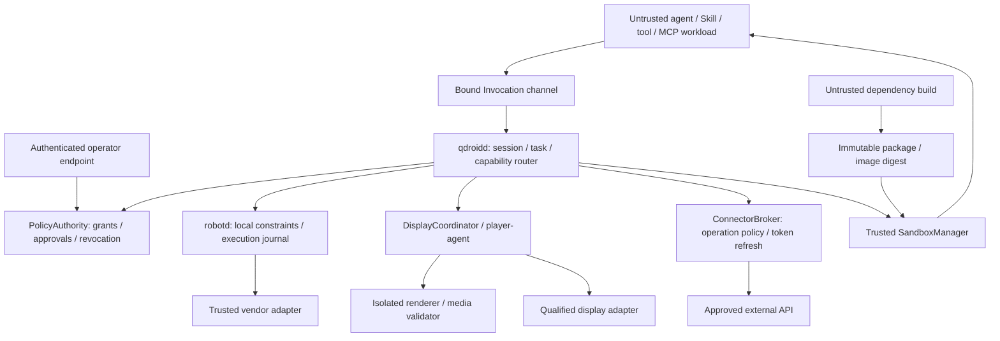

# Architecture and authority boundaries

Status: proposed v0.1 contract, 2026-10-23. No component below is an implemented or qualified runtime yet.

## Scope

qdroid runs agent applications on capable Linux robot hosts. Skills and tools are portable where their capability and platform requirements are met. Primebot T1 Pro is the first adapter, not a dependency of core. The project does not replace vendor locomotion, servo loops, hardware safety, or certified emergency stops.

The initial deployment is a single administrator, one robot, and supervised local services. Multiple workload identities and isolated trust domains are still required on that one host. Fleet management, arbitrary multi-tenant hosting, remote robot teleoperation, and marketplace operation are outside this MVP.

## Component composition

Arrows describe allowed calls, not a shared process. The core and brokers must not load third-party modules into their address spaces. An agent backend may plan tool calls, but a compromised backend must not obtain administrative approval authority.

## Ownership

| Component | Owns | Does not own |
|---|---|---|
| PolicyAuthority | Operator policy, grants, approval records, revocation generation | Model-generated requests as authority |
| qdroidd | Session/Task IDs, invocation routing, durable task state, bounded events | Raw vendor SDK or external refresh tokens |
| PluginSupervisor | Installation/instance/workload identity and lifetime | Arbitrary host execution requested by a plugin |
| SandboxManager | Approved profiles/images, creation/cleanup, host limits and network isolation | User-supplied OCI flags, mounts, devices, runtime sockets |
| robotd | Device resource arbitration, local lease/epoch, command evidence | Assuming every vendor RPC exposes completion/cancellation |
| DisplayCoordinator/player-agent | Scene revisions, presentation ownership, playback queue, local recovery | Treating a submitted clip as visibly displayed |
| ConnectorBroker | External credentials, downstream operation policy, refresh serialization | General-purpose authenticated HTTP forwarding |
| ArtifactStore | Content hashes, ownership, provenance, quotas, retention | Arbitrary host paths supplied by callers |

The first implementation may co-deploy trusted components, but it must preserve their explicit APIs and filesystem/process privileges. A single root process containing plugins, secrets, and device SDKs does not satisfy this design.

## Independent portability dimensions

`RobotProfile` selects capability providers, vendor/firmware compatibility, limits, semantic actions, and input mappings. `HostEnvironmentProfile` records OS/architecture/libc, actual kernel features, resource budgets, and qualified runtime profiles. `DeploymentProfile` assigns services to nodes and authenticated links. None of these grants application permissions.

Core imports contracts, not adapter packages. Adapter DTOs never expose ROS messages, vendor action IDs, screen paths, or raw pointers. CPU architecture and dependency variants belong to package resolution. T1's MP4 presentation is a `VideoDisplayBackend`; other devices may implement isolated web, image, or native-template presentation.

## Persistent and ephemeral state

Trusted service state is separated by ownership: policy/approval/admission store, core task journal, robot execution journal, installation registry, and artifact metadata. The single-host MVP uses SQLite for durable local records, with pinned library/driver and transaction/durability settings selected and fault-tested during implementation. A database file is local to one service/node; it is not shared over a network filesystem or exposed to workloads. The implementation must follow the official [transaction](https://www.sqlite.org/lang_transaction.html) and [WAL constraints](https://www.sqlite.org/wal.html), including handling contention rather than treating a failed commit as permission to dispatch.

PolicyAuthority owns an admission ledger in the same local transaction boundary as Grant budgets, approval usage and pre-dispatch cancellation markers. Core task status is a projection of admission/execution records, not an independent authority for permission or cancellation races. `commitDispatch` atomically checks current policy generation, lease, cancellation state, remaining budget and idempotency, records the dispatch intent, consumes the allowed use, and issues the internal execution ticket. Revocation/cancellation ordered before this commit prevents dispatch; after it, the operation is in-flight and cannot be promised undone. The broker calls this operation at its final submission boundary, not when the core first queues work.

Write intent durably before dispatching side effects. A crash between this commit, the actual vendor call and result recording leaves an unknown outcome unless an authoritative query/idempotency contract resolves it. Recovery does not blindly repeat a call, spend a second budget unit, or automatically refund a committed unknown use. All service projections retain the same operation/admission identity across restart.

Installation registry updates are serialized per installation and conditionally committed using installation generation and expected active digest. Upgrade, rollback and removal share that ordering. A failed old candidate cannot overwrite a later successful activation; content-addressed immutable artifacts can be prepared independently before the guarded activation step.

Boot IDs and session/provider epochs invalidate old control requests. Resource leases use a local monotonic clock in the actual execution service. Cross-node wall-clock timestamps require an explicit bounded-clock or lease protocol; they are not compared as if monotonic clocks were shared.

## Display and input

An application submits a typed Scene reference, frozen state, revision, and presentation policy. Rendering returns an ArtifactRef; the display adapter imports it to the actual player node. Applications never choose a host filename, vendor priority, or control-source ID.

HTML scenes can target video, snapshots, or a qualified web backend. Native UI requires a separate supported template/format; arbitrary HTML is not automatically portable to native widgets. Physical touch/button/ASR input is mapped to semantic actions such as `ui.next` and `ui.back`, with the actual device capability recorded.

Only one trusted sender submits a device's display commands. It serializes calls, coalesces unsent revisions, rejects stale epochs, and retains unknown state for unresolved requests. Vendor asynchronous ordering must be verified before promising that the latest requested scene is the latest visible scene. A player-side independent supervisor must handle lost leases; a host-side timer alone cannot clear a remote screen after disconnection.

## Extension classes

Application, Skill/tool/MCP, renderer, device adapter, and host backend are different installation classes. The first three are untrusted runtime workloads. Device adapters and host backends are administrator-installed trusted infrastructure, with device/environment qualification; a Skill cannot install them or replace PolicyAuthority.

## Current choices and open implementation decisions

- TypeScript is the proposed core/SDK language; provider processes can use Go, Python, or C++. No dependency lock or production build exists yet.
- SQLite is the initial local persistence choice, with service-owned databases and one transactional authority for admission/budgets/cancellation; no distributed database is required for the single-host MVP.
- pi is the first agent-engine candidate. Agent/backend hooks do not replace broker checks or OS isolation.
- OCI plus gVisor systrap is the first Linux isolation candidate. Exact versions and qualified profiles are implementation outputs, not assumed support.
- Immutable multi-platform images and content-addressed packages replace arbitrary in-session installation on the trusted host.
- The MVP admits only profiles that satisfy all required isolation properties. There is no automatic host-shell fallback.

Normative details: [core interfaces](../specs/core-interfaces.md), [packages](../specs/plugin-package.md), [sandbox and permissions](../specs/sandbox-permissions.md), [T1](../specs/t1-adapter.md).
