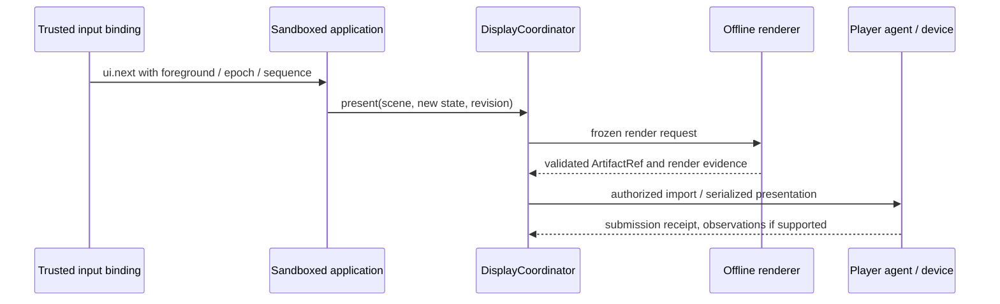

# Scene rendering and video interaction

Status: proposed v0.1, 2026-10-23. No renderer or player integration is implemented here. The contract targets repeatable offline rendering and state-driven interaction; arbitrary websites are not assumed to be reproducible or safe to capture.

## State and presentation

An application owns schema-validated state and semantic actions. A display backend presents that state in its supported format. An MP4 contains pixels and a timeline; it does not retain DOM buttons, event handlers or browser navigation.



For T1, verified voice/body-touch input changes application state and produces the next clip or snapshot. A future touchscreen device can supply the same semantic action. The input gateway validates the action catalog, foreground ownership and freshness; page content cannot create new host commands. The application reducer remains untrusted code in its application sandbox.

## Scene format

The initial format is `qdroid.scene/html-v0.1`. A package declares an immutable entry document, bundled assets, a state JSON Schema, bounded action catalog and presentation requirements. State contains data, not executable JavaScript, HTML fragments or host paths. Insert dynamic text as text; rich content requires an explicit sanitized format.

The scene lock identifies all HTML/JS/CSS/font/image/media bytes. Remote dependencies, analytics and service-worker updates are disallowed. Broker data reaches the application through its grant, then a minimal frozen state reaches the renderer. The renderer cannot fetch Lark data or invoke robot capabilities.

Illustrative metadata, not an installed package:

```json
{
  "schema": "qdroid.scene/html-v0.1",
  "entry": "scenes/calendar/index.html",
  "stateSchema": "scenes/calendar/state.schema.json",
  "actions": ["ui.next", "ui.back", "ui.close"],
  "timeline": {"mode": "seekable", "loopSafe": true},
  "requiredFormats": ["video/mp4"]
}
```

The host selects dimensions, frame rate, duration and codec from qualified device profiles and current budgets. A package may request a supported range; it cannot force unlimited frames, arbitrary dimensions or encoder flags. A loop-safe declaration is a claim to test, not a guarantee that a device player loops or clears its final frame.

## RenderBackend and HTML contracts

```typescript
interface RenderBackend {
  describe(): Promise<RenderDescriptor>;
  render(request: FrozenRenderRequest): Promise<RenderResult>;
  cancel(renderId: string): Promise<CleanupEvidence>;
}

interface QdroidHtmlSceneV1 {
  initialize(context: SceneContext): Promise<void>;
  renderFrame(input: {
    state: JsonValue;
    revision: number;
    timeMs: number;
    seed: string;
  }): Promise<void>;
  dispose(): Promise<void>;
}
```

DisplayCoordinator constructs `FrozenRenderRequest` after checking scene ownership, state schema, display grant, revision and budgets. It binds scene/state digests, revision, seed, renderer/profile versions, viewport, timeline and output specification. Input is a read-only scoped handle; output is private bounded staging. No caller-supplied host path is accepted.

`RenderResult` contains ArtifactRef, input/environment digests, actual frames/duration, validation report and bounded resource evidence. It proves rendering only. Import, submission and observed-visible evidence belong to later steps.

The entry document implements the browser-side scene API. The bridge exposes no Node, filesystem, broker or browser-debugging capabilities. `renderFrame` is seekable and resolves when the requested frame is ready; rendering must not emit semantic actions.

Use supplied time and seed for animation. Pause/seek CSS or Web Animations through an explicit timeline, or compute styles directly from `timeMs`. Uncontrolled wall-clock time, randomness, intervals, real-time animation loops, live video or network state cannot define output. Bundled video needs a tested seek/readiness path; otherwise reject that feature. Detect unsupported behavior where possible and document the remaining author contract.

Initialize fonts and decode assets before capture; await readiness with a per-frame timeout. Crashes, missing assets, unresolved promises, unsupported features or quota failures fail the render and clean its descendants. They do not publish partial artifacts or open internet access to repair the scene.

## HTML to MP4 pipeline

1. Freeze the authorized scene/state/output; compute a cache key including complete environment/profile identity. Cache access remains owner/application/data-policy scoped even for identical content hashes.
2. Start a `render-offline` sandbox with pinned Chromium/fonts/assets, read-only input, bounded scratch/output and no broker/network credentials. Retain Chromium's sandbox inside the qualified outer boundary; startup failure does not permit `--no-sandbox`.
3. Load through an explicit local asset resolver. Enforce resolved-root access, scheme/request allowlisting and navigation/download/pop-up restrictions. No debugging endpoint is exposed outside the render workload.
4. Capture frames at `timeMs = frameIndex * 1000 / fps`: invoke `renderFrame`, await readiness and capture the fixed viewport. Stream into a bounded encoder rather than retaining the complete animation in RAM.
5. Encode with pinned FFmpeg/codec and a qualified output profile. H.264 MP4 is a T1 candidate whose profile/pixel format/dimensions need device tests. Initial video has no audio track; TTS remains separate, without a precise synchronization promise.
6. Validate size, frame count, duration, codec and file completeness in an isolated media-validation path. Atomically publish immutable output with host-attested provenance/ACLs; discard failed staging.
7. Import onto the actual player node, verify transfer and atomically select the complete file. The player agent submits under a display lease and records actual vendor evidence.

Software encoding is the initial portable option. Hardware encoding needs separate qualification; GPU compute does not establish an encoder. CPU, memory, frame count, encoding time and concurrency remain measured limits. Desktop performance is not a T1 budget.

## Interaction and recovery

The first application has at least two pages and `next/back/close`. Deduplicate input by stream identity/sequence; reject stale or unfocused input. A new revision cancels/coalesces obsolete unsent work where possible. It cannot retract a vendor RPC already dispatched.

Initially allow one render and one trusted presentation sender per display resource. Keep the last authorized scene while rendering, or use a tested busy/neutral scene. Adjacent-page pre-rendering must fit the same data/retention budget. Snapshot, looped-video and direct-web modes are explicit capabilities, not implicit fallback choices.

Without actual ordering evidence, advertise a restricted mode and retain unknown presentation state after ambiguous calls. An unresolved call cannot be bypassed by another sender. Player-side independent lease supervision and measured safe fallback/clearing are prerequisites for unattended private content; clip duration or a host timer is insufficient.

## Conformance and evidence

- In the exact pinned environment, compare repeated frame hashes for identical state/time/seed; changed time must change expected pixels. MP4 byte identity is a separate tested property, sensitive to codec and metadata behavior.
- Reject external/undeclared assets, host-file schemes, navigation escape, invalid state/action names, oversized timelines, malicious media and access to connector/device channels.
- Exercise renderer/encoder failures, truncation, wrong digest, cross-app artifacts, transfer interruption, limits and descendant cleanup.
- Reorder rendering/import completion and rapidly alternate pages; only current authorized unsent work proceeds. Separately verify device ordering and visible pages on T1.
- Record environment/profile versions, frame/codec metadata and resource results. Desktop rendering, Linux isolation and T1 presentation are separate evidence classes.

Implementation references: [Playwright screenshots](https://playwright.dev/docs/screenshots), [Chromium Linux sandbox](https://chromium.googlesource.com/chromium/src/+/HEAD/sandbox/linux/README.md), [FFmpeg documentation](https://ffmpeg.org/ffmpeg.html). Exact FFmpeg build/options require implementation-time verification. These tools do not implement qdroid policy or device guarantees by themselves.
